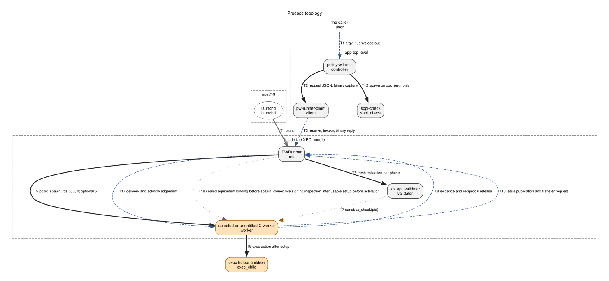
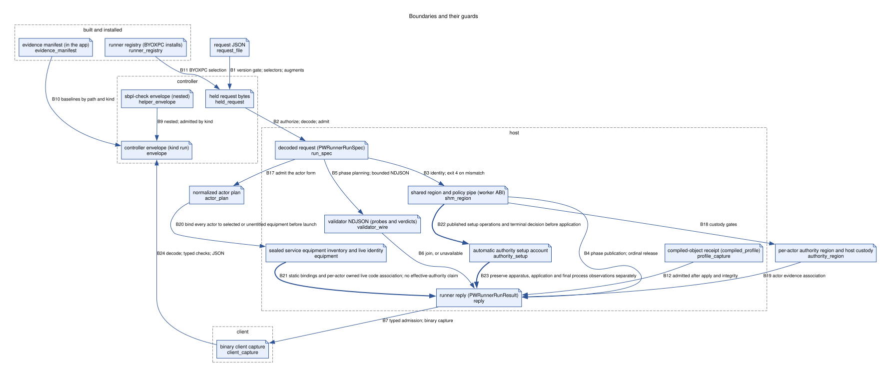
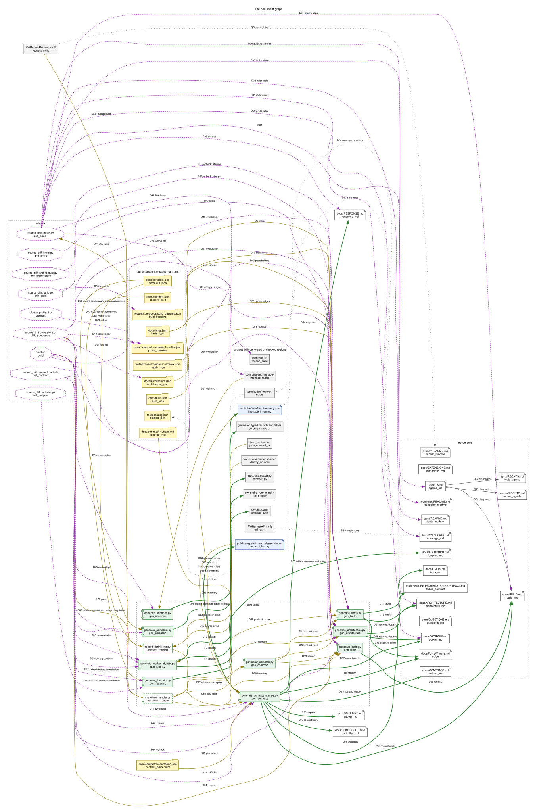
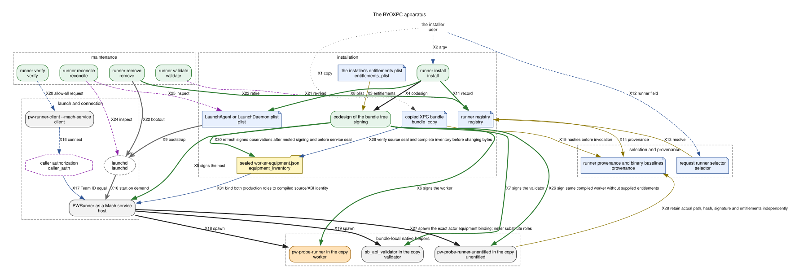

# PolicyWitness architecture

This tour follows one run through the internals and across their boundaries.
Read it after the README's [The Experiment](../README.md#the-experiment) section
and before the directory READMEs. Each section links to the relevant field
reference, contract, module list, test map or build guide. The
[controller tour](CONTROLLER.md) follows preparation, evidence assessment,
publication and equipment recovery at their respective authority boundaries.

The <!-- span architecture.documents.architecture.graphs -->4<!-- /span --> figures are generated from [architecture.json](architecture.json)
by [generate_architecture.py](generate_architecture.py). Every node and edge in
a figure has an id, and the table beside the figure names, for that id, the
source symbol that implements it and the test or rule the manifest names. The
generator verifies symbol presence and test definition. Follow a node or edge's
id to inspect its cited implementation and checks. The hand-drawn run timeline
below cites its sources the same way. Behavior that falls short of a stated promise is
written where the promise is stated, in a paragraph that opens with "Known
gap", and indexed in the [last section](#known-gaps).

## Why these processes exist

Two facts about the macOS sandbox shape everything. `sandbox_check` answers
for a live process, and `sandbox_apply` is one-way: a process that has applied
a profile keeps it for the rest of its lifetime. A specimen therefore needs a
fresh process that applies the policy and stays alive long enough to be queried
and to attempt things. PolicyWitness spawns one fresh worker per sandboxed
process the specimen names: one for the single-worker form, one per actor for
the actor form. Each applies its own policy once (an unapplied actor applies
none) and is queried from outside.

The reply path must stay outside the policy under test. A `(deny default)`
profile can deny the worker's own writes and even its exit. The worker therefore
publishes into a shared region the host mapped and pre-touched before the spawn.
The unsandboxed host assembles a typed reply and applies reporting admission
before binary encoding. The client retains its exact bytes in a binary transport
capture. The controller decodes typed records, admits their evidence and renders
public JSON from borrowed records; rejected binary bytes remain available.
Published attempt, native-call and progress
records describe the worker's observations; the host separately observes process
exit and cleanup. The
[disposition record](../tests/FAILURE-PROPAGATION-CONTRACT.md#worker-disposition-record)
keeps those sources distinct.

The host is an XPC service that launchd starts for one specimen and that exits
shortly after replying, giving each run fresh host state. The controller is a
separate process with a reporting path outside the host, including when the
host never answers. Output can still fail after work occurs; the
[publication account](CONTROLLER.md#selecting-a-result-and-publishing-it)
distinguishes a selected result from successful delivery of its envelope. The controller is Rust and `NSXPCConnection` is an
Objective-C API, so a small Swift client owns the connection
([why the launcher shells out](../controller/README.md#why-the-rust-launcher-still-shells-out)).

### Authorization, reservation and once-only invocation

The client acquires an effect-free reservation before submitting a specimen.
The complete protocol below separates that retryable acquisition from once-only
invocation under the original allowance. Its control records travel with the
protocol; [the returned capture](RESPONSE.md#contract-transport-capture) states
what the client retained. Surface support remains in the response account with
its original scope.

<!-- BEGIN GENERATED CONTRACT transport -->
Inherited surface support: [Implementation and evidence](RESPONSE.md#contract-transport-support) (original subtree scope).

<a id="contract-transport-authorization"></a>
### Caller authorization

<a id="contract-transport-authorization-connection"></a>
#### Admit a connection

[Runner host](CONTRACT.md#contract-identity-definitions-host) checks at NSXPCListener connection acceptance before exporting reservation methods. Entry: cli run, runner verify, direct xpc. Recipient: xpc caller. Reports: connection acceptance. The host reads PWRunnerRequireSignedCaller from its Info.plist as a Boolean; absence or an unavailable Boolean value selects false. When true, obtain caller signing information using the connection PID and the host's own signing information; require both Team IDs to be present and equal. If a nonempty identifier allowlist is configured, also require the caller signing identifier to occur in it. Reject the connection before exporting reservation methods when these checks fail.

`PWRunnerAllowedIdentifiers` is a string array whose members are trimmed and empty members removed. An unavailable or empty resulting list leaves the identifier unrestricted within the Team ID check. The shipped template enables the signed-caller check and lists `pw-runner-client` and `com.policywitness.policy-witness`. An ad-hoc host has no Team ID and fails the enabled check. With the Boolean false, the listener accepts local connections without these signing comparisons; reservation and specimen admission still follow. These signing comparisons and public contract equality are separate checks.

<a id="contract-transport-authorization-support"></a>
**Support: [source read](CONTRACT.md#contract-support-grades) for [Caller authorization](#contract-transport-authorization) and its descendants.** The listener applies configured signing-information comparisons before exporting a service; source defaults and shipped settings are distinct. Context: Read Security lookup, Team ID and identifier comparisons, option decoding, listener call order and shipped template. Evidence limit: Source reading. The external-auth wrapper was read, but its delegated setup assertions and a signed refusal matrix are not credited by this owner. [Evidence details](CONTRACT.md#contract-transport-authorization-support-details).

<a id="contract-transport-delivery"></a>
### Reservation and execution

<a id="contract-transport-delivery-acquire"></a>
#### Acquire an unused host

[Runner client](CONTRACT.md#contract-identity-definitions-client), [Runner host](CONTRACT.md#contract-identity-definitions-host) acts at reserveRunner control RPC. Entry: cli run, runner verify, direct xpc. Recipient: runner host, runner client. Reports: client capture, control reply. Uses [Exact admission identity](CONTRACT.md#contract-identity-public-contract). The client has a positive remaining overall allowance and has already begun fewer than <!-- span limits.reservation_attempts.value -->256<!-- /span --> acquisition attempts. Send only the reservation control; the host may grant its one unused slot to that connection. Occupied or transport-lost acquisition may reconnect within the original allowance.

The requested lease is at most <!-- span limits.reservation_lease.value_unit -->5,000 milliseconds<!-- /span --> and at most the remaining overall allowance. Each reservation RPC waits at most <!-- span limits.reservation_rpc_wait.value_unit -->5,000 milliseconds<!-- /span -->; retries wait up to <!-- span limits.reservation_retry_delay.value_unit -->100 milliseconds<!-- /span -->, shortened by the remaining allowance. Every attempt uses a new UUID. A host shares its one slot across authenticated connections. Grant, execution, expiry and abandonment advance that slot toward retirement; expiry or disconnect does not make it reusable.

<a id="contract-transport-delivery-admit_control"></a>
#### Admit the control

[Runner client](CONTRACT.md#contract-identity-definitions-client) checks at reservation and submission-control reply admission. Entry: cli run, runner verify. Recipient: runner client. Reports: client capture. Uses [Exact admission identity](CONTRACT.md#contract-identity-public-contract), [Host control reply](#contract-transport-control). Control bytes arrive before a terminal client decision. Bound the control to <!-- span limits.reservation_control_bytes.value_unit -->65,536 bytes<!-- /span -->, compare the contract before decoding descendants, validate host-instance and credential UUID syntax, and associate the callback with the active phase and attempt. Acquisition accepts granted or occupied and checks the echoed attempt and requested lease; submission accepts reservation_refused. On refusal retain control byte count and SHA-256, withhold decoded fields and end with protocol_error.

Both reservation requests and admitted control replies reject unknown keys after identity admission. Optional control fields accept JSON null as absence. Reservation acceptance establishes control admission and ownership of a slot. Peer PID and host-instance strings are assertions supplied by that peer.

| Item | Requirement or consequence |
| --- | --- |
| <a id="contract-transport-delivery-admit_control-identity"></a>Typed control identity | Requires (`control.host_pid` > `0` and `control.host_pid` ≤ `2147483647` and utf8_length(`control.host_instance`) = `36`). |
| <a id="contract-transport-delivery-admit_control-status"></a>Admitted status forms | Requires `control.status` ∈ [`"granted"`, `"occupied"`, `"reservation_refused"`]. |
| <a id="contract-transport-delivery-admit_control-grant"></a>Granted reservation fields | Requires implies(`control.status` = `"granted"`, (present(`control.attempt_id`) and absent(`control.reason`) and present(`control.reservation_id`) and utf8_length(`control.reservation_id`) = `36` and present(`control.lease_ms`) and `control.lease_ms` > `0` and `control.lease_ms` ≤ `5,000 milliseconds` (`reservation_lease`) )). |
| <a id="contract-transport-delivery-admit_control-occupied"></a>Occupied reservation fields | Requires implies(`control.status` = `"occupied"`, (present(`control.attempt_id`) and absent(`control.reason`) and absent(`control.reservation_id`) and absent(`control.lease_ms`))). |
| <a id="contract-transport-delivery-admit_control-refusal"></a>Submission refusal fields | Requires implies(`control.status` = `"reservation_refused"`, (absent(`control.attempt_id`) and absent(`control.reservation_id`) and absent(`control.lease_ms`) and `control.reason` ∈ [`"wrong"`, `"expired"`, `"absent"`, `"consumed"`, `"clock_error"`])). |

<a id="contract-transport-delivery-invoke"></a>
#### Invoke execution once

[Runner client](CONTRACT.md#contract-identity-definitions-client) acts at runReservedSpecimen or runReservedExperiment invocation on the granting connection. Entry: cli run, runner verify. Recipient: runner host. Reports: client capture. set_value(`capture.submission.state`, `"invoked"`). A grant was admitted and a fresh continuous-clock sample is before the original deadline. Record the sampled invocation elapsed time before acquiring/calling the execution proxy. Make one execution invocation and preserve its observation through later error, timeout or refusal; never replay the specimen.

The host checks the connection-bound credential before interpreting the specimen. A session invoked with a controls object makes the [experimental submission](REQUEST.md#contract-request-overrides-experimental) through `runReservedExperiment`, with the request bytes unchanged and the controls bytes as given; any other session calls `runReservedSpecimen`. It makes one of the two calls, once. A transport error after invocation leaves receipt and execution uncertain until independent observations resolve them.

<a id="contract-transport-delivery-deadline"></a>
#### Apply the original allowance

[Controller](CONTRACT.md#contract-identity-definitions-controller), [Runner client](CONTRACT.md#contract-identity-definitions-client) acts at client launch, input delivery, acquisition and execution wait. Entry: cli run, runner verify. Recipient: cli caller. Reports: client capture, run envelope, runner verify. The controller invokes its runner client with timeout_ms clamped to at least one millisecond. Create an absolute mach_continuous_time deadline before tool resolution and process spawn and pass it to the client. The client ends on expiry and ignores later callbacks; granting a reservation never resets the deadline.

Continuous time includes machine sleep. Client clock failure ends with `local_error` and `clock_error`, preserves valid earlier readings and any positive invocation, and leaves the final reading absent. The controller drains complete stdout and stderr and waits for the client process; that collection has no independent receiver deadline. Client allowance expiry ends its wait. Host cleanup and worker termination follow their own owners and observations.

<a id="contract-transport-delivery-uncertain"></a>
#### Uncertain invocation example

A capture can contain `acquisition_stop: "granted"`, `submission: {"state":"invoked"}` and `terminal: "xpc_error"` while `runner_reply` is absent. The client crossed its execution-call boundary once; the reply was unavailable. Retrying the specimen would be a new caller decision with possible repeated effects.

<a id="contract-transport-delivery-live_evidence"></a>
#### Transport evidence scope

Controlled client connections establish the observed control-identity refusal and once-only submission behavior. Signed reservation and single-use observations concern their selected service and binaries. A foreign signed host’s receiving boundary, unbound-peer branches and native request/reply faults require their own observations. Native outcomes between the <!-- span limits.client_reply_retention.value_unit -->96,468,992 bytes<!-- /span --> client-retention cap and <!-- span limits.porcelain_frame_bytes.value_unit -->134,217,728 bytes<!-- /span --> frame limit remain unobserved in this account.

<a id="contract-transport-delivery-live_evidence-disposition_support"></a>
**Support: [source read](CONTRACT.md#contract-support-grades) for [Transport evidence scope](#contract-transport-delivery-live_evidence).** Control admission and submission phase changes preserve the once-only client boundary. Evidence limit: A substituted foreign control is a controlled receive observation. Native cap-interval behavior and a complete native fault matrix remain outside that observation. [Evidence details](CONTRACT.md#contract-transport-delivery-live_evidence-disposition_support-details).

<a id="contract-transport-reservation"></a>
### Reservation request

Record `reservation`: `PWRunnerReservationRequest`.

- <a id="contract-transport-reservation-contract"></a>**`contract`** (string; as defined below): The client’s exact public identity. The host compares it before decoding the rest of this control.
- <a id="contract-transport-reservation-attempt_id"></a>**`attempt_id`** (string; as defined below): UUID naming one acquisition attempt, echoed by granted or occupied control responses.
- <a id="contract-transport-reservation-lease_ms"></a>**`lease_ms`** (integer; as defined below): Positive requested reservation lifetime in milliseconds; the host caps an accepted lease at 5,000.

<a id="contract-transport-control"></a>
### Host control reply

Record `control`: `PWRunnerControlReply`.

- <a id="contract-transport-control-contract"></a>**`contract`** (string): The host’s compiled public identity, checked by the client before reading the control body.
- <a id="contract-transport-control-status"></a>**`status`** (string): The host reports `granted`, `occupied`, `invalid_request`, `unsupported_protocol` or `reservation_refused` at the corresponding boundary.
- <a id="contract-transport-control-attempt_id"></a>**`attempt_id`** (string?): Acquisition attempt echoed when available; submission-refusal replies omit it.
- <a id="contract-transport-control-host_pid"></a>**`host_pid`** (integer): Host-reported process identifier. A client-admitted control requires a positive value representable as signed 32-bit.
- <a id="contract-transport-control-host_instance"></a>**`host_instance`** (string): Host-generated UUID for its admission owner, reported by that host.
- <a id="contract-transport-control-reservation_id"></a>**`reservation_id`** (string?): Single-use UUID credential returned by a grant and supplied only on the granting connection’s execution call. Capture projection omits this credential.
- <a id="contract-transport-control-lease_ms"></a>**`lease_ms`** (integer?): Lifetime granted in milliseconds. A client accepts a positive value no greater than the requested lease.
- <a id="contract-transport-control-reason"></a>**`reason`** (string?): Control refusal diagnostic. Submission refusals use `wrong`, `expired`, `absent`, `consumed` or `clock_error`; invalid/unsupported acquisition controls have their own reason.
<!-- END GENERATED CONTRACT transport -->

Known gap: the terminal reply flush delay is best effort. A completed specimen
can lose its reply if the host or connection disappears; no result retrieval or
safe execution replay is available.

The validator is its own process so that `sandbox_check` runs unsandboxed
against the worker's PID while requested actions are held after setup.
`sbpl-check` supplies an independent compile diagnostic in the controller's
context when an admitted client capture ends in `xpc_error`. The held whole
request retains its fallback diagnostic. For actors the controller additionally
selects each object-valued actor policy and associates the helper result with
that actor; this is not evidence of application. Fallback can precede
host admission, so the admitted actor-count bound does not bound the number of
helper invocations. Per-helper retention also does not bound their cumulative
envelope or process memory; [LIMITS](LIMITS.md#evidence-capture) owns those bounds.

Each actor chooses `equipment: "selected"` (the default) or `"unentitled"`, independently of `sandbox.mode`. Both are signed copies of the same compiled worker. The selected copy carries the runner's supplied entitlements; the unentitled copy has an empty entitlement dictionary. Neither name establishes effective authority: an unapplied actor can inherit restrictions, and signing entitlements are associated code metadata. Optional actor `required_entitlements` require boolean `true` in that actor's selected equipment and live signing readback. The controller's `runner.required_entitlements` remains a separate preflight on the selected runner worker.

The service validates its own seal, its sealed `Contents/Resources/worker-equipment.json`, and both production worker artifacts before launching any actor. The inventory binds roles to relative paths, signed hashes, CDHashes, identifiers, teams, entitlements and the compiled worker ABI/build identity. There is no fallback between roles. After usable setup and before any activation or query collection, the host inspects the owned live process and matches its associated code to the binding. An inspection failure cancels scheduled activations while preserving any application already observed. Setup-failed or unlaunched actors remain unavailable without turning their missing inspection into a failure of healthy actors.

Extension issuance runs inside the named actor after setup. The host moves token bytes through private custody and per-actor authority regions, without calling sandbox APIs. One actor runs requested actions at a time; parked workers service deliveries. The [handoff sequence](#actor-handoff-and-schedule-advancement) explains the gates.

Only the worker (compile/apply and actor file issuance/consume/release),
the validator (`sandbox_check`) and `sbpl-check` (compile only) call native sandbox APIs; the topology table's
Native sandbox API column records these roles. Source and artifact checks
enforce the host's separation through
[source drift](../tests/suites/source_drift/README.md#invariants) and
[artifact inspection](../tests/suites/preflight/README.md).

## Process topology

This is an inventory of processes and channels, not a complete protocol trace.
The worker node stands for each actor worker; channel arrows aggregate reciprocal
traffic (notably T8 and T16–T17). The sequences below supply the order.
Who starts whom, over what channel, with what lifetime. Locations are given
at the granularity of "app top level" and "inside the XPC bundle"; the exact
bundle paths are the contract in the README's
[Build and bundle](../README.md#build-and-bundle). Both C worker variants and the validator sit
inside the XPC bundle so that the built-in runner and a BYOXPC copy each
resolve their own helpers relative to their own bundle.

<!-- BEGIN GENERATED ARCHITECTURE GRAPH topology -->


*Figure: process topology. Generated from [architecture.json](architecture.json) by [generate_architecture.py](generate_architecture.py); dot source in [architecture-topology.dot](architecture-topology.dot). The ids in the figure are the ids in the tables below, and each row cites the source symbol that implements it and the test or rule the manifest names for it. Symbol presence and test definition are verified; whether a test asserts the row is not verified.*

<details>
<summary>Process topology: 9 nodes and 13 edges, with symbol presence and test definition verified; whether a test asserts the row is not verified</summary>

#### Process topology nodes

| Id | Node | Kind | Where | Lifetime | Language | Started by | Sandboxed | Native sandbox API | Sources | Checks | Limits |
| --- | --- | --- | --- | --- | --- | --- | --- | --- | --- | --- | --- |
| user | the caller | person | a shell or a harness | owns the request file and reads the envelope |  |  |  |  | [`pub fn run`](../controller/src/cli.rs) | [`interface_cases_hold_on_the_signed_controller`](../controller/integration/cli_contract.rs) |  |
| controller | policy-witness | executable | app top level | one run | Rust | the caller | no | none | [`fn main`](../controller/src/main.rs); [`cmd_run`](../controller/src/run_flow.rs) | [`consumer_controls`](../tests/suites/blackbox_e2e/checker_controls.py); [`inventory`](../tests/lib/artifact.py) |  |
| client | pw-runner-client | executable | app top level | one helper per request; effect-free reservation attempts and the single execution invocation share one absolute deadline | Swift | the controller | no | none | [`PWRunnerClientSession`](../runner/Clients/PWRunnerClient/PWRunnerClientSession.swift); [`readToEnd`](../runner/Clients/PWRunnerClient/main.swift); [`NSXPCConnection`](../runner/Clients/PWRunnerClient/PWRunnerClientSession.swift) | [`independent_binary_records_reach_typed_storage_without_text_conversion`](../controller/src/runner_client.rs); [`client_output_control`](../tests/suites/blackbox_e2e/checker_controls.py); [`runClientSessionControls`](../runner/Tests/PWRunnerClientSessionTests/main.swift) |  |
| host | PWRunner | executable | inside the XPC bundle | one reservation and at most one specimen; unused reservation expiry or abandonment retires the host; terminal reply flush delay 50 milliseconds is best effort | Swift | launchd: XPC service lookup, or a Mach service for BYOXPC | no | none, by the invariance rule; actor-form token custody copies, compares and erases bytes without a sandbox call | [`NSXPCListener.service()`](../runner/Services/PWRunner/main.swift); [`runReservedSpecimen`](../runner/Sources/PWRunnerCore/PWRunnerService.swift); [`hostExitDelayMs`](../runner/Sources/PWRunnerCore/PWRunnerService.swift); [`AuthorityCustody`](../runner/Sources/PWRunnerCore/AuthorityCustody.swift) | [`inspect`](../tests/lib/artifact.py); [`check_host_invariance`](../tests/suites/source_drift/check.py); [`runServiceAdmissionTests`](../runner/Tests/PWRunnerCoreTests/ServiceAdmissionTests.swift); [`single_use`](../tests/suites/runner_byoxpc/opt_in/single_use.sh); [`runActorReplyTests`](../runner/Tests/PWRunnerCoreTests/ActorReplyTests.swift) | [`host_exit_delay`](LIMITS.md#execution-budgets) |
| worker | selected or unentitled C worker | sandboxed | inside the XPC bundle | one specimen in the single-worker form, or one actor of an actor-form specimen; one application (none for an unapplied actor) and all of its ordered visits; parked between visits; terminal publication exits without host permission | C | the host | equipment is independent of apply/unapplied; inherited restrictions remain | sandbox_compile_string, params, sandbox_apply; actor sandbox_extension_issue_file, consume and release | [`sandbox_compile_string`](../controller/tools/pw_probe_runner/pw_probe_runner.c); [`sandbox_apply`](../controller/tools/pw_probe_runner/pw_probe_runner.c); [`publish_done_and_exit`](../controller/tools/pw_probe_runner/pw_probe_runner.c); [`attempt_extension_issue`](../controller/tools/pw_probe_runner/pw_probe_runner.c) | [`test_production`](../tests/suites/runner_c_worker_harness/test_exec_control_states.py); [`happy_default_allow`](../tests/suites/runner_use_c_worker/run.sh); [`runPhaseProtocolTests`](../runner/Tests/PWRunnerCoreTests/PhaseProtocolTests.swift); [`run_targets`](../tests/suites/witness_contract/check_extensions.py); [`run_case`](../tests/suites/witness_contract/check_extension_boundaries.py); [`check_row`](../tests/suites/witness_contract/check_extension_combinations.py); [`terminal_exit_without_request`](../tests/suites/runner_c_worker_harness/run.sh); [`runActorAuthorityTests`](../runner/Tests/PWRunnerCoreTests/ActorAuthorityTests.swift) |  |
| exec_child | exec helper children | sandboxed | the caller's path | the worker bounds collection and leader reap; ordinary completion requests no group termination, so a same-group descendant may be alive or already exited afterwards; worker death can leave descendants alive; escaped descendants are not contained | caller-supplied | the worker | inherit the worker's sandbox | none of PolicyWitness's | [`attempt_exec_spawn`](../controller/tools/pw_probe_runner/pw_worker_exec.h); [`exec_resources_acquire`](../controller/tools/pw_probe_runner/pw_worker_exec.h) | [`timeout_preserves_output_and_continues`](../tests/suites/runner_exec_lifecycle/run.sh); [`contaminated_worker`](../tests/suites/runner_exec_inheritance/run.sh); [`closed_streams_leader_exit`](../tests/suites/runner_exec_lifecycle/closed_streams_leader_exit.sh); [`worker_dies_during_exec`](../tests/suites/runner_exec_lifecycle/run.sh); [`main`](../tests/fixtures/worker_lifecycle/exec_control.c) |  |
| validator | sb_api_validator | executable | inside the XPC bundle | one phase collection | C | the host at each eligible phase arrival | no | sandbox_check | [`sandbox_check`](../controller/tools/sb_api_validator/sb_api_validator.c); [`SANDBOX_CHECK_NO_REPORT`](../controller/tools/sb_api_validator/sb_api_validator.c); [`runValidator`](../runner/Sources/PWRunnerCore/ValidatorClient.swift) | [`predictions_do_not_report`](../tests/suites/validator_batch_mode/run.sh); [`bothBinariesExist`](../runner/Tests/PWRunnerCoreTests/CWorkerValidatorTests.swift); [`runPhaseProtocolTests`](../runner/Tests/PWRunnerCoreTests/PhaseProtocolTests.swift) |  |
| sbpl_check | sbpl-check | executable | app top level | one compile per helper process; the controller invokes a helper for the held request and one for each selected actor policy, potentially before host admission | Rust | the controller, only for an admitted client terminal xpc_error | no | sandbox_compile_string and params; never applies | [`sandbox_compile_string`](../controller/src/bin/sbpl-check.rs); [`run_policy_check`](../controller/src/policy_check.rs) | [`fallback_compilation_is_requested_only_for_an_admitted_xpc_error`](../controller/src/run_flow.rs) |  |
| launchd | launchd | os | system |  | OS |  | no | none | [`NSXPCListener(machServiceName:`](../runner/Services/PWRunner/main.swift); [`MachServices`](../controller/src/runner_manager.rs) | [`pwrunner_survives_mach_service_launch`](../tests/suites/runner_mach_service_liveness/run.sh); [`runner_install`](../tests/suites/runner_byoxpc/run.sh) |  |

#### Process topology edges

| Id | From | To | Kind | Edge | Sources | Checks | Limits |
| --- | --- | --- | --- | --- | --- | --- | --- |
| T1 | user | controller | channel | argv in; one JSON envelope on stdout | [`pub fn run`](../controller/src/cli.rs); [`print_envelope`](../controller/src/json_contract.rs) | [`interface_cases_hold_on_the_signed_controller`](../controller/integration/cli_contract.rs); [`envelope_shape_golden_agrees_with_the_manifest`](../controller/src/run_flow.rs) |  |
| T2 | controller | client | spawn | spawn once; held request JSON on stdin to EOF, and for test-input run a controls object in the --experimental-controls argument; binary typed client capture on stdout | [`run_pw_runner_client`](../controller/src/runner_client.rs); [`fn submission_arguments`](../controller/src/runner_client.rs); [`emit`](../runner/Clients/PWRunnerClient/main.swift); [`parse_runner_client_output`](../controller/src/runner_client.rs) | [`independent_binary_records_reach_typed_storage_without_text_conversion`](../controller/src/runner_client.rs); [`client_output_control`](../tests/suites/blackbox_e2e/checker_controls.py); [`only_an_experimental_submission_names_a_controls_object`](../controller/src/runner_client.rs) |  |
| T3 | client | host | channel | effect-free reservation, then one runReservedSpecimen call, or one runReservedExperiment call with a controls object beside the request; request JSON and binary typed host reply | [`NSXPCConnection`](../runner/Clients/PWRunnerClient/PWRunnerClientSession.swift); [`runReservedSpecimen`](../runner/Sources/PWRunnerCore/PWRunnerService.swift); [`runReservedExperiment`](../runner/Sources/PWRunnerCore/PWRunnerAPI.swift); [`submitExperiment`](../runner/Clients/PWRunnerClient/PWRunnerClientSession.swift); [`authorizedCaller`](../runner/Sources/PWRunnerCore/PWRunnerService.swift); [`pwRunnerPorcelainReplyData`](../runner/Sources/PWRunnerCore/PWRunnerService.swift) | [`happy_default_allow`](../tests/suites/runner_use_c_worker/run.sh); [`accepted_input_contract`](../tests/suites/runner_outcome_bad_request/run.sh); [`runClientSessionControls`](../runner/Tests/PWRunnerClientSessionTests/main.swift); [`runExperimentalSubmissionTests`](../runner/Tests/PWRunnerCoreTests/ExperimentalSubmissionTests.swift); [`test_input`](../tests/suites/witness_contract/test_input.sh) |  |
| T4 | launchd | host | launch | start on XPC lookup, or as a Mach service (BYOXPC) | [`NSXPCListener.service()`](../runner/Services/PWRunner/main.swift); [`NSXPCListener(machServiceName:`](../runner/Services/PWRunner/main.swift); [`launchctl_bootstrap`](../controller/src/runner_manager.rs) | [`pwrunner_survives_mach_service_launch`](../tests/suites/runner_mach_service_liveness/run.sh); [`runner_install`](../tests/suites/runner_byoxpc/run.sh) |  |
| T5 | host | worker | spawn | posix_spawn; fd 0 policy pipe, fd 3 shared region, fd 4 ready pipe; optional fd 5 transient token channel | [`posix_spawn_file_actions_adddup2`](../runner/Sources/PWRunnerCore/ActorSession.swift); [`F_SETNOSIGPIPE`](../runner/Sources/PWRunnerCore/ActorSession.swift); [`writePolicy`](../runner/Sources/PWRunnerCore/MonotonicDeadline.swift); [`PW_SHM_ABI_MAGIC`](../controller/tools/pw_probe_runner/pw_probe_runner_abi.h); [`PW_FAILURE_SOURCE_LENGTH`](../controller/tools/pw_probe_runner/pw_probe_runner.c) | [`c_swift_layout_agreement`](../tests/suites/runner_abi_layout/run.sh); [`test_production`](../tests/suites/runner_c_worker_harness/test_exec_control_states.py); [`runPolicyTransferTests`](../runner/Tests/PWRunnerCoreTests/PolicyTransferTests.swift); [`run_case`](../tests/suites/witness_contract/check_extension_boundaries.py); [`check_row`](../tests/suites/witness_contract/check_extension_combinations.py); [`policy_truncated_prefix`](../tests/suites/runner_c_worker_harness/run.sh) |  |
| T6 | host | validator | spawn | fresh posix_spawn --batch <pid> per eligible phase; bundle-local default or the validator path control of an experimental submission; bounded NDJSON | [`runValidator`](../runner/Sources/PWRunnerCore/ValidatorClient.swift); [`decodeValidatorFrames`](../runner/Sources/PWRunnerCore/ValidatorClient.swift); [`defaultValidatorExecutablePath`](../runner/Sources/PWRunnerCore/CWorkerOrchestrator.swift); [`runSubmission`](../runner/Sources/PWRunnerCore/PWRunnerService.swift) | [`predictions_do_not_report`](../tests/suites/validator_batch_mode/run.sh); [`transcript_controls`](../tests/suites/runner_validator_failure/run.sh); [`runPhaseProtocolTests`](../runner/Tests/PWRunnerCoreTests/PhaseProtocolTests.swift); [`runValidatorSelectionTests`](../runner/Tests/PWRunnerCoreTests/ServiceAdmissionTests.swift); [`runOrderingTests`](../runner/Tests/PWRunnerCoreTests/OrderingTests.swift) |  |
| T7 | validator | worker | native | sandbox_check against the worker PID, with SANDBOX_CHECK_NO_REPORT | [`sandbox_check`](../controller/tools/sb_api_validator/sb_api_validator.c); [`SANDBOX_CHECK_NO_REPORT`](../controller/tools/sb_api_validator/sb_api_validator.c) | [`predictions_do_not_report`](../tests/suites/validator_batch_mode/run.sh); [`independent_worker_and_host_queries`](../tests/suites/runner_live_worker_identity/run.sh) |  |
| T8 | worker | host | channel | shared-region worker arrivals, acknowledgements, completions and native observations; reciprocal host numbered releases hold requested actions | [`wait_for_proceed`](../controller/tools/pw_probe_runner/pw_probe_runner.c); [`run_attempt`](../controller/tools/pw_probe_runner/pw_probe_runner.c); [`CWorkerStepResult`](../runner/Sources/PWRunnerCore/CWorker.swift); [`proceedOffset`](../runner/Sources/PWRunnerCore/CWorker.swift) | [`signal_while_waiting`](../runner/Tests/PWRunnerCoreTests/OrderingTests.swift); [`order_barrier_mutations`](../tests/suites/witness_contract/opt_in/mutations.sh); [`runPhaseProtocolTests`](../runner/Tests/PWRunnerCoreTests/PhaseProtocolTests.swift); [`run_case`](../tests/suites/witness_contract/check_extension_boundaries.py); [`check_row`](../tests/suites/witness_contract/check_extension_combinations.py); [`proceed_precedence`](../tests/suites/runner_c_worker_harness/run.sh) |  |
| T9 | worker | exec_child | spawn | posix_spawn inside an exec action after setup (after apply when supplied); stdout/stderr pipes into bounded slot buffers; excluded for authority-participating actors | [`attempt_exec_spawn`](../controller/tools/pw_probe_runner/pw_worker_exec.h); [`exec_resources_acquire`](../controller/tools/pw_probe_runner/pw_worker_exec.h) | [`timeout_preserves_output_and_continues`](../tests/suites/runner_exec_lifecycle/run.sh); [`test_production`](../tests/suites/runner_c_worker_harness/test_exec_control_states.py) |  |
| T12 | controller | sbpl_check | spawn | spawn only for an admitted client terminal xpc_error; held-request diagnostic plus independently associated actor-policy diagnostics; host request admission may not have occurred | [`fallback_policy_check`](../controller/src/run_flow.rs); [`run_policy_check`](../controller/src/policy_check.rs) | [`fallback_compilation_is_requested_only_for_an_admitted_xpc_error`](../controller/src/run_flow.rs); [`refused_reply_versions_request_no_fallback_compilation`](../controller/src/run_flow.rs) |  |
| T16 | worker | host | channel | one-shot outbound publication per admitted issue and a distinct request/answer cell per transfer; the host owns published outbound bytes until copying or rejection and erasure | [`attempt_extension_transfer`](../controller/tools/pw_probe_runner/pw_probe_runner.c); [`pw_authority_transfer_t`](../controller/tools/pw_probe_runner/pw_authority_region.h); [`serviceOutbound`](../runner/Sources/PWRunnerCore/AuthorityCustody.swift) | [`runActorAuthorityTests`](../runner/Tests/PWRunnerCoreTests/ActorAuthorityTests.swift); [`c_swift_layout_agreement`](../tests/suites/runner_abi_layout/run.sh) | [`actor_exchange_allowance`](LIMITS.md#execution-budgets) |
| T17 | host | worker | channel | delivery into the recipient's assigned inbound slot; the parked recipient validates framing and its preassigned source/action/delivery before acknowledging without consuming | [`serviceTransfer`](../runner/Sources/PWRunnerCore/AuthorityCustody.swift); [`service_inbound_once`](../controller/tools/pw_probe_runner/pw_probe_runner.c); [`pw_authority_slot_problem`](../controller/tools/pw_probe_runner/pw_authority_region.h) | [`runActorAuthorityTests`](../runner/Tests/PWRunnerCoreTests/ActorAuthorityTests.swift); [`runActorReplyTests`](../runner/Tests/PWRunnerCoreTests/ActorReplyTests.swift) |  |
| T18 | host | worker | observes | sealed equipment binding before spawn; owned live signing inspection after usable setup before activation | [`ActorEquipmentPreparation`](../runner/Sources/PWRunnerCore/ActorEquipment.swift) | [`runActorEquipmentTests`](../runner/Tests/PWRunnerCoreTests/ActorEquipmentTests.swift) |  |

Notes:

- `host`: All authorized connections share one locked reservation slot. Only the connection holding its grant can consume it, before specimen decoding. Stale expiry or disconnect cannot retire an executing owner; client loss after submission never permits replay.
- `T5`: Policy delivery uses nonblocking writes under one absolute monotonic deadline (the worker_policy_transfer limit) beginning after spawn. Expiry closes input and enters cleanup before readiness or sentinel polling. The pipe carries no framing: the host writes the submission's byte count into the shared header before spawn, and the worker at EOF publishes the count it read and refuses a different length before compiling.
- `T16`: Exchange allowance 5,000 milliseconds on each side; expiry is a transport status, never a native result. A later operation cannot reuse the expired operation's payload or answer cell. Host answer and completed source action are separate observations; a source timeout can still complete its phase.
- `T17`: Recipient framing acknowledgement precedes host byte equality and usable/failed settlement, then the source answer. Consumption requires committed, accepted, usable settlement. Private custody erases at last declared transfer use, including failed delivery; shared teardown erasure requires a reaped or never-launched owner.
- `T18`: Constructed signing observations exercise complete two-role binding, per-actor boolean requirements, explicit fixture provenance, live path mismatch, process association and ownership/deadline refusal. They do not establish native signature validity or effective authority.

Every node and edge above cites at least one test or rule.

</details>
<!-- END GENERATED ARCHITECTURE GRAPH topology -->

## One run in time

### Collection before release

The host closes query collection before releasing the actions of each phase.
`comparison.order: "query_first"` requires that phase's eligible native record
and observed collection, release, acknowledgement and ownership chain
([the record](../tests/FAILURE-PROPAGATION-CONTRACT.md#the-record)). A simple
`probe_plan` becomes one phase named `main`. Ordinary requests
use [CWorker.swift](../runner/Sources/PWRunnerCore/CWorker.swift): one worker,
one policy application and all its phases. Public actor requests instead reach
[`runActors`](../runner/Sources/PWRunnerCore/CWorkerOrchestrator.swift).
[ActorScheduler.swift](../runner/Sources/PWRunnerCore/ActorScheduler.swift)
walks their serial schedule, activating the scheduled actor's worker for each visit while
others remain parked. Each actor keeps its own fresh process across its visits. Each actor applies its policy once or declares unapplied
setup. Both drivers use [ActorSession.swift](../runner/Sources/PWRunnerCore/ActorSession.swift)
for launch, policy transfer, readiness, polling and cleanup.

Actor setup automatically records bounded apparatus observations before policy compilation/application: core-limit handling, authority mapping and framing, descriptor closure and each extension-symbol lookup. Missing extension symbols make the corresponding actions unavailable; required apparatus failure prevents application. Setup publication, application observation and final process disposition remain separate. Missing terminal publication leaves application uncertain rather than proving it did not happen.

A phase may specify `after_termination: {"actor_id": "issuer"}` when that actor's last scheduled visit precedes the phase. The gate requires an owned natural reap after the source's final activation, including a nonzero exit or signal, before dependent activation and query collection. It does not require final phase completion. It does not kill an actor to satisfy the dependency. A failed evaluated gate cancels the remaining schedule; cleanup and previously published facts retain their own meanings. A phase skipped because its dependent actor is unavailable does not evaluate its gate or independently cancel later phases. The source actor owns the native reap record. Source-scoped activation, reap and gate-close ordinals establish their capture order; optional timestamps preserve clock gaps instead of filling them. The gate carries an ordinal reference, not another copy of native wait facts. [RESPONSE](RESPONSE.md#contract-actor_evidence-gate) specifies eligibility and landing paths.

The single-worker sequence is:

```text
controller / client          host                        worker                validator
-------------------          ----                        ------                ---------
read; gate; select;
resolve augments;
serialize held request
stdin to EOF; XPC ----------> authorize; decode; admit
                             prepare shared region
                             spawn; policy pipe --------> compile; ready byte
                                                         apply once
                             <--------------------------- phase arrival
                             check identity + ownership
                             plan this phase afresh
                             spawn eligible collection -----------------------> sandbox_check
                             <----------------------------------------------- bounded NDJSON
                             collection closes
                             recheck phase + ownership
                             numbered release ----------> acknowledge ordinal
                                                         ordinary/native actions in order
                                                         publish completion
                             <--------------------------- next phase arrival
                             repeat collection/release   repeat phases
                                                         done; exit
                             exit request (cancellation/cleanup)
                             grace; kill if needed; reap
                             final snapshot; disposition;
                             phase evidence; comparisons
binary capture <------------ binary reply; schedule host exit
decode typed records;
admit reply version;
complete execution;
optional logs;
print envelope
```

Collection can close with unavailable predictions or incomplete validator
cleanup. Release still requires a live, correctly waiting worker. A failed
phase wait, invalid release ordinal or loss of worker ownership prevents later
actions while preserving earlier publications. A boundary publication records
progress; each action publishes its result separately.
Native pre-call markers and completed result publication are distinct. A call
without a published result remains unresolved even if an independent test knows
it returned. A consume/release action before an ordinary action in the same
phase can change what that action encounters after its query was collected.
Read phase progress as the observed sequence of collections and actions. Ordinary later phases require prior completion.
Actor visits instead follow the serial schedule's availability, confirmed-reap
and cancellation gates: another available actor can continue after a failed
actor is reaped. The [scheduler obligation](REQUEST.md#contract-actors-phase-order)
and [returned ordering claim](RESPONSE.md#contract-steps-assessment-order)
keep those scopes distinct. The latter additionally requires established setup,
the violation-free collection/release/acknowledgement and ownership chain, and
one matching eligible native answer for the step and owned worker PID, including
its operation, filter, value, outcome, return and errno. This supports the
bounded ordering observation, not prediction/enforcement agreement.
The worker exits after terminal publication without waiting for host permission.
The host's mapping retains its publications. An acknowledgement acquired after
confirmed reap can establish the earlier phase interval while ownership remained
unbroken, including when fatal termination followed acknowledgement without
`done`. The run retains its independently observed abnormal disposition.

### Actor handoff and schedule advancement

After setup, each scheduled visit follows activation → arrival → eligible query
collection → numbered release → worker acknowledgement → ordered actions →
phase completion. Empty visits still have these boundaries. While parked,
recipients service transport apparatus without running requested native actions.
The complete custody protocol follows preparation through issue, transfer,
source-answer observation and erasure. Its returned event, resource and handle
records are in [RESPONSE](RESPONSE.md#contract-extensions-event). Preparation
and cleanup conditions apply even when a native action never runs.

<!-- BEGIN GENERATED CONTRACT extensions -->
<a id="contract-extensions-custody"></a>
### Custody protocol

Authority payloads occupy bounded native storage assigned to the admitted resource plan. Public records expose references, lengths, framing, status and observations. Token bytes stay in the native custody channels.

<a id="contract-extensions-custody-prepare"></a>
#### Prepare before use

[Runner host](CONTRACT.md#contract-identity-definitions-host), [Worker](CONTRACT.md#contract-identity-definitions-worker) acts at host custody preparation before launch and actor setup before application or unapplied declaration. Entry: xpc execute. Recipient: caller, report reader. Reports: runner reply. Applies when present(`request.actors`). Uses [Authority setup account](RESPONSE.md#contract-equipment-authority_setup). When the admitted resource plan contains a token or delivery, the host attempts to disable core dumps; after that succeeds, it prepares one authority region for every actor and a bounded custody buffer for each token. Failure of this host custody preparation prevents every actor launch. Each actor worker reaching authority setup looks up extension symbols and attempts its own core-dump limit. Required setup publishes ready after mapping and validating its assigned region; a primary failure publishes terminal_required_failure and ends the worker before policy setup. Unneeded authority selects not_required without mapping, including when the core-limit attempt failed. These worker setup operations precede application or the actor's unapplied declaration. A reached extension action reports unavailability for missing required apparatus or symbols.

<a id="contract-extensions-custody-issue"></a>
#### Issue and transfer payload ownership

[Worker](CONTRACT.md#contract-identity-definitions-worker), [Runner host](CONTRACT.md#contract-identity-definitions-host) acts at outbound token publication by the issuing worker. Entry: actor worker. Recipient: caller, report reader. Reports: runner reply. Publish a one-shot bounded token only when native issuance returned a non-null payload with length from one through <!-- span limits.extension_token_payload.value_unit -->16,383 bytes<!-- /span -->. Erase the native allocation after copying. Keep the published outbound slot immutable until the host validates, copies or rejects it, erases its payload and acknowledges it.

The slot owns one declared issue. A worker timeout or exit leaves its published bytes available for the host's later copy and erasure. Another issue uses another slot. The native return and host custody acceptance are reported independently.

<a id="contract-extensions-custody-deliver"></a>
#### Acknowledge, compare and settle delivery

[Runner host](CONTRACT.md#contract-identity-definitions-host), [Worker](CONTRACT.md#contract-identity-definitions-worker) acts at explicit transfer exchange with the named recipient worker. Entry: actor worker. Recipient: caller, report reader. Reports: runner reply. Require a valid transfer request and held host custody, copy into the assigned recipient slot, obtain recipient framing acknowledgement and compare its complete length and bytes with custody. Set delivered and publish settlement only after accepted acknowledgement and equal bytes. On failure publish the corresponding acknowledgement and withdraw the delivery.

A parked recipient validates framing. A self-transfer also services inbound work while waiting. Consumption requires settled, committed and accepted delivery. Each exchange is bounded by <!-- span limits.actor_exchange_allowance.value_unit -->5,000 milliseconds<!-- /span --> and the remaining actor budget; timeout and clock observations retain their own boundary.

<a id="contract-extensions-custody-source_answer"></a>
#### Observe the source answer

[Runner host](CONTRACT.md#contract-identity-definitions-host) acts at reply assembly after transfer. Entry: xpc execute. Recipient: caller, report reader. Reports: runner reply. Applies when present(`request.actors`). Set source_acknowledged only when the source action completed and its published transfer status matches the host's nonzero acknowledgement. Preserve late host answers independently of an unpublished or differently completed source action.

<a id="contract-extensions-custody-erase"></a>
#### Erase at declared last use and teardown

[Runner host](CONTRACT.md#contract-identity-definitions-host), [Worker](CONTRACT.md#contract-identity-definitions-worker) acts at resource retirement. Entry: xpc execute. Recipient: caller, report reader. Reports: runner reply. Applies when present(`request.actors`). Erase host-private custody at the last declared transfer (or after issue when never transferred) and at teardown. Erase worker-owned inbound payloads after their last declared consume and at normal exit once host settlement transfers ownership. At host teardown erase shared regions only for actors whose termination is established; otherwise detach the host mapping.

A last transfer retires custody even when the recipient is unavailable. Payload erasure is a memory-lifetime action; a native release request and the later access observation are separate operations.

<a id="contract-extensions-custody-native_library"></a>
#### Native extension evidence scope

Native extension issuance, consumption and release observations are scoped to the concrete policy, entitlements, resource, token bytes and macOS build. Host custody records describe the controlled publication, copying and erasure protocol. A release return records that native call; subsequent access is established by the corresponding access observation.

<a id="contract-extensions-custody-native_library-disposition_support"></a>
**Support: [source read](CONTRACT.md#contract-support-grades) for [Native extension evidence scope](#contract-extensions-custody-native_library).** Host transfer observations record custody, copying, recipient acknowledgement and equality separately. Evidence limit: Private-library allocation and opaque token behavior retain the scope of their native observations. [Evidence details](CONTRACT.md#contract-extensions-custody-native_library-disposition_support-details).

<a id="contract-extensions-custody-support"></a>
**Support: [source read](CONTRACT.md#contract-support-grades) for [Custody protocol](#contract-extensions-custody) and its descendants.** The adjacent meanings follow the named request, producer and observation branches. Evidence limit: Conditional host/worker setup, host custody service and worker issue/transfer/consume/release have source-read support here. Collected setup-account meanings are owned by the equipment surface. Native private-library behavior remains environment-specific evidence. [Evidence details](CONTRACT.md#contract-extensions-custody-support-details).
<!-- END GENERATED CONTRACT extensions -->

A failed visit requires stopping and reaping its actor before further activation;
unresolved termination cancels remaining activation, and timeout or ownership
failures can cancel even after reap. Shared authority erasure requires a reaped
or never-launched owner; private host custody is erased separately. The
[worker resource account](WORKER.md#supplied-extension-authority) gives the
lifetimes. This sequence follows
[`walkSchedule`](../runner/Sources/PWRunnerCore/ActorScheduler.swift),
[`serviceOutbound`](../runner/Sources/PWRunnerCore/AuthorityCustody.swift),
[`serviceTransfer`](../runner/Sources/PWRunnerCore/AuthorityCustody.swift) and
[`recordSourceAcknowledgements`](../runner/Sources/PWRunnerCore/AuthorityCustody.swift),
and the worker's [`wait_exchange`](../controller/tools/pw_probe_runner/pw_probe_runner.c)
and [`service_inbound_once`](../controller/tools/pw_probe_runner/pw_probe_runner.c).
[Actor authority controls](../runner/Tests/PWRunnerCoreTests/ActorAuthorityTests.swift)
and [handoff mutation controls](../tests/suites/runner_unit/README.md) cover
copying, parked acknowledgement, settlement and quiescence dependencies.

### Implementation and checking routes

Where each stage is pinned:

- **Controller admission and selection.** [`run`](../controller/src/run_flow.rs) in
  run_flow.rs: the manifest is loaded once,
  then `parse_request`, `validate_request_version`, selector parsing,
  `resolve_runner_target_with_registry`, `resolve_augments`, the dossier, and
  `strip_runner_selector` before the held bytes are serialized. Checked by the
  `orchestration` tests in the same file.
- **Actor equipment and authority setup.**
  [ActorEquipment.swift](../runner/Sources/PWRunnerCore/ActorEquipment.swift) validates the sealed service inventory and both worker roles, binds each actor's requirements independently, and checks owned live code after usable setup. [ActorEquipmentTests.swift](../runner/Tests/PWRunnerCoreTests/ActorEquipmentTests.swift) controls inspection results and checks association/refusal behavior; those injected results do not establish native signing behavior.
  [AuthoritySetupRuntime.swift](../runner/Sources/PWRunnerCore/AuthoritySetupRuntime.swift) records host apparatus operations and decodes the worker's published setup trailer. [ActorScheduler.swift](../runner/Sources/PWRunnerCore/ActorScheduler.swift) gates activation on usable setup, equipment inspection and any explicit termination dependency.
- **Caller authorization.** [`authorizedCaller`](../runner/Sources/PWRunnerCore/PWRunnerService.swift) runs when the connection is
  accepted, before any request is read.
- **Host admission.** `runSpecimen` decodes with closed keys, then
  `admissionFailure(for:)` (capacity), `requestMeaningFailure` (meaning) and
  `computePolicyHash`, in that order; a refusal replies without spawning
  anything. Checked by `runner_outcome_bad_request` and `failure_boundaries`.
- **Query planning.** `planValidatorQueries` runs anew at each observed phase
  arrival, after all prior phase actions have completed. It drops excluded
  operation/filter pairs and paths that do not resolve on the host then.
  `path_unresolved_at_planning` supplies an explicit unavailable prediction
  without suppressing the paired attempt. Checked by `PhaseProtocolTests`,
  query admission tests and the planner rule in `source_drift`.
- **Spawn and apply.** The driver's header comment in
  [CWorker.swift](../runner/Sources/PWRunnerCore/CWorker.swift) from the
  region setup through the ready byte, and the worker's from mapping the
  region through apply. The ready byte has its own window
  (`readyByteTimeoutMs`); `runner_ready_byte_resilience` checks it.
- **Compiled-object receipt.** When the request opts in, the worker copies
  the compiled object into its capture region before applying it
  (`pw_capture_profile`). The host admits that copy only after successful
  application, worker completion, PID, nonce, input identity and payload
  integrity checks (`decodeProfileCapture`); the
  [guide](PolicyWitness.md#compiled-object-receipt-opt-in) defines the receipt's
  provenance and reading rules. In actor form the receipt belongs to the opted-in
  apply actor and is admitted using that actor's identity and completion; unapplied
  setup supplies no receipt. Checked by `CompiledProfileCaptureTests`.
- **The barrier.** The `phaseBoundary` callback collects against the worker's
  PID. The driver observes arrival and checks child ownership before collection
  and again before release. Its ordinal store cannot reuse an earlier release;
  immutable phase acknowledgement records preserve earlier observations.
  `PWRunnerOrdering` is assembled independently per phase. `PhaseProtocolTests`,
  `OrderingTests` and the opt-in
  [order-barrier mutation control](../tests/CHANGE-VERIFICATION.md#order-barrier-mutation-controls) check the protocol.
- **Attempts and publication.** `run_attempt` writes each slot and releases
  `completed`; an exec attempt acquires its pipes and spawn handles after
  apply and releases them before its slot completes. Checked by
  `runner_c_worker_harness` and `runner_exec_lifecycle`.
- **Exit, grace and kill.** The worker harness's `terminal_exit_without_request`
  and `terminal_erasure` controls cover autonomous exit and erasure before
  publication; `runner_outcome_runner_timeout/host_kills_hung_worker` checks
  the kill path. `runCWorkerLifecycleTests` covers acknowledgement recovery
  after confirmed reap without restoring a broken ownership chain.
- **Reply and envelope.** `reply_version` admits the reply or retains it
  unread; `fallback_policy_check` runs only for an admitted `xpc_error`;
  `complete_execution` projects the disposition; `execution_envelope` assembles
  the execution records. Checked by the Rust unit
  tests named in the boundary tables below.

The client's timeout ends the controller's wait and yields a synthetic
`xpc_timeout` reply. Host work continues independently. The host's cleanup can
fail: `terminate` makes one blocking wait
after a successful kill request, and when no reap is confirmed the
collection basis reads `execution_may_continue` rather than
`after_confirmed_reap`. The
[failure evidence contract](../tests/FAILURE-PROPAGATION-CONTRACT.md#host-observations)
records reply delivery, the end of observation and the end of execution
separately. There is no global lifecycle deadline.

The worker tour owns the [exec-descendant limitation](WORKER.md#acquisitions-inside-attempts)
and explains the resources and observations retained during exec cleanup.

Each budget covers a specific stage. Actor live equipment inspection is charged to the original setup allowance. Policy delivery has its own
absolute monotonic deadline, [`worker_policy_transfer`](LIMITS.md#execution-budgets),
started immediately after the spawn; the ready window,
[`worker_ready_wait`](LIMITS.md#execution-budgets), covers only the wait for the
ready byte after the policy has been written. In the single-worker driver the sentinel deadline,
[`worker_sentinel_wait`](LIMITS.md#execution-budgets), covers application through
`done`, less every phase collection interval, because callbacks run
synchronously between polls; the
validator I/O deadline, [`validator_io_wait`](LIMITS.md#execution-budgets), covers
one collection, capped by the remaining cumulative
[`phase_collection_wait`](LIMITS.md#execution-budgets) allowance for planning and
collection across all phases. Cleanup time is charged to that allowance but can
overrun it; exhausted later phases retain unavailable predictions. The proceed budget, [`worker_proceed_wait`](LIMITS.md#execution-budgets),
covers each worker phase's wait for its exact release ordinal; the grace timer,
[`worker_exit_grace`](LIMITS.md#execution-budgets), covers exit request to kill; the
exec deadline and attempt budget, [`exec_child_wait`](LIMITS.md#execution-budgets) and
[`exec_attempt_budget`](LIMITS.md#execution-budgets), cover the worker's waits on exec
children, per step and per worker plan, excluding acknowledged phase release waits
and, for actors, accepted parked activation waits.
The worker's release wait and exec allowances count continuous Mach time,
which includes system sleep, in one validated tick domain; host waits keep
their own clock, and no worker time is compared with them.
The ready and sentinel budgets are elapsed monotonic allowances: each sentinel
sleep, and each readiness wait for the ready pipe to become readable, is bounded
by what remains, polling costs consume it, the sentinel allowance excludes
measured phase collection intervals, and expiry starts cleanup rather than
promising a total response time. These `HostWaitClock` waits fall back to
remaining nominal sleeps or waits on a clock fault. After a release,
activation or inbound delivery commit, the first wait re-samples the worker's
answer for at most 100 microseconds of the same clock before it sleeps, so an
answer published within that interval is observed without waiting a poll period.
Their values and checks are in [LIMITS.md](LIMITS.md).

Actors instead have one setup allowance starting before authority-region
preparation, one execution pool for the whole schedule excluding synchronous
collection, and one aggregate collection pool reducible by
`validator_total_timeout_ms`. Policy delivery and readiness are capped by
remaining setup time. The legacy sentinel override does not change the actor
execution pool. The shared continuous lifetime cutoff is sampled at checked
worker waits; it does not preempt blocked native calls or bound final cleanup.
These allowances are distinct from the client's reply deadline and each
worker's exec budget; see [execution budgets](LIMITS.md#execution-budgets).

The host sends policy bytes through a nonblocking pipe under the delivery
deadline ([`writePolicy`](../runner/Sources/PWRunnerCore/MonotonicDeadline.swift) and [`MonotonicDeadline`](../runner/Sources/PWRunnerCore/MonotonicDeadline.swift) in
MonotonicDeadline.swift).
Partial writes, interruptions and backpressure consume the same allowance.
Expiry records `policy_transfer_timeout` separately from any write errno,
closes input and enters cleanup without starting readiness or sentinel polling.
Counts describe writes accepted by the pipe. The worker's account of what it
read is separate: the host writes the submission's byte count into the shared
header before spawn, and the worker, at EOF, publishes the count it read
(`policy_read` in the reply) and refuses a different length before compiling,
so a delivery cut after a complete form is never applied as a shorter policy.
`PolicyTransferTests` checks a stalled reader, exact draining delivery, deadline
edge cases, cleanup failures and the truncated delivery the shipped worker
refuses after the host's timeout; the actual driver replies pass through
controller assembly and the independent consumer. The worker harness pins the
refusal, the receipt and both directions of the comparison without the host.
The deadline does not bound final reap or cancel an earlier client timeout.

<!-- BEGIN GENERATED CONTRACT commitments_ordering -->
Commitments explained here:

- [Fresh process and retained policy](REQUEST.md#contract-actors-actor-fresh) (`actors.actor.fresh`).
- [Collect, release and advance](REQUEST.md#contract-actors-phase-order) (`actors.phase.order`).
- [Validate and evaluate the dependency](REQUEST.md#contract-actors-after_termination-gate) (`actors.after_termination.gate`).
- [Evaluating and applying the dependency](RESPONSE.md#contract-actor_evidence-gate-evaluate) (`actor_evidence.gate.evaluate`).
- [Establish query order](RESPONSE.md#contract-steps-assessment-order) (`steps.assessment.order`).
<!-- END GENERATED CONTRACT commitments_ordering -->

## Evidence channels and ownership

The channels that reach the envelope are tabulated below. Each native result has one writer. The
host preserves native results and adds its own observations beside them; the
controller does the same with the host's.

| Channel | Native result written by | Host adds | Where it lands | What it is |
| --- | --- | --- | --- | --- |
| Prediction | the validator | an explicit `prediction_unavailable` observation for a step the planner excluded; path diagnostics after orchestration | `steps[].sandbox_check` | one `sandbox_check` verdict per predicted step |
| Attempt | the worker, through the shared region | the lifecycle copies; path diagnostics after orchestration | `steps[].attempt` | the attempted operation's own result, with `rc` and `errno` |
| Native lifecycle | worker call marker and result slot | phase/reference association and lifecycle claims; for an actor, the acting actor, family, class, target and token length | `extension_events[]` | consume handle, release result or issue result when published |
| Transfer | none; host transport exchange | custody, copy, byte equality, recipient and source acknowledgement | `transfers[]` | one explicit exchange between actors, with no native return attached |
| Resources | none: a join over the actor and worker records | token, delivery and handle tables keyed by the request's references with owners and last uses | `resources` | which reference is which, who owns it and what became of it |
| Actor disposition | each actor's host, from the raw facts it cites | the controller's per-actor projection | `actors[].subprocess.disposition`; `data.runner_sandbox_diagnostics.actors[]` | what happened to each actor's process, answered only from the cited facts |
| Fresh read | worker syscalls inside the requested action after setup | phase and step association | `steps[].attempt.fresh_read` | fresh descriptor identity and bounded bytes, separate open/stat/read/close results |
| Comparison | the host | nothing further | `steps[].comparison` | the attempt's classified observation, the submitted-scope relations, the order established, and the limitations |
| Disposition | the host, from raw facts it cites | the controller's projection | `runner_subprocess.disposition`; `data.runner_sandbox_diagnostics` (execution fields) | what happened to the worker process, answered only from the cited facts |
| Compiled-object receipt | the worker, before apply, when asked | admission after application, completion, PID, nonce and integrity checks | `compiled_profile`, or `actors[].compiled_profile` | a worker copy of the compiled object before apply |
| Dossier | the controller | nothing further | `data.specimen` | the request as submitted, augmentation and imports, host facts, runner and app provenance, binary hashes observed before invocation |

The host adds path diagnostics through
[`enrichPathDiagnostics`](../runner/Sources/PWRunnerCore/PWRunnerService.swift) in
PWRunnerService.swift
and synthesizes excluded-query results from planner decisions in
[CWorkerStepResults.swift](../runner/Sources/PWRunnerCore/CWorkerStepResults.swift).
The [failure evidence contract](../tests/FAILURE-PROPAGATION-CONTRACT.md#comparison-record)
defines the reply's normative semantics and the comparison record's reading rules.

## Boundaries

Each node below is a record that crosses from one owner to another, and each
edge is the guard that lets it cross. The [public contract](CONTRACT.md)
binds requests and independent producers to one build identity. The worker
identity generator produces a separate host/worker source identity; the build
checks its copies and refuses stale ones without rewriting them
([CONTRACT.md](CONTRACT.md#contract-identity-other-worker)). Local infrastructure
formats keep their own markers: the evidence manifest, runner registry and
validator NDJSON. Nested compiled-profile receipts inherit the reply context.
Every other
boundary is held by a golden, a suite, or by being built and shipped
together, and the edge table says which.

<!-- BEGIN GENERATED ARCHITECTURE GRAPH boundaries -->


*Figure: boundaries and their guards. Generated from [architecture.json](architecture.json) by [generate_architecture.py](generate_architecture.py); dot source in [architecture-boundaries.dot](architecture-boundaries.dot). The ids in the figure are the ids in the tables below, and each row cites the source symbol that implements it and the test or rule the manifest names for it. Symbol presence and test definition are verified; whether a test asserts the row is not verified.*

<details>
<summary>Boundaries and their guards: 16 nodes and 19 edges, with symbol presence and test definition verified; whether a test asserts the row is not verified</summary>

#### Boundaries and their guards nodes

| Id | Node | Kind | Owner | Form | Sources | Checks | Limits |
| --- | --- | --- | --- | --- | --- | --- | --- |
| request_file | request JSON | record | the caller | a JSON file asserting the exact build contract | [`parse_request`](../controller/src/request_patch.rs) | [`accepted_input_contract`](../tests/suites/runner_outcome_bad_request/run.sh) |  |
| held_request | held request bytes | record | the controller | one serialization; selectors stripped, augments spliced | [`strip_runner_selector`](../controller/src/runner_select.rs); [`pub fn resolve_augments`](../controller/src/augments.rs) | [`invalid_request_version_stops_before_selection_augments_or_client_invocation`](../controller/src/run_flow.rs) |  |
| run_spec | decoded request (PWRunnerRunSpec) | record | the host | Codable with closed keys | [`PWRunnerRunSpec`](../runner/Sources/PWRunnerCore/PWRunnerRequest.swift); [`CodingKeys`](../runner/Sources/PWRunnerCore/PWRunnerRequest.swift) | [`accepted_input_contract`](../tests/suites/runner_outcome_bad_request/run.sh); [`admission`](../tests/suites/failure_boundaries/check.py) |  |
| shm_region | shared region and policy pipe (worker ABI) | record | host writes inputs, worker writes outputs | fixed layout; magic at byte 0, source identity at byte 64 | [`PW_SHM_ABI_MAGIC`](../controller/tools/pw_probe_runner/pw_probe_runner_abi.h); [`PW_WORKER_ABI_IDENTITY_HEX`](../controller/tools/pw_probe_runner/pw_probe_runner_abi.h); [`PWShmLayout`](../runner/Sources/PWRunnerCore/CWorker.swift) | [`c_swift_layout_agreement`](../tests/suites/runner_abi_layout/run.sh); [`PW_SHM_`](../tests/fixtures/contract/abi_layout.txt) |  |
| validator_wire | validator NDJSON (probes and verdicts) | record | host and validator, co-shipped in one bundle | bounded NDJSON; exact kind sb_api_validator_verdict and schema_version 1 | [`sb_api_validator_verdict`](../runner/Sources/PWRunnerCore/ValidatorClient.swift); [`decodeValidatorFrames`](../runner/Sources/PWRunnerCore/ValidatorClient.swift); [`sandbox_check`](../controller/tools/sb_api_validator/sb_api_validator.c) | [`predictions_do_not_report`](../tests/suites/validator_batch_mode/run.sh); [`validator_overlong_request`](../tests/suites/failure_boundaries/check.py); [`runValidatorEvidenceTests`](../runner/Tests/PWRunnerCoreTests/ValidatorEvidenceTests.swift) |  |
| reply | runner reply (PWRunnerRunResult) | record | the host | schema-owned Swift fields; typed reporting admission; bounded binary frame with schema fingerprint | [`validateForReporting`](../runner/Sources/PWRunnerCore/PWRunnerReply.swift); [`pwRunnerPorcelainReplyData`](../runner/Sources/PWRunnerCore/PWRunnerService.swift); [`wire_identity`](../docs/generate_porcelain.py) | [`runReplyFailureTests`](../runner/Tests/PWRunnerCoreTests/ReplyFailureTests.swift); [`test_actual_reply_schema_preserves_conflicting_observations`](../tests/suites/source_drift/porcelain_codec.py) |  |
| profile_capture | compiled-object receipt (compiled_profile) | record | the opted-in worker before apply; admitted by the host for that worker or apply actor | opt-in copy of the compiled object with a nonce; CompiledProfileCapture names the worker producer and before_apply stage under the admitted host producer context | [`pw_capture_profile`](../controller/tools/pw_probe_runner/pw_probe_runner.c); [`CompiledProfileCapture`](../runner/Sources/PWRunnerCore/PWRunnerProfileCapture.swift) | [`runCompiledProfileCaptureTests`](../runner/Tests/PWRunnerCoreTests/CompiledProfileCaptureTests.swift) |  |
| envelope | controller envelope (kind run) | record | the controller | public JSON envelope rendered from borrowed typed capture, reply and diagnostic records before stdout | [`render_envelope`](../controller/src/json_contract.rs); [`complete_execution`](../controller/src/run_flow.rs); [`execution_diagnostics`](../controller/src/porcelain_admission.rs) | [`renderer_borrows_nonclone_typed_payload_and_serializes_it_once`](../controller/src/json_contract.rs) |  |
| helper_envelope | sbpl-check envelope (nested) | record | sbpl-check | envelope frame; kind sbpl_check; independently compiled diagnostic associated with the selected policy, not application evidence | [`run_policy_check`](../controller/src/policy_check.rs); [`sandbox_compile_string`](../controller/src/bin/sbpl-check.rs) | [`_validate_policy_check_reply`](../tests/lib/consumer.py); [`policy_check_controls`](../tests/suites/blackbox_e2e/checker_controls.py) |  |
| evidence_manifest | evidence manifest (in the app) | record | the build | hashes and entitlements of every shipped binary; its own schema_version (EVIDENCE_SCHEMA_VERSION) | [`manifest.json`](../tests/build-evidence.py); [`EVIDENCE_SCHEMA_VERSION`](../controller/src/evidence.rs) | [`codesign.preflight`](../tests/suites/preflight/run.sh); [`dossier_witness`](../tests/suites/witness_contract/dossier_witness.sh) |  |
| runner_registry | runner registry (BYOXPC installs) | record | the runner commands | additive-field loader; retired kind aliases kept for recovery; its own schema_version (RUNNER_REGISTRY_SCHEMA_VERSION) | [`load_registry`](../controller/src/runner_manager.rs); [`RUNNER_REGISTRY_SCHEMA_VERSION`](../controller/src/runner_manager.rs); [`Reader::Registry) => Some(Rule::Alias)`](../controller/src/interface/runner_kind.rs) | [`legacy_machme_kind_deserializes_as_byoxpc`](../controller/src/runner_manager.rs); [`runner_install`](../tests/suites/runner_byoxpc/run.sh) |  |
| actor_plan | normalized actor plan | record | host normalization before process work; admitted public actor requests dispatch to runActors and its serial scheduler | actors, phases with actor and visit, tokens, deliveries and handles by reference with owners, producers and last uses | [`normalizeActorPlan`](../runner/Sources/PWRunnerCore/ActorPlan.swift); [`ActorTranslation`](../runner/Sources/PWRunnerCore/ActorOrchestration.swift) | [`runActorPlanTests`](../runner/Tests/PWRunnerCoreTests/ActorPlanTests.swift); [`runRequestContractTests`](../runner/Tests/PWRunnerCoreTests/RequestContractTests.swift) |  |
| authority_region | per-actor authority region and host custody | record | host creates, unlinks and maps each region; the actor maps its inherited descriptor; custody buffers are host-only | one outbound slot per admitted issue, one inbound slot per recipient delivery and one answer cell per transfer; fixed headers with family, writer, indexes, length, commit, acknowledgement and settlement words; never retained JSON | [`pw_authority_slot_t`](../controller/tools/pw_probe_runner/pw_authority_region.h); [`PWAuthorityLayout`](../runner/Sources/PWRunnerCore/AuthorityCustody.swift); [`TokenCustody`](../runner/Sources/PWRunnerCore/AuthorityCustody.swift) | [`c_swift_layout_agreement`](../tests/suites/runner_abi_layout/run.sh); [`runActorAuthorityTests`](../runner/Tests/PWRunnerCoreTests/ActorAuthorityTests.swift) |  |
| equipment | sealed service equipment inventory and live identity | record | build/BYOXPC seals static inventory; host inspects both artifacts and owned usable actor processes | role/path/hash/CDHash/identifier/team/entitlements plus build identity; per-actor requirements and execution evidence | [`ActorEquipmentPreparation`](../runner/Sources/PWRunnerCore/ActorEquipment.swift) | [`runActorEquipmentTests`](../runner/Tests/PWRunnerCoreTests/ActorEquipmentTests.swift) |  |
| authority_setup | automatic authority setup account | record | host apparatus recorder and worker release-published fixed trailer | bounded per-operation native observations; terminal required-apparatus decision separate from application and cleanup | [`AuthoritySetupRecorder`](../runner/Sources/PWRunnerCore/AuthoritySetupRuntime.swift); [`prepare_authority`](../controller/tools/pw_probe_runner/pw_probe_runner.c) | [`runActorAuthorityTests`](../runner/Tests/PWRunnerCoreTests/ActorAuthorityTests.swift); [`runActorSchedulerTests`](../runner/Tests/PWRunnerCoreTests/ActorSchedulerTests.swift) |  |
| client_capture | binary client capture | record | client records transport; controller owns admitted typed capture or exact rejected bytes | binary frame; retained host bytes remain opaque to the client; byte fields are spelled as text only in public JSON | [`PWRunnerReplyCapture`](../runner/Sources/PWRunnerCore/PWRunnerTransport.swift); [`emit`](../runner/Clients/PWRunnerClient/main.swift); [`TransportCapture`](../controller/src/runner_client.rs) | [`independent_binary_records_reach_typed_storage_without_text_conversion`](../controller/src/runner_client.rs); [`malformed_capture_keeps_exact_bytes_and_no_recovered_submission`](../controller/src/runner_client.rs) |  |

#### Boundaries and their guards edges

| Id | From | To | Kind | Edge | Sources | Checks | Limits |
| --- | --- | --- | --- | --- | --- | --- | --- |
| B1 | request_file | held_request | guard | request contract gate; selector parse; augment resolution | [`validate_request_contract`](../controller/src/request_patch.rs); [`parse_runner_selector_value`](../controller/src/runner_select.rs); [`pub fn resolve_augments`](../controller/src/augments.rs) | [`invalid_request_version_stops_before_selection_augments_or_client_invocation`](../controller/src/run_flow.rs); [`accepted_input_contract`](../tests/suites/runner_outcome_bad_request/run.sh) |  |
| B2 | held_request | run_spec | guard | caller authorization; closed-key decode; capacity, then meaning; policy hash | [`authorizedCaller`](../runner/Sources/PWRunnerCore/PWRunnerService.swift); [`CodingKeys`](../runner/Sources/PWRunnerCore/PWRunnerRequest.swift); [`admissionFailure(for`](../runner/Sources/PWRunnerCore/CWorkerRequestPlanning.swift); [`requestMeaningFailure`](../runner/Sources/PWRunnerCore/ProbeRunner.swift); [`computePolicyHash`](../runner/Sources/PWRunnerCore/SandboxApply.swift) | [`admission`](../tests/suites/failure_boundaries/check.py); [`runEnvelopeInvariantTests`](../runner/Tests/PWRunnerCoreTests/EnvelopeInvariantTests.swift) |  |
| B3 | run_spec | shm_region | guard | host writes identity, counts, phase partitions, the expected policy length and slots; worker refuses mismatched identity, invalid partition, an expectation the source buffer cannot hold, or an unusable timebase or allowance before any policy byte | [`abiIdentityHex`](../runner/Sources/PWRunnerCore/CWorker.swift); [`PW_WORKER_ABI_IDENTITY`](../controller/tools/pw_probe_runner/pw_probe_runner.c); [`return 4`](../controller/tools/pw_probe_runner/pw_probe_runner.c); [`SOURCE_DIRS`](../docs/generate_worker_identity.py); [`PW_FAILURE_LENGTH_EXPECTATION`](../controller/tools/pw_probe_runner/pw_probe_runner.c); [`pw_timing_setup`](../controller/tools/pw_probe_runner/pw_worker_timing.h) | [`c_swift_layout_agreement`](../tests/suites/runner_abi_layout/run.sh); [`independent_worker_and_host_queries`](../tests/suites/runner_live_worker_identity/run.sh); [`test_production`](../tests/suites/runner_c_worker_harness/test_exec_control_states.py); [`runPhaseProtocolTests`](../runner/Tests/PWRunnerCoreTests/PhaseProtocolTests.swift); [`policy_expectation_out_of_range_refused`](../tests/suites/runner_c_worker_harness/run.sh); [`clock_arithmetic`](../tests/suites/runner_c_worker_harness/run.sh) |  |
| B4 | shm_region | reply | guard | per-phase release/acquire publication; exact ordinal before actions after a validated continuous-time decision; disposition from raw facts; collection status agrees with validator observations; native result publication and fresh-read consistency before claims | [`wait_for_proceed`](../controller/tools/pw_probe_runner/pw_probe_runner.c); [`pw_clock_sample`](../controller/tools/pw_probe_runner/pw_worker_timing.h); [`proceedOffset`](../runner/Sources/PWRunnerCore/CWorker.swift); [`PWRunnerOrdering`](../runner/Sources/PWRunnerCore/CWorkerComparison.swift); [`extensionEvidenceProblem`](../runner/Sources/PWRunnerCore/PWRunnerReply.swift); [`collectionEvidenceConsistent`](../runner/Sources/PWRunnerCore/PWRunnerReply.swift); [`publish_done_and_exit`](../controller/tools/pw_probe_runner/pw_probe_runner.c); [`observeAcknowledgement`](../runner/Sources/PWRunnerCore/CWorker.swift) | [`signal_while_waiting`](../runner/Tests/PWRunnerCoreTests/OrderingTests.swift); [`order_barrier_mutations`](../tests/suites/witness_contract/opt_in/mutations.sh); [`runPhaseProtocolTests`](../runner/Tests/PWRunnerCoreTests/PhaseProtocolTests.swift); [`runExtensionEvidenceTests`](../runner/Tests/PWRunnerCoreTests/ExtensionEvidenceTests.swift); [`phase_collection_states_gate_disposition_without_requiring_success`](../controller/src/porcelain_admission.rs); [`run_extension_controls`](../tests/suites/blackbox_e2e/extension_controls.py); [`proceed_precedence`](../tests/suites/runner_c_worker_harness/run.sh); [`runWorkerClockTests`](../runner/Tests/PWRunnerCoreTests/WorkerClockTests.swift); [`terminal_exit_without_request`](../tests/suites/runner_c_worker_harness/run.sh); [`runCWorkerLifecycleTests`](../runner/Tests/PWRunnerCoreTests/CWorkerLifecycleTests.swift) |  |
| B5 | run_spec | validator_wire | guard | fresh phase planning; bounded strict NDJSON decode; unique step association within the phase | [`planValidatorQueries`](../runner/Sources/PWRunnerCore/CWorkerRequestPlanning.swift); [`decodeValidatorFrames`](../runner/Sources/PWRunnerCore/ValidatorClient.swift) | [`predictions_do_not_report`](../tests/suites/validator_batch_mode/run.sh); [`transcript_controls`](../tests/suites/runner_validator_failure/run.sh); [`runPhaseProtocolTests`](../runner/Tests/PWRunnerCoreTests/PhaseProtocolTests.swift) |  |
| B6 | validator_wire | reply | guard | verdict joined only to its phase and step, or explicit unavailable prediction | [`ComparisonEvidence`](../runner/Sources/PWRunnerCore/CWorkerComparison.swift); [`sb_api_validator_verdict`](../runner/Sources/PWRunnerCore/ValidatorClient.swift) | [`transcript_controls`](../tests/suites/runner_validator_failure/run.sh); [`happy_default_allow`](../tests/suites/runner_use_c_worker/run.sh); [`runPhaseProtocolTests`](../runner/Tests/PWRunnerCoreTests/PhaseProtocolTests.swift) |  |
| B7 | reply | client_capture | guard | typed reporting gate; binary encoding with rich and minimal failure paths; exact retained host bytes | [`pwRunnerReportData`](../runner/Sources/PWRunnerCore/PWRunnerService.swift); [`PWRunnerReplyCapture`](../runner/Sources/PWRunnerCore/PWRunnerTransport.swift) | [`runReplyFailureTests`](../runner/Tests/PWRunnerCoreTests/ReplyFailureTests.swift) |  |
| B9 | helper_envelope | envelope | guard | nested unchanged and associated with the selected policy/actor; admitted by kind and frame version; per-helper retention is not a cumulative envelope or memory bound | [`fallback_policy_check`](../controller/src/run_flow.rs); [`_validate_policy_check_reply`](../tests/lib/consumer.py) | [`fallback_compilation_is_requested_only_for_an_admitted_xpc_error`](../controller/src/run_flow.rs); [`policy_check_controls`](../tests/suites/blackbox_e2e/checker_controls.py) |  |
| B10 | evidence_manifest | envelope | guard | dossier compares selected binaries with manifest baselines; lookup by exact path and kind | [`unique_typed_entry`](../controller/src/evidence.rs); [`pub struct Binaries`](../controller/src/dossier.rs) | [`codesign.preflight`](../tests/suites/preflight/run.sh); [`dossier_witness`](../tests/suites/witness_contract/dossier_witness.sh) |  |
| B11 | runner_registry | held_request | guard | selection resolves a BYOXPC target; selector fields stripped before XPC | [`resolve_runner_target_with_registry`](../controller/src/runner_select.rs); [`strip_runner_selector`](../controller/src/runner_select.rs); [`load_registry`](../controller/src/runner_manager.rs) | [`legacy_machme_kind_deserializes_as_byoxpc`](../controller/src/runner_manager.rs); [`runner_install`](../tests/suites/runner_byoxpc/run.sh) |  |
| B12 | profile_capture | reply | guard | admitted only after successful application, completion, PID, nonce, input identity and payload integrity checks for its producing worker/apply actor | [`decodeProfileCapture`](../runner/Sources/PWRunnerCore/CWorker.swift) | [`runCompiledProfileCaptureTests`](../runner/Tests/PWRunnerCoreTests/CompiledProfileCaptureTests.swift) |  |
| B17 | run_spec | actor_plan | guard | closed actor and sandbox objects, phases naming declared actors, single-assignment references used after their producers by their owners, and the per-actor exec exclusion | [`normalizeActorPlan`](../runner/Sources/PWRunnerCore/ActorPlan.swift); [`actorAdmissionFailure`](../runner/Sources/PWRunnerCore/CWorkerRequestPlanning.swift) | [`runActorPlanTests`](../runner/Tests/PWRunnerCoreTests/ActorPlanTests.swift); [`main`](../tests/suites/runner_outcome_bad_request/contract.py) | [`actor_deliveries`](LIMITS.md#specimen-admission); [`actor_handles`](LIMITS.md#specimen-admission); [`actor_id`](LIMITS.md#specimen-admission); [`actor_issues`](LIMITS.md#specimen-admission); [`actor_phases`](LIMITS.md#specimen-admission); [`actor_releases`](LIMITS.md#specimen-admission); [`actors`](LIMITS.md#specimen-admission); [`extension_issue_target`](LIMITS.md#specimen-admission) |
| B18 | shm_region | authority_region | guard | an outbound token enters custody only with the expected framing, writer, action and token indexes, and only while the writer still stands behind it; a delivery is credited only when the recipient's accepted bytes equal the custody copy | [`slotFramingProblem`](../runner/Sources/PWRunnerCore/AuthorityCustody.swift); [`serviceTransfer`](../runner/Sources/PWRunnerCore/AuthorityCustody.swift); [`pw_authority_slot_problem`](../controller/tools/pw_probe_runner/pw_authority_region.h) | [`runActorAuthorityTests`](../runner/Tests/PWRunnerCoreTests/ActorAuthorityTests.swift) |  |
| B19 | authority_region | reply | guard | every actor event names its actor and one of that actor's phases, references resolve to their owners in the resource tables, transfers carry no native result, and nothing is credited without the actor's declared or applied setup and its phase's acknowledged release | [`actorExtensionEvidenceProblem`](../runner/Sources/PWRunnerCore/PWRunnerReply.swift); [`custody`](../controller/src/porcelain_actor.rs); [`validate_actor_extensions`](../tests/lib/extension_evidence.py) | [`runActorReplyTests`](../runner/Tests/PWRunnerCoreTests/ActorReplyTests.swift); [`runContractShapeTests`](../runner/Tests/PWRunnerCoreTests/ContractShapeTests.swift) |  |
| B20 | actor_plan | equipment | guard | bind every actor to selected or unentitled equipment before launch | [`bind`](../runner/Sources/PWRunnerCore/ActorEquipment.swift) | [`runActorEquipmentTests`](../runner/Tests/PWRunnerCoreTests/ActorEquipmentTests.swift) |  |
| B21 | equipment | reply | publishes | static bindings and per-actor owned live code association; no effective-authority claim | [`pwRunnerEquipmentProblems`](../runner/Sources/PWRunnerCore/PWRunnerEquipment.swift) | [`runActorEquipmentTests`](../runner/Tests/PWRunnerCoreTests/ActorEquipmentTests.swift) |  |
| B22 | shm_region | authority_setup | publishes | published setup operations and terminal decision before application | [`prepare_authority`](../controller/tools/pw_probe_runner/pw_probe_runner.c); [`decodeAuthoritySetup`](../runner/Sources/PWRunnerCore/AuthoritySetupRuntime.swift) | [`runActorAuthorityTests`](../runner/Tests/PWRunnerCoreTests/ActorAuthorityTests.swift); [`runActorSchedulerTests`](../runner/Tests/PWRunnerCoreTests/ActorSchedulerTests.swift) |  |
| B23 | authority_setup | reply | publishes | preserve apparatus, application and final process observations separately | [`decodeAuthoritySetup`](../runner/Sources/PWRunnerCore/AuthoritySetupRuntime.swift) | [`runActorAuthorityTests`](../runner/Tests/PWRunnerCoreTests/ActorAuthorityTests.swift); [`runActorSchedulerTests`](../runner/Tests/PWRunnerCoreTests/ActorSchedulerTests.swift) |  |
| B24 | client_capture | envelope | guard | producer admission and bounded binary decode; typed coherence checks; rejected bytes retained; JSON projection borrows records | [`parse_runner_client_output`](../controller/src/runner_client.rs); [`admit_reply`](../controller/src/porcelain_admission.rs); [`render_envelope`](../controller/src/json_contract.rs) | [`independent_binary_records_reach_typed_storage_without_text_conversion`](../controller/src/runner_client.rs); [`typed_degradation_never_certifies_surviving_comparison`](../controller/src/porcelain_admission.rs); [`renderer_borrows_nonclone_typed_payload_and_serializes_it_once`](../controller/src/json_contract.rs) |  |

Notes:

- `equipment`: Constructed signing observations exercise complete two-role binding, per-actor boolean requirements, explicit fixture provenance, live path mismatch, process association and ownership/deadline refusal. They do not establish native signature validity or effective authority.
- `authority_setup`: Constructed setup trailer cells establish independently published cleanup eligibility before a terminal decision and malformed-cell rejection. Native authority exercises separately observe mapped regions and symbol bits; this is not exhaustive apparatus-failure coverage. Scheduler controls preserve application observed during cleanup after setup expiry, retain healthy actor progress after another setup failure, and distinguish natural termination-gate completion from later cleanup. These observations do not infer unobserved application.
- `B4`: Terminal publication erases accepted token storage, releases done and exits. The host retains its mapping and reconciles acknowledgement after confirmed reap only while ownership through acknowledgement remains established, including abnormal exit without done. Poll stop, deadline and disposition remain independent.
- `B17`: Actors 8 items; phases 16 items; issues 32 items; deliveries 64 items; handles 64 items; releases 64 items; identifiers 63 UTF-8 bytes; issue target 1,023 UTF-8 bytes.
- `B18`: Recipient acceptance is framing only; host equality and usable settlement precede native consume. Source-observed answer and phase completion are separate gates.
- `B19`: A failed exchange may still complete its action and phase; schedule advancement does not require all deliveries to succeed. No native permission or revocation follows from transport evidence.
- `B20`: Constructed signing observations exercise complete two-role binding, per-actor boolean requirements, explicit fixture provenance, live path mismatch, process association and ownership/deadline refusal. They do not establish native signature validity or effective authority.
- `B21`: Constructed signing observations exercise complete two-role binding, per-actor boolean requirements, explicit fixture provenance, live path mismatch, process association and ownership/deadline refusal. They do not establish native signature validity or effective authority.
- `B22`: Constructed setup trailer cells establish independently published cleanup eligibility before a terminal decision and malformed-cell rejection. Native authority exercises separately observe mapped regions and symbol bits; this is not exhaustive apparatus-failure coverage. Scheduler controls preserve application observed during cleanup after setup expiry, retain healthy actor progress after another setup failure, and distinguish natural termination-gate completion from later cleanup. These observations do not infer unobserved application.
- `B23`: Constructed setup trailer cells establish independently published cleanup eligibility before a terminal decision and malformed-cell rejection. Native authority exercises separately observe mapped regions and symbol bits; this is not exhaustive apparatus-failure coverage. Scheduler controls preserve application observed during cleanup after setup expiry, retain healthy actor progress after another setup failure, and distinguish natural termination-gate completion from later cleanup. These observations do not infer unobserved application.
- `B24`: Typed coherence checks govern claims; rejected or conflicting records retain native observations and withhold dependent claims.

Every node and edge above cites at least one test or rule.

</details>
<!-- END GENERATED ARCHITECTURE GRAPH boundaries -->

The validator receiver checks an exact kind and schema marker, bounded frames
and strings, and per-query byte and record allowances before association. A
rejected frame retains bounded context and prior complete records. Co-shipping
and the worker source identity do not authenticate a validator selected through
a test seam; its observations and process disposition remain explicit.

The controller and the nested `data.policy_check.envelope` share the
[envelope frame](RESPONSE.md#contract-envelope). The helper receiver
checks its kind and version in [policy_check.rs](../controller/src/policy_check.rs)
before interpreting its outcome; rejected parsed output is retained as opaque
evidence.

### Complete frame and validator protocols

The typed host/client frames and validator JSON lines have separate receivers
and admission rules. Their complete statements follow; direct validator command
results are [a separate interface](RESPONSE.md#contract-wire-standalone).

<!-- BEGIN GENERATED CONTRACT wire -->
<a id="contract-wire"></a>
## Response encoding

The host reply and client capture use typed binary frames. The controller projects admitted typed records into public JSON. Saved specimens and reservation controls use their own JSON decoders; validator query records use the separate line protocol below.

<a id="contract-wire-support"></a>
**Support: [check read](CONTRACT.md#contract-support-grades) for [Response encoding](#contract-wire) and its descendants.** The schema owns record identities/tags/types and public projections. Swift writes declared values; Rust and Python independently read their structure. The named controls reject authored scalar/record faults and preserve byte projections. Context: Read the cited producer/receiver declarations and branches; check citations identify the assertions read. Evidence limit: Shared generated tables establish agreement with the declared schema; native malformed-container and host frame-cap coverage remain separate evidence work. [Evidence details](CONTRACT.md#contract-wire-support-details).

<a id="contract-wire-frame"></a>
### Frame grammar

<a id="contract-wire-frame-headers"></a>
#### Frame and value headers

A frame is the four ASCII bytes `PWP1`, 32 raw bytes of the schema SHA-256 fingerprint, then exactly one root value. A value is a one-byte kind, a four-byte unsigned little-endian payload length, and exactly that many payload bytes. Every multi-byte integer in the frame grammar is little-endian. Root, record and field identities are those of the declared wire schema retained with the wire surface’s canonical shape.

<a id="contract-wire-frame-primitives"></a>
#### Primitive payloads

| Kind | Payload and interpretation |
| --- | --- |
| 1 · boolean | Exactly one byte: 0 means false and 1 means true. |
| 2 · signed integer | Exactly eight bytes, two’s-complement signed 64-bit. The declared destination type also constrains its representable range. |
| 3 · unsigned integer | Exactly eight bytes, unsigned 64-bit. The declared destination type also constrains its representable range. |
| 4 · text | Strict UTF-8 bytes of the string; payload length supplies its extent. |
| 5 · bytes | Uninterpreted octets. The owning field supplies their public JSON spelling. |
| 6 · record | Unsigned two-byte record ID, then repeated unsigned two-byte field tag and complete value pairs. Tags are nonzero and strictly increasing. |
| 7 · list | Unsigned four-byte element count, followed by that many complete values of the schema’s element type. |
| 8 · ordered string map | Unsigned four-byte entry count, followed by text-key/value pairs. Keys are unique and strictly increasing by their UTF-8 bytes; values have the declared homogeneous type. |
| 9 · declared variant | Unsigned two-byte case tag, followed by exactly one complete value of that case’s declared type. |

Optional record fields are omitted from the binary record when the producer has no value. A reader requires each nonoptional field and constructs optional absence from missing tags. JSON omission and null are projection choices owned by the field definition.

<a id="contract-wire-frame-variants"></a>
#### Text enums and typed variants

Outcome, state and reason vocabularies travel as text values. Each field's named recipient checks and assessments determine the consequence of a familiar or unfamiliar value. Record references retain their declared record type; equipment references use unsigned indices into their named tables. The declared PWDispositionValue variant has case tag 1 carrying a signed integer and case tag 2 carrying PWRunnerTerminationRequest. Public JSON serializes the selected value directly.

<a id="contract-wire-frame-reader"></a>
#### Retained-byte reader

The Python retained-byte reader admits captured porcelain frames against the
declared wire schema and projects their fields for the repository's evidence
readers. The received bytes remain with their capture owner.

<a id="contract-wire-frame-admit"></a>
#### Exact structural admission

[Controller](CONTRACT.md#contract-identity-definitions-controller), [Retained-byte reader](#contract-wire-frame-reader) checks at one complete client-capture or host-reply frame. Entry: client stdout, host reply, retained frame. Recipient: controller, report reader. Reports: run envelope. Uses [Exact admission identity](CONTRACT.md#contract-identity-public-contract), [Wire-schema fingerprint](CONTRACT.md#contract-identity-other-wire). A complete frame has been retained for the requested root kind. Check frame extent/magic and exact fingerprint, then the expected root and producer identity before descendants. Refuse wrong kinds, unknown records/tags/cases, missing required fields, invalid UTF-8, out-of-range integers, impossible lengths/counts, duplicate or out-of-order fields/keys and trailing bytes.

A complete header naming another fingerprint yields unsupported schema before payload interpretation. A short fingerprint is malformed. The bound reader compares the client’s contract or host producer contract with the caller’s expected public identity; `unbound` cannot supply a positive identity admission. Successful structural decoding establishes the declared typed shape. Native-operation, lifecycle, phase, actor, equipment and custody consistency have separately named semantic readers.

<a id="contract-wire-frame-budgets"></a>
#### Receiver and writer budgets

The frame cap is <!-- span limits.porcelain_frame_bytes.value_unit -->134,217,728 bytes<!-- /span --> and the nesting limit is <!-- span limits.porcelain_nesting.value -->32<!-- /span --> values; the public schema is nonrecursive. Rust shares one <!-- span limits.porcelain_decoded_storage_bytes.value_unit -->134,217,728 bytes<!-- /span --> logical decoded-storage budget across collection slots, strings and byte arrays within each frame; slot charges use the compiled destination type’s size. Capture and embedded host reply are separate frames and separate budgets. Swift bounds encoded values and record growth so a produced frame fits its frame cap. The client retains at most <!-- span limits.client_reply_retention.value_unit -->96,468,992 bytes<!-- /span --> of a host reply. The controller collects client output before applying its <!-- span limits.controller_output.value_unit -->285,212,672 bytes<!-- /span --> per-stream retention cap. These quantities describe distinct allocation, encoding and retention operations; complete-output collection can use more memory than a retained prefix.

<a id="contract-wire-frame-identity"></a>
#### Exact wire identity

The fingerprint is SHA-256 of the compact, object-key-sorted JSON wire identity emitted by `wire_identity`: schema version; records in schema order with ID, name and fields; each field’s tag, public name, type descriptor, null rule and any byte projection; path-form and conditional-null rules; root names mapped to record IDs; and declared variant cases. Local-only fields are omitted. Source paths, mutable/default annotations and descriptive text remain source provenance. Changes to a field’s name, tag, type, optionality, null/projection rule or a newly added optional field change the fingerprint and require exact receiver agreement.

<a id="contract-wire-frame-projection"></a>
#### Public JSON projection

Bytecode, retained host frames and rejected validator context become standard base64. Digests, code-directory hashes, worker identity and fresh-read bytes become lowercase hexadecimal. Path-form fields equal to their input bytes are omitted and listed in `same_as_input`; unavailable forms remain null. Conditional-null fields are carried only when their guard has a value. Other optional fields follow their declared omit/null rule. The generated Rust serializers and independent Python projection apply these rules after typed byte admission.

<a id="contract-wire-frame-disposition_support"></a>
**Support: [check read](CONTRACT.md#contract-support-grades) for [Frame grammar](#contract-wire-frame).** Actual decoder and writer boundaries own structural refusal and fallback. Context: Static review of the cited producer and assertion branches. Evidence limit: The huge diagnostic is constructed; writer refusal and its retained minimal frame are distinct from native production or XPC cap-interval observation. [Evidence details](CONTRACT.md#contract-wire-frame-disposition_support-details).

<a id="contract-wire-frame-rust_execution"></a>
**Support: [executed](CONTRACT.md#contract-support-grades) for [Frame grammar](#contract-wire-frame).** Literal frames exercise duplicate/descending map keys, impossible or mixed lists, generated byte kind, variant tag/payload/body and actual nested depths 32 and 33. Context: The completed unit/rust.unit case passed with zero recorded system sleep; all five named controls passed in cargo-test-bins.log. Evidence limit: The depth control uses a recursive test wrapper over the production list reader; the public schema is nonrecursive. These are structural decoder controls over constructed bytes. [Evidence details](CONTRACT.md#contract-wire-frame-rust_execution-details).

<a id="contract-wire-frame-writer_execution"></a>
**Support: [executed](CONTRACT.md#contract-support-grades) for [Frame grammar](#contract-wire-frame).** A constructed 134217729-byte attempt diagnostic reaches the actual text guard twice. The independent minimal writer emits 621 bytes with evidence_retained false, empty steps/phases and preserved scalar identity and original summary; Rust and Python read the retained frame. Context: The whole fresh runner-unit case passed with zero recorded system sleep. writer-cap-receipt.json and writer-cap-minimal.pwp join the actual Swift failures to the exact-one Rust and completed Python corpus replay. Evidence limit: The diagnostic is constructed. The observation covers the production writer and fallback; native production of that diagnostic and XPC behavior between retention and frame limits retain separate evidence scopes. [Evidence details](CONTRACT.md#contract-wire-frame-writer_execution-details).

<a id="contract-wire-validator"></a>
### Validator query and reply lines

Uses [Accepted validator record](RESPONSE.md#contract-steps-verdict), [Validator subprocess](RESPONSE.md#contract-lifecycle-validator), [Rejected validator frame](RESPONSE.md#contract-lifecycle-decode_fault), [Validator query association](RESPONSE.md#contract-lifecycle-association_issue).

<a id="contract-wire-validator-query"></a>
#### Query production and native boundary

[Runner host](CONTRACT.md#contract-identity-definitions-host), [Validator](CONTRACT.md#contract-identity-definitions-validator) acts at validator --batch PID stdin and sandbox check call. Entry: eligible phase query. Recipient: validator. Reports: validator records. The host has planned an eligible query against the active worker PID. Write one JSON object per line with string step_id, operation and filter_type, and string filter_value for a non-NONE filter. The helper parses that line and calls sandbox_check with SANDBOX_CHECK_NO_REPORT only after grammar and filter admission.

The batch parser accepts a flat object with exactly the recognized key names; each supplied value is a string. NONE requires filter_value absent; other types require it present. Trailing content, raw NUL, invalid UTF-8, invalid escapes, U+0000 and unpaired surrogates are refused. Standard JSON escapes and paired Unicode surrogate escapes decode to their UTF-8 characters. Physical lines exceeding <!-- span limits.validator_query_payload.value -->65,534<!-- /span --> payload bytes are drained and yield one parse_error diagnostic. Blank lines are skipped. A repeated recognized key currently replaces the earlier parsed value.

<a id="contract-wire-validator-emit"></a>
#### Verdict production

[Validator](CONTRACT.md#contract-identity-definitions-validator) reports at batch stdout after each nonblank input line. Entry: validator batch. Recipient: runner host. Reports: validator records. The helper parsed a physical input line or performed its requested native call. Emit a newline-terminated object with kind sb_api_validator_verdict, integer schema_version 1, step_id and outcome. Native-call records carry operation, filter_type, filter_type_id, filter_value, rc, errno and error; parse/filter refusals carry recovered-or-null step_id and error without inventing native results.

Before each native call the helper clears errno. Native rc 0 is `allow`; rc 1 with errno 0 is `deny`; rc -1 with EINVAL is `unsupported_operation`; other pairs are `error`. Parse errors use `parse_error`; an unsupported filter uses `bad_filter`. Per-line failures continue to the next line, and clean batch EOF returns zero even when individual records report failures.

<a id="contract-wire-validator-read"></a>
#### Host line admission

[Runner host](CONTRACT.md#contract-identity-definitions-host) checks at validator stdout framing and decoded-record construction. Entry: validator stdout. Recipient: runner host. Reports: validator records, runner reply. Uses [Validator subprocess](RESPONSE.md#contract-lifecycle-validator). The host has received a validator output prefix within its stream allowance. Split on LF, ignore empty frames and decode a final nonempty fragment. Admit strict UTF-8 JSON objects under per-frame, record-count, primitive-type and string-byte checks. Stop at the first refused frame while preserving earlier complete records and bounded rejection context.

Every admitted object has exact kind, integer schema_version 1, a present string-or-null step_id and nonempty string outcome. Known optional strings and integer fields may be absent or null; Boolean, fractional, string-valued and overflowing numbers cannot supply native integers. Allow/deny require nonempty step_id, operation and filter_type plus integer rc and errno. Every other outcome requires string error. Extra JSON fields and unfamiliar diagnostic outcomes survive in the accepted raw line. Frame size is at most <!-- span limits.validator_reply_frame.value_unit -->8,192 bytes<!-- /span -->; string limits are <!-- span limits.validator_reply_step_id.value_unit -->63 UTF-8 bytes<!-- /span --> for step_id, <!-- span limits.validator_reply_filter_type.value_unit -->63 UTF-8 bytes<!-- /span --> for filter_type, <!-- span limits.validator_reply_outcome.value_unit -->63 UTF-8 bytes<!-- /span --> for outcome, <!-- span limits.validator_reply_operation.value_unit -->127 UTF-8 bytes<!-- /span --> for operation, <!-- span limits.validator_reply_filter_value.value_unit -->1,023 UTF-8 bytes<!-- /span --> for filter_value and <!-- span limits.validator_reply_error.value_unit -->511 UTF-8 bytes<!-- /span --> for error. Rejected context retains at most <!-- span limits.validator_fault_context.value_unit -->256 bytes<!-- /span -->. The validator subprocess account defines this phase collector's total stream and record allowances and subsequent unique-step association.

<a id="contract-wire-validator-duplicate_keys"></a>
#### Repeated native query keys

The native batch parser accepts repeated recognized string keys and keeps the last parsed value for each key. Host query serialization emits each key once. Direct-arrival batch queries retain their own parsing rule at this native boundary.

<a id="contract-wire-validator-duplicate_keys-disposition_support"></a>
**Support: [check read](CONTRACT.md#contract-support-grades) for [Repeated native query keys](#contract-wire-validator-duplicate_keys).** The native batch parser supplies the accepted query values. Context: Static review of the cited producer and assertion branches. Evidence limit: Both member orders are retained in raw query text and checked against independently selected final strings. [Evidence details](CONTRACT.md#contract-wire-validator-duplicate_keys-disposition_support-details).

<a id="contract-wire-validator-example"></a>
#### Native prediction example

For a query with step_id `read`, operation `file-read-data`, filter_type `PATH` and a concrete path, a native return rc 1/errno 0 produces outcome `deny` and error null. That record describes the native prediction for the queried worker and target at the query boundary. The separate attempt observation supplies the operation’s observed effect.

<a id="contract-wire-validator-support"></a>
**Support: [check read](CONTRACT.md#contract-support-grades) for [Validator query and reply lines](#contract-wire-validator) and its descendants.** Constructed byte controls retain valid prefixes and raw native values, refuse invalid UTF-8/numeric types/overflow/oversized fields, and withhold guessed joins for duplicate or unknown IDs. Context: Read C query parser and batch emission, Swift framing/type validation, and the named Swift control body. Evidence limit: Check reading only. The numeric example follows the emitter branch; an observed deny prediction for a particular current host/path requires its own native run. Duplicate query-key behavior is source-read. [Evidence details](CONTRACT.md#contract-wire-validator-support-details).
<!-- END GENERATED CONTRACT wire -->

## How the system verifies itself

The suites are listed in [tests/README.md](../tests/README.md#suite-coverage);
this section names the mechanisms they are built from.

- **Goldens.** `response_shape.json` and `envelope_shape.json` under
  `tests/fixtures/contract/` record every key a reply or envelope can carry
  and its type, collected from field-complete fixtures; they are also the
  readers' allowlists. `abi_layout.txt` is the compiled harvest of the
  worker ABI's sizes and offsets. A difference writes a candidate; replacing
  the golden with the reviewed candidate is the acknowledgement
  ([shape goldens](CONTRACT.md#contract-identity-surfaces)).
- **Generators with marked regions.**
  The <!-- span architecture.documents.kinds.manifest -->11<!-- /span --> manifest
  nodes of the document graph, including the contract tree, wire numbers and prose baseline,
  are authored facts, and the identity is digested from the sources
  themselves.
  The <!-- span architecture.documents.kinds.generator -->9<!-- /span --> generator
  nodes, one of them the shared module, render the contract tree with imported
  field definitions, copy manifest facts into marked regions of documents and
  sources, render counts and limit values into
  inline spans, and resolve limit placeholders in the architecture facts;
  the build runs every generator's check before signing. Every check
  citation carries a form, and the generator verifies the definition behind
  a test. Prose that still states a value, a count or a citation outside
  these mechanisms is listed in the
  [prose baseline](../tests/fixtures/docs/prose_baseline.json), which grows
  only by an explicit entry and which a release cannot grow. These documentation
  input manifests feed build-time checks. The embedded evidence manifest is read
  by the controller during a run, as the
  [run inventory](../controller/README.md#what-a-run-reads-and-launches) describes.
- **Source-drift rules.** Mechanical checks over text that is not generated,
  from the host invariance rule to the harness note's copies. Each rule is a
  citation of the drift node in the document graph, and a test holds that
  list equal to the rules the script runs.
- **The consumer.** [consumer.py](../tests/lib/consumer.py) gates an
  envelope on exact versions, validates every step against its raw channel
  fields through the goldens, and selects steps by field; it is the reader
  the suites share and the reader an external consumer is expected to copy.
- **Test controls.** A request's `_test_overrides` block can select a
  replacement ordinary worker executable or explicit actor equipment fixtures.
  Deadlines, hangs, a self-signal, a kill before a slot's publication and a
  replacement validator executable are controls of an experimental submission:
  `test-input run` or the client's controls object supplies them, and the host
  refuses them in a request block.
  Supplied controls are echoed when available, subject to refusal sanitization;
  an echo does not prove that execution reached the selected boundary. The supported
  keys are the two tables in [runner/README.md](../runner/README.md), locked to
  the Swift type by a drift rule, and the assertion recipe is in
  [runner/AGENTS.md](../runner/AGENTS.md). Direct driver tests also inject process
  calls, and [native extension fixtures](../tests/fixtures/extension_controls/README.md)
  instrument separately compiled helpers; these are distinct test boundaries.
- **The C harness.** `runner_c_worker_harness` drives the real worker
  through the shared-memory ABI from a C program with no host, so the
  worker's publication and failure paths are pinned independently of the
  Swift driver, including the actor-mode activation wait, the declared
  unapplied setup and the worker's own policy hash.
- **The actor driver tests.** `runActorSchedulerTests` drives the internal
  actor scheduler against the shipped worker and validator. Process identity,
  each actor's policy and the quiescence of parked actors are checked through
  the kernel process table, validator verdicts against the live PID and the
  other sessions' own publications, not through the scheduler's labels.
- **The lifecycle oracle.** [lifecycle_oracle.py](../tests/lib/lifecycle_oracle.py)
  constructs envelopes from worker records and raw facts and checks that the
  disposition projection says only what those facts support, with disabled
  unrelated fields so only supporting evidence can decide a lifecycle claim.
- **The dispatcher's artifact check.** Before any app-dependent case runs,
  the dispatcher verifies the bundle layout against `EXECUTABLES`, the
  signatures, the embedded evidence hashes and the host's undefined symbols;
  fixture bundles with a damaged seal or a sandbox-importing host prove the
  check refuses them.

The document graph below shows how those generators and rules connect the
documents: which authored source feeds which generator, which outputs it writes,
which copies a rule keeps equal, and where the build runs the checks.

<!-- BEGIN GENERATED ARCHITECTURE GRAPH documents -->


*Figure: the document graph. Generated from [architecture.json](architecture.json) by [generate_architecture.py](generate_architecture.py); dot source in [architecture-documents.dot](architecture-documents.dot). The ids in the figure are the ids in the tables below, and each row cites the source symbol that implements it and the test or rule the manifest names for it. Symbol presence and test definition are verified; whether a test asserts the row is not verified.*

<details>
<summary>The document graph: 64 nodes and 91 edges, with symbol presence and test definition verified; whether a test asserts the row is not verified</summary>

#### The document graph nodes

| Id | Node | Kind | Owns | Carries | Guards | Sources | Checks | Limits |
| --- | --- | --- | --- | --- | --- | --- | --- | --- |
| contract_tree | docs/contract/*.surface.md | manifest | public meanings, applicability, obligations, examples, evidence limits and surface membership |  |  | [`parse_surface`](../docs/contract/tree.py) | [`test_complete_fixture_joins_imported_fields_and_renders_distinctions`](../tests/suites/source_drift/contract_tree_controls.py); [`test_field_coverage_vocabulary_and_support_are_required`](../tests/suites/source_drift/contract_tree_controls.py) |  |
| limits_json | docs/limits.json | manifest | every runtime limit with its source and check citations |  |  | [`schema_version`](../docs/limits.json) | [`test_document_is_current`](../tests/suites/source_drift/limits.py) |  |
| matrix_json | tests/fixtures/comparison/matrix.json | manifest | the comparison scenario matrix |  |  | [`observation`](../tests/fixtures/comparison/matrix.json) | [`test_document_is_current`](../tests/suites/source_drift/limits.py) |  |
| architecture_json | docs/architecture.json | manifest | the nodes and edges of these figures, each with its citations |  |  | [`MANIFEST_NAME`](../docs/generate_architecture.py) | [`test_document_and_figures_are_current`](../tests/suites/source_drift/architecture.py) |  |
| catalog_json | tests/catalog.json | manifest | the registered suites and cases |  |  | [`"suites"`](../tests/catalog.json) | [`check_index_vs_disk`](../tests/suites/source_drift/check.py) |  |
| gen_contract | generate_contract_stamps.py | generator | routed statement regions, tour commitment lists, trace indexes, public snapshot and surface stamp tables |  |  | [`render`](../docs/contract/runtime.py); [`public_payload`](../docs/contract/tree.py) | [`test_complete_fixture_joins_imported_fields_and_renders_distinctions`](../tests/suites/source_drift/contract_tree_controls.py); [`test_prepared_tree_release_reproduces_after_tag_and_preserves_legacy_removal`](../tests/suites/source_drift/contract_tree_controls.py) |  |
| gen_limits | generate_limits.py | generator | the limits tables, the scenario matrix, the guide's copied regions and the limits spans |  |  | [`CONTRACT_NAME`](../docs/generate_limits.py) | [`test_document_is_current`](../tests/suites/source_drift/limits.py) |  |
| gen_identity | generate_worker_identity.py | generator | the host/worker source identity regions |  |  | [`SOURCE_DIRS`](../docs/generate_worker_identity.py) | [`test_identity_is_current_relocatable_and_regeneration_is_idempotent`](../tests/suites/source_drift/build_contracts.py); [`test_pending_release_reproduces_after_tagging_and_tracks_removal`](../tests/suites/source_drift/build_contracts.py) |  |
| gen_architecture | generate_architecture.py | generator | these figures, their dot and SVG files, the tables beside them and the architecture spans |  |  | [`MANIFEST_NAME`](../docs/generate_architecture.py) | [`test_document_and_figures_are_current`](../tests/suites/source_drift/architecture.py) |  |
| contract_md | docs/CONTRACT.md | document |  | identity derivation, definitions, trace indexes, graded support and surface history |  | [`DOCUMENT_BEGIN`](../docs/contract/runtime.py) | [`test_complete_fixture_joins_imported_fields_and_renders_distinctions`](../tests/suites/source_drift/contract_tree_controls.py); [`test_prepared_tree_release_reproduces_after_tag_and_preserves_legacy_removal`](../tests/suites/source_drift/contract_tree_controls.py) |  |
| limits_md | docs/LIMITS.md | document |  | the limits tables and coverage |  | [`BEGIN GENERATED LIMITS`](../docs/LIMITS.md) | [`test_document_is_current`](../tests/suites/source_drift/limits.py) |  |
| guide | docs/PolicyWitness.md | document |  | frozen copied limits, questions, reading rules and extension statuses and coverage; the frozen surface history table; the standalone publication manual |  | [`BEGIN COPIED LIMITS`](../docs/PolicyWitness.md); [`BEGIN GENERATED CONTRACT STAMPS`](../docs/PolicyWitness.md) | [`test_document_is_current`](../tests/suites/source_drift/limits.py); [`--stage-development`](../build.sh) |  |
| questions_md | docs/QUESTIONS.md | document |  | the shared questions the guide copies |  | [`BEGIN SHARED QUESTIONS`](../docs/QUESTIONS.md) | [`test_document_is_current`](../tests/suites/source_drift/limits.py) |  |
| failure_contract | tests/FAILURE-PROPAGATION-CONTRACT.md | document |  | the generated scenario matrix, shared reading rules and extension statuses |  | [`BEGIN GENERATED SCENARIO MATRIX`](../tests/FAILURE-PROPAGATION-CONTRACT.md); [`BEGIN SHARED READING RULES`](../tests/FAILURE-PROPAGATION-CONTRACT.md); [`BEGIN SHARED EXTENSION STATUSES`](../tests/FAILURE-PROPAGATION-CONTRACT.md) | [`test_document_is_current`](../tests/suites/source_drift/limits.py) |  |
| architecture_md | docs/ARCHITECTURE.md | document |  | these figures and their tables |  | [`REGION_START`](../docs/generate_architecture.py) | [`test_document_and_figures_are_current`](../tests/suites/source_drift/architecture.py) |  |
| agents_md | AGENTS.md | document |  | repository working rules and sandbox guidance with routes to local diagnostics |  | [`Sandboxed automation harnesses`](../AGENTS.md) | [`check_harness_guidance_routes`](../tests/suites/source_drift/check.py) |  |
| controller_readme | controller/README.md | document |  | the CLI surface block and the version sentence |  | [`CLI surface (contract)`](../controller/README.md); [`controller/`](../controller/README.md) | [`check_cli_surface_agreement`](../tests/suites/source_drift/check.py) |  |
| runner_readme | runner/README.md | document |  | the two test-seam tables and the version sentence |  | [`_test_overrides`](../runner/README.md); [`Key files`](../runner/README.md) | [`check_test_overrides_table_agreement`](../tests/suites/source_drift/check.py) |  |
| runner_agents | runner/AGENTS.md | document |  | runner working rules and local sandbox diagnostics |  | [`Sandboxed automation harnesses`](../runner/AGENTS.md) | [`check_harness_guidance_routes`](../tests/suites/source_drift/check.py) |  |
| tests_readme | tests/README.md | document |  | the harness reference and suite table |  | [`Suite coverage`](../tests/README.md) | [`check_index_vs_disk`](../tests/suites/source_drift/check.py) |  |
| tests_agents | tests/AGENTS.md | document |  | test working rules and local sandbox diagnostics |  | [`Sandboxed automation harnesses`](../tests/AGENTS.md) | [`check_harness_guidance_routes`](../tests/suites/source_drift/check.py) |  |
| coverage_md | tests/COVERAGE.md | document |  | the outcome coverage matrices |  | [`Normalized outcome coverage matrix`](../tests/COVERAGE.md) | [`check_normalized_outcomes_have_matrix_rows`](../tests/suites/source_drift/check.py) |  |
| api_swift | PWRunnerAPI.swift | source |  | the compiled build context and the outcome vocabularies |  | [`PWBuildContext`](../runner/Sources/PWRunnerCore/PWRunnerAPI.swift); [`NormalizedOutcome`](../runner/Sources/PWRunnerCore/PWRunnerAPI.swift) | [`check_normalized_outcomes_have_matrix_rows`](../tests/suites/source_drift/check.py) |  |
| request_swift | PWRunnerRequest.swift | source |  | the Swift request types and test overrides |  | [`PWRunnerTestOverrides`](../runner/Sources/PWRunnerCore/PWRunnerRequest.swift) | [`check_test_overrides_table_agreement`](../tests/suites/source_drift/check.py) |  |
| json_contract_rs | json_contract.rs | source |  | the compiled build contract and the envelope frame |  | [`BUILD_CONTRACT`](../controller/src/json_contract.rs) | [`test_pending_release_reproduces_after_tagging_and_tracks_removal`](../tests/suites/source_drift/build_contracts.py) |  |
| contract_py | tests/lib/contract.py | source | the generated worker ABI identity for independent tests |  |  | [`WORKER_IDENTITY`](../tests/lib/contract.py); [`WORKER_IDENTITY`](../tests/lib/contract.py) | [`test_pending_release_reproduces_after_tagging_and_tracks_removal`](../tests/suites/source_drift/build_contracts.py); [`test_identity_is_current_relocatable_and_regeneration_is_idempotent`](../tests/suites/source_drift/build_contracts.py) |  |
| abi_header | pw_probe_runner_abi.h | source |  | the C identity region and the shared-region layout |  | [`PW_WORKER_ABI_IDENTITY_HEX`](../controller/tools/pw_probe_runner/pw_probe_runner_abi.h) | [`c_swift_layout_agreement`](../tests/suites/runner_abi_layout/run.sh) |  |
| cworker_swift | CWorker.swift | source |  | the Swift identity region and the layout mirror |  | [`abiIdentityHex`](../runner/Sources/PWRunnerCore/CWorker.swift) | [`c_swift_layout_agreement`](../tests/suites/runner_abi_layout/run.sh) |  |
| interface_tables | controller/src/interface/ | source |  | the command, topic, option, runner-kind and result definitions that dispatch, argument parsing, every kind reader and result selection read |  | [`pub fn recognize`](../controller/src/interface/commands.rs); [`pub fn select`](../controller/src/interface/result.rs) | [`check_interface_literals`](../tests/suites/source_drift/check.py); [`each_result_class_agrees_in_fields_process_status_and_card`](../controller/src/run_flow.rs) |  |
| interface_inventory | controller/interface/inventory.json | record |  | every interface definition with its admission kind and reader, the result relation's rows and derived facts, and the four help cards with the entries each references |  | [`COMMITTED_INVENTORY`](../controller/build.rs); [`def validate`](../docs/generate_interface.py) | [`test_inventory_refusals`](../tests/suites/source_drift/interface.py) |  |
| identity_sources | worker and runner sources | source |  | every byte the identity digest covers |  | [`SOURCE_DIRS`](../docs/generate_worker_identity.py) | [`test_new_protocol_helpers_are_discovered_but_tests_are_not_identity_inputs`](../tests/suites/source_drift/build_contracts.py); [`test_pending_release_reproduces_after_tagging_and_tracks_removal`](../tests/suites/source_drift/build_contracts.py) |  |
| meson_build | meson.build | source |  | the native targets and their explicit source lists |  | [`pwrunner_core`](../meson.build) | [`check_meson_source_lists`](../tests/suites/source_drift/check.py) |  |
| suites | tests/suites/<name>/ | source |  | a README per suite and the case scripts the catalog names; no script is an entry point |  | [`suite_directories`](../tests/suites/source_drift/check.py) | [`check_index_vs_disk`](../tests/suites/source_drift/check.py); [`check_run_scripts_are_catalog_commands`](../tests/suites/source_drift/check.py) |  |
| drift_check | source_drift check.py | check |  |  | copies and vocabularies that are not generated, the interface literal convention, workflow guidance sections and diagnostic routes, the Known gap indexes in the architecture, build, worker and controller tours, and the evidence-channel landing paths | [`check_harness_guidance_routes`](../tests/suites/source_drift/check.py) | [`check_readmes_present`](../tests/suites/source_drift/check.py); [`check_index_vs_disk`](../tests/suites/source_drift/check.py); [`check_run_scripts_are_catalog_commands`](../tests/suites/source_drift/check.py); [`check_no_direct_case_commands_in_docs`](../tests/suites/source_drift/check.py); [`check_release_production_runs_the_default_battery`](../tests/suites/source_drift/check.py); [`check_baseline_in_catalog_defaults`](../tests/suites/source_drift/check.py); [`check_runner_outcome_suites_have_matrix_rows`](../tests/suites/source_drift/check.py); [`check_normalized_outcomes_have_matrix_rows`](../tests/suites/source_drift/check.py); [`check_attempt_outcomes_have_matrix_rows`](../tests/suites/source_drift/check.py); [`check_attempt_kind_enum_agreement`](../tests/suites/source_drift/check.py); [`check_prediction_unavailable_agreement`](../tests/suites/source_drift/check.py); [`check_prediction_unavailable_planner`](../tests/suites/source_drift/check.py); [`check_test_overrides_table_agreement`](../tests/suites/source_drift/check.py); [`check_harness_guidance_routes`](../tests/suites/source_drift/check.py); [`check_cli_surface_agreement`](../tests/suites/source_drift/check.py); [`check_interface_literals`](../tests/suites/source_drift/check.py); [`check_host_invariance`](../tests/suites/source_drift/check.py); [`check_known_gap_index`](../tests/suites/source_drift/check.py); [`check_evidence_channel_paths`](../tests/suites/source_drift/check.py); [`check_meson_source_lists`](../tests/suites/source_drift/check.py); [`runner_source_manifests_agree`](../tests/suites/source_drift/run.sh) |  |
| drift_limits | source_drift limits.py | check |  |  | the limits generator's copies and the standalone guide's structure and internal links | [`LimitsDocumentationTests`](../tests/suites/source_drift/limits.py) | [`test_document_is_current`](../tests/suites/source_drift/limits.py) |  |
| drift_contract | source_drift contract controls | check | public build identity, authored tree and imported field checks, retained surface history and worker identity controls |  |  | [`ContractTreeTests`](../tests/suites/source_drift/contract_tree_controls.py); [`test_pending_release_reproduces_after_tagging_and_tracks_removal`](../tests/suites/source_drift/build_contracts.py); [`WorkerIdentityTests`](../tests/suites/source_drift/build_contracts.py) | [`build_contracts`](../tests/suites/source_drift/run.sh) |  |
| drift_architecture | source_drift architecture.py | check |  |  | this manifest against its dot, SVG and document copies | [`ArchitectureDocumentationTests`](../tests/suites/source_drift/architecture.py) | [`architecture_documentation`](../tests/suites/source_drift/run.sh) |  |
| gen_common | generator_common.py | generator | the citation forms, the duration pattern, the limits formatter and the span rules the three document generators share |  |  | [`FORM_RULES`](../docs/generator_common.py); [`render_spans`](../docs/generator_common.py) | [`test_check_citations_carry_a_form_and_tests_are_defined`](../tests/suites/source_drift/generators.py); [`test_readme_form_table_is_a_copy_of_the_shared_rules`](../tests/suites/source_drift/generators.py) |  |
| prose_baseline | tests/fixtures/docs/prose_baseline.json | manifest | every prose site that still states a value, a count or a citation in an unverified form |  |  | [`BASELINE_NAME`](../tests/suites/source_drift/generators.py) | [`test_prose_baseline_is_consistent_and_growth_is_explicit`](../tests/suites/source_drift/generators.py) |  |
| drift_generators | source_drift generators.py | check |  |  | the uniform generator invariants, selected prose links, the baseline's consistency, the drift node's rule list and the form table's copy | [`GeneratorContractTests`](../tests/suites/source_drift/generators.py); [`broken_links`](../tests/suites/source_drift/generators.py) | [`generator_contract`](../tests/suites/source_drift/run.sh) |  |
| preflight | release_preflight.py | check |  |  | the baseline against the previous release tag | [`inspect_baseline`](../tests/lib/release_preflight.py) | [`test_release_preflight_refuses_a_grown_baseline`](../tests/suites/source_drift/generators.py) |  |
| build | build.sh | check |  |  | checks the generated copies, selects the SDK, refuses a build directory configured for another checkout, compiles the native executables through Meson, checks the configured source lists against the tree and every output's minimum version, assembles and signs the bundle, checks every executable's signer and records publication withheld | [`generate_worker_identity.py`](../build.sh); [`MESON_SOURCE_DIR`](../build.sh); [`meson compile`](../build.sh); [`native_sources.py`](../build.sh); [`check_minimum_macos`](../build.sh); [`signer_check.py`](../build.sh); [`--stage-development`](../build.sh) | [`test_document_is_current`](../tests/suites/source_drift/limits.py); [`problems`](../tests/lib/native_sources.py) |  |
| build_json | docs/build.json | manifest | the build's steps, refusals, knobs, signing list, helper invocations and directories, each with its citations |  |  | [`MANIFEST_NAME`](../docs/generate_build.py) | [`test_document_and_figure_are_current_and_the_rules_agree`](../tests/suites/source_drift/build.py) |  |
| gen_build | generate_build.py | generator | the build figure, its dot and SVG files, the generated build tables and the build spans; refuses a manifest that disagrees with build.sh |  |  | [`parse_script`](../docs/generate_build.py) | [`test_document_and_figure_are_current_and_the_rules_agree`](../tests/suites/source_drift/build.py) |  |
| build_md | docs/BUILD.md | document |  | the build figure and tables; local signing and compiler-discovery diagnostics |  | [`REGION_START`](../docs/generate_build.py) | [`test_document_and_figure_are_current_and_the_rules_agree`](../tests/suites/source_drift/build.py) |  |
| build_baseline | tests/fixtures/docs/build_baseline.json | manifest | every build refusal that no behavioral or helper control produces, with the control that would |  |  | [`BASELINE_NAME`](../docs/generate_build.py) | [`check_baseline`](../tests/suites/source_drift/build_rules.py) |  |
| drift_build | source_drift build.py | check |  |  | the build manifest against build.sh, meson.build, the Makefile, the inventories and the baseline, and its copies | [`BuildDocumentationTests`](../tests/suites/source_drift/build.py) | [`build_documentation`](../tests/suites/source_drift/run.sh) |  |
| worker_md | docs/WORKER.md | document |  | resource inventory, capability figure and tables |  | [`SPAN_DOCUMENTS`](../docs/generate_architecture.py) | [`test_routing_and_second_document_refusals`](../tests/suites/source_drift/architecture.py) |  |
| markdown_reader | markdown_reader.py | library | the only import of the vendored markdown-it-py 3.0.0 and mdurl 0.1.2, and the Markdown structure the generators and checks read: blocks, headings and anchors, sections, links, inline code, list items and table cells |  |  | [`PARSER`](../docs/markdown_reader.py); [`__version__ = "3.0.0"`](../tests/lib/vendor/markdown_it/__init__.py) | [`markdown_reader`](../tests/suites/source_drift/test_markdown_reader.py); [`test_vendored_files_are_the_wheels_bytes`](../tests/suites/source_drift/test_markdown_reader.py); [`test_only_the_reader_imports_the_parser`](../tests/suites/source_drift/test_markdown_reader.py) |  |
| extensions_md | docs/EXTENSIONS.md | document |  | the shared sandbox-extension coverage the guide copies |  | [`BEGIN SHARED EXTENSION COVERAGE`](../docs/EXTENSIONS.md) | [`test_extension_coverage_is_copied_from_its_document_demoted_and_standalone`](../tests/suites/source_drift/limits.py) |  |
| footprint_json | docs/footprint.json | manifest | resource claims, quantities, conditions, ownership and ending boundaries |  |  | [`MANIFEST_NAME`](../docs/generate_footprint.py) | [`test_strict_manifest`](../tests/suites/source_drift/footprint.py) |  |
| gen_footprint | generate_footprint.py | generator | footprint tables, coverage and scalar spans |  |  | [`render_document`](../docs/generate_footprint.py) | [`test_regions_spans_and_authored_text`](../tests/suites/source_drift/footprint.py) |  |
| footprint_md | docs/FOOTPRINT.md | document |  | waiting demand, response storage and state remaining after runs |  | [`BEGIN GENERATED FOOTPRINT WAITING`](../docs/FOOTPRINT.md) | [`test_current_document`](../tests/suites/source_drift/footprint.py) |  |
| drift_footprint | source_drift footprint.py | check |  |  | qualified quantities and generated copies | [`FootprintDocumentationTests`](../tests/suites/source_drift/footprint.py) | [`test_stale_refusal_and_no_check_writes`](../tests/suites/source_drift/footprint.py) |  |
| porcelain_json | docs/porcelain.json | manifest | typed record fields, tags, primitive kinds and public presentation rules |  |  | [`wire_identity`](../docs/generate_porcelain.py) | [`test_comment_only_change_preserves_wire_fingerprint_and_codecs`](../tests/suites/source_drift/porcelain_codec.py) |  |
| gen_porcelain | generate_porcelain.py | generator | Swift stored-field regions, Swift writers, Rust records/readers and Python structural tables |  |  | [`outputs`](../docs/generate_porcelain.py) | [`test_one_sided_regeneration_is_stale_and_old_fingerprint_is_refused`](../tests/suites/source_drift/porcelain_codec.py) |  |
| gen_interface | generate_interface.py | generator | the committed interface inventory, its case and mutation joins and the residue baseline |  |  | [`def residue`](../docs/generate_interface.py) | [`test_residue_accepts_reductions_and_refuses_new_members`](../tests/suites/source_drift/interface.py); [`test_stale_refusal_and_no_check_writes`](../tests/suites/source_drift/interface.py) |  |
| porcelain_records | generated typed records and tables | source |  | binary structure shared by producers and readers; semantic checks remain authored |  | [`OUTPUTS`](../docs/generate_porcelain.py) | [`test_literal_invalid_ids_variants_and_cycles_do_not_write`](../tests/suites/source_drift/porcelain_codec.py) |  |
| contract_records | record_definitions.py | library |  | public field types and presence imported from porcelain, Swift request decoders and Rust serialization declarations |  | [`load`](../docs/contract/record_definitions.py); [`RUST_INPUTS`](../docs/contract/record_definitions.py) | [`test_public_projection_types_and_presence_follow_the_owners`](../tests/suites/source_drift/build_contracts.py) |  |
| contract_history | public snapshots and release shapes | record |  | the current canonical public view and each release's own public definitions and shape files, read through retained layout readers |  | [`SNAPSHOT`](../docs/contract/history_v1.py); [`surface_hash`](../docs/contract/history_v0.py); [`history`](../docs/contract/runtime.py) | [`test_prepared_tree_release_reproduces_after_tag_and_preserves_legacy_removal`](../tests/suites/source_drift/contract_tree_controls.py); [`test_released_snapshot_remains_readable_when_authoring_syntax_changes`](../tests/suites/source_drift/contract_tree_controls.py) |  |
| contract_placement | docs/contract/presentation.json | manifest |  | Explicit whole-subject destinations, ordering and tour commitment associations |  | [`load`](../docs/contract/presentation.py) | [`test_every_node_has_one_statement_home_and_support_links_keep_scope`](../tests/suites/source_drift/contract_tree_controls.py) |  |
| request_md | docs/REQUEST.md | document |  | Authored request teaching path and complete routed declarations and obligations |  | [`BEGIN GENERATED CONTRACT request`](../docs/REQUEST.md) | [`test_every_node_has_one_statement_home_and_support_links_keep_scope`](../tests/suites/source_drift/contract_tree_controls.py) |  |
| response_md | docs/RESPONSE.md | document |  | Authored envelope-first interpretation and complete returned-evidence statements |  | [`BEGIN GENERATED CONTRACT envelope`](../docs/RESPONSE.md) | [`test_every_node_has_one_statement_home_and_support_links_keep_scope`](../tests/suites/source_drift/contract_tree_controls.py) |  |
| controller_md | docs/CONTROLLER.md | document |  | Authored controller mechanism account and generated commitment links |  | [`BEGIN GENERATED CONTRACT commitments_result`](../docs/CONTROLLER.md) | [`test_every_node_has_one_statement_home_and_support_links_keep_scope`](../tests/suites/source_drift/contract_tree_controls.py) |  |

#### The document graph edges

| Id | From | To | Kind | Edge | Sources | Checks | Limits |
| --- | --- | --- | --- | --- | --- | --- | --- |
| D1 | contract_tree | gen_contract | reads | authored tree and declared surface shapes | [`load_tree`](../docs/contract/tree.py) | [`test_complete_fixture_joins_imported_fields_and_renders_distinctions`](../tests/suites/source_drift/contract_tree_controls.py) |  |
| D2 | gen_contract | contract_md | writes | identity, shared definitions, trace indexes, support and surface history | [`assemble`](../docs/contract/runtime.py) | [`test_complete_fixture_joins_imported_fields_and_renders_distinctions`](../tests/suites/source_drift/contract_tree_controls.py); [`test_prepared_tree_release_reproduces_after_tag_and_preserves_legacy_removal`](../tests/suites/source_drift/contract_tree_controls.py) |  |
| D6 | gen_contract | guide | writes | strict publication derives the stamp table; development preserves frozen guide bytes | [`_replace_table`](../docs/contract/runtime.py) | [`test_prepared_tree_release_reproduces_after_tag_and_preserves_legacy_removal`](../tests/suites/source_drift/contract_tree_controls.py); [`test_guide_and_support_edits_leave_public_stamps_while_meaning_changes_move_them`](../tests/suites/source_drift/contract_tree_controls.py) |  |
| D9 | limits_json | gen_limits | reads | limits with citations | [`load_limits`](../docs/generate_limits.py) | [`test_document_is_current`](../tests/suites/source_drift/limits.py) |  |
| D10 | matrix_json | gen_limits | reads | scenario rows | [`MATRIX_NAME`](../docs/generate_limits.py) | [`test_document_is_current`](../tests/suites/source_drift/limits.py) |  |
| D11 | questions_md | gen_limits | reads | shared questions | [`QUESTIONS_START`](../docs/generate_limits.py) | [`test_document_is_current`](../tests/suites/source_drift/limits.py) |  |
| D12 | failure_contract | gen_limits | reads | shared reading rules and extension statuses | [`RULES_START`](../docs/generate_limits.py); [`EXTENSION_START`](../docs/generate_limits.py) | [`test_document_is_current`](../tests/suites/source_drift/limits.py); [`test_extension_statuses_are_complete_and_copied_from_the_contract`](../tests/suites/source_drift/limits.py) |  |
| D13 | gen_limits | failure_contract | writes | scenario matrix | [`MATRIX_START`](../docs/generate_limits.py) | [`test_document_is_current`](../tests/suites/source_drift/limits.py) |  |
| D14 | gen_limits | limits_md | writes | limits tables and coverage | [`COVERAGE_START`](../docs/generate_limits.py) | [`test_document_is_current`](../tests/suites/source_drift/limits.py) |  |
| D15 | gen_limits | guide | writes | strict publication copies limits, questions, reading rules and extension statuses; development preserves frozen bytes | [`GUIDE_START`](../docs/generate_limits.py); [`--stage-development`](../build.sh); [`GUIDE_EXTENSION_START`](../docs/generate_limits.py) | [`test_document_is_current`](../tests/suites/source_drift/limits.py) |  |
| D16 | identity_sources | gen_identity | reads | sorted paths and contents, length-framed | [`SOURCE_DIRS`](../docs/generate_worker_identity.py) | [`test_new_protocol_helpers_are_discovered_but_tests_are_not_identity_inputs`](../tests/suites/source_drift/build_contracts.py); [`test_pending_release_reproduces_after_tagging_and_tracks_removal`](../tests/suites/source_drift/build_contracts.py) |  |
| D17 | gen_identity | abi_header | writes | identity bytes | [`TARGETS`](../docs/generate_worker_identity.py) | [`test_identity_is_current_relocatable_and_regeneration_is_idempotent`](../tests/suites/source_drift/build_contracts.py); [`test_pending_release_reproduces_after_tagging_and_tracks_removal`](../tests/suites/source_drift/build_contracts.py) |  |
| D18 | gen_identity | cworker_swift | writes | identity bytes | [`TARGETS`](../docs/generate_worker_identity.py) | [`test_identity_is_current_relocatable_and_regeneration_is_idempotent`](../tests/suites/source_drift/build_contracts.py); [`test_pending_release_reproduces_after_tagging_and_tracks_removal`](../tests/suites/source_drift/build_contracts.py) |  |
| D19 | gen_identity | contract_py | writes | identity hex | [`TARGETS`](../docs/generate_worker_identity.py) | [`test_identity_is_current_relocatable_and_regeneration_is_idempotent`](../tests/suites/source_drift/build_contracts.py); [`test_pending_release_reproduces_after_tagging_and_tracks_removal`](../tests/suites/source_drift/build_contracts.py) |  |
| D20 | architecture_json | gen_architecture | reads | nodes, edges, styles and citations | [`load_manifest`](../docs/generate_architecture.py) | [`test_document_and_figures_are_current`](../tests/suites/source_drift/architecture.py) |  |
| D21 | gen_architecture | architecture_md | writes | figure regions; dot and stamped SVG files beside the document | [`expected_outputs`](../docs/generate_architecture.py); [`render_region`](../docs/generate_architecture.py); [`stamp_svg`](../docs/generate_architecture.py) | [`test_document_and_figures_are_current`](../tests/suites/source_drift/architecture.py) |  |
| D22 | agents_md | runner_agents | links | links to workflow-local sandbox diagnostics; destination section and root route are checked | [`HARNESS_GUIDANCE_ROUTES`](../tests/suites/source_drift/check.py) | [`check_harness_guidance_routes`](../tests/suites/source_drift/check.py) |  |
| D23 | agents_md | tests_agents | links | links to workflow-local sandbox diagnostics; destination section and root route are checked | [`HARNESS_GUIDANCE_ROUTES`](../tests/suites/source_drift/check.py) | [`check_harness_guidance_routes`](../tests/suites/source_drift/check.py) |  |
| D24 | interface_inventory | controller_readme | copies | command spellings | [`check_cli_surface_agreement`](../tests/suites/source_drift/check.py) | [`check_cli_surface_agreement`](../tests/suites/source_drift/check.py) |  |
| D25 | api_swift | coverage_md | copies | one matrix row per outcome constant | [`check_normalized_outcomes_have_matrix_rows`](../tests/suites/source_drift/check.py) | [`check_normalized_outcomes_have_matrix_rows`](../tests/suites/source_drift/check.py) |  |
| D26 | request_swift | runner_readme | copies | test-seam tables from PWRunnerTestOverrides and its experimentalControls | [`check_test_overrides_table_agreement`](../tests/suites/source_drift/check.py) | [`check_test_overrides_table_agreement`](../tests/suites/source_drift/check.py) |  |
| D27 | suites | tests_readme | copies | one suite-table row per suite | [`check_index_vs_disk`](../tests/suites/source_drift/check.py) | [`check_index_vs_disk`](../tests/suites/source_drift/check.py) |  |
| D28 | suites | catalog_json | copies | suite directories equal catalog suites | [`check_index_vs_disk`](../tests/suites/source_drift/check.py) | [`check_index_vs_disk`](../tests/suites/source_drift/check.py) |  |
| D29 | drift_check | agents_md | checks | nonempty sandbox guidance sections at workflow entry points and root links to their diagnostics | [`check_harness_guidance_routes`](../tests/suites/source_drift/check.py) | [`runner_source_manifests_agree`](../tests/suites/source_drift/run.sh) |  |
| D30 | drift_check | controller_readme | checks | CLI surface block equals the inventory's command spellings | [`check_cli_surface_agreement`](../tests/suites/source_drift/check.py) | [`runner_source_manifests_agree`](../tests/suites/source_drift/run.sh) |  |
| D31 | drift_check | coverage_md | checks | every outcome constant has a row and every row a constant | [`check_normalized_outcomes_have_matrix_rows`](../tests/suites/source_drift/check.py) | [`runner_source_manifests_agree`](../tests/suites/source_drift/run.sh) |  |
| D32 | drift_check | tests_readme | checks | suite table equals suites and catalog | [`check_index_vs_disk`](../tests/suites/source_drift/check.py) | [`runner_source_manifests_agree`](../tests/suites/source_drift/run.sh) |  |
| D33 | drift_limits | gen_limits | checks | --check, stale-copy and standalone-guide staging controls | [`test_check_and_staging_refuse_stale_or_incomplete_documents_without_writing`](../tests/suites/source_drift/limits.py) | [`limits_documentation`](../tests/suites/source_drift/run.sh) |  |
| D34 | drift_contract | gen_contract | checks | tree, imported record, snapshot and release-history controls | [`ContractTreeTests`](../tests/suites/source_drift/contract_tree_controls.py); [`RecordDefinitionTests`](../tests/suites/source_drift/build_contracts.py) | [`build_contracts`](../tests/suites/source_drift/run.sh) |  |
| D35 | drift_contract | gen_identity | checks | regeneration, relocation and stale-value controls | [`WorkerIdentityTests`](../tests/suites/source_drift/build_contracts.py) | [`build_contracts`](../tests/suites/source_drift/run.sh) |  |
| D36 | drift_architecture | gen_architecture | checks | --check, citation, stale-copy and SVG-stamp controls | [`ArchitectureDocumentationTests`](../tests/suites/source_drift/architecture.py) | [`architecture_documentation`](../tests/suites/source_drift/run.sh) |  |
| D37 | build | gen_limits | checks | --check current owners and frozen guide before compiling; --stage-development records publication withheld | [`--stage-development`](../build.sh) | [`test_document_is_current`](../tests/suites/source_drift/limits.py) |  |
| D38 | build | gen_contract | checks | --check before compiling | [`generate_contract_stamps.py`](../build.sh) | [`test_build_checks_every_generator_before_signing`](../tests/suites/source_drift/generators.py) |  |
| D39 | build | gen_identity | checks | --check before compiling and again before signing | [`generate_worker_identity.py`](../build.sh) | [`test_build_checks_every_generator_before_signing`](../tests/suites/source_drift/generators.py) |  |
| D40 | build | gen_architecture | checks | --check before compiling | [`generate_architecture.py`](../build.sh) | [`test_build_checks_every_generator_before_signing`](../tests/suites/source_drift/generators.py) |  |
| D41 | gen_common | gen_limits | reads | shared citation, formatter and span rules | [`from generator_common import`](../docs/generate_limits.py) | [`test_limits_check_forms_and_value_owners`](../tests/suites/source_drift/generators.py) |  |
| D42 | gen_common | gen_architecture | reads | shared citation, placeholder and span rules | [`from generator_common import`](../docs/generate_architecture.py) | [`test_check_citations_carry_a_form_and_tests_are_defined`](../tests/suites/source_drift/generators.py) |  |
| D43 | limits_json | gen_architecture | reads | limit placeholders in facts, labels and notes, and the Limits column | [`resolve_graph`](../docs/generate_architecture.py) | [`test_durations_and_sizes_render_from_limits`](../tests/suites/source_drift/generators.py) |  |
| D44 | drift_generators | gen_contract | checks | nothing changes outside its regions; --check before signing | [`test_regeneration_changes_nothing_outside_regions`](../tests/suites/source_drift/generators.py) | [`test_regeneration_changes_nothing_outside_regions`](../tests/suites/source_drift/generators.py) |  |
| D45 | drift_generators | gen_identity | checks | nothing changes outside its regions; --check before signing | [`test_regeneration_changes_nothing_outside_regions`](../tests/suites/source_drift/generators.py) | [`test_regeneration_changes_nothing_outside_regions`](../tests/suites/source_drift/generators.py) |  |
| D46 | drift_generators | gen_limits | checks | ownership, spans, forms and value owners, and whole-file staging | [`test_whole_file_staging_is_owned_and_idempotent`](../tests/suites/source_drift/generators.py) | [`test_spans_are_authored_outside_regions_and_copied_as_bytes`](../tests/suites/source_drift/generators.py) |  |
| D47 | drift_generators | gen_architecture | checks | ownership, spans, placeholders, declared columns, captions and render refusal | [`test_architecture_render_failure_leaves_every_copy_untouched`](../tests/suites/source_drift/generators.py) | [`test_captions_state_the_verified_guarantee`](../tests/suites/source_drift/generators.py) |  |
| D48 | drift_generators | prose_baseline | checks | the listed sites equal the scanned sites; growth only by an explicit entry | [`baseline_problems`](../tests/suites/source_drift/generators.py) | [`test_prose_baseline_is_consistent_and_growth_is_explicit`](../tests/suites/source_drift/generators.py) |  |
| D49 | preflight | prose_baseline | checks | a release's baseline is a subset of the previous release's | [`inspect_baseline`](../tests/lib/release_preflight.py) | [`test_release_preflight_refuses_a_grown_baseline`](../tests/suites/source_drift/generators.py) |  |
| D50 | drift_check | architecture_md | checks | Known gap paragraphs equal the index; evidence-channel paths resolve in the shape goldens | [`check_known_gap_index`](../tests/suites/source_drift/check.py); [`check_evidence_channel_paths`](../tests/suites/source_drift/check.py) | [`runner_source_manifests_agree`](../tests/suites/source_drift/run.sh) |  |
| D51 | drift_generators | architecture_json | checks | the drift node's rule citations equal the rules check.py runs | [`test_document_graph_cites_every_drift_rule`](../tests/suites/source_drift/generators.py) | [`test_document_graph_cites_every_drift_rule`](../tests/suites/source_drift/generators.py) |  |
| D52 | drift_check | meson_build | checks | source list equals the tree | [`check_meson_source_lists`](../tests/suites/source_drift/check.py) | [`runner_source_manifests_agree`](../tests/suites/source_drift/run.sh) |  |
| D53 | build_json | gen_build | reads | steps, refusals, knobs, signing, invocations, directories and citations | [`load_manifest`](../docs/generate_build.py) | [`test_document_and_figure_are_current_and_the_rules_agree`](../tests/suites/source_drift/build.py) |  |
| D54 | build | gen_build | reads | banners, refusals, signing calls, knobs and helper invocations, parsed | [`parse_script`](../docs/generate_build.py) | [`check_banner_order`](../tests/suites/source_drift/build_rules.py); [`test_script_mutations_are_named_by_their_rule`](../tests/suites/source_drift/build.py) |  |
| D55 | gen_build | build_md | writes | figure, step, refusal, signing, knob and directory regions; dot and stamped SVG beside the document | [`render_document`](../docs/generate_build.py); [`stamp_svg`](../docs/generate_build.py) | [`test_document_and_figure_are_current_and_the_rules_agree`](../tests/suites/source_drift/build.py) |  |
| D56 | build | gen_build | checks | --check before compiling | [`generate_build.py`](../build.sh) | [`test_build_checks_every_generator_before_signing`](../tests/suites/source_drift/generators.py) |  |
| D57 | drift_build | gen_build | checks | --check, the ten grounding rules, parser refusals, citation, stale-copy and mutation controls | [`BuildDocumentationTests`](../tests/suites/source_drift/build.py) | [`build_documentation`](../tests/suites/source_drift/run.sh) |  |
| D58 | drift_build | build_baseline | checks | the listed refusals equal the uncovered ones; growth only by an explicit entry, refused at release | [`baseline_problems`](../docs/generate_build.py) | [`test_release_preflight_refuses_a_grown_build_baseline`](../tests/suites/source_drift/build.py) |  |
| D59 | gen_common | gen_build | reads | shared citation, placeholder and span rules; the architecture generator's table and stamp rendering | [`from generator_common import`](../docs/generate_build.py); [`import generate_architecture as arch`](../docs/generate_build.py) | [`test_document_and_figure_are_current_and_the_rules_agree`](../tests/suites/source_drift/build.py) |  |
| D60 | drift_generators | gen_build | checks | nothing changes outside its regions; --check before signing; one span owner | [`test_regeneration_changes_nothing_outside_regions`](../tests/suites/source_drift/generators.py) | [`test_regeneration_changes_nothing_outside_regions`](../tests/suites/source_drift/generators.py) |  |
| D61 | drift_check | build_md | checks | Known gap paragraphs equal the index, as in the architecture document | [`known_gap_index_problems`](../tests/suites/source_drift/check.py) | [`runner_source_manifests_agree`](../tests/suites/source_drift/run.sh) |  |
| D62 | agents_md | build_md | links | links to workflow-local sandbox diagnostics; destination section and root route are checked | [`HARNESS_GUIDANCE_ROUTES`](../tests/suites/source_drift/check.py) | [`check_harness_guidance_routes`](../tests/suites/source_drift/check.py) |  |
| D65 | gen_architecture | worker_md | writes | per-graph destination; capability figure and inventory beside WORKER.md | [`graph_document`](../docs/generate_architecture.py) | [`test_routing_and_second_document_refusals`](../tests/suites/source_drift/architecture.py) |  |
| D66 | drift_check | worker_md | checks | Known gap paragraphs equal the final index in document order | [`check_known_gap_index`](../tests/suites/source_drift/check.py) | [`runner_source_manifests_agree`](../tests/suites/source_drift/run.sh) |  |
| D67 | markdown_reader | gen_common | reads | Markdown citations and span placement | [`import markdown_reader`](../docs/generator_common.py) | [`test_markdown_citations_name_headings_heading_code_or_markers`](../tests/suites/source_drift/generators.py); [`test_a_span_marker_that_begins_a_line_is_refused`](../tests/suites/source_drift/generators.py) |  |
| D68 | markdown_reader | gen_limits | reads | the guide's headings, rows, lists and links and the standalone refusals | [`import markdown_reader`](../docs/generate_limits.py) | [`test_constructs_in_comments_or_code_satisfy_no_structural_check`](../tests/suites/source_drift/limits.py) |  |
| D69 | markdown_reader | gen_architecture | reads | heading anchors for figure and limit links | [`markdown_reader.slug`](../docs/generate_architecture.py) | [`test_anchors_keep_underscores_and_number_duplicates`](../tests/suites/source_drift/test_markdown_reader.py) |  |
| D70 | markdown_reader | gen_build | reads | README.md's bundle inventory and figure anchors | [`import markdown_reader`](../docs/generate_build.py) | [`test_figure_labels_links_and_paths_render_as_claimed`](../tests/suites/source_drift/build.py); [`test_meson_makefile_inventory_and_baseline_mutations_are_named`](../tests/suites/source_drift/build.py) |  |
| D71 | markdown_reader | drift_check | reads | sections, tables, lists, links and guidance routes | [`import markdown_reader`](../tests/suites/source_drift/check.py) | [`runner_source_manifests_agree`](../tests/suites/source_drift/run.sh) |  |
| D72 | markdown_reader | drift_generators | reads | G9 prose lines, citation pairs and G11 links | [`import markdown_reader`](../tests/suites/source_drift/generators.py) | [`test_prose_links_resolve_anchors_and_symbol_links`](../tests/suites/source_drift/generators.py); [`test_prose_baseline_is_consistent_and_growth_is_explicit`](../tests/suites/source_drift/generators.py) |  |
| D63 | extensions_md | gen_limits | reads | shared extension coverage | [`COVERAGE_SHARED_START`](../docs/generate_limits.py) | [`test_extension_coverage_copy_rejects_staleness_dependencies_and_missing_regions_without_writes`](../tests/suites/source_drift/limits.py) |  |
| D73 | footprint_json | gen_footprint | reads | qualified resource rows | [`load_manifest`](../docs/generate_footprint.py) | [`test_strict_manifest`](../tests/suites/source_drift/footprint.py) |  |
| D75 | gen_footprint | footprint_md | writes | tables, coverage and spans | [`render_document`](../docs/generate_footprint.py) | [`test_regions_spans_and_authored_text`](../tests/suites/source_drift/footprint.py) |  |
| D76 | drift_footprint | gen_footprint | checks | stale and malformed controls | [`load_manifest`](../docs/generate_footprint.py) | [`test_stale_refusal_and_no_check_writes`](../tests/suites/source_drift/footprint.py) |  |
| D77 | build | gen_footprint | checks | --check before compilation | [`generate_footprint.py`](../build.sh) | [`test_build_checks_every_generator_before_signing`](../tests/suites/source_drift/generators.py) |  |
| D78 | porcelain_json | gen_porcelain | reads | record schema and presentation rules | [`wire_identity`](../docs/generate_porcelain.py) | [`test_one_sided_regeneration_is_stale_and_old_fingerprint_is_refused`](../tests/suites/source_drift/porcelain_codec.py) |  |
| D79 | gen_porcelain | porcelain_records | writes | stored fields and typed codecs | [`outputs`](../docs/generate_porcelain.py) | [`test_one_sided_regeneration_is_stale_and_old_fingerprint_is_refused`](../tests/suites/source_drift/porcelain_codec.py) |  |
| D80 | build | gen_porcelain | checks | refuse stale outputs before compilation | [`main`](../docs/generate_porcelain.py) | [`test_one_sided_regeneration_is_stale_and_old_fingerprint_is_refused`](../tests/suites/source_drift/porcelain_codec.py) |  |
| D81 | porcelain_json | contract_records | reads | typed host and client public declarations | [`_porcelain_records`](../docs/contract/record_definitions.py) | [`test_public_projection_types_and_presence_follow_the_owners`](../tests/suites/source_drift/build_contracts.py) |  |
| D82 | request_swift | contract_records | reads | request field names, decoded types and presence | [`_request_records`](../docs/contract/record_definitions.py) | [`test_public_projection_types_and_presence_follow_the_owners`](../tests/suites/source_drift/build_contracts.py) |  |
| D83 | json_contract_rs | contract_records | reads | controller envelope among the imported Rust record declarations | [`_rust_records`](../docs/contract/record_definitions.py) | [`test_public_projection_types_and_presence_follow_the_owners`](../tests/suites/source_drift/build_contracts.py) |  |
| D84 | contract_records | gen_contract | reads | join imported public fields to their authored meanings | [`load_tree`](../docs/contract/tree.py) | [`test_complete_fixture_joins_imported_fields_and_renders_distinctions`](../tests/suites/source_drift/contract_tree_controls.py) |  |
| D85 | gen_contract | contract_history | writes | canonical public snapshot and refreshed shape views | [`render`](../docs/contract/runtime.py) | [`test_prepared_tree_release_reproduces_after_tag_and_preserves_legacy_removal`](../tests/suites/source_drift/contract_tree_controls.py) |  |
| D86 | contract_history | gen_contract | reads | released public definitions and their own shape files | [`history`](../docs/contract/runtime.py) | [`test_prepared_tree_release_reproduces_after_tag_and_preserves_legacy_removal`](../tests/suites/source_drift/contract_tree_controls.py); [`test_missing_released_inputs_propagate_without_current_tree_fallback`](../tests/suites/source_drift/build_contracts.py) |  |
| D87 | interface_tables | gen_interface | reads | definitions, rendered by the controller's build script | [`inventory::render`](../controller/build.rs); [`def built_inventory`](../docs/generate_interface.py) | [`stale_interface_inventory_stops_the_build_script`](../controller/integration/cli_contract.rs) |  |
| D88 | gen_interface | interface_inventory | writes | inventory, joins and residue baseline | [`OUTPUTS`](../docs/generate_interface.py) | [`test_stale_refusal_and_no_check_writes`](../tests/suites/source_drift/interface.py) |  |
| D89 | build | gen_interface | checks | refuse stale copies before compilation; the build script refuses a stale inventory | [`generate_interface.py`](../build.sh); [`is stale`](../controller/build.rs) | [`test_build_checks_every_generator_before_signing`](../tests/suites/source_drift/generators.py); [`test_build_refuses_a_stale_interface_copy_before_compiling`](../tests/suites/preflight/check_build_entry.py); [`stale_interface_inventory_stops_the_build_script`](../controller/integration/cli_contract.rs) |  |
| D90 | interface_inventory | gen_contract | reads | identifiers the contract cites, compared with its structured facts | [`def join`](../docs/contract/interface_join.py) | [`test_contract_join_compares_structured_facts_and_reports_prose`](../tests/suites/source_drift/interface.py) |  |
| D91 | drift_check | interface_tables | checks | no spelling matched beside the tables | [`check_interface_literals`](../tests/suites/source_drift/check.py) | [`test_literal_rule_refuses_spellings_beside_the_tables`](../tests/suites/source_drift/interface.py) |  |
| D92 | contract_placement | gen_contract | reads | explicit destinations and commitment lists | [`load`](../docs/contract/presentation.py) | [`test_every_node_has_one_statement_home_and_support_links_keep_scope`](../tests/suites/source_drift/contract_tree_controls.py) |  |
| D93 | gen_contract | request_md | writes | statement regions preserve authored request teaching | [`render`](../docs/contract/presentation.py) | [`test_every_node_has_one_statement_home_and_support_links_keep_scope`](../tests/suites/source_drift/contract_tree_controls.py) |  |
| D94 | gen_contract | response_md | writes | statement regions preserve authored evidence interpretation | [`render`](../docs/contract/presentation.py) | [`test_every_node_has_one_statement_home_and_support_links_keep_scope`](../tests/suites/source_drift/contract_tree_controls.py) |  |
| D95 | gen_contract | architecture_md | writes | complete protocols and commitment links in disjoint regions | [`render`](../docs/contract/presentation.py) | [`test_every_node_has_one_statement_home_and_support_links_keep_scope`](../tests/suites/source_drift/contract_tree_controls.py) |  |
| D96 | gen_contract | controller_md | writes | section commitment lists | [`render`](../docs/contract/presentation.py) | [`test_every_node_has_one_statement_home_and_support_links_keep_scope`](../tests/suites/source_drift/contract_tree_controls.py) |  |
| D97 | gen_contract | worker_md | writes | section commitment lists | [`render`](../docs/contract/presentation.py) | [`test_every_node_has_one_statement_home_and_support_links_keep_scope`](../tests/suites/source_drift/contract_tree_controls.py) |  |
| D98 | gen_contract | build_md | writes | section commitment lists | [`render`](../docs/contract/presentation.py) | [`test_every_node_has_one_statement_home_and_support_links_keep_scope`](../tests/suites/source_drift/contract_tree_controls.py) |  |

Every node and edge above cites at least one test or rule.

</details>
<!-- END GENERATED ARCHITECTURE GRAPH documents -->

## BYOXPC as a variation on launch and selection

A BYOXPC runner is a copy of the XPC bundle registered as a launchd Mach
service, in user or system scope, by the `runner` subcommands
([controller/README.md](../controller/README.md#runner-external-runner-manager)).
The client connects with `NSXPCConnection(machServiceName:)`. The host binds
`NSXPCListener(machServiceName:)` and resolves its selected worker, unentitled
worker and validator relative to its own bundle, exactly as the
built-in one does. The request names the runner through the selector fields
the controller strips before XPC delivery, and the registry supplies the
service name and scope. The installer verifies the source service seal and
equipment inventory, signs the selected worker with supplied entitlements and
the unentitled worker and validator with the identity alone, refreshes the
inventory's signing-dependent rows, then signs and verifies the enclosing
service. The registry records each binary's signature and entitlement readback
([`sign_install_tree`](../controller/src/runner_manager.rs), [`read_back`](../controller/src/runner_manager.rs) in
runner_manager.rs). The dossier
records the hashes of the bundle's service, selected worker, unentitled worker and validator files as
observed before invocation and compares them with the manifest baselines
([`byoxpc_run_with_a_manifest_compares_the_bundle_copies_with_its_baselines`](../controller/src/run_flow.rs)
in run_flow.rs); the
[guide](PolicyWitness.md#the-specimen-dossier) defines how to interpret these
pre-invocation observations. The registry is read by an additive loader
that still accepts retired kind spellings so an old install can be listed
and removed; recovery of a half-removed install is the
[registry ownership](../controller/README.md#registry-ownership-and-recovery)
procedure. Historical registry records retain list, reconcile and removal recovery even when they are no longer executable. New installations require both signed worker variants, the validator and a valid service-local equipment inventory. Actor execution verifies both roles; ordinary execution keeps its single-worker route.

`--env` configures the host's launchd environment. The worker's environment is
not recorded in the reply; actor launches explicitly supply an empty environment,
and the single-worker launch account is in
[WORKER](WORKER.md#starting-authority-and-ambient-context). Each worker spawns exec
children with an empty environment.

The apparatus itself, from the copied bundle to the processes the policy
reaches, has the last figure. Two of its facts are easy to miss from the
guide's install recipe: `runner verify` sends a real request, so it consumes
the host it reaches, and the next request meets that host's terminal claim
or encounters launchd pacing configured by the plist's `ThrottleInterval`
of <!-- span limits.byoxpc_throttle_interval.value_unit -->1 second<!-- /span -->, which does not guarantee a request-delivery time; and a
selector's `required_entitlements` is satisfied only by keys the worker's
read-back records with the value `true`.

<!-- BEGIN GENERATED ARCHITECTURE GRAPH byoxpc -->


*Figure: the byoxpc apparatus. Generated from [architecture.json](architecture.json) by [generate_architecture.py](generate_architecture.py); dot source in [architecture-byoxpc.dot](architecture-byoxpc.dot). The ids in the figure are the ids in the tables below, and each row cites the source symbol that implements it and the test or rule the manifest names for it. Symbol presence and test definition are verified; whether a test asserts the row is not verified.*

<details>
<summary>The BYOXPC apparatus: 21 nodes and 31 edges, with symbol presence and test definition verified; whether a test asserts the row is not verified</summary>

#### The BYOXPC apparatus nodes

| Id | Node | Kind | Role | Contents | Ownership | Behavior | Identity | Checks | Location | Lifecycle | Sources | Checks | Limits |
| --- | --- | --- | --- | --- | --- | --- | --- | --- | --- | --- | --- | --- | --- |
| user | the installer | person | a person or a harness | a bundle copy, an identity, an entitlements plist, a scope |  |  |  |  |  |  | [`Install a BYOXPC runner`](../docs/PolicyWitness.md) | [`install`](../tests/fixtures/byoxpc/session.py); [`runner_install`](../tests/suites/runner_byoxpc/run.sh) |  |
| bundle_copy | copied XPC bundle | record |  | the host, selected worker, unentitled worker and validator, each with the build's signature until the installer re-signs them; CFBundleIdentifier is the service name | the installer |  |  |  |  |  | [`Install a BYOXPC runner`](../docs/PolicyWitness.md); [`sign_macho`](../build.sh) | [`owned_bundle`](../tests/fixtures/byoxpc/session.py); [`runner_install`](../tests/suites/runner_byoxpc/run.sh) |  |
| entitlements_plist | the installer's entitlements plist | record |  |  | the installer | the host executable and the embedded worker, the process the policy is applied to |  |  |  |  | [`--entitlements`](../controller/src/runner_commands.rs) | [`binary_entitlements`](../tests/fixtures/byoxpc/session.py); [`runner_install`](../tests/suites/runner_byoxpc/run.sh) |  |
| install | runner install | command |  |  |  | Verifies source seal and inventory before mutation; signs selected worker with supplied entitlements and unentitled worker/validator without them; refreshes inventory, seals service, registers launchd and retains readbacks |  |  |  |  | [`cmd_runner_install`](../controller/src/runner_commands.rs); [`--env`](../controller/src/runner_commands.rs); [`sign_install_tree`](../controller/src/runner_manager.rs) | [`runner_install`](../tests/suites/runner_byoxpc/run.sh); [`install`](../tests/fixtures/byoxpc/session.py); [`entitlement_readback`](../tests/suites/runner_byoxpc/opt_in/entitlement_readback.sh) |  |
| signing | codesign of the bundle tree | command |  |  |  |  | the embedded worker with the identity and the supplied entitlements, the validator and unentitled worker with the identity alone, then the enclosing bundle with the identity and the entitlements | the sealed bundle recursively (--deep --strict) before anything is recorded |  |  | [`sign_install_tree`](../controller/src/runner_manager.rs); [`codesign_sign`](../controller/src/runner_manager.rs); [`codesign_verify`](../controller/src/runner_manager.rs) | [`install_signing_signs_helpers_and_inventory_before_the_bundle`](../controller/src/runner_manager.rs); [`byoxpc_verification_controls`](../tests/suites/preflight/run.sh); [`binary_entitlements`](../tests/fixtures/byoxpc/session.py) |  |
| plist | LaunchAgent or LaunchDaemon plist | record |  | MachServices, RunAtLoad, ProgramArguments with --mach-service, EnvironmentVariables from --env, ThrottleInterval of 1 second |  |  |  |  | the user's LaunchAgents or /Library/LaunchDaemons |  | [`build_launchd_plist`](../controller/src/runner_manager.rs); [`MachServices`](../controller/src/runner_manager.rs); [`EnvironmentVariables`](../controller/src/runner_manager.rs); [`launchd_plist_path`](../controller/src/runner_manager.rs); [`BYOXPC_THROTTLE_INTERVAL_SECONDS`](../controller/src/runner_manager.rs) | [`byoxpc_setup`](../tests/suites/shell_helpers/run.sh); [`runner_install`](../tests/suites/runner_byoxpc/run.sh); [`byoxpc_plist_sets_the_respawn_throttle`](../controller/src/runner_manager.rs) | [`byoxpc_throttle_interval`](LIMITS.md#execution-budgets) |
| registry | runner registry | record |  | service name, scope, bundle path, and separate host/selected worker/unentitled worker/validator signature and entitlement read-backs, each entitlement set with its keys and the keys granted (value true); absent helper observations in older records remain unknown |  |  |  |  |  | pending, installed, pending_cleanup | [`install_record`](../controller/src/runner_manager.rs); [`RunnerState`](../controller/src/runner_manager.rs); [`PendingCleanup`](../controller/src/runner_manager.rs); [`entitlements_from_codesign`](../controller/src/runner_manager.rs); [`read_back`](../controller/src/runner_manager.rs) | [`legacy_machme_kind_deserializes_as_byoxpc`](../controller/src/runner_manager.rs); [`registry_recovery`](../tests/suites/runner_byoxpc/opt_in/registry_recovery.sh); [`registry_records_without_helper_read_backs_still_load`](../controller/src/runner_manager.rs); [`registry_records_without_helper_read_backs_still_load`](../controller/src/runner_manager.rs) |  |
| launchd | launchd | os |  |  |  | the host on demand for its Mach service |  |  |  | one launch per ThrottleInterval, 1 second in the generated plist; launchd's own default applies without the key | [`launchctl_bootstrap`](../controller/src/runner_manager.rs); [`launchctl_target`](../controller/src/runner_manager.rs) | [`pwrunner_survives_mach_service_launch`](../tests/suites/runner_mach_service_liveness/run.sh); [`service_present`](../tests/fixtures/byoxpc/session.py) | [`byoxpc_throttle_interval`](LIMITS.md#execution-budgets) |
| host | PWRunner as a Mach service | executable |  |  |  | NSXPCListener(machServiceName:) from --mach-service | the installed identity and entitlements |  | relative to its own bundle |  | [`NSXPCListener(machServiceName:`](../runner/Services/PWRunner/main.swift); [`defaultWorkerExecutablePath`](../runner/Sources/PWRunnerCore/CWorkerOrchestrator.swift) | [`pwrunner_survives_mach_service_launch`](../tests/suites/runner_mach_service_liveness/run.sh); [`single_use`](../tests/suites/runner_byoxpc/opt_in/single_use.sh) |  |
| client | pw-runner-client --mach-service | executable |  |  |  | NSXPCConnection(machServiceName:), with the privileged option for system scope |  |  |  |  | [`--mach-service`](../runner/Clients/PWRunnerClient/main.swift); [`--privileged`](../runner/Clients/PWRunnerClient/main.swift) | [`runner_install`](../tests/suites/runner_byoxpc/run.sh); [`runClientSessionControls`](../runner/Tests/PWRunnerClientSessionTests/main.swift) |  |
| caller_auth | caller authorization | check |  | PWRunnerRequireSignedCaller and PWRunnerAllowedIdentifiers in the host's Info.plist, inherited by a copy |  |  |  | the caller's Team ID equals the host's; an optional identifier allowlist |  |  | [`authorizedCaller`](../runner/Sources/PWRunnerCore/PWRunnerService.swift); [`PWRunnerRequireSignedCaller`](../runner/Sources/PWRunnerCore/PWRunnerService.swift); [`PWRunnerAllowedIdentifiers`](../runner/Sources/PWRunnerCore/PWRunnerService.swift) | [`runner_auth_external`](../tests/suites/runner_byoxpc/opt_in/runner_auth_external.sh) |  |
| selector | request runner selector | record |  | the runner by id or service, with mode and required_entitlements |  |  |  | every required key present with the value true in the worker's recorded read-back; the host's entitlements are recorded, not consulted; a record without a worker read-back is refused with a reinstall message when anything is required |  | before XPC delivery | [`parse_runner_selector_value`](../controller/src/runner_select.rs); [`enforce_required_entitlements`](../controller/src/runner_select.rs); [`strip_runner_selector`](../controller/src/runner_select.rs) | [`malformed_selection_never_falls_back_or_discards_entitlements`](../controller/src/runner_select.rs); [`selection_refuses_a_false_valued_required_key`](../controller/src/runner_select.rs); [`entitlement_gate_consults_the_worker_not_the_host`](../controller/src/runner_select.rs) |  |
| provenance | runner provenance and binary baselines | record |  | runner kind, service name, registry id and separate host/selected worker/unentitled worker/validator signature and entitlement read-backs; selected binary hashes observed before invocation; historical observations remain available for recovery |  |  |  |  |  |  | [`runner_provenance_from_target`](../controller/src/runner_select.rs); [`observe`](../controller/src/dossier.rs) | [`byoxpc_run_with_a_manifest_compares_the_bundle_copies_with_its_baselines`](../controller/src/run_flow.rs); [`byoxpc_binaries`](../tests/suites/witness_contract/check_dossier.py); [`dossier_witness_byoxpc`](../tests/suites/witness_contract/opt_in/dossier_witness_byoxpc.sh); [`actors_byoxpc`](../tests/suites/witness_contract/opt_in/actors_byoxpc.sh) |  |
| worker | pw-probe-runner in the copy | sandboxed |  |  |  | the installed plist's entitlements; a require-entitlement rule consults this process | the installed identity and the supplied entitlements, signed before the bundle seal |  |  |  | [`sign_install_tree`](../controller/src/runner_manager.rs); [`defaultWorkerExecutablePath`](../runner/Sources/PWRunnerCore/CWorkerOrchestrator.swift) | [`single_use`](../tests/suites/runner_byoxpc/opt_in/single_use.sh); [`entitlement_transfer`](../tests/suites/runner_byoxpc/opt_in/entitlement_transfer.sh) |  |
| validator | sb_api_validator in the copy | executable |  |  |  |  | the installed identity alone, no entitlements |  |  |  | [`sign_install_tree`](../controller/src/runner_manager.rs); [`defaultValidatorExecutablePath`](../runner/Sources/PWRunnerCore/CWorkerOrchestrator.swift) | [`runner_install`](../tests/suites/runner_byoxpc/run.sh); [`entitlement_readback`](../tests/suites/runner_byoxpc/opt_in/entitlement_readback.sh) |  |
| verify | runner verify | command |  |  |  | sends a fixed allow-all request through the client and waits 5,000 milliseconds by default |  |  |  | one reserved host and at most one execution; subsequent acquisition can wait through occupied hosts or the generated plist throttle, without sending a specimen before its own grant | [`cmd_runner_verify`](../controller/src/runner_commands.rs); [`verify_request`](../controller/src/runner_commands.rs); [`PWRunnerAdmission`](../runner/Sources/PWRunnerCore/PWRunnerReservation.swift) | [`verification_request_is_the_fixed_allow_all_specimen`](../controller/src/runner_commands.rs) | [`runner_verify_wait`](LIMITS.md#execution-budgets) |
| validate | runner validate | command |  |  |  | Verifies service and each current role, sealed equipment inventory and signature/entitlement readbacks; legacy issuer records remain inspectable for recovery; consults no launchctl |  |  |  |  | [`cmd_runner_validate`](../controller/src/runner_commands.rs); [`codesign_metadata`](../controller/src/runner_manager.rs); [`validate_record`](../controller/src/runner_manager.rs) | [`validation_reports_the_bundle_and_each_binary_that_fails`](../controller/src/runner_manager.rs); [`byoxpc_verification_controls`](../tests/suites/preflight/run.sh); [`runner_install`](../tests/suites/runner_byoxpc/run.sh) |  |
| remove | runner remove | command |  |  |  | moves ownership to pending_cleanup, boots the service out, removes the plist, retires the record after verified absence |  |  |  |  | [`cmd_runner_remove`](../controller/src/runner_commands.rs); [`bootout_service`](../controller/src/runner_manager.rs); [`cleanup_complete`](../controller/src/runner_manager.rs) | [`registry_recovery`](../tests/suites/runner_byoxpc/opt_in/registry_recovery.sh); [`cleanup`](../tests/fixtures/byoxpc/session.py) |  |
| reconcile | runner reconcile | command |  |  |  | reports launchd services and plists that look owned, changing nothing |  |  |  |  | [`cmd_runner_reconcile`](../controller/src/runner_commands.rs); [`inspect_service`](../controller/src/runner_manager.rs); [`inspect_plist`](../controller/src/runner_manager.rs) | [`runner_install`](../tests/suites/runner_byoxpc/run.sh) |  |
| unentitled | pw-probe-runner-unentitled in the copy | executable |  |  |  | actor equipment choice independent of sandbox mode; no inherited restriction is removed | same compiled worker, installed identity, empty entitlement dictionary |  |  |  | [`sign_install_tree`](../controller/src/runner_manager.rs); [`bind`](../runner/Sources/PWRunnerCore/ActorEquipment.swift) | [`install_signing_signs_helpers_and_inventory_before_the_bundle`](../controller/src/runner_manager.rs); [`runActorEquipmentTests`](../runner/Tests/PWRunnerCoreTests/ActorEquipmentTests.swift) |  |
| equipment_inventory | sealed worker-equipment.json | manifest |  |  |  | host verifies own service seal and both roles; controller registry is not execution authority | source seal verified before mutation; refreshed signed-role observations retain source build identity |  |  |  | [`verify_equipment_inventory`](../controller/src/runner_manager.rs); [`refresh_equipment_inventory`](../controller/src/runner_manager.rs) | [`equipment_inventory_requires_closed_complete_current_roles`](../controller/src/runner_manager.rs); [`byoxpc_verification_controls`](../tests/suites/preflight/run.sh) |  |

#### The BYOXPC apparatus edges

| Id | From | To | Kind | Edge | Sources | Checks | Limits |
| --- | --- | --- | --- | --- | --- | --- | --- |
| X1 | user | bundle_copy | copies | copies the shipped PWRunner.xpc | [`Install a BYOXPC runner`](../docs/PolicyWitness.md) | [`owned_bundle`](../tests/fixtures/byoxpc/session.py); [`runner_install`](../tests/suites/runner_byoxpc/run.sh) |  |
| X2 | user | install | channel | runner install with --bundle, --identity, --entitlements, --scope and optional --env | [`cmd_runner_install`](../controller/src/runner_commands.rs) | [`install`](../tests/fixtures/byoxpc/session.py); [`runner_install`](../tests/suites/runner_byoxpc/run.sh) |  |
| X3 | entitlements_plist | signing | reads | supplied entitlements | [`--entitlements`](../controller/src/runner_commands.rs) | [`entitlements`](../tests/fixtures/byoxpc/session.py); [`runner_install`](../tests/suites/runner_byoxpc/run.sh) |  |
| X4 | install | signing | spawn | sign_install_tree: codesign the worker with --entitlements, the validator and unentitled worker, refresh inventory, then seal the bundle; codesign --verify --deep --strict | [`sign_install_tree`](../controller/src/runner_manager.rs); [`codesign_verify`](../controller/src/runner_manager.rs) | [`entitlements`](../tests/fixtures/byoxpc/session.py); [`runner_install`](../tests/suites/runner_byoxpc/run.sh) |  |
| X5 | signing | host | writes | the host executable carries the identity and entitlements; read back by entitlements_from_codesign and codesign_metadata | [`entitlements_from_codesign`](../controller/src/runner_manager.rs) | [`entitlements`](../tests/fixtures/byoxpc/session.py); [`runner_install`](../tests/suites/runner_byoxpc/run.sh) |  |
| X6 | signing | worker | writes | the worker carries the identity and the supplied entitlements; read back by read_back | [`sign_install_tree`](../controller/src/runner_manager.rs); [`read_back`](../controller/src/runner_manager.rs) | [`entitlement_readback`](../tests/suites/runner_byoxpc/opt_in/entitlement_readback.sh) |  |
| X7 | signing | validator | writes | the validator carries the identity alone; read back by read_back | [`sign_install_tree`](../controller/src/runner_manager.rs); [`read_back`](../controller/src/runner_manager.rs) | [`entitlement_readback`](../tests/suites/runner_byoxpc/opt_in/entitlement_readback.sh) |  |
| X8 | install | plist | writes | build_launchd_plist and write_launchd_plist | [`build_launchd_plist`](../controller/src/runner_manager.rs); [`write_launchd_plist`](../controller/src/runner_manager.rs) | [`byoxpc_setup`](../tests/suites/shell_helpers/run.sh) |  |
| X9 | plist | launchd | launch | launchctl bootstrap into the gui or system domain | [`launchctl_bootstrap`](../controller/src/runner_manager.rs); [`launchctl_target`](../controller/src/runner_manager.rs) | [`service_present`](../tests/fixtures/byoxpc/session.py); [`runner_install`](../tests/suites/runner_byoxpc/run.sh) |  |
| X10 | launchd | host | launch | start on demand for the Mach service; configured ThrottleInterval 1 second paces launches without guaranteeing request-delivery time | [`MachServices`](../controller/src/runner_manager.rs); [`NSXPCListener(machServiceName:`](../runner/Services/PWRunner/main.swift) | [`pwrunner_survives_mach_service_launch`](../tests/suites/runner_mach_service_liveness/run.sh) | [`byoxpc_throttle_interval`](LIMITS.md#execution-budgets) |
| X11 | install | registry | writes | install_record: pending before the plist, installed after the bootstrap | [`install_record`](../controller/src/runner_manager.rs) | [`registry_recovery`](../tests/suites/runner_byoxpc/opt_in/registry_recovery.sh) |  |
| X12 | user | selector | channel | the specimen's runner field: mode, id or service, required_entitlements | [`parse_runner_selector_value`](../controller/src/runner_select.rs) | [`parses_runner_selector_from_nested_runner`](../controller/src/runner_select.rs) |  |
| X13 | selector | registry | reads | resolve by id or service; every required entitlement must be granted (value true) in the worker's recorded read-back | [`resolve_runner_target_with_registry`](../controller/src/runner_select.rs); [`enforce_required_entitlements`](../controller/src/runner_select.rs) | [`malformed_selection_never_falls_back_or_discards_entitlements`](../controller/src/runner_select.rs); [`selection_refuses_a_false_valued_required_key`](../controller/src/runner_select.rs) |  |
| X14 | registry | provenance | reads | runner_provenance_from_target copies kind, service, id and each binary's signature and entitlements | [`runner_provenance_from_target`](../controller/src/runner_select.rs) | [`byoxpc_binaries`](../tests/suites/witness_contract/check_dossier.py); [`actors_byoxpc`](../tests/suites/witness_contract/opt_in/actors_byoxpc.sh) |  |
| X15 | bundle_copy | provenance | reads | Binaries::observe hashes the service, selected worker, unentitled worker and validator files before invocation | [`observe`](../controller/src/dossier.rs) | [`byoxpc_run_with_a_manifest_compares_the_bundle_copies_with_its_baselines`](../controller/src/run_flow.rs) |  |
| X16 | client | caller_auth | channel | NSXPCConnection(machServiceName:), privileged for system scope | [`--mach-service`](../runner/Clients/PWRunnerClient/main.swift) | [`runner_install`](../tests/suites/runner_byoxpc/run.sh) |  |
| X17 | caller_auth | host | guard | shouldAcceptNewConnection: the caller's Team ID equals the host's, and the identifier allowlist if present | [`shouldAcceptNewConnection`](../runner/Sources/PWRunnerCore/PWRunnerService.swift); [`authorizedCaller`](../runner/Sources/PWRunnerCore/PWRunnerService.swift) | [`runner_auth_external`](../tests/suites/runner_byoxpc/opt_in/runner_auth_external.sh) |  |
| X18 | host | worker | spawn | posix_spawn of the copy's own worker | [`defaultWorkerExecutablePath`](../runner/Sources/PWRunnerCore/CWorkerOrchestrator.swift) | [`single_use`](../tests/suites/runner_byoxpc/opt_in/single_use.sh) |  |
| X19 | host | validator | spawn | eligible collection spawns the copy’s bundle-local validator by default; the validator path control of an experimental submission takes precedence | [`defaultValidatorExecutablePath`](../runner/Sources/PWRunnerCore/CWorkerOrchestrator.swift); [`runSubmission`](../runner/Sources/PWRunnerCore/PWRunnerService.swift) | [`runner_install`](../tests/suites/runner_byoxpc/run.sh); [`runValidatorSelectionTests`](../runner/Tests/PWRunnerCoreTests/ServiceAdmissionTests.swift) |  |
| X20 | verify | client | channel | a fixed allow-all request on the client's stdin | [`verify_request`](../controller/src/runner_commands.rs) | [`verification_request_is_the_fixed_allow_all_specimen`](../controller/src/runner_commands.rs) |  |
| X21 | validate | registry | checks | verifies the bundle recursively and each binary on its own, re-reads every signature and entitlement set, reports failures | [`cmd_runner_validate`](../controller/src/runner_commands.rs); [`validate_record`](../controller/src/runner_manager.rs) | [`byoxpc_verification_controls`](../tests/suites/preflight/run.sh) |  |
| X22 | remove | launchd | launch | bootout, then re-read for up to 1,000 milliseconds of teardown | [`bootout_service`](../controller/src/runner_manager.rs) | [`cleanup`](../tests/fixtures/byoxpc/session.py); [`runner_install`](../tests/suites/runner_byoxpc/run.sh) | [`runner_remove_teardown_wait`](LIMITS.md#execution-budgets) |
| X23 | remove | registry | writes | pending_cleanup first; retired only after verified absence of service and plist | [`PendingCleanup`](../controller/src/runner_manager.rs); [`cleanup_complete`](../controller/src/runner_manager.rs) | [`registry_recovery`](../tests/suites/runner_byoxpc/opt_in/registry_recovery.sh) |  |
| X24 | reconcile | launchd | checks | inspect_service lists candidate services without changes | [`inspect_service`](../controller/src/runner_manager.rs) | [`runner_install`](../tests/suites/runner_byoxpc/run.sh) |  |
| X25 | reconcile | plist | checks | inspect_plist lists candidate plists without changes | [`inspect_plist`](../controller/src/runner_manager.rs) | [`runner_install`](../tests/suites/runner_byoxpc/run.sh) |  |
| X26 | signing | unentitled | writes | sign same compiled worker without supplied entitlements | [`sign_install_tree`](../controller/src/runner_manager.rs) | [`install_signing_signs_helpers_and_inventory_before_the_bundle`](../controller/src/runner_manager.rs) |  |
| X27 | host | unentitled | spawn | spawn the exact actor equipment binding; never substitute roles | [`ActorEquipmentPreparation`](../runner/Sources/PWRunnerCore/ActorEquipment.swift) | [`runActorEquipmentTests`](../runner/Tests/PWRunnerCoreTests/ActorEquipmentTests.swift) |  |
| X28 | unentitled | provenance | reads | retain actual path, hash, signature and entitlements independently | [`unentitled_worker`](../controller/src/dossier.rs) | [`byoxpc_run_with_a_manifest_compares_the_bundle_copies_with_its_baselines`](../controller/src/run_flow.rs) |  |
| X29 | bundle_copy | equipment_inventory | guard | verify source seal and complete inventory before changing bytes | [`verify_equipment_inventory`](../controller/src/runner_manager.rs) | [`byoxpc_verification_controls`](../tests/suites/preflight/run.sh) |  |
| X30 | signing | equipment_inventory | writes | refresh signed observations after nested signing and before service seal | [`refresh_equipment_inventory`](../controller/src/runner_manager.rs) | [`install_signing_signs_helpers_and_inventory_before_the_bundle`](../controller/src/runner_manager.rs); [`byoxpc_verification_controls`](../tests/suites/preflight/run.sh) |  |
| X31 | equipment_inventory | host | guard | bind both production roles to compiled source/ABI identity | [`ActorEquipmentManifest`](../runner/Sources/PWRunnerCore/ActorEquipment.swift) | [`runActorEquipmentTests`](../runner/Tests/PWRunnerCoreTests/ActorEquipmentTests.swift); [`equipment_inventory_requires_closed_complete_current_roles`](../controller/src/runner_manager.rs) |  |

Notes:

- `host`: All authorized connections share one locked reservation slot. Only the connection holding its grant can consume it, before specimen decoding. Stale expiry or disconnect cannot retire an executing owner; client loss after submission never permits replay.
- `unentitled`: Injected signer and inventory publisher establish selected entitlement input, empty-input unentitled/validator signing, inventory publication before enclosing seal, and missing-role/publication failure refusal. They supply no native codesign acceptance evidence. Constructed signing observations exercise complete two-role binding, per-actor boolean requirements, explicit fixture provenance, live path mismatch, process association and ownership/deadline refusal. They do not establish native signature validity or effective authority.
- `equipment_inventory`: Constructed inventories exercise current protocol, exactly two distinct roles, fixed paths, bounded entitlement text and closed keys. Native seal and signed-byte equality require the separate verification controls. Never-launched signed copies exercise changed nested code and validly resealed stale or malformed equipment inventories. Installation must refuse without registration; these controls do not establish live actor identity or execution.
- `X26`: Injected signer and inventory publisher establish selected entitlement input, empty-input unentitled/validator signing, inventory publication before enclosing seal, and missing-role/publication failure refusal. They supply no native codesign acceptance evidence.
- `X27`: Constructed signing observations exercise complete two-role binding, per-actor boolean requirements, explicit fixture provenance, live path mismatch, process association and ownership/deadline refusal. They do not establish native signature validity or effective authority.
- `X28`: Constructed BYOXPC dossier input compares copied binary paths and hashes against app manifest baselines. Signature and entitlement readbacks retain their own source; this test does not attest live process identity.
- `X29`: Never-launched signed copies exercise changed nested code and validly resealed stale or malformed equipment inventories. Installation must refuse without registration; these controls do not establish live actor identity or execution.
- `X30`: Injected signer and inventory publisher establish selected entitlement input, empty-input unentitled/validator signing, inventory publication before enclosing seal, and missing-role/publication failure refusal. They supply no native codesign acceptance evidence. Never-launched signed copies exercise changed nested code and validly resealed stale or malformed equipment inventories. Installation must refuse without registration; these controls do not establish live actor identity or execution.
- `X31`: Constructed signing observations exercise complete two-role binding, per-actor boolean requirements, explicit fixture provenance, live path mismatch, process association and ownership/deadline refusal. They do not establish native signature validity or effective authority. Constructed inventories exercise current protocol, exactly two distinct roles, fixed paths, bounded entitlement text and closed keys. Native seal and signed-byte equality require the separate verification controls.

Every node and edge above cites at least one test or rule.

</details>
<!-- END GENERATED ARCHITECTURE GRAPH byoxpc -->

## Known gaps

Each gap is stated in full where the promise it limits is stated; this list
only points there, in document order.

- [Why these processes exist](#why-these-processes-exist):
  a completed specimen can lose its reply, with no result retrieval or safe
  execution replay.
