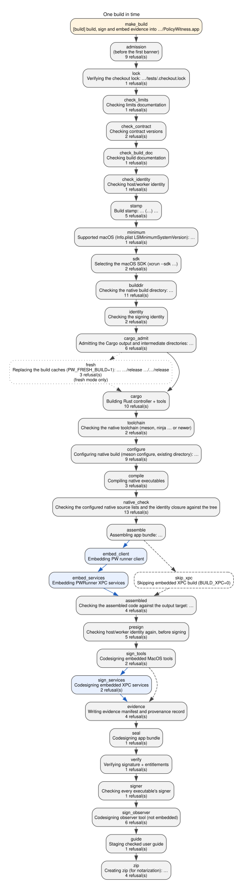

# The build

This document is the account of one build in time: what each step reads,
writes and refuses; the three knobs and what each governs; what `meson.build`
owns and what `build.sh` owns; the trust placed in the build directories, the
stamp that records the toolchain a directory was configured with, and the
fresh mode that replaces them; the checkout lock a build holds; the signing
contract and the guarantees verified on the signatures made; the evidence and
the provenance record the build embeds; and how the build verifies itself.
The release ships the [user guide](PolicyWitness.md), which states the
supported macOS; [CONTRACT.md](CONTRACT.md#internal-hostworker-identity)
keeps the identity's definition, and [SIGNING.md](SIGNING.md) keeps the
evidence inventory and record formats, notarization, release and the
archives. [DEPENDENCIES.md](DEPENDENCIES.md) lists the tools and conditions a
build needs and the versions it enforces.

## Why the build is shaped this way

Three ideas shape the script. The app is a coherent signed specimen: one
bundle of macOS code for Apple Silicon, every executable in it a thin arm64
Mach-O, assembled from compilers the script drives itself, signed from the
inside out with one explicitly named identity, and carrying a manifest of the
bytes that were signed and a record of the tools, configuration and build
directories behind them. The host and the worker share an exact source
identity ([`generate_worker_identity.py`](generate_worker_identity.py)),
checked before compiling and again before signing, when the built worker is
also asked to report it, so the pair that ships carries the identity of the
sources in the tree; that the binaries were compiled from those sources rests
on the build directories' own records, as the last section says. And every
refusal precedes the step it protects: the builder is confirmed to be a native
process on Apple Silicon before anything else runs, the tracked inputs are
admitted and the checkout lock is taken before the first check, the cache
paths are admitted before the session or any cache is written, the
documentation and identity checks run before any compile, a reused build
directory is validated against its stamp before any compile or
reconfiguration, each compile is followed by its own checks before anything
is copied, the assembled bundle's code is checked against the output target
before the first signature, every bundle copy precedes every signature, and
the signatures precede the ZIP.

What a refusal leaves behind depends on where it fires. A refusal before
assembly leaves the previous distribution outputs untouched; the build
directories change as the compiles run, and in fresh mode they are replaced
after admission, so a refusal after that point leaves fresh caches and the
previous outputs. A refusal between assembly and the seal leaves an unsealed
partial app and no ZIP; a refusal after the seal leaves a sealed app that
failed verification, the signer check or packaging,
and no ZIP or a partial one. The test inspector checks the app's signatures,
its inventory and evidence, including signer consistency for the listed
executables and the provenance record against the manifest and the bytes, and
the output target of every executable it carries
([`inspect`](../tests/lib/artifact.py)).

Known gap: a failure staging the guide or writing the ZIP can leave an app that passes inspection.

The build preserves tracked files: a stale generated copy is refused with the
command that regenerates it, so a clean checkout builds with a clean stamp.
Its writes go to the two build directories,
to the build session file beside Cargo's artifact
messages, and to the output directory, which defaults to the ignored `dist/`
but can be placed elsewhere with `DIST_DIR`. The build is a function of the
checkout, its two build directories and the [inputs beyond the
tree](#inputs-beyond-the-tree). It relies on the tools' records to decide
whether cached outputs are current, refuses a Meson build directory that
belongs to another checkout or another toolchain, and records what the tools
reported rather than repairing anything.

`make build` is the documented entry and the first row of the step table. It
calls `build.sh`, passing `PW_FRESH_BUILD` through only when the caller set
it: the release targets reach the same row through `$(MAKE) build
PW_FRESH_BUILD=1`, and a direct `./build.sh` meets the script's own checks,
including the missing-identity refusal that names the make invocation.

Supply an SDK request as `make build SDKROOT=…` or use `./build.sh`.
The Makefile validates every nonempty `SDKROOT`, inherited or supplied on
the command line, before any recipe. `/usr/bin/make` with a bad inherited
`SDKROOT` can request Command Line Tools installation before it reads the
Makefile; repository code cannot guard that launch. Any other make reaches
the check, including the developer directory's make invoked through `xcrun`.

The native builder check is the script's: `make` reaches it only through the
recipe. A translated make starts `build.sh` translated, and the script
refuses; make's own launch as a developer-tool shim and its SDK check have
already run by then, translated with it. An invalid `SDKROOT` on the make
command line is refused at parse time, before the script starts.

## One build in time

What the order establishes. The admission, the lock and the documentation and
identity checks precede every compile, the build directory's stamp is
validated before any compile or reconfiguration, each compile's own checks
follow it and precede any copy, the copies precede every signature, and the
signatures precede the ZIP, as the table shows and the rule compares. The
refusals table distinguishes this textual check from controls that drive the
build and observe it stopping.

The partial build. With `BUILD_XPC=0` the script still runs Cargo, builds and
minimum-checks the C executables, checks the signing identity, and signs
and packages a bundle without the client, the service or the embedded helpers;
the `skip_xpc` row stands in for the embed and service-signing rows it skips.
No Swift compiler is discovered, probed or recorded: the record names the
Swift compiler as not applicable, and a partial build needs no Swift
toolchain. That bundle passes evidence generation and the seal, fails the
full inspector, and cannot run a specimen, because its evidence manifest
names no runner. Use it only for iteration; the script still writes its ZIP
under the release name.

Fresh mode. With `PW_FRESH_BUILD=1` the script admits its inputs, tools and
identity as usual, then replaces `builddir/`, `controller/target/release/`
and `controller/target/aarch64-apple-darwin/release/` in the `fresh` step and
requires Cargo to report rebuilding every shipped target; the `fresh` row runs only then, which the figure draws as a dotted
node beside the direct edge of the incremental path. In incremental mode
(`PW_FRESH_BUILD` unset or `0`) the `builddir` step validates the
directory's stamp instead, and the `fresh` step does not run. The two are
alternatives at one point in the order, not a sequence.

Packaging. After the signer check, the script
stages the checked user guide beside the app and writes the ZIP for
notarization; the staging command checks the guide's sources again before it
writes. A test compares the staged copy itself.

<!-- BEGIN GENERATED BUILD FIGURE -->


*Figure: one build in time, step by step. Generated from [build.json](build.json) by [generate_build.py](generate_build.py); dot source in [build-steps.dot](build-steps.dot). The ids in the figure are the ids in the step table; a blue node and a blue edge belong only to a full build, a dashed node or edge only to a partial build, and the two paths rejoin where both variants run. A dotted node runs only under the condition it names (fresh mode, PW_FRESH_BUILD=1) and is skipped otherwise: its dotted edges and the direct edge beside them are alternatives, not a sequence. Symbol presence and test definition are verified, and the banner order with each step's condition, the refusal messages with the script's own statuses and steps, the Meson assertion family's template and asserted options, knob values, signing calls with their flags, helper and tool invocations with their subcommands and listed flags, and the signing inventory are compared with the script by the build_documentation case; whether a test asserts the row, or a refusal fires before the operation it protects, is not verified.*
<!-- END GENERATED BUILD FIGURE -->

<!-- BEGIN GENERATED BUILD STEPS -->
<details>
<summary>33 steps in order, with symbol presence and test definition verified and the banner order compared with the script; whether a test asserts the row is not verified</summary>

| Id | Banner | Variants | Reads | Writes | Refusals | Sources | Checks |
| --- | --- | --- | --- | --- | --- | --- | --- |
| make_build | Makefile: [build] build, sign and embed evidence into $(DIST_DIR)/PolicyWitness.app | both | IDENTITY, DIST_DIR and, when the caller set it, PW_FRESH_BUILD from the make command line or environment; every nonempty SDKROOT, inherited or supplied on the command line, is validated by sdk_guard.sh while parsing the Makefile before any recipe. /usr/bin/make is itself a developer-tool shim and that SDK check runs xcrun, both before build.sh and its native builder check, and both run translated when make does | nothing; runs build.sh with them, which a translated make starts translated | none | [`[build] build, sign and embed evidence into $(DIST_DIR)/PolicyWitness.app`](../Makefile); [`PW_SDK_REFUSAL`](../Makefile) | [`check_makefile_entry`](../tests/suites/source_drift/build_rules.py); [`test_make_build_runs_the_script_which_names_the_make_invocation_in_its_identity_refusal`](../tests/suites/source_drift/contract.py); [`test_make_checks_command_line_and_inherited_sdk_before_recipes`](../tests/suites/preflight/check_build_provenance.py) |
| admission | (none) | both | hw.optional.arm64 and sysctl.proc_translated, each read by /usr/sbin/sysctl from the script's own shell before anything else runs (--help included): the build proceeds only on 1 and 0, and an empty value or a failed probe refuses; then BUILD_XPC, PW_INSPECTION, PW_FRESH_BUILD and the argument list (--help prints the usage and exits after the knobs are validated, before any other check); whether each tracked input the build copies exists; the pinned interpreter, /opt/homebrew/opt/python@3.14/bin/python3.14, which must be an executable file in a python@3.14 keg that names a 3.14 version and must report that version when probed in isolation, with no PYTHON* variable set other than the three the helpers own, resolved again by the shell front end and by the script under the owner; without a claim in the environment, the caller's SDKROOT, CPATH, LIBRARY_PATH, MANPATH and LC_CTYPE, witnessed by the shell front end's builtins, and tests/.checkout.lock, which the owner it starts directly takes before supervising the script again under it; every nonempty caller SDKROOT must resolve through xcrun to an existing SDK directory with a numeric version before the lock front end or any developer-tool shim starts | the owner record in tests/.checkout.lock (pid, start time, acquisition nonce and admission socket identity) for as long as the owner and its protected children hold it; nothing else | native_builder_required, knob_value, unknown_argument, missing_tree_input, checkout_busy, direct_python_unavailable, python_version_mismatch, python_environment_set, environment_witness_missing, environment_witness_changed, sdk_request_invalid | [`this build runs only natively on Apple Silicon`](../build.sh); [`must be 0 or 1`](../build.sh); [`checkout_lock.sh`](../build.sh) | [`check_refusals`](../tests/suites/source_drift/build_rules.py); [`test_build_refuses_a_knob_value_other_than_0_or_1_before_any_check`](../tests/suites/source_drift/contract.py); [`test_build_refuses_an_unknown_argument_before_any_check`](../tests/suites/source_drift/contract.py); [`control_missing_tree_input`](../tests/suites/preflight/opt_in/build_refusals.py); [`control_checkout_busy`](../tests/suites/preflight/opt_in/build_refusals.py); [`test_build_refuses_an_unexecutable_interpreter_before_any_python`](../tests/suites/source_drift/contract.py); [`test_build_refuses_a_builder_it_cannot_confirm_before_anything_else`](../tests/suites/source_drift/contract.py); [`control_unconfirmed_machine`](../tests/suites/preflight/opt_in/build_refusals.py) |
| lock | Verifying the checkout lock: ${ROOT_DIR}/tests/.checkout.lock | both | the channel's socket identity matching the acquisition record and its kernel-reported peer PID matching the acquisition owner and the owner's handoff over the channel the claim names: the held descriptor, open on this checkout's lock file, and the acquisition nonce its owner record carries; never the environment alone | nothing | lock_claim_invalid | [`Verifying the checkout lock`](../build.sh) | [`check_banner_order`](../tests/suites/source_drift/build_rules.py); [`control_lock_claim_invalid`](../tests/suites/preflight/opt_in/build_refusals.py) |
| check_limits | Checking limits documentation | both | docs/limits.json and the documents it renders | nothing | stale_limits | [`Checking limits documentation`](../build.sh) | [`check_banner_order`](../tests/suites/source_drift/build_rules.py) |
| check_contract | Checking contract versions | both | docs/contract.json, docs/architecture.json and their generated copies | nothing | stale_contract, stale_architecture | [`Checking contract versions`](../build.sh) | [`check_banner_order`](../tests/suites/source_drift/build_rules.py) |
| check_build_doc | Checking build documentation | both | docs/build.json, build.sh, meson.build, the Makefile, the inventories, the baseline and the generated copies | nothing | stale_build_doc | [`Checking build documentation`](../build.sh) | [`check_banner_order`](../tests/suites/source_drift/build_rules.py) |
| check_identity | Checking host/worker identity | both | the identity inputs and the three generated copies | nothing | stale_identity | [`Checking host/worker identity`](../build.sh) | [`check_banner_order`](../tests/suites/source_drift/build_rules.py) |
| stamp | Build stamp: ${PW_VERSION} (${PW_BUILD_NUMBER}) ${PW_BUILD_DESCRIBE} | both | git describe, rev-parse and rev-list, or PW_VERSION and PW_BUILD_NUMBER from the environment; the environment witness compared with the starting environment (SDKROOT supplied from before its removal) | the four stamp variables for Cargo and the plists; after admitting builddir/, controller/target/, its release/, its aarch64-apple-darwin/ and that directory's release/, and the session destination, controller/target/ when it is missing and the build session file, opened with the stamp, the three knobs, the fixed output target, the acquisition nonce and the build's witnessed starting environment as requests | provenance_probe_failed, lock_claim_invalid, cache_path_unsafe, environment_witness_missing, environment_witness_changed | [`Build stamp: ${PW_VERSION} (${PW_BUILD_NUMBER}) ${PW_BUILD_DESCRIBE}`](../build.sh) | [`check_banner_order`](../tests/suites/source_drift/build_rules.py); [`control_provenance_probe_failed`](../tests/suites/preflight/opt_in/build_refusals.py); [`control_cache_path_unsafe`](../tests/suites/preflight/opt_in/build_refusals.py); [`control_environment_witness_missing`](../tests/suites/preflight/opt_in/build_refusals.py); [`control_environment_witness_changed`](../tests/suites/preflight/opt_in/build_refusals.py) |
| minimum | Supported macOS (Info.plist LSMinimumSystemVersion): ${PW_MINIMUM_MACOS} | both | LSMinimumSystemVersion in Info.plist | MACOSX_DEPLOYMENT_TARGET for Cargo | plist_minimum_malformed | [`Supported macOS (Info.plist LSMinimumSystemVersion): ${PW_MINIMUM_MACOS}`](../build.sh) | [`check_banner_order`](../tests/suites/source_drift/build_rules.py) |
| sdk | Selecting the macOS SDK (xcrun --sdk ${SDK_REQUEST}) | both | the SDK path and numeric version xcrun reports under DEVELOPER_DIR for the macosx default, or for the SDK a caller's SDKROOT names | SDKROOT for Cargo and Meson, resolved by xcrun, and the SDK version every shipped output must carry | sdk_unavailable, sdk_version_unreadable | [`Selecting the macOS SDK (xcrun --sdk ${SDK_REQUEST})`](../build.sh) | [`check_banner_order`](../tests/suites/source_drift/build_rules.py); [`control_sdk_unavailable`](../tests/suites/preflight/opt_in/build_refusals.py); [`control_sdk_version_unreadable`](../tests/suites/preflight/opt_in/build_refusals.py) |
| builddir | Checking the native build directory: ${MESON_BUILD_DIR} | both | in incremental mode: builddir/meson-info/meson-info.json and builddir/pw-toolchain.json when the directory is configured: its output target (Meson's host machine, the targets' architecture selections and the Cargo triple), compared with the required target and then with Meson's introspection of the directory before any probe, and the stamped SDK, developer directory, compiler commands and Rust compiler probed now; in fresh mode nothing, since the directory is replaced | the toolchain observation into the build session | builddir_unreadable, builddir_other_checkout, builddir_stamp_missing, builddir_stamp_invalid, builddir_toolchain_changed, builddir_target_mismatch, provenance_probe_failed, lock_claim_invalid, cache_path_unsafe, cargo_configuration_unresolved, cargo_environment_conflict | [`Checking the native build directory: ${MESON_BUILD_DIR}`](../build.sh) | [`check_banner_order`](../tests/suites/source_drift/build_rules.py); [`test_build_refuses_a_build_directory_configured_for_another_checkout_before_cargo`](../tests/suites/source_drift/contract.py); [`control_builddir_stamp_missing`](../tests/suites/preflight/opt_in/build_refusals.py); [`control_builddir_stamp_invalid`](../tests/suites/preflight/opt_in/build_refusals.py); [`control_builddir_toolchain_changed`](../tests/suites/preflight/opt_in/build_refusals.py); [`control_builddir_target_mismatch`](../tests/suites/preflight/opt_in/build_refusals.py) |
| identity | Checking the signing identity | both | IDENTITY and the keychain listing; the knobs, for Meson's options and RUSTFLAGS | RUSTFLAGS, when inspection is on and it was unset or empty, and the record of who set it | identity_unset, identity_absent | [`Checking the signing identity`](../build.sh) | [`check_banner_order`](../tests/suites/source_drift/build_rules.py); [`test_build_refuses_a_developer_id_identity_the_keychain_lacks_before_cargo`](../tests/suites/source_drift/contract.py); [`test_build_refuses_an_identity_of_another_class_as_absent_before_cargo`](../tests/suites/source_drift/contract.py) |
| cargo_admit | Admitting the Cargo output and intermediate directories: ${CARGO_TARGET_DIR_PINNED} | both | Cargo's configuration as one invocation from this directory reads it: `.cargo/config` or `config.toml` here, in each ancestor and in Cargo home, with their includes, merged by Cargo's precedence; the environment overrides; the launcher (a rustup proxy and the toolchain it resolves); the output triple the command passes and the lower-precedence target defaults it overrides; and cargo metadata's report of the target and build directories under the pinned target directory | the compiler and wrapper selection with its sources, the `[env]` entries and whether each applied, the compiler's inputs in Cargo's child environment, the output triple with the defaults it overrides, the requested Rust flags by precedence, target rules attributed to that triple and the admission, into the build session | cargo_build_dir_redirected, cargo_build_dir_unknown, lock_claim_invalid, cache_path_unsafe, cargo_configuration_unresolved, cargo_environment_conflict | [`Admitting the Cargo output and intermediate directories`](../build.sh) | [`check_banner_order`](../tests/suites/source_drift/build_rules.py); [`control_cargo_build_dir_redirected`](../tests/suites/preflight/opt_in/build_refusals.py); [`control_cargo_build_dir_unknown`](../tests/suites/preflight/opt_in/build_refusals.py); [`control_cargo_configuration_unresolved`](../tests/suites/preflight/opt_in/build_refusals.py); [`control_cargo_environment_conflict`](../tests/suites/preflight/opt_in/build_refusals.py); [`control_cargo_selection_sequence`](../tests/suites/preflight/opt_in/build_refusals.py) |
| fresh | Replacing the build caches (PW_FRESH_BUILD=1): ${MESON_BUILD_DIR} ${CARGO_TARGET_DIR_PINNED}/release ${CARGO_TARGET_DIR_PINNED}/${CARGO_OUTPUT_TRIPLE}/release | both; fresh mode only | builddir/, controller/target/release/ and controller/target/aarch64-apple-darwin/release/, admitted again with every component below the checkout a real directory of this user, or absent, all before any is removed, and rechecked before each removal | removes the three directories through their admitted descriptors; records each one's replacement in the build session; nothing else is removed, including other profiles and other triples | fresh_removal_failed, lock_claim_invalid, cache_path_unsafe | [`Replacing the build caches`](../build.sh) | [`check_banner_order`](../tests/suites/source_drift/build_rules.py); [`control_cache_path_unsafe`](../tests/suites/preflight/opt_in/build_refusals.py); [`control_fresh_removal_failed`](../tests/suites/preflight/opt_in/build_refusals.py); [`control_fresh_sequence`](../tests/suites/preflight/opt_in/build_refusals.py) |
| cargo | Building Rust controller + tools | both | cargo on PATH with its configuration, caches and registries; controller/ sources and the output triple passed with --target, the stamp variables, MACOSX_DEPLOYMENT_TARGET, SDKROOT and RUSTFLAGS; the artifact paths and per-target reuse judgments Cargo reports, each a literal boolean bound to the shipped target, a typed non-test profile and the admitted executable, and Cargo's fingerprint for each shipped target; each shipped output's container, architecture names and platform, from its header, lipo -archs and its load commands | controller/target/aarch64-apple-darwin/release/ under the pinned output directory for the shipped executables and controller/target/release/ for build scripts and procedural macros, the messages file Cargo reports its artifacts in, and the output check's observations and the judgments into the build session | cargo_artifact_elsewhere, missing_cargo_output, output_target_mismatch, minimum_mismatch, cargo_failed, cargo_target_reused, provenance_probe_failed, lock_claim_invalid, cache_path_unsafe, cargo_judgment_unknown | [`Building Rust controller + tools`](../build.sh) | [`check_banner_order`](../tests/suites/source_drift/build_rules.py); [`control_missing_cargo_output`](../tests/suites/preflight/opt_in/build_refusals.py); [`control_cargo_target_reused`](../tests/suites/preflight/opt_in/build_refusals.py); [`control_cargo_judgment_unknown`](../tests/suites/preflight/opt_in/build_refusals.py); [`control_output_target_mismatch`](../tests/suites/preflight/opt_in/build_refusals.py) |
| toolchain | Checking the native toolchain (meson, ninja ${NINJA_MINIMUM} or newer) | both | meson and ninja on PATH and ninja's version | nothing | meson_ninja_missing, ninja_old | [`Checking the native toolchain (meson, ninja ${NINJA_MINIMUM} or newer)`](../build.sh) | [`check_banner_order`](../tests/suites/source_drift/build_rules.py) |
| configure | Configuring native build (meson configure, existing directory): ${MESON_OPTIONS[*]} / Configuring native build (meson setup, fresh directory): ${MESON_BUILD_DIR} ${MESON_OPTIONS[*]} | both | whether builddir/build.ninja exists, meson.build, meson.options and the two Meson options; a fresh setup also reads CFLAGS and the other flag variables, and the compilers Meson selected | builddir/ configuration; a fresh setup publishes builddir/pw-toolchain.json atomically from the selected compilers, SDK and Rust compiler; meson configure records the two options and the policy assertions run at setup or at the regeneration the next compile triggers | meson_policy, meson_target, meson_failed, builddir_stamp_invalid, provenance_probe_failed, lock_claim_invalid, cache_path_unsafe, cargo_configuration_unresolved, cargo_environment_conflict | [`Configuring native build (meson configure, existing directory): ${MESON_OPTIONS[*]}`](../build.sh) | [`check_banner_order`](../tests/suites/source_drift/build_rules.py); [`control_meson_policy`](../tests/suites/preflight/opt_in/build_refusals.py); [`control_fresh_sequence`](../tests/suites/preflight/opt_in/build_refusals.py); [`control_meson_target`](../tests/suites/preflight/opt_in/build_refusals.py) |
| compile | Compiling native executables | both | the native sources through builddir/; a changed option triggers regeneration, which runs the policy assertions first | builddir/ outputs and the Swift module cache under it | meson_policy, meson_target, meson_failed | [`Compiling native executables`](../build.sh) | [`check_banner_order`](../tests/suites/source_drift/build_rules.py) |
| native_check | Checking the configured native source lists and the identity closure against the tree | both | Meson's introspection of builddir/, Ninja's dependency log, the identity inputs, the stamp and the compilers the directory records, and every shipped output's container, architecture names and load commands | builddir/pw-toolchain.json extended with the Swift compiler a reused directory discovered when this build enabled the XPC pieces, atomically and without changing another field; the toolchain, option, Meson machine, output target and SDK observations into the build session | minimum_mismatch, missing_native_output, output_target_mismatch, native_sources_differ, native_sources_unreadable, builddir_stamp_invalid, builddir_toolchain_changed, sdk_disagreement, provenance_probe_failed, lock_claim_invalid, cache_path_unsafe, cargo_configuration_unresolved, cargo_environment_conflict | [`Checking the configured native source lists and the identity closure against the tree`](../build.sh) | [`check_banner_order`](../tests/suites/source_drift/build_rules.py); [`test_build_guards`](../tests/suites/preflight/opt_in/build_guards.py); [`control_fresh_sequence`](../tests/suites/preflight/opt_in/build_refusals.py); [`control_output_target_mismatch`](../tests/suites/preflight/opt_in/build_refusals.py) |
| assemble | Assembling app bundle: ${APP_BUNDLE} | both | Info.plist, the three Rust outputs, runner/augments/, dist/README.md and dist/AGENTS.md, all admitted before the first check | the two documents under DIST_DIR; removes the previous app, ZIP and guide; the stamped Info.plist, the three Rust executables and the augments under the new app | none | [`Assembling app bundle: ${APP_BUNDLE}`](../build.sh) | [`check_banner_order`](../tests/suites/source_drift/build_rules.py) |
| embed_client | Embedding PW runner client | full | builddir/pw-runner-client | Contents/MacOS/pw-runner-client and its dSYM in inspection builds | none | [`Embedding PW runner client`](../build.sh) | [`check_banner_order`](../tests/suites/source_drift/build_rules.py) |
| embed_services | Embedding PWRunner XPC services | full | each service's Info.plist and builddir/ host, the worker, validator and issuer | each service bundle: its stamped Info.plist, the host with its dSYM in inspection builds, the worker, validator and issuer | none | [`Embedding PWRunner XPC services`](../build.sh) | [`check_banner_order`](../tests/suites/source_drift/build_rules.py) |
| skip_xpc | Skipping embedded XPC build (BUILD_XPC=0) | partial | nothing | nothing | none | [`Skipping embedded XPC build (BUILD_XPC=0)`](../build.sh) | [`check_banner_order`](../tests/suites/source_drift/build_rules.py) |
| assembled | Checking the assembled code against the output target: ${APP_BUNDLE} | both | the variant's required executable paths even when missing or lacking a Mach-O header, plus every regular file under the assembled app whose header is a Mach-O or fat container, except dSYM companions whose every slice has a complete debug header: its container, lipo -archs names and LC_BUILD_VERSION platform | the observations into the build session; nothing in the bundle | output_target_mismatch, provenance_probe_failed, lock_claim_invalid, cache_path_unsafe | [`Checking the assembled code against the output target`](../build.sh) | [`check_banner_order`](../tests/suites/source_drift/build_rules.py); [`control_output_target_mismatch`](../tests/suites/preflight/opt_in/build_refusals.py) |
| presign | Checking host/worker identity again, before signing | both | the identity inputs and copies, the generated identity in tests/lib/contract.py and the built worker's --version report | nothing | stale_identity_presign, worker_identity_mismatch, provenance_probe_failed, lock_claim_invalid, cache_path_unsafe | [`Checking host/worker identity again, before signing`](../build.sh) | [`check_banner_order`](../tests/suites/source_drift/build_rules.py); [`control_stale_identity_presign`](../tests/suites/preflight/opt_in/build_refusals.py); [`control_worker_identity_mismatch`](../tests/suites/preflight/opt_in/build_refusals.py) |
| sign_tools | Codesigning embedded MacOS tools | both | the copied top-level helpers | signatures on the top-level helpers | sign_target_not_macho, codesign_failed | [`Codesigning embedded MacOS tools`](../build.sh) | [`check_banner_order`](../tests/suites/source_drift/build_rules.py) |
| sign_services | Codesigning embedded XPC services | full | each service's Entitlements.plist, admitted before the first check, and the assembled bundle | signatures on the nested helpers, then each service seal | sign_target_not_macho, codesign_failed | [`Codesigning embedded XPC services`](../build.sh) | [`check_banner_order`](../tests/suites/source_drift/build_rules.py) |
| evidence | Writing evidence manifest and provenance record | both | the signed bytes, entitlements and exported symbols of the helpers, services and augments; the build session; every shipped output's load commands, container, architecture names and signature display; the caller's requests and Cargo's effective deployment target and SDK, from the build session | Contents/Resources/Evidence/manifest.json, symbols.json and provenance.json, the manifest listing the other two; the record only after it passes its own validation | evidence_failed, provenance_required_unknown, lock_claim_invalid, cache_path_unsafe | [`Writing evidence manifest and provenance record`](../build.sh) | [`check_banner_order`](../tests/suites/source_drift/build_rules.py); [`control_evidence_failed`](../tests/suites/preflight/opt_in/build_refusals.py); [`control_provenance_required_unknown`](../tests/suites/preflight/opt_in/build_refusals.py) |
| seal | Codesigning app bundle | both | PolicyWitness.entitlements | the app seal over everything under Contents/ | codesign_failed | [`Codesigning app bundle`](../build.sh) | [`check_banner_order`](../tests/suites/source_drift/build_rules.py) |
| verify | Verifying signature + entitlements | both | the sealed app | nothing | verify_failed | [`Verifying signature + entitlements`](../build.sh) | [`check_banner_order`](../tests/suites/source_drift/build_rules.py) |
| signer | Checking every executable's signer | both | every regular file under the app's and each service's Contents/MacOS, and the app and service seals, as codesign displays them | nothing | signer_mismatch | [`Checking every executable's signer`](../build.sh) | [`check_banner_order`](../tests/suites/source_drift/build_rules.py) |
| guide | Staging checked user guide | both | docs/PolicyWitness.md and its inputs | PolicyWitness.md under DIST_DIR | stale_guide | [`Staging checked user guide`](../build.sh) | [`check_banner_order`](../tests/suites/source_drift/build_rules.py) |
| zip | Creating zip (for notarization): ${ZIP_NAME} | both | the sealed app, the variant's required executable paths and any additional code found by header checked against the output target again before the ZIP is written; only debug-only dSYM companions are excluded | PolicyWitness.zip under DIST_DIR | output_target_mismatch, provenance_probe_failed, lock_claim_invalid, cache_path_unsafe | [`Creating zip (for notarization): ${ZIP_NAME}`](../build.sh) | [`check_banner_order`](../tests/suites/source_drift/build_rules.py); [`control_output_target_mismatch`](../tests/suites/preflight/opt_in/build_refusals.py) |

</details>
<!-- END GENERATED BUILD STEPS -->

How to read the table. A step is a banner the script prints; the rows are in
script order, and the generator refuses a manifest whose banners are not the
script's, in that order, under the same `BUILD_XPC` branches and the same
`PW_FRESH_BUILD` condition
([`check_banner_order`](../tests/suites/source_drift/build_rules.py)). The
first row is the Makefile's `build` target; the second, `admission`, has no
banner and holds the refusals that fire before any banner prints, including
the tracked-input check and the launcher's refusal of a busy checkout lock. A
refusal belongs to the banner that precedes it in the script, and a refusal
inside a function belongs to every step that calls the function; the script is
arranged so that every refusal follows the banner of the step it protects,
which is what makes that rule honest. Variants are `full` (`BUILD_XPC=1`) and
`partial` (`BUILD_XPC=0`); a row marked `both` runs in either, and a row
marked `fresh mode only` runs only when `PW_FRESH_BUILD=1`. `--help` prints
the usage and exits once the native builder check has passed and the knobs
are validated, before any other check. The
script prints a warning and continues when the augments directory holds no
augment. The tables cover refusals; their Reads and Writes columns are
manually maintained descriptions of each step.

## Inputs beyond the tree

The build depends on these inputs and working state, in the order it meets them.

- **An Apple Silicon Mac, building natively.** Before anything else runs,
  including `--help`, the script's own shell reads `hw.optional.arm64` and
  `sysctl.proc_translated` with `/usr/sbin/sysctl` and proceeds only on `1`
  and `0`. A Rosetta-translated process reads `1` and `1`; an empty value or
  a probe that fails refuses too, naming both values read. The check
  describes the process that asks: the universal tools the script starts run
  natively with it, while a tool installed with only an x86_64 slice would
  still run translated. The record carries what rustc and Meson report about
  the machine they ran on (rustc's host triple and Meson's build machine)
  and nothing about this check.
- **The tracked inputs.** `Info.plist`, the two entitlement plists, the
  service's `Info.plist`, the service directory and the augments directory
  must exist before the first check; the first absent one is named. A copy
  that finds its input gone later fails on its own, since the build assumes a
  stable checkout.
- **The checkout lock and the caller's environment.** Every invocation holds
  `tests/.checkout.lock` from admission through packaging, as a managed test
  execution does, so a build and a battery in one checkout are mutually
  exclusive. A direct invocation hands itself to the shell front end before
  any Python runs; the front end witnesses the caller's `SDKROOT`, `CPATH`,
  `LIBRARY_PATH`, `MANPATH` and `LC_CTYPE`, and the owner it starts directly
  takes the lock without blocking and refuses a busy one before any cache or
  distribution mutation. [Locking](#the-checkout-lock) explains how a claim
  is admitted, how the witness is checked and how long the hold lasts.
- **The git stamp.** `git describe`, `rev-parse` and `rev-list` give the
  version, the commit count, the describe string and the commit
  ([`PW_BUILD_DESCRIBE`](../build.sh)). `PW_VERSION` and `PW_BUILD_NUMBER`
  override the first two for builds outside a checkout; the other two always
  come from git or read `unknown`. The same four values reach the controller
  through Cargo ([build.rs](../controller/build.rs)), both plists
  ([`stamp_info_plist`](../build.sh)) and the provenance record.
- **The supported macOS.** [`LSMinimumSystemVersion`](../Info.plist) is the
  one declaration the script enforces: it becomes `MACOSX_DEPLOYMENT_TARGET`
  for Cargo, and every Cargo and Meson executable is checked against it
  before assembly ([`check_minimum_macos`](../build.sh)). `meson.build` pins
  the same value for the native compile and link
  ([`macos_minimum`](../meson.build)); the two agree because a build in which
  they disagree refuses.
- **The output target.** Every executable the build delivers is a thin arm64
  Mach-O for macOS ([output_target.py](../tests/lib/output_target.py)): one
  architecture, `arm64` exactly (not `arm64e`, and not a universal file that
  includes it), in a thin file rather than a fat container, with the macOS
  platform in its `LC_BUILD_VERSION`. The macOS minimum and the SDK stay
  separate requirements beside it. Each toolchain is told the target rather
  than left to its default: Cargo gets `--target aarch64-apple-darwin`, and
  the controller package's build script ([build.rs](../controller/build.rs))
  refuses any other Cargo `TARGET`, which also stops a direct
  `cargo build --target x86_64-apple-darwin`; `meson.build` asserts that
  Meson's host machine, where the products run, is arm64 macOS, and passes
  `-arch arm64` to every C compile and link and `arm64-apple-macosx<minimum>`
  as the Swift target. Then the bytes are checked, never
  executed, at every boundary they could change: each Cargo and Meson output
  after its compile and before its minimum is read (so before the worker is
  run for its identity), every Mach-O the assembled bundle carries, found by
  header and not by the names copied in, before the first signature, the
  standalone observer before it is signed, and the sealed bundle again before
  the ZIP is written. A reused output is checked on every build like a new
  one; nothing is thinned or repaired. Both app-wide checks include every
  executable required by the build variant, even when missing or lacking a
  recognizable header, plus additional code discovered by header. A dSYM
  companion is excluded as debug data only when every slice has a complete
  debug header; mixed code/debug containers remain subject to the output rule.
  The target describes the products, not the machine or processes that built
  them, and the record makes no claim about translation.
- **The SDK and the developer directory.** `xcrun --sdk macosx` selects the
  SDK once, under whatever `DEVELOPER_DIR` names, unless the caller's
  `SDKROOT` names an SDK, which `xcrun` resolves instead. The caller's
  `SDKROOT` is the value in the environment `build.sh` starts with, saved
  before the script removes it until SDK selection. An empty value selects
  the default but remains recorded as explicitly set. A nonempty request
  must first resolve through `xcrun` to an existing SDK directory with a
  numeric version: the shared entry guard refuses an invalid `SDKROOT` at
  admission, naming its value, before taking the lock or writing the build
  session. The same guard runs in the test dispatcher and lock front end.
  The script exports
  the resolved path as `SDKROOT` for Cargo and Meson alike, keeps its numeric
  version and records which of the two selected it. A failed selection or a
  version that is not numeric at SDK selection still refuses before the build directory and the
  signing identity are checked. Which toolchain `xcrun` resolves is the
  operator's choice; every shipped output must carry that
  SDK's version in its load commands before assembly
  ([`sdk_check`](../tests/lib/build_provenance.py)), compared numerically so
  equivalent spellings agree and a missing or malformed value never does. The
  SDK's build identifier is a separate observation in the record, not a fact
  the load commands establish.
- **The two build directories.** Before the session or either cache is
  written or inspected, the `stamp` step's helper admits every component of
  `builddir/`, `controller/target/` and its `release/` below the checkout, and
  the session destination, and below `controller/target/` the output
  triple's `aarch64-apple-darwin/` and its `release/`: each directory must be
  a real directory of this user, or absent, and the session an absent path or a regular file of this
  user with one link. A symlink, another user's directory or a non-directory
  refuses as `cache_path_unsafe` with nothing written or removed, and a
  missing `controller/target/` is created only beneath the admitted
  `controller/`. Every later helper admits the paths again and writes and
  removes through the directories it admitted, rechecking first that the path
  still names them. Meson's is checked: a directory whose
  recorded source is another checkout, or whose record cannot be read, is
  refused before Cargo; so is one whose toolchain stamp is missing, malformed
  or describes other tools than the ones selected now, as
  [cache compatibility](#cache-compatibility-replacement-and-recovery) says.
  Cargo's is pinned with `--target-dir` and its output triple with
  `--target`: the shipped executables land under
  `controller/target/aarch64-apple-darwin/release/`, while build scripts and
  procedural macros stay under `controller/target/release/`. Its intermediate
  release state must lie under that directory, and Cargo is asked to report
  the executables it produced and whether it reused each one, so an
  executable reported at another path is refused before any copy.
- **The signing identity.** `IDENTITY` must name an identity that `security
  find-identity` lists; nothing is auto-selected, and the keychain listing is
  checked before Cargo because an empty listing is also what a sandboxed
  harness shows for a keychain it cannot open. The identity's class, chain,
  team and secure timestamp are verified on the signatures it makes, after
  the seal, as [the signing contract](#the-signing-contract) says.
- **Cargo's environment.** `cargo` is resolved on `PATH` and brings its own
  configuration, caches and registries. The script adds the four stamp
  variables, `MACOSX_DEPLOYMENT_TARGET`, `SDKROOT`, and `RUSTFLAGS` with
  debug info, frame pointers and opt-level 1 when inspection is on and the
  caller left it unset or empty; a caller's `RUSTFLAGS` wins silently, and
  the record says which of the two set it. Cargo also honors compiler
  overrides and flag sources the script does not set, and the build resolves
  them the way that one Cargo invocation does
  ([cargo_config.py](../tests/lib/cargo_config.py)): the configuration files
  in the directory the build is run from, its ancestors and Cargo home (Cargo
  reads `config` where both names exist), parsed as TOML with their
  `include` files followed recursively and merged by Cargo's precedence, with
  each value kept beside the file that defined it for relative paths; then
  `RUSTC`, `CARGO_BUILD_RUSTC` and `build.rustc`, each wrapper with an empty
  value disabling it, and the `[env]` entries Cargo gives every process it
  starts, forced or applied only where Cargo's own environment lacks them.
  When `cargo` on `PATH` is a rustup proxy, which only a proxy's acceptance
  of `cargo +<toolchain>` shows, the proxy's `PATH` prefix and toolchain are
  part of that environment. The compiler is found in that child environment
  and probed there, in the workspace root where Cargo runs it. Distinguishing
  the launcher requires an explicit `RUSTUP_TOOLCHAIN` or a readable active
  toolchain from `rustup` on `PATH`; a missing or failed observation refuses,
  including a timeout or output overflow from the launcher probe. A graph that
  cannot be read, parsed or bounded, a cycle, a missing required include, a
  value of an unsupported type or a program not on Cargo's `PATH` refuses
  as `cargo_configuration_unresolved`, and an effective `SDKROOT`,
  `MACOSX_DEPLOYMENT_TARGET` or `DEVELOPER_DIR` that differs from the build's
  refuses as `cargo_environment_conflict`, at the stamp check and again at
  Cargo admission, before Cargo runs in either mode; the minimum and SDK
  checks on the outputs remain a separate gate. A setting a higher-precedence
  one overrides is recorded, not refused. The requested Rust flags are named
  by Cargo's precedence (`CARGO_ENCODED_RUSTFLAGS`, `RUSTFLAGS`, matching
  target rules, `build.rustflags`), with target rules using `cfg()` left
  unresolved, and compared with Cargo's own record of the effective flags.
  Target rules match the output triple the command passes, never the host
  the compiler reports for itself; with an explicit target, Cargo applies
  them to the shipped units only. `CARGO_BUILD_TARGET` and `build.target`
  name a target only when the command names none: the explicit `--target`
  overrides them, and the record lists them as overridden, never applied
  and never refused.
  The build also asks Cargo for its effective intermediate directory and
  refuses one outside the pinned target directory, or a report that names
  none, before any mutation. A plain `cargo build` outside the script
  carries none of this; on the toolchain this was observed with, it produced
  executables for an older macOS than the plist declares, which the minimum
  check would refuse. Its target, though, is the package's own rule: with
  another `--target` or a configured target default, the build script stops
  it.
- **The output directory.** `DIST_DIR`, `dist/` by default; a custom one
  also receives copies of the tracked `dist/README.md` and `dist/AGENTS.md`. Its
  trust and that of the build directories are in the table.

<!-- BEGIN GENERATED BUILD DIRECTORIES -->
| Directory | Trusted as | Refused when | Sources | Checks |
| --- | --- | --- | --- | --- |
| builddir/ | Meson's configuration and incremental native outputs for this checkout, reused only under the toolchain its stamp (pw-toolchain.json) records: SDK path, version and build, developer directory, configured compiler commands and their probed identities, and the selected Rust compiler, and the output target it was configured for: Meson's host machine, the targets' architecture selections and the Cargo triple | a component of its path is a symlink, not a directory or another user's, refused at admission before any session or cache write; its recorded source directory is not this checkout, its meson-info cannot be read, its stamp is missing, malformed, unsupported (a stamp from before the output target contract included) or does not describe the directory, its stamped output target is not the required one, a stamped field differs from the toolchain selected now, or a field needed for that comparison cannot be observed; fresh mode replaces the directory after admission instead of validating it | [`MESON_SOURCE_DIR`](../build.sh); [`stamp-check`](../build.sh); [`stamp_check`](../tests/lib/build_provenance.py) | [`check_refusals`](../tests/suites/source_drift/build_rules.py); [`test_build_refuses_a_build_directory_configured_for_another_checkout_before_cargo`](../tests/suites/source_drift/contract.py); [`control_builddir_toolchain_changed`](../tests/suites/preflight/opt_in/build_refusals.py); [`control_fresh_sequence`](../tests/suites/preflight/opt_in/build_refusals.py) |
| controller/target/ | Cargo's incremental outputs and intermediate release state under the pinned --target-dir, the shipped executables under aarch64-apple-darwin/release/ and the host build scripts and procedural macros under release/, with Cargo's own reuse judgment recorded per shipped target; fresh mode replaces only those two release/ subdirectories | a component of its path, of release/, of aarch64-apple-darwin/ or of its release/ is a symlink, not a directory or another user's, or the session destination is not a regular file of this user, refused at admission before any session or cache write; Cargo would keep intermediate state outside it, reports an executable at another path than the pinned one, produces a shipped output that is not a thin arm64 Mach-O for macOS, reports no literal boolean judgment for a shipped target, or, in fresh mode, reports reusing one; otherwise a stale output is caught only by the minimum and SDK checks and Cargo's own fingerprints, and a replaced cached output that Cargo judges current is recorded as reused, not detected | [`CARGO_TARGET_DIR_PINNED`](../build.sh); [`cargo-admit`](../build.sh); [`cargo_admit`](../tests/lib/build_provenance.py) | [`check_invocations`](../tests/suites/source_drift/build_rules.py); [`control_cargo_build_dir_redirected`](../tests/suites/preflight/opt_in/build_refusals.py); [`control_cargo_target_reused`](../tests/suites/preflight/opt_in/build_refusals.py); [`control_replaced_cached_output_is_recorded_not_detected`](../tests/suites/preflight/opt_in/build_refusals.py); [`control_output_target_mismatch`](../tests/suites/preflight/opt_in/build_refusals.py) |
| dist/ (DIST_DIR) | the output directory; the previous app, ZIP and guide are preserved by every refusal before assembly, including fresh mode's cache replacement, and are removed one after another at assembly with nothing preserved | never; a failure between the removals leaves a mixture, a refusal before the seal leaves an unsealed partial app, and a later failure can leave a sealed app; inspection checks the app, not completion of guide staging or ZIP creation | [`rm -f "${ZIP_NAME}" "${GUIDE_NAME}"`](../build.sh) | [`check_banner_order`](../tests/suites/source_drift/build_rules.py) |
<!-- END GENERATED BUILD DIRECTORIES -->

### Cache compatibility, replacement and recovery

A configured `builddir/` carries `builddir/pw-toolchain.json`, its toolchain
stamp, published atomically right after a successful `meson setup` from the
compilers Meson actually selected: the developer directory, the SDK's path,
version and build, each configured compiler command with the identity it
reports when probed in the directory's context, the selected Rust compiler
with its wrappers, and the output target the directory is configured for:
Meson's host machine, the architecture each target selects with its
effective arguments (`-arch` at C compile and executable link, the Swift
`-target`), read from Meson's introspection and never from the default a
compiler's version output names, and the Cargo output triple. Its scope is
the Meson configuration and the compatibility inputs observed at setup; it
says nothing about how outputs Cargo retained were produced. Meson's
introspection does not list a Swift target's link arguments, so the Swift
target is recorded from the compile. A failed setup publishes nothing.

On reuse, the `builddir` step reads the stamp, checks that it names this
checkout, compares its output target with the required one, refusing a
directory configured for another target as `builddir_target_mismatch`
before any probe, checks that it names the compiler commands and the output
target the directory records, probes those same commands now, together with `xcrun`, the developer directory and the Rust
compiler, and compares every applicable field. A field that differs refuses
as `builddir_toolchain_changed`, naming the field, both values and the
remedy; a field that cannot be observed on either side refuses as well,
because two failed observations never establish equality. A configured
directory with a missing, malformed or unsupported stamp, a stamp beside an
unconfigured directory, or a stamp that does not describe the directory, is
refused rather than adopted: the build never writes today's values over
unknown state. A directory configured before stamps existed, or stamped
before the output target joined the stamp (schema 1), therefore needs one
explicit fresh build; an old stamp is never relabelled as describing arm64
outputs. After compiling, the stamp must still describe the output target
the directory is configured for, since a regeneration can change it. Unchanged reuse leaves the stamp byte-for-byte
intact. Enabling the XPC pieces on a directory configured without them is an
ordinary configuration change: the compile's regeneration discovers the Swift
compiler, and after a successful compile the stamp is extended with that
compiler's command and identity, atomically and without changing another
field; disabling them later leaves the binding in place. Changing the
inspection option never touches the stamp.

Interruption follows the same rule. A build killed after setup but before
publication leaves a configured, unstamped directory, which the next
incremental build refuses until fresh mode replaces it. A build killed after
publication, or one whose compile failed, leaves a stamped directory that the
next incremental build validates and compiles again. The two caches survive
independently: removing `controller/target/aarch64-apple-darwin/release/`
alone makes the next build rebuild every shipped Cargo target under a
validated stamp, and removing
`builddir/` alone makes it set up and stamp the directory anew while Cargo
reuses its outputs.

Fresh mode replaces the caches explicitly. After the tracked inputs, the
tools and the identity are admitted, the `fresh` step removes `builddir/`,
`controller/target/release/` and `controller/target/aarch64-apple-darwin/release/`
and nothing else. Its helper admits all three again, before any is removed: every path component below the checkout must be a
real directory owned by the current user, or absent, so a symlink placed even
after an earlier step's admission refuses before anything is removed. Each
removal goes through the directory admitted, never following a link inside
it, and rechecks that the path still names that directory before it starts
and before the last `rmdir`; a removal that fails part way refuses too.
Cargo's other profiles and other target triples, its registry downloads, compiler caches elsewhere,
`CACHEDIR.TAG`, the session file and the previous distribution outputs stay.
The record names each directory's replacement, and Cargo must then report
rebuilding every shipped target; a reused output refuses before Meson runs.
In either mode, a shipped target whose report carries no literal boolean
`fresh`, an absent or malformed profile (including a test-harness profile),
another executable than the admitted one, or a second,
contradictory message refuses as `cargo_judgment_unknown`. Cargo's reuse judgment is a different thing from
this mode: `fresh: true` in Cargo's report means Cargo reused an output it
judged current, and the record keeps the two apart.

Known gap: the stamp covers the Meson configuration and the compatibility
inputs observed at setup, not how the outputs Cargo retained were produced,
and freshness means only that the admitted cache areas were replaced and
Cargo compiled the shipped targets. It is not a hermetic build, and a
compiler wrapper's own cache elsewhere is outside its claim.

To discard incremental build state by hand, remove `builddir/` and
`controller/target/` from the repository root while no build or test is
running; the next `make build` recreates them and publishes a new stamp.
Prefer `PW_FRESH_BUILD=1`, which does the same for the two owned areas under
the lock with path and ownership admission. `make prune` manages test output
only and does not remove either cache or the distribution directory.

### The checkout lock

`build.sh`, the test dispatcher, release acceptance, archiving and rotation
each hold `tests/.checkout.lock` for their own duration: an advisory lock on
the file's inode, never on a replaced file, so the file is never unlinked.
Acquisition, nested admission and protected launches belong to
[checkout_lock.py](../tests/lib/checkout_lock.py). A direct `build.sh` hands
itself to the shell front end [checkout_lock.sh](../tests/lib/checkout_lock.sh)
before any Python runs. Each of `build.sh`, the front end, `tests/run.sh`,
`tests/lib/python.sh` and `tests/accept-release.sh` sources
[python_start.sh](../tests/lib/python_start.sh) and calls its two
functions, never trusting an inherited `PW_PYTHON`. `pw_python_start`
selects Homebrew's `python@3.14` at
`/opt/homebrew/opt/python@3.14/bin/python3.14`, the one path the pin names,
and checks that it is an executable file whose real path, every symlink
resolved, lies in a `python@3.14` keg naming a 3.14 version (a Homebrew
revision suffix such as `3.14.8_1` is allowed; the recorded version is the
upstream `3.14.8`); it refuses with status 2 as `direct Python unavailable`
or `python_version_mismatch`, and refuses as `python_environment_set` when
any `PYTHON*` variable other than `PYTHONCOERCECLOCALE`,
`PYTHONDONTWRITEBYTECODE` and `PYTHONOPTIMIZE` is set, since the helpers
take no Python environment and the resolver repairs nothing. It exports
`PW_PYTHON`, `PW_PYTHON_REALPATH`, `PW_PYTHON_VERSION` and
`PYTHONCOERCECLOCALE=0`, so the interpreter preserves the caller's locale
environment as well. `pw_python_probe` then starts the interpreter once, as
`-I -S -B`, and refuses when the version it reports is not the keg's.
Helpers start with `-B -S`, inline and stdin starts with `-B -S -P`: a
helper's `sys.path` holds the interpreter's own standard library, the
script's directory and the tree's explicit insertions, and nothing else; the
interpreter's site-packages, `.pth` files and the working directory are not
inputs. `-E` and `-I` are not used for helpers because they ignore
`PYTHONCOERCECLOCALE`.

The front end witnesses `SDKROOT`, `CPATH`, `LIBRARY_PATH`, `MANPATH` and
`LC_CTYPE` with shell builtins. Each `PW_ENV_WITNESS_<name>` is `u` for unset
or `s` followed by the exact value, including empty values and trailing
newlines. The command-line owner compares these against its environment
before taking the lock; a missing or changed witness refuses and names the
variable. A nested front end records its own caller's environment.
`session-start` compares again before creating a target directory or writing
the session, using the SDK request `build.sh` saved before removing `SDKROOT`.
Nothing restores values, and `configuration.requests` describes the
environment the build starts with. Python callers of `owned()` need no
witness for ownership alone; to launch a build they use the front end.

The owner takes the lock without blocking or refuses a busy one and
supervises the script in its own process group. It forwards SIGINT, SIGTERM and
SIGHUP to the group, allows the supervisor's [`GROUP_GRACE`](../tests/lib/checkout_lock.py) for the group to
stop, then sends SIGKILL if necessary and observes termination for at most
[`KILL_GRACE`](../tests/lib/checkout_lock.py). A
cancelled launch returns 128 plus the original signal; otherwise it returns
the script's status. Any surviving protected process keeps the lock held.

Under the owner, the `lock` step proves the claim by admission, never from
the environment. Over the private channel the owner created when it
launched the script, the verifier asks the owner for its held descriptor and
first checks the channel's socket identity against the acquisition record
and its kernel-reported peer PID against the acquisition owner's PID. It
accepts the answer only when that descriptor is open on this checkout's lock
file and the owner record carries the acquisition nonce the claim names. The
owner hands over the descriptor and acquisition identity. A claim whose channel is closed or was never
passed, a descriptor that is not an owner channel (an unheld descriptor on
the lock inode, say), a wrong nonce, another checkout's claim and an owner
that has exited or does not answer within a bounded wait all refuse, and the
real holder's lock is left unchanged. The deadline covers sending the request
as well as receiving the complete, bounded reply. Nested owners pass the
original channel onward; they cannot admit new work after the acquisition
owner exits. Admission never takes the lock itself,
because taking a free lock says nothing about earlier ownership. Every
helper that writes the session, removes a cache or publishes or extends the
stamp is admitted the same way and requires the session to carry the same
acquisition nonce, so a helper run by hand or after its owner died writes
nothing.

The hold belongs to the open file description. The owner passes the held
descriptor explicitly to the script, bash passes it on to every compiler and
tool the script runs, the build's test wrappers pass it on because Python
closes inherited descriptors in its children by default, and the real
Cargo, Meson and Ninja pass it to the compilers they run. The lock therefore
stays held until the last protected process exits, including when the owner,
the script and a wrapper are all killed while a child compiles; the next
helper of such an orphaned build is refused, because the owner's channel is
gone. Processes an owner starts outside its protected launch never receive
the descriptor. Nothing unlocks explicitly, because an explicit unlock by one
sharer would end the hold for all of them; descriptors are closed and the
operating system releases the lock when none remains. The dispatcher holds
its scope the same way ([`checkout_lock`](../tests/lib/retention.py)) and
passes the descriptor to each case it runs, so a killed dispatcher's case
keeps the lock until it and its descendants exit. A claim names one
checkout: an owner of another checkout takes that checkout's lock itself, so
separate worktrees have independent locks.

Known gap: this is a managed-entrypoint guarantee for builds, the battery,
acceptance, archiving and rotation; it does not serialize arbitrary direct
tool invocations, and Cargo's own locking does not protect a shell deletion
made before Cargo starts. A protected descendant that outlives its command
keeps the lock until it exits. The witness establishes preservation from the
front end onward, not the history of its caller: values already inserted by a
shim before the front end starts are part of that caller's environment.
`make build` is such a caller: `/usr/bin/make` is a shim that prepends the
developer directory's manual paths to `MANPATH`. Leaf checkers resolve the
same pinned interpreter through `tests/lib/testlib.sh`, so a case and its
children start no shim either; the git shim still exists, and the resolver
does not validate an SDK.

A standalone Cargo invocation against the managed cache goes through the same
front end, which takes the lock or is admitted by the owner of an inherited
claim:

```sh
tests/lib/checkout_lock.sh -- cargo test --manifest-path controller/Cargo.toml
```

Alternatively isolate both the outputs and the intermediates outside the
managed areas, since the final output directory alone does not constrain
where Cargo keeps intermediate state:

```sh
CARGO_TARGET_DIR=/private/tmp/pw-cargo CARGO_BUILD_BUILD_DIR=/private/tmp/pw-cargo cargo test --manifest-path controller/Cargo.toml
```

Direct Meson work uses a separate build directory, as [native
compilation](#native-compile-with-meson) shows. `make release` holds no outer
lock of its own: its nested build, acceptance, battery, archive and rotation
phases each acquire and release the lock in turn, and separate worktrees
have independent locks.

The build checks that Meson and Ninja are installed and checks Ninja's version.
The operator selects their toolchain; a changed compiler or SDK is caught by
the stamp comparison above and needs one fresh build. Signing needs an
unsandboxed shell with the login keychain and network access for the
timestamp service. A release needs a clean checkout at the release commit,
enforced by release preflight, and is built fresh.
The harness constraints below apply to signing and compiler discovery.

### Sandboxed automation harnesses

Run signing and Swift discovery from an unsandboxed shell with the required
keychain access. A restrictive automation sandbox can block the login
keychain or swiftc's per-user module cache, and can make `codesign --verify`
report an invalid signature for unchanged bytes. Request escalation and rerun
the same failing command once outside the automation sandbox without changing
the inspected artifact. Treat a signature failure as environmental only if
that verification passes.

Meson uses swiftc's per-user module cache for discovery before the targets can
use `builddir/`; discovery and identity prerequisites can fail before copying
or signing, and signing itself can fail later. `BUILD_XPC=0` skips Swift discovery.

Manifest-only source checks use introspection without compiler discovery.
The `source_drift/build_documentation` controls also configure Swift to test
its policy assertions, so they need the unsandboxed shell.

## Refusals

<!-- BEGIN GENERATED BUILD REFUSALS -->
<details>
<summary>60 refusals (18 the script's own, 1 Meson assertion family over 21 options, 1 Meson output-target assertion, 40 propagated from a check or a tool, 0 in the Makefile), with symbol presence and test definition verified and the messages, statuses and steps compared with the script; every refusal has a control that produces it and the baseline is empty; whether a test asserts the row is not verified</summary>

| Id | Message | Steps | Status | Kind | Variants | Coverage | Sources | Checks |
| --- | --- | --- | --- | --- | --- | --- | --- | --- |
| native_builder_required | this build runs only natively on Apple Silicon (hw.optional.arm64=${NATIVE_ARM64}, sysctl.proc_translated=${NATIVE_TRANSLATED}) | admission | 2 | script | both | a control produces it | [`this build runs only natively on Apple Silicon`](../build.sh) | [`check_refusals`](../tests/suites/source_drift/build_rules.py); [`test_build_refuses_a_builder_it_cannot_confirm_before_anything_else`](../tests/suites/source_drift/contract.py); [`control_unconfirmed_machine`](../tests/suites/preflight/opt_in/build_refusals.py); [`control_translated_builder`](../tests/suites/preflight/opt_in/translated_build_refusals.py) |
| knob_value | ${knob} must be 0 or 1 (got '${!knob}') | admission | 2 | script | both | a control produces it | [`${knob} must be 0 or 1 (got '${!knob}')`](../build.sh) | [`check_refusals`](../tests/suites/source_drift/build_rules.py); [`test_build_refuses_a_knob_value_other_than_0_or_1_before_any_check`](../tests/suites/source_drift/contract.py) |
| unknown_argument | unknown argument: $1 | admission | 2 | script | both | a control produces it | [`unknown argument: $1`](../build.sh) | [`check_refusals`](../tests/suites/source_drift/build_rules.py); [`test_build_refuses_an_unknown_argument_before_any_check`](../tests/suites/source_drift/contract.py) |
| missing_tree_input | missing tracked build input: ${tree_input} | admission | 2 | script | both | a control produces it | [`missing tracked build input: ${tree_input}`](../build.sh) | [`check_refusals`](../tests/suites/source_drift/build_rules.py); [`control_missing_tree_input`](../tests/suites/preflight/opt_in/build_refusals.py) |
| checkout_busy | checkout busy: another execution or mutating operation holds tests/.checkout.lock; wait for it to finish or use a second worktree | admission | 2 | propagated | both | a control produces it | [`checkout_lock.sh`](../build.sh); [`checkout busy`](../tests/lib/checkout_lock.py) | [`check_propagated_refusals`](../tests/suites/source_drift/build_rules.py); [`control_checkout_busy`](../tests/suites/preflight/opt_in/build_refusals.py); [`test_claims_are_admitted_only_by_a_live_owners_handoff`](../tests/suites/preflight/check_build_provenance.py) |
| lock_claim_invalid | checkout lock claim is not verified: <reason> | lock, stamp, builddir, cargo_admit, fresh, cargo, configure, native_check, assembled, presign, evidence, zip | 2 | propagated | both | a control produces it | [`checkout_lock.py`](../build.sh); [`checkout lock claim is not verified`](../tests/lib/checkout_lock.py); [`build helpers mutate only under an owned build`](../tests/lib/build_provenance.py) | [`check_propagated_refusals`](../tests/suites/source_drift/build_rules.py); [`control_lock_claim_invalid`](../tests/suites/preflight/opt_in/build_refusals.py); [`test_claims_are_admitted_only_by_a_live_owners_handoff`](../tests/suites/preflight/check_build_provenance.py); [`test_owner_exit_during_admission_creates_no_hold`](../tests/suites/preflight/check_build_provenance.py); [`test_helpers_refuse_without_ownership`](../tests/suites/preflight/check_build_provenance.py); [`test_unrelated_socket_cannot_handoff_a_copied_nonce_and_unheld_descriptor`](../tests/suites/preflight/check_build_provenance.py); [`test_nested_scope_cannot_admit_after_acquisition_owner_exits`](../tests/suites/preflight/check_build_provenance.py) |
| sdk_request_invalid | admission: SDKROOT=<value> does not resolve to an SDK with a numeric version | admission | 2 | propagated | both | a control produces it | [`python_start.sh`](../build.sh); [`does not resolve to an SDK with a numeric version`](../tests/lib/sdk_guard.sh) | [`check_propagated_refusals`](../tests/suites/source_drift/build_rules.py); [`test_entrypoints_refuse_sdk_at_admission`](../tests/suites/preflight/check_build_provenance.py); [`control_sdk_requests`](../tests/suites/preflight/opt_in/build_refusals.py) |
| direct_python_unavailable | direct Python unavailable: <path, keg or probe failure> | admission | 2 | propagated | both | a control produces it | [`python_start.sh`](../build.sh); [`direct Python unavailable`](../tests/lib/python_start.sh) | [`check_propagated_refusals`](../tests/suites/source_drift/build_rules.py); [`test_build_refuses_an_unexecutable_interpreter_before_any_python`](../tests/suites/source_drift/contract.py) |
| python_version_mismatch | python_version_mismatch: <interpreter or keg> is Python <found>; 3.14 is required | admission | 2 | propagated | both | a control produces it | [`python_start.sh`](../build.sh); [`python_version_mismatch`](../tests/lib/python_start.sh) | [`check_propagated_refusals`](../tests/suites/source_drift/build_rules.py); [`test_the_path_checks_refuse_by_name_without_starting_anything`](../tests/suites/preflight/check_build_provenance.py) |
| python_environment_set | python_environment_set: <variable> is set; the helpers take no Python environment (unset it) | admission | 2 | propagated | both | a control produces it | [`python_start.sh`](../build.sh); [`python_environment_set`](../tests/lib/python_start.sh) | [`check_propagated_refusals`](../tests/suites/source_drift/build_rules.py); [`test_python_environment_is_refused_except_the_three_the_helpers_own`](../tests/suites/preflight/check_build_provenance.py) |
| environment_witness_missing | environment witness missing for <variable>; start through tests/lib/checkout_lock.sh | admission, stamp | 2 | propagated | both | a control produces it | [`checkout_lock.sh`](../build.sh); [`environment witness missing for`](../tests/lib/checkout_lock.py); [`verify_environment`](../tests/lib/build_provenance.py) | [`check_propagated_refusals`](../tests/suites/source_drift/build_rules.py); [`control_environment_witness_missing`](../tests/suites/preflight/opt_in/build_refusals.py); [`test_witness_refusals_precede_lock_writes`](../tests/suites/preflight/check_build_provenance.py) |
| environment_witness_changed | environment witness differs for <variable>; start through tests/lib/checkout_lock.sh (or, for an LC_CTYPE the interpreter set from a C locale: the helper interpreter coerced the locale; PYTHONCOERCECLOCALE=0 was not honored) | admission, stamp | 2 | propagated | both | a control produces it | [`checkout_lock.sh`](../build.sh); [`environment witness differs for`](../tests/lib/checkout_lock.py); [`verify_environment`](../tests/lib/build_provenance.py) | [`check_propagated_refusals`](../tests/suites/source_drift/build_rules.py); [`control_environment_witness_changed`](../tests/suites/preflight/opt_in/build_refusals.py); [`control_environment_witness_coerced`](../tests/suites/preflight/opt_in/build_refusals.py); [`test_a_coerced_locale_is_named_as_such`](../tests/suites/preflight/check_build_provenance.py); [`test_witness_refusals_precede_lock_writes`](../tests/suites/preflight/check_build_provenance.py) |
| plist_minimum_malformed | Info.plist LSMinimumSystemVersion is not a major.minor version: '${PW_MINIMUM_MACOS}' | minimum | 2 | script | both | a control produces it | [`Info.plist LSMinimumSystemVersion is not a major.minor version: '${PW_MINIMUM_MACOS}'`](../build.sh) | [`check_refusals`](../tests/suites/source_drift/build_rules.py); [`test_build_refuses_a_malformed_plist_minimum_after_its_banner_and_before_the_sdk`](../tests/suites/source_drift/contract.py) |
| sdk_unavailable | xcrun could not select the macOS SDK (DEVELOPER_DIR=${DEVELOPER_DIR:-unset}, requested ${SDK_REQUEST}) | sdk | 2 | script | both | a control produces it | [`xcrun could not select the macOS SDK (DEVELOPER_DIR=${DEVELOPER_DIR:-unset}, requested ${SDK_REQUEST})`](../build.sh) | [`check_refusals`](../tests/suites/source_drift/build_rules.py); [`control_sdk_unavailable`](../tests/suites/preflight/opt_in/build_refusals.py) |
| sdk_version_unreadable | xcrun did not report a numeric macOS SDK version (got '${SDK_VERSION:-}') | sdk | 2 | script | both | a control produces it | [`xcrun did not report a numeric macOS SDK version`](../build.sh) | [`check_refusals`](../tests/suites/source_drift/build_rules.py); [`control_sdk_version_unreadable`](../tests/suites/preflight/opt_in/build_refusals.py) |
| builddir_unreadable | ${MESON_BUILD_DIR} has no readable meson-info; remove it or use a fresh build directory | builddir | 2 | script | both | a control produces it | [`${MESON_BUILD_DIR} has no readable meson-info; remove it or use a fresh build directory`](../build.sh) | [`check_refusals`](../tests/suites/source_drift/build_rules.py); [`test_build_refuses_a_build_directory_configured_for_another_checkout_before_cargo`](../tests/suites/source_drift/contract.py) |
| builddir_other_checkout | ${MESON_BUILD_DIR} is configured for ${MESON_SOURCE_DIR}, not this checkout (${ROOT_DIR}); remove it or use a fresh build directory | builddir | 2 | script | both | a control produces it | [`${MESON_BUILD_DIR} is configured for ${MESON_SOURCE_DIR}, not this checkout (${ROOT_DIR}); remove it or use a fresh build directory`](../build.sh) | [`check_refusals`](../tests/suites/source_drift/build_rules.py); [`test_build_refuses_a_build_directory_configured_for_another_checkout_before_cargo`](../tests/suites/source_drift/contract.py) |
| builddir_stamp_missing | <builddir> is configured but has no pw-toolchain.json; its toolchain is unknown and is not adopted: set PW_FRESH_BUILD=1 to replace builddir/, controller/target/release/ and controller/target/aarch64-apple-darwin/release/ | builddir | 2 | propagated | both | a control produces it | [`stamp-check`](../build.sh); [`is configured but has no`](../tests/lib/build_provenance.py) | [`check_propagated_refusals`](../tests/suites/source_drift/build_rules.py); [`control_builddir_stamp_missing`](../tests/suites/preflight/opt_in/build_refusals.py); [`test_stamp_states_are_decided_without_adopting_unknowns`](../tests/suites/preflight/check_build_provenance.py) |
| builddir_stamp_invalid | pw-toolchain.json is malformed, unsupported, describes another checkout or does not describe the directory's configured compilers or output target; the toolchain is unknown and is not adopted | builddir, configure, native_check | 2 | propagated | both | a control produces it | [`stamp-check`](../build.sh); [`does not describe`](../tests/lib/build_provenance.py) | [`check_propagated_refusals`](../tests/suites/source_drift/build_rules.py); [`control_builddir_stamp_invalid`](../tests/suites/preflight/opt_in/build_refusals.py); [`test_stamp_states_are_decided_without_adopting_unknowns`](../tests/suites/preflight/check_build_provenance.py); [`test_stamps_carry_the_output_target_and_refuse_another`](../tests/suites/preflight/check_build_provenance.py) |
| builddir_toolchain_changed | builddir/ was configured with <field> = <stamped>, but the selected toolchain now has <current>; a changed toolchain cannot reuse this directory | builddir, native_check | 1 | propagated | both | a control produces it | [`stamp-check`](../build.sh); [`a changed toolchain cannot reuse this directory`](../tests/lib/build_provenance.py) | [`check_propagated_refusals`](../tests/suites/source_drift/build_rules.py); [`control_builddir_toolchain_changed`](../tests/suites/preflight/opt_in/build_refusals.py); [`test_stamp_states_are_decided_without_adopting_unknowns`](../tests/suites/preflight/check_build_provenance.py) |
| builddir_target_mismatch | builddir/ is configured for output <field> = <recorded>, but the output target requires <required>; a directory configured for another target cannot be reused | builddir | 1 | propagated | both | a control produces it | [`stamp-check`](../build.sh); [`a directory configured for another target cannot be reused`](../tests/lib/build_provenance.py) | [`check_propagated_refusals`](../tests/suites/source_drift/build_rules.py); [`control_builddir_target_mismatch`](../tests/suites/preflight/opt_in/build_refusals.py); [`test_stamps_carry_the_output_target_and_refuse_another`](../tests/suites/preflight/check_build_provenance.py) |
| provenance_probe_failed | required toolchain observation failed: <field> (<kind>), or a session or report the helper needs is unreadable | stamp, builddir, cargo, configure, native_check, assembled, presign, zip | 2 | propagated | both | a control produces it | [`build_provenance.py`](../build.sh); [`required toolchain observation failed`](../tests/lib/build_provenance.py) | [`check_propagated_refusals`](../tests/suites/source_drift/build_rules.py); [`control_provenance_probe_failed`](../tests/suites/preflight/opt_in/build_refusals.py); [`test_probes_are_bounded_and_failures_carry_no_output`](../tests/suites/preflight/check_build_provenance.py); [`test_comparison_inputs_are_complete_within_their_bounds`](../tests/suites/preflight/check_build_provenance.py); [`test_failed_required_observations_refuse_compatibility_and_publication`](../tests/suites/preflight/check_build_provenance.py) |
| cache_path_unsafe | <path> is a symlink, is not a directory, is owned by another user, is missing or was replaced after admission, or the session or stamp destination is not a regular file of this user with one link; the build admits only real directories of this user inside the checkout (nothing was written or removed) | stamp, builddir, cargo_admit, fresh, cargo, configure, native_check, assembled, presign, evidence, zip | 2 | propagated | both | a control produces it | [`build_provenance.py`](../build.sh); [`the build admits only real directories`](../tests/lib/build_provenance.py) | [`check_propagated_refusals`](../tests/suites/source_drift/build_rules.py); [`control_cache_path_unsafe`](../tests/suites/preflight/opt_in/build_refusals.py); [`test_cache_paths_are_admitted_before_any_write`](../tests/suites/preflight/check_build_provenance.py); [`test_fresh_removal_admits_only_owned_real_directories`](../tests/suites/preflight/check_build_provenance.py); [`test_refused_start_does_not_create_a_missing_target_directory`](../tests/suites/preflight/check_build_provenance.py) |
| identity_unset | IDENTITY is not set. | identity | 2 | script | both | a control produces it | [`IDENTITY is not set.`](../build.sh) | [`check_refusals`](../tests/suites/source_drift/build_rules.py); [`test_build_refuses_a_build_directory_configured_for_another_checkout_before_cargo`](../tests/suites/source_drift/contract.py); [`test_make_build_runs_the_script_which_names_the_make_invocation_in_its_identity_refusal`](../tests/suites/source_drift/contract.py) |
| identity_absent | codesigning identity not found in your keychain: | identity | 2 | script | both | a control produces it | [`codesigning identity not found in your keychain:`](../build.sh) | [`check_refusals`](../tests/suites/source_drift/build_rules.py); [`test_build_refuses_a_developer_id_identity_the_keychain_lacks_before_cargo`](../tests/suites/source_drift/contract.py); [`test_build_refuses_an_identity_of_another_class_as_absent_before_cargo`](../tests/suites/source_drift/contract.py) |
| cargo_build_dir_redirected | Cargo would keep intermediate release state under <directory>, outside the admitted controller/target; unset CARGO_BUILD_BUILD_DIR or the build.build-dir setting (nothing was removed) | cargo_admit | 1 | propagated | both | a control produces it | [`cargo-admit`](../build.sh); [`outside the admitted`](../tests/lib/build_provenance.py) | [`check_propagated_refusals`](../tests/suites/source_drift/build_rules.py); [`control_cargo_build_dir_redirected`](../tests/suites/preflight/opt_in/build_refusals.py) |
| cargo_build_dir_unknown | cargo metadata did not report the intermediate directory; it cannot be admitted | cargo_admit | 2 | propagated | both | a control produces it | [`cargo-admit`](../build.sh); [`cannot be admitted`](../tests/lib/build_provenance.py) | [`check_propagated_refusals`](../tests/suites/source_drift/build_rules.py); [`control_cargo_build_dir_unknown`](../tests/suites/preflight/opt_in/build_refusals.py) |
| cargo_configuration_unresolved | Cargo configuration cannot be resolved: <reason>; the compiler Cargo would select, or the environment it would give it, is unknown | builddir, cargo_admit, configure, native_check | 2 | propagated | both | a control produces it | [`build_provenance.py`](../build.sh); [`Cargo configuration cannot be resolved`](../tests/lib/build_provenance.py) | [`check_propagated_refusals`](../tests/suites/source_drift/build_rules.py); [`control_cargo_configuration_unresolved`](../tests/suites/preflight/opt_in/build_refusals.py); [`control_cargo_configuration_oracle`](../tests/suites/preflight/opt_in/build_refusals.py); [`test_includes_follow_cargo_order_and_refuse_what_cannot_be_read`](../tests/suites/preflight/check_build_provenance.py); [`test_program_paths_resolve_as_cargo_resolves_them`](../tests/suites/preflight/check_build_provenance.py); [`test_failed_launcher_observations_never_fall_back_to_standalone_cargo`](../tests/suites/preflight/check_build_provenance.py) |
| cargo_environment_conflict | Cargo's [env] gives the compiler <name>=<value>, but the build selected <value>; the effective setting conflicts with build policy | builddir, cargo_admit, configure, native_check | 1 | propagated | both | a control produces it | [`build_provenance.py`](../build.sh); [`the effective setting conflicts with build policy`](../tests/lib/build_provenance.py) | [`check_propagated_refusals`](../tests/suites/source_drift/build_rules.py); [`control_cargo_environment_conflict`](../tests/suites/preflight/opt_in/build_refusals.py); [`control_cargo_configuration_oracle`](../tests/suites/preflight/opt_in/build_refusals.py); [`test_env_entries_apply_as_cargo_applies_them`](../tests/suites/preflight/check_build_provenance.py) |
| fresh_removal_failed | fresh mode could not remove <path>; remove it by hand before building again | fresh | 1 | propagated | both | a control produces it | [`fresh-remove`](../build.sh); [`fresh mode could not remove`](../tests/lib/build_provenance.py) | [`check_propagated_refusals`](../tests/suites/source_drift/build_rules.py); [`control_fresh_removal_failed`](../tests/suites/preflight/opt_in/build_refusals.py) |
| missing_cargo_output | expected an executable Cargo output at ${rust_bin} | cargo | 2 | script | both | a control produces it | [`expected an executable Cargo output at ${rust_bin}`](../build.sh) | [`check_refusals`](../tests/suites/source_drift/build_rules.py); [`control_missing_cargo_output`](../tests/suites/preflight/opt_in/build_refusals.py) |
| cargo_artifact_elsewhere | cargo built ${bin_name} at ${bin_path}, not at ${bin_expected}; a Cargo setting or Cargo's report moved it | cargo | 2 | script | both | a control produces it | [`cargo built ${bin_name} at ${bin_path}, not at ${bin_expected}; a Cargo setting or Cargo's report moved it`](../build.sh) | [`check_refusals`](../tests/suites/source_drift/build_rules.py); [`control_cargo_artifact_elsewhere`](../tests/suites/preflight/opt_in/build_refusals.py) |
| minimum_mismatch | ${target} is built for macOS ${minos:-?}; Info.plist declares ${PW_MINIMUM_MACOS} | cargo, native_check | 2 | script | both | a control produces it | [`${target} is built for macOS ${minos:-?}; Info.plist declares ${PW_MINIMUM_MACOS}`](../build.sh) | [`check_refusals`](../tests/suites/source_drift/build_rules.py); [`test_build_guards`](../tests/suites/preflight/opt_in/build_guards.py) |
| cargo_target_reused | fresh mode requires Cargo to report rebuilding every shipped target, but <target> (reused) | cargo | 1 | propagated | both | a control produces it | [`cargo-judge`](../build.sh); [`fresh mode requires Cargo to report rebuilding`](../tests/lib/build_provenance.py) | [`check_propagated_refusals`](../tests/suites/source_drift/build_rules.py); [`control_cargo_target_reused`](../tests/suites/preflight/opt_in/build_refusals.py); [`test_cargo_judgments_bind_fingerprints_without_guessing`](../tests/suites/preflight/check_build_provenance.py) |
| cargo_judgment_unknown | Cargo's report establishes no literal boolean fresh judgment for the admitted executable of <target> (<problem>); reuse cannot be recorded | cargo | 2 | propagated | both | a control produces it | [`cargo-judge`](../build.sh); [`establishes no literal boolean fresh judgment`](../tests/lib/build_provenance.py) | [`check_propagated_refusals`](../tests/suites/source_drift/build_rules.py); [`control_cargo_judgment_unknown`](../tests/suites/preflight/opt_in/build_refusals.py); [`test_fresh_judgments_are_literal_booleans_bound_to_the_admitted_executable`](../tests/suites/preflight/check_build_provenance.py) |
| meson_ninja_missing | meson and ninja are required for the native build (brew install meson ninja); see docs/DEPENDENCIES.md | toolchain | 2 | script | both | a control produces it | [`meson and ninja are required for the native build (brew install meson ninja); see docs/DEPENDENCIES.md`](../build.sh) | [`check_refusals`](../tests/suites/source_drift/build_rules.py); [`control_meson_ninja_missing`](../tests/suites/preflight/opt_in/build_refusals.py) |
| ninja_old | ninja ${NINJA_VERSION} is older than the ${NINJA_MINIMUM} minimum; see docs/DEPENDENCIES.md | toolchain | 2 | script | both | a control produces it | [`ninja ${NINJA_VERSION} is older than the ${NINJA_MINIMUM} minimum; see docs/DEPENDENCIES.md`](../build.sh) | [`check_refusals`](../tests/suites/source_drift/build_rules.py); [`control_ninja_old`](../tests/suites/preflight/opt_in/build_refusals.py) |
| meson_policy | fixed native policy: ${name} must be ${expected} (got ${got}); only inspection and xpc are configurable (the assertion family: 21 options, optimization, debug, warning_level, werror, strip, unity, b_ndebug, b_lto, b_coverage, b_pgo, b_bitcode, b_pie, b_staticpic, b_lundef, b_sanitize, c_std, c_args, c_link_args, buildtype, swift_args, swift_link_args) | configure, compile | 1 | meson | both | a control produces it | [`fixed_options`](../meson.build); [`fixed native policy`](../meson.build) | [`check_meson_assertions`](../tests/suites/source_drift/build_rules.py); [`test_meson_policy_assertions_refuse_each_option`](../tests/suites/source_drift/build.py); [`test_bypassing_one_meson_policy_assertion_fails_its_control`](../tests/suites/source_drift/build.py); [`control_meson_policy`](../tests/suites/preflight/opt_in/build_refusals.py) |
| meson_target | output target: the native products are macOS arm64 code, but Meson is configured for host ${host_system} ${host_cpu_family} (the output-target assertion: host darwin aarch64) | configure, compile | 1 | meson | both | a control produces it | [`output target: the native products are macOS arm64 code`](../meson.build) | [`check_meson_assertions`](../tests/suites/source_drift/build_rules.py); [`control_meson_target`](../tests/suites/preflight/opt_in/build_refusals.py); [`test_meson_output_target_assertion_refuses_other_hosts`](../tests/suites/source_drift/build.py) |
| stale_limits | stale <copy>; run tests/lib/python.sh docs/generate_limits.py | check_limits | 1 | propagated | both | a control produces it | [`generate_limits.py`](../build.sh); [`stale`](../docs/generate_limits.py) | [`check_propagated_refusals`](../tests/suites/source_drift/build_rules.py); [`test_build_refuses_stale_guide_before_signing_or_creating_output`](../tests/suites/source_drift/limits.py) |
| stale_contract | stale <copy>; run tests/lib/python.sh docs/generate_contract.py | check_contract | 1 | propagated | both | a control produces it | [`generate_contract.py`](../build.sh); [`stale`](../docs/generate_contract.py) | [`check_propagated_refusals`](../tests/suites/source_drift/build_rules.py); [`test_build_refuses_stale_contract_copy_before_signing_or_creating_output`](../tests/suites/source_drift/contract.py) |
| stale_architecture | architecture documentation is stale | check_contract | 1 | propagated | both | a control produces it | [`generate_architecture.py`](../build.sh); [`architecture documentation is stale`](../docs/generate_architecture.py) | [`check_propagated_refusals`](../tests/suites/source_drift/build_rules.py); [`test_build_checks_every_generator_before_signing`](../tests/suites/source_drift/generators.py); [`test_build_refuses_a_stale_architecture_copy_before_compiling`](../tests/suites/source_drift/contract.py) |
| stale_build_doc | build documentation is stale | check_build_doc | 1 | propagated | both | a control produces it | [`generate_build.py`](../build.sh); [`build documentation is stale`](../docs/generate_build.py) | [`check_propagated_refusals`](../tests/suites/source_drift/build_rules.py); [`test_build_checks_every_generator_before_signing`](../tests/suites/source_drift/generators.py); [`test_build_refuses_a_stale_build_document_copy_before_compiling`](../tests/suites/source_drift/contract.py) |
| stale_identity | stale <copy>; run tests/lib/python.sh docs/generate_worker_identity.py | check_identity | 1 | propagated | both | a control produces it | [`generate_worker_identity.py`](../build.sh); [`stale`](../docs/generate_worker_identity.py) | [`check_propagated_refusals`](../tests/suites/source_drift/build_rules.py); [`test_build_refuses_a_stale_identity_copy_before_compiling_and_writes_nothing`](../tests/suites/source_drift/contract.py) |
| stale_identity_presign | stale <copy>; run tests/lib/python.sh docs/generate_worker_identity.py | presign | 1 | propagated | both | a control produces it | [`generate_worker_identity.py`](../build.sh); [`stale`](../docs/generate_worker_identity.py) | [`check_propagated_refusals`](../tests/suites/source_drift/build_rules.py); [`control_stale_identity_presign`](../tests/suites/preflight/opt_in/build_refusals.py) |
| worker_identity_mismatch | the built worker reports identity <reported>, not the generated <expected>; the worker in builddir/ was compiled from other identity inputs | presign | 1 | propagated | both | a control produces it | [`worker-identity`](../build.sh); [`reports identity`](../tests/lib/build_provenance.py) | [`check_propagated_refusals`](../tests/suites/source_drift/build_rules.py); [`control_worker_identity_mismatch`](../tests/suites/preflight/opt_in/build_refusals.py) |
| cargo_failed | Cargo's own diagnostic | cargo | 101 | propagated | both | a control produces it | [`cargo build`](../build.sh) | [`check_propagated_refusals`](../tests/suites/source_drift/build_rules.py); [`control_cargo_failed`](../tests/suites/preflight/opt_in/build_refusals.py) |
| meson_failed | Meson's or Ninja's own diagnostic | configure, compile | 1 | propagated | both | a control produces it | [`meson compile`](../build.sh); [`meson setup`](../build.sh) | [`check_propagated_refusals`](../tests/suites/source_drift/build_rules.py); [`control_meson_failed`](../tests/suites/preflight/opt_in/build_refusals.py) |
| native_sources_differ | native source lists differ from the tree | native_check | 1 | propagated | both | a control produces it in the helper, not through the script | [`native_sources.py`](../build.sh); [`native source lists differ from the tree`](../tests/lib/native_sources.py) | [`check_propagated_refusals`](../tests/suites/source_drift/build_rules.py); [`configured_controls`](../tests/suites/source_drift/check_planner.py) |
| native_sources_unreadable | native sources: meson introspection failed | native_check | 2 | propagated | both | a control produces it | [`native_sources.py`](../build.sh); [`meson introspection failed`](../tests/lib/native_sources.py) | [`check_propagated_refusals`](../tests/suites/source_drift/build_rules.py); [`control_native_sources_unreadable`](../tests/suites/preflight/opt_in/build_refusals.py) |
| missing_native_output | expected Meson output at ${native_bin} | native_check | 2 | script | both | a control produces it | [`expected Meson output at ${native_bin}`](../build.sh) | [`check_refusals`](../tests/suites/source_drift/build_rules.py); [`control_missing_native_output`](../tests/suites/preflight/opt_in/build_refusals.py) |
| sdk_disagreement | shipped outputs disagree with the selected SDK version: <path> built against SDK <found>, or its LC_BUILD_VERSION sdk is missing or not numeric | native_check | 1 | propagated | both | a control produces it | [`sdk-check`](../build.sh); [`disagree with the selected SDK`](../tests/lib/build_provenance.py) | [`check_propagated_refusals`](../tests/suites/source_drift/build_rules.py); [`test_build_guards`](../tests/suites/preflight/opt_in/build_guards.py); [`test_sdk_versions_normalize_and_unknowns_never_agree`](../tests/suites/preflight/check_build_provenance.py) |
| output_target_mismatch | outputs are not thin arm64 Mach-O executables for macOS: <path>: <problem> | cargo, native_check, assembled, zip | 1 | propagated | both | a control produces it | [`output-check`](../build.sh); [`outputs are not thin arm64 Mach-O executables for macOS`](../tests/lib/build_provenance.py) | [`check_propagated_refusals`](../tests/suites/source_drift/build_rules.py); [`control_output_target_mismatch`](../tests/suites/preflight/opt_in/build_refusals.py); [`test_build_guards`](../tests/suites/preflight/opt_in/build_guards.py); [`test_the_build_gate_records_each_stage_and_refuses_any_departure`](../tests/suites/preflight/check_build_provenance.py) |
| sign_target_not_macho | ${target} is missing or not a Mach-O; the signing list names only executables | sign_tools, sign_services | 2 | script | both | a control produces it | [`${target} is missing or not a Mach-O; the signing list names only executables`](../build.sh) | [`check_refusals`](../tests/suites/source_drift/build_rules.py); [`control_sign_target_not_macho`](../tests/suites/preflight/opt_in/build_refusals.py) |
| codesign_failed | codesign's own diagnostic | sign_tools, sign_services, seal | 1 | propagated | both | a control produces it | [`codesign --force`](../build.sh) | [`check_propagated_refusals`](../tests/suites/source_drift/build_rules.py); [`control_codesign_failed`](../tests/suites/preflight/opt_in/build_refusals.py) |
| evidence_failed | missing app bundle Contents | evidence | 2 | propagated | both | a control produces it | [`build-evidence.py`](../build.sh); [`missing app bundle Contents`](../tests/build-evidence.py) | [`check_propagated_refusals`](../tests/suites/source_drift/build_rules.py); [`control_evidence_failed`](../tests/suites/preflight/opt_in/build_refusals.py) |
| provenance_required_unknown | provenance: a required observation, the build session or a shipped output's load commands or hash cannot be established, the record fails its own validation, or it would publish forbidden content | evidence | 2 | propagated | both | a control produces it | [`build-evidence.py`](../build.sh); [`ERROR: provenance`](../tests/build-evidence.py) | [`check_propagated_refusals`](../tests/suites/source_drift/build_rules.py); [`control_provenance_required_unknown`](../tests/suites/preflight/opt_in/build_refusals.py); [`test_records_are_bounded_redacted_and_complete`](../tests/suites/preflight/check_build_provenance.py); [`test_the_producer_validates_before_sealing`](../tests/suites/preflight/check_build_provenance.py); [`test_records_are_validated_by_shape_in_every_reader`](../tests/suites/preflight/check_build_provenance.py) |
| verify_failed | codesign's own diagnostic | verify | 1 | propagated | both | a control produces it | [`codesign --verify`](../build.sh) | [`check_propagated_refusals`](../tests/suites/source_drift/build_rules.py); [`control_verify_failed`](../tests/suites/preflight/opt_in/build_refusals.py) |
| signer_mismatch | executables or seals not signed by <identity> with the hardened runtime, the Developer ID chain, its team identifier and a secure timestamp | signer | 1 | propagated | both | a control produces it | [`signer_check.py`](../build.sh); [`executables or seals not signed by`](../tests/lib/signer_check.py) | [`check_propagated_refusals`](../tests/suites/source_drift/build_rules.py); [`signed_artifact_controls`](../tests/suites/preflight/run.sh); [`test_build_guards`](../tests/suites/preflight/opt_in/build_guards.py); [`test_signature_displays_establish_class_team_and_timestamp`](../tests/suites/preflight/check_build_provenance.py) |
| stale_guide | stale PolicyWitness.md | guide | 1 | propagated | both | a control produces it in the helper, not through the script | [`--stage-guide`](../build.sh); [`stale`](../docs/generate_limits.py) | [`check_propagated_refusals`](../tests/suites/source_drift/build_rules.py); [`test_check_and_staging_refuse_stale_or_incomplete_documents_without_writing`](../tests/suites/source_drift/limits.py) |

</details>
<!-- END GENERATED BUILD REFUSALS -->

Statuses. The script's own refusals exit 2. A refusal that a check or a tool
produces propagates that tool's status: 1 for a stale generated copy, a
source list that differs from the tree, a changed toolchain, a directory
configured for another output target, an output outside the output target,
a disagreeing SDK, a reused target in fresh mode, a redirected Cargo directory, a failed
removal or a worker reporting another identity; 2 when a check could not
read or observe what it needed, including a busy lock, an unverified lock
claim, a missing or invalid stamp, an unobservable required field, an
unsafe removal path and a missing session; Cargo's 101; and 1 from Meson,
Ninja or codesign. Under `set -e` the script exits with the failing command's
status; the message identifies the step that refused. The propagated statuses
in the table are the tools' documented ones, verified only where a control
asserts them. The table lists the refusals the script declares, Meson's
assertion family and the checks and tools the script names; any other failing
command also stops the build with its own status, a plist key PlistBuddy
cannot read, a copy or removal that fails, `dsymutil`, `ditto`, and those
stops have no row.

The Meson assertion family is one row. `meson.build` asserts every fixed
option in a loop with one message template, and the manifest models that
family rather than one row per option: the row carries the template and
lists the asserted options in `meson.build`'s order, the grounding rule
compares both, and the per-option control still poisons each option in turn
and requires the next regeneration to refuse it by name; a mutation control
removes one assertion and shows that option's control failing. Fewer rows
did not remove any assertion. The output-target assertion is one more row,
carrying the host machine it requires instead of options; the grounding
rule compares its message and that host with `meson.build`, a control
refuses an x86_64 host at setup and at the regeneration of a directory
configured before the assertion existed, and a mutation that removes it
shows the control failing.

Coverage. Each row's coverage column says what produces the refusal in a test:
a control that drives the build and observes the message and the operation it
prevented; a control that drives the helper that prints it, establishing the
helper's diagnostic; or only the grounding rule that compares the message with
the script. No row has only a grounding rule:
[the baseline](../tests/fixtures/docs/build_baseline.json) of such rows is
empty, and [release_preflight.py](../tests/lib/release_preflight.py) refuses a
release whose baseline grew or rewrote an entry since the previous release, as
it does for the prose baseline.

The opt-in [`test_build_guards`](../tests/suites/preflight/opt_in/build_guards.py)
control drives the unchanged build script with real compilers and signing
tools in a disposable checkout. In both variants, a tool wrapper substitutes
a wrong-minimum Cargo or native output, which the build must name and exit 2
before assembly; one output or every shipped output whose `LC_BUILD_VERSION`
names another SDK version, linked with the selected SDK and stamped by the
linker's `-platform_version` (a controlled metadata mismatch, not a compile
against a second SDK), which the SDK comparison must name before assembly; a
Cargo output replaced by a thin x86_64 and a native output by a universal
Mach-O, each with the plist's minimum and the selected SDK, which only the
output target check must name before assembly (the minimum and SDK faults
must not reach it either); a helper
signed ad hoc; and a helper, the service seal or the app seal signed with
`--timestamp=none`, which deep verification accepts and the signer check
must name and refuse before observer signing, guide staging or ZIP creation,
after the control has inspected the signature it actually made. Every
refusal before assembly leaves previous distribution bytes intact.
Successful sibling builds package both variants.

The opt-in [`test_build_refusals`](../tests/suites/preflight/opt_in/build_refusals.py)
control drives the same unchanged script through every refusal the manifest
lists, in each variant the refusal applies to. One fault at a time is
arranged beside the guarded boundary: an unreadable `hw.optional.arm64` under
a sandbox profile, refused ahead of `--help`, an unknown argument, a bad knob,
a missing tracked input, an invalid `SDKROOT` (under the shim-probe
containment with the same rule) and an independently held lock; a tracked
input gone, a held lock, a
claim without a live owner's handoff (stale or closed descriptors, an unheld
descriptor on the lock inode with a released owner's nonce, another open
while a real owner holds the lock, a wrong nonce, another checkout) or an
owner killed mid-build, a CLI owner or nested build without a witness, or a
witness changed by a shim, an environment in which xcrun selects no SDK or
reports no numeric version, a missing,
malformed or foreign stamp, a forwarding Rust or C compiler wrapper
relabelled after the stamp recorded it, a probe that fails, hangs or floods
stderr past its cap while exiting zero, a Cargo configuration that cannot be
resolved or whose `[env]` forces another deployment target or SDK, a Cargo
report whose judgment is null, missing, a string, a number or contradicted,
Cargo intermediates redirected elsewhere, a symlink at any cache path component
or at the session destination in either mode, a path replaced after an
earlier helper admitted it, a missing `controller/target/`, a removal that
fails, a Cargo output removed or made
non-executable, a reused judgment in fresh mode, a Ninja reporting an old
version, a Meson directory departing from the policy, a source that does not
compile, a worker replaced by one reporting another identity, an input or
output removed by a wrapper after one named call, a Mach-O truncated as
codesign reaches it, the session gone before evidence, a sealed resource or
the record changed after the seal. For the output target: a Cargo output
replaced after Cargo reported it, by x86_64 bytes written into the cached
unit (refused, and refused again when the next build reuses it) and by a
truncated file; a native output replaced by a universal file and the worker
by a one-slice fat container, refused before the worker is run; a copy
replaced in the assembled bundle with an unlisted universal file beside it,
refused before any signature; the standalone observer replaced after the
seal and the sealed bundle's code after the observer's signature; a stamp
naming another target or predating the output target contract; a cross
file giving `meson setup` an x86_64 host; Cargo's report naming another path; an x86_64
target default overridden by the explicit target; and the package guard on a
direct Cargo build for other targets. The forwarding wrappers run the real
compilers and record every invocation, distinguishing compilations from
version probes, and the effective flags the record reports per output are
compared with the compilations the wrapper received. The same control runs
the state sequence through the script, fresh build, unchanged reuse, enabling
the XPC pieces, refused incompatible reuse and explicit fresh recovery, with
interrupted setup, interrupted publication, a retried compile failure and
the two caches surviving independently, plants canaries in an unrelated
environment variable and every tool's stderr that no record may carry,
replaces a cached Cargo output before capture to show the limit the record
states, and drives `make notarize` and `make release` with a controlled
build step to show fresh mode enforced or refused before building. A lock
lifetime sequence observes the hold from outside every owner: a holder
started beyond the meson wrapper keeps the lock after the owner, the script
and the wrapper are killed, so a competing build, a battery and a standalone
Cargo command are refused until it exits and succeed afterwards, while the
same scenario with a wrapper that drops the descriptor finds the lock free;
SIGINT and SIGTERM sent to the owner stop the build's process group with
statuses 130 and 143 and leave the lock free; every compilation the real
Cargo and Meson ran, through forwarding compiler wrappers, held the
descriptor; a nested build and a nested owned command run under one
acquisition while an independent worktree is held; and the lock is held
when the standalone observer is signed. A Cargo oracle builds a scratch crate
with real Cargo through recording forwarders for each configuration form the
resolver reads, including the review's counterexamples (an inline table, an
included `build.rustc`, a forced `[env]` `PATH`), and requires the compilers,
wrapper chain, working directory and child environment Cargo actually used
to be the predicted ones, while Cargo fails each graph the resolver refuses.
A selection sequence then drives the script with retained caches: an
included file selecting a forwarding compiler, a change to only that file
refused reuse, a forced `PATH` selecting another compiler, and the encoded
flags and target rules each rebuilding with the winner recorded. Copies of the script with a guard
removed or moved past its operation (the native builder check removed, or
moved past Python and SDK setup or past the lock front end), and a session
helper with path admission disabled, must fail the matching control, and a
successful build in each variant is the neighbour that shows the checkout
and wrappers build. The opt-in
[`control_translated_builder`](../tests/suites/preflight/opt_in/translated_build_refusals.py)
needs Rosetta and nothing else: in a disposable admission fixture it runs the
unchanged script under `arch -x86_64 /bin/bash` and `make build` under
`arch -x86_64 /usr/bin/make`, in both variants, and requires the refusal
naming `sysctl.proc_translated=1` ahead of every other admission check and a
held lock, with no wrapped tool call and no session, cache or distribution
change; a make given an invalid `SDKROOT` refuses at parse time instead.
The opt-in
[`test_toolchain_switch`](../tests/suites/preflight/opt_in/build_toolchain_switch.py)
control makes the switch real: it builds under the selected developer
directory, is refused reuse under the Command Line Tools by a field its own
probes of both directories show to differ, and recovers fresh.

## What Meson owns and what the script owns

[meson.build](../meson.build) owns the native compile: source lists, module
names and flags, the supported macOS passed at compile and at link, the
output target (the assertion that the host machine is arm64 macOS, and the
architecture passed explicitly at every compile and link), and the fixed
policy for the targets in the [shipped inventory](../README.md#build-and-bundle).
The C shim is linked into the host. Both
`meson.build` and `meson.options` are host/worker identity inputs. The policy is
an enumerated list of options asserted as effective values
([`fixed_options`](../meson.build)), with two more inside
the Swift branch; every option it names is refused at any other value, and
the one manifest row lists them all. Two of the script's three knobs map
onto Meson's options; the third governs the script's own cache replacement:

<!-- BEGIN GENERATED BUILD KNOBS -->
| Knob | Values | Unset means | Governs | Sources | Checks |
| --- | --- | --- | --- | --- | --- |
| BUILD_XPC | `1`: build and embed the Swift client, the XPC host and the C shim (Meson xpc=true); `0`: skip them; the C executables still build and nothing Meson-built ships (Meson xpc=false) | 1 | Meson's xpc option, the embed and service-signing steps, and which Meson outputs are minimum-checked and signed | [`BUILD_XPC="${BUILD_XPC-1}"`](../build.sh); [`option('xpc'`](../meson.options) | [`check_knobs`](../tests/suites/source_drift/build_rules.py); [`test_build_refuses_a_knob_value_other_than_0_or_1_before_any_check`](../tests/suites/source_drift/contract.py) |
| PW_INSPECTION | `1`: Swift -Onone -g with a dSYM beside each Swift executable; RUSTFLAGS with debug info, frame pointers and opt-level 1 when RUSTFLAGS was unset or empty (Meson inspection=true); `0`: Swift -O and no dSYM; RUSTFLAGS untouched (Meson inspection=false) | 1 | Meson's inspection option, RUSTFLAGS and the dSYM step; the C executables are -O2 without debug info in both | [`PW_INSPECTION="${PW_INSPECTION-1}"`](../build.sh); [`option('inspection'`](../meson.options) | [`check_knobs`](../tests/suites/source_drift/build_rules.py); [`test_build_refuses_a_knob_value_other_than_0_or_1_before_any_check`](../tests/suites/source_drift/contract.py) |
| PW_FRESH_BUILD | `0`: reuse builddir/, controller/target/release/ and controller/target/aarch64-apple-darwin/release/ under the toolchain the stamp records, validating the stamp before any compile or reconfiguration; `1`: replace the three directories after admission and require Cargo to report rebuilding every shipped target; the record names each directory's replacement | 0 | the fresh step, Cargo's rebuild requirement and the directory states the record carries; a script knob, not a Meson option; notarize and release enforce 1 | [`PW_FRESH_BUILD="${PW_FRESH_BUILD-0}"`](../build.sh); [`PW_FRESH_BUILD=1`](../Makefile) | [`check_knobs`](../tests/suites/source_drift/build_rules.py); [`test_build_refuses_a_knob_value_other_than_0_or_1_before_any_check`](../tests/suites/source_drift/contract.py); [`control_fresh_sequence`](../tests/suites/preflight/opt_in/build_refusals.py); [`control_release_entrypoints_enforce_fresh_mode`](../tests/suites/preflight/opt_in/build_refusals.py) |
<!-- END GENERATED BUILD KNOBS -->

The script maps `BUILD_XPC` and `PW_INSPECTION` onto Meson's `xpc` and
`inspection` options on every build: `meson setup` for a fresh directory,
followed by the stamp's publication, and `meson configure` afterwards, which
records the two values and regenerates only when one changed. A refused value
is recorded too: `meson configure` with any other option exits 0, and the
assertion fires at the next regeneration, which the compile step triggers
before anything compiles, or at setup for a fresh directory. Meson reads
`CFLAGS` and the other flag variables only at setup, so a fresh directory
refuses them the same way. `PW_FRESH_BUILD` is not a Meson option: it decides
whether the `builddir` step validates the directory's stamp or the `fresh`
step replaces the directory before the compiles. An unset knob keeps its
default; `make notarize` and `make release` pass `PW_FRESH_BUILD=1` through
their recursive Make calls and refuse a caller's conflicting value before
building, so a release build is never silently incremental. Executables are
linked with `b_asneeded=false` declared per target; Meson's own additions to
the compile and link lines (`-headerpad_max_install_names` and
`-fdiagnostics-color`) are accepted and recorded by the comparison tools.
Compilation and linking are separate steps; the script runs `dsymutil` for
inspection builds. Changing the supported macOS requires changing the plist
and Meson's pinned minimum together. Building for an older macOS this way is
possible but unsupported.

The script owns everything around the compile: the admission of its tracked
inputs and the lock, the plist's declaration and the per-output minimum and
SDK checks, the build-directory and stamp guards, the configured source and
closure check, Cargo's environment and directory admission, the dSYM step,
assembly, the worker identity check, signing, evidence and packaging. Three
of its checks look inside the build directory. Before Cargo, it refuses a
directory whose recorded source directory is not this checkout
([`MESON_SOURCE_DIR`](../build.sh)), because Meson keeps compiling the
directory it was set up for and every later check would pass against that
other tree, and it validates the stamp. After compiling,
[`native_sources.py`](../tests/lib/native_sources.py) reads the targets Meson
actually evaluated and refuses unless every target's sources are exactly the
files the tree holds for it, reads Ninja's dependency log and refuses, for the
worker and the shim, an include of a repository file outside the identity's
inputs or of a file outside the checkout that is not under the selected SDK or
the developer directory, and repeats the checkout comparison. These are
membership checks; binary provenance relies on the tools' records, as described
under [Known gaps](#known-gaps).

### Native compile with Meson

To compile the native targets alone, without assembly or signing, use a
build directory of your own; `builddir/` belongs to `build.sh`, which stamps
it, and a directory configured by hand there would be refused as unstamped
until a fresh build replaces it:

```sh
SDKROOT="$(xcrun --sdk macosx --show-sdk-path)" meson setup builddir-direct -Dinspection=true -Dxpc=true
meson compile -C builddir-direct
```

Use separate build directories for different toolchains, and a fresh directory
or `meson setup --wipe` after changing the compiler or SDK. For example:

```sh
DEVELOPER_DIR=/Library/Developer/CommandLineTools \
SDKROOT="$(DEVELOPER_DIR=/Library/Developer/CommandLineTools xcrun --sdk macosx --show-sdk-path)" \
meson setup builddir-clt
```

The setup above configures the machine it runs on, an Apple Silicon Mac, as
the host; `meson.build` refuses any other host at setup. If unstamped state
occupies `builddir/` after such work, the next `PW_FRESH_BUILD=1` build
replaces it. Swift discovery uses swiftc's default module cache, while the
targets use the build directory's own. The
[comparison tools](../tests/README.md#comparing-native-builds) can record
effective commands and output metadata after compilation.

## The signing contract

Identity. `IDENTITY` must name an identity that the keychain lists; the
script requires it for every signature and verifies, after the seal, that
every signature it made carries that leaf, the hardened runtime, the
Developer ID chain to the Apple root, the team identifier the leaf names and a
secure timestamp. A string of another class is therefore caught where the
class is a fact, on the signed bytes, not by a prefix check on the string.
The tests resolve their own identity separately: `PW_BYOXPC_IDENTITY`, then
`IDENTITY`, then a keychain identity whose team matches the app's.

Gates before any signature. The generated identity copies must be current,
checked again after assembly so an identity input edited during the build
without regeneration is refused before signing, and the built worker must
report the generated identity, since a worker compiled from other identity
inputs and an unchanged generated constant can agree with the tree. The build
assumes a stable checkout throughout execution. Every Cargo and Meson
executable was a thin arm64 Mach-O for macOS and carried the plist's minimum
and the selected SDK's version, and the configured source lists and closure
matched the tree, before assembly began; every Mach-O in the assembled
bundle, the bundle mains included, was checked against the output target
again before the first signature. The standalone observer is checked again
at its own signing, and the sealed bundle again before the ZIP.

<!-- BEGIN GENERATED BUILD SIGNING -->
<details>
<summary>7 signing calls in order, with symbol presence and test definition verified and the calls, their targets and entitlements compared with the script and the signed inventory with EXECUTABLES, the evidence generator and the README; whether a test asserts the row is not verified</summary>

| # | Target | Kind | Flags | Entitlements | In the service loop | Step | Variants | Sources | Checks |
| --- | --- | --- | --- | --- | --- | --- | --- | --- | --- |
| 1 | ${APP_BUNDLE}/Contents/MacOS/pw-runner-client | signature | --force --options runtime --timestamp | none | no | sign_tools | full | [`${APP_BUNDLE}/Contents/MacOS/pw-runner-client`](../build.sh) | [`check_signing`](../tests/suites/source_drift/build_rules.py); [`check_inventory`](../tests/suites/source_drift/build_rules.py) |
| 2 | ${APP_BUNDLE}/Contents/MacOS/sbpl-check | signature | --force --options runtime --timestamp | none | no | sign_tools | both | [`${APP_BUNDLE}/Contents/MacOS/sbpl-check`](../build.sh) | [`check_signing`](../tests/suites/source_drift/build_rules.py); [`check_inventory`](../tests/suites/source_drift/build_rules.py) |
| 3 | ${svc_bundle}/Contents/MacOS/pw-probe-runner | signature | --force --options runtime --timestamp | none | XPC_SERVICE_NAMES | sign_services | full | [`${svc_bundle}/Contents/MacOS/pw-probe-runner`](../build.sh) | [`check_signing`](../tests/suites/source_drift/build_rules.py); [`check_inventory`](../tests/suites/source_drift/build_rules.py) |
| 4 | ${svc_bundle}/Contents/MacOS/sb_api_validator | signature | --force --options runtime --timestamp | none | XPC_SERVICE_NAMES | sign_services | full | [`${svc_bundle}/Contents/MacOS/sb_api_validator`](../build.sh) | [`check_signing`](../tests/suites/source_drift/build_rules.py); [`check_inventory`](../tests/suites/source_drift/build_rules.py) |
| 5 | ${svc_bundle}/Contents/MacOS/pw-extension-issuer | signature | --force --options runtime --timestamp | none | XPC_SERVICE_NAMES | sign_services | full | [`${svc_bundle}/Contents/MacOS/pw-extension-issuer`](../build.sh) | [`check_signing`](../tests/suites/source_drift/build_rules.py); [`check_inventory`](../tests/suites/source_drift/build_rules.py) |
| 6 | ${svc_bundle} | seal | --force --options runtime --timestamp | ${svc_entitlements} | XPC_SERVICE_NAMES | sign_services | full | [`-s "${IDENTITY}" "${svc_bundle}"`](../build.sh) | [`check_signing`](../tests/suites/source_drift/build_rules.py); [`check_inventory`](../tests/suites/source_drift/build_rules.py) |
| 7 | ${APP_BUNDLE} | seal | --force --options runtime --timestamp | ${ENTITLEMENTS_PLIST} | no | seal | both | [`-s "${IDENTITY}" "${APP_BUNDLE}"`](../build.sh) | [`check_signing`](../tests/suites/source_drift/build_rules.py); [`check_inventory`](../tests/suites/source_drift/build_rules.py) |

</details>
<!-- END GENERATED BUILD SIGNING -->

Order. Signing is inside-out, in the table's order, every signature and seal
with `--force --options runtime --timestamp`, so the timestamp service must be
reachable; the evidence manifest and the provenance record are written between
the service seal and the app seal, so the app seal covers them. The dSYM
bundles beside the Swift executables, including their DWARF files, are sealed
as resources. The standalone observer under
`controller/target/aarch64-apple-darwin/release` is signed in place for
direct use outside the bundle.

The list and the inventory. [`sign_macho`](../build.sh) refuses a missing or
non-Mach-O target before codesign runs: the list names exactly the executables
this build produced, and codesign would otherwise store a signature beside a
file that is not code. The grounding rule expands the list, through the
service loop, into bundle paths and requires them, plus the bundle mains the
seals sign, to equal [`EXECUTABLES`](../tests/lib/artifact.py), the helper
list in [build-evidence.py](../tests/build-evidence.py) and the README's
inventory ([`check_inventory`](../tests/suites/source_drift/build_rules.py)).
Do not add `--deep` to a signing step; it would sign nested code outside the
explicit inventory.

After the seal. `codesign --verify --deep --strict` checks the bundle seal.
Then [signer_check.py](../tests/lib/signer_check.py) examines every regular
file directly inside the app's `Contents/MacOS` directory and the corresponding
directory in each XPC service, including files absent from the signing list,
and the app and service seals. Each file must be a Mach-O, and each signature,
as `codesign -dvv` displays it, must name the identity as its leaf authority
with the hardened runtime, chain through the Developer ID Certification
Authority to the Apple Root CA, carry the team identifier the leaf names, and
carry a secure timestamp: a `Timestamp=` line from a timestamp authority, not
a `Signed Time=` line from the signer's own clock. A display the parser
cannot read establishes nothing and is a finding. The check prints one
bounded observation per signature; real signature verification runs beside it.
The requested signing flags are the script's; these facts are read from the
signatures made.

The linker leaves every compiler output ad hoc-signed, and an ad hoc
executable can pass the seal and deep verification. The build's signer check
refuses it before the ZIP. The test inspector separately refuses a listed
helper whose signer differs from the controller's; a test copy signed ad hoc
throughout stays consistent.

The standalone validator build script,
`controller/tools/sb_api_validator/build.sh`, supports local debugging. It
compiles the validator beside its source and signs the result ad hoc with
`debug.ent`. That git-ignored output is for direct local use.

## The evidence the build embeds

After the nested signatures and before the app seal,
[build-evidence.py](../tests/build-evidence.py) writes the three files in the
[evidence inventory](SIGNING.md#evidence-artifacts): the manifest, with the
hash of every helper and of each service's main executable as signed, each
one's load-command UUID, entitlements and exported marker symbols as far as
the tools can read them (a tool's failure is recorded in the entry), the
hashes of the shipped augments and of the other two files, and the time of
writing; the symbols file; and the provenance record, assembled from the build
session the script kept through its steps. The record holds the source stamp
and the hashes of the build's input files, the selected tools with what they
reported about themselves, the configuration and the state of each build
directory, the fixed output target and Meson's host and build machines, every
shipped Mach-O's load commands, architectures and container with its hash as
signed and
Cargo's reuse judgment and fingerprint observation for the Cargo targets, and
the facts of each nested signature, and the caller's requests beside the
effective deployment target and SDK Cargo gives the compiler. The evidence
step validates the record against its documented shape before writing it,
and refuses one that fails. The controller's hash is deliberately
absent: the app seal that follows changes its signature, so its final hash
cannot live inside the record that seal covers; the release record carries it,
read from the accepted ZIP, together with the seal's own facts. The manifest
lists the record like the symbols file, and the seal covers all three, so
each describes signed bytes and is itself signed. No embedded evidence is
rewritten after the seal; the inspector refuses an edit.
[SIGNING.md](SIGNING.md#evidence-artifacts) owns the record's format, field
meanings and limits. The controller reads only the manifest at run time, to
locate its runner, which is why a partial bundle refuses to run a specimen.

The record describes selection and observation, kept apart. The compiler
commands come from Meson's configuration; their identities from probing those
commands now; Cargo's reuse judgment and the effective flags from Cargo's own
report and fingerprint for that unit, bound through the uplifted executable.
The recorded Rust flags are additional compiler arguments, not the complete
command. Published paths under the home directory are redacted; the exact
paths stay in the local stamp and session. Every probe is bounded by a
deadline over the whole run and by caps on stdout and stderr that apply while
the tool runs: both streams are drained as they arrive, more than the cap on
either is an overflow even when the tool exits zero, and a tool that overflows
or outlives the deadline, including through a descendant that keeps a pipe
open after its leader exited, has its process group terminated within a
bound that the failure entry reports. A failure entry carries only its kind,
stream, status and sizes. A value a comparison rests on, such as an identity,
a configured compiler command or Cargo's effective flags, is complete within
its declared bound or is an oversized failure; it is never truncated into a
value that could equal another. A required observation that fails stops the
build rather than leaving a field unknown.

Known gap: the historical compiler behind a reused output is not established
by a current probe, the hash fields in Cargo's fingerprint are opaque, and a
compiler wrapper's identity is recorded as selected now, not recovered from
the output; the record does not attribute a reused output's history to
either.

To record a native build receipt or compare native builds, use the test
equipment described under
[comparing native builds](../tests/README.md#comparing-native-builds).

## How the build verifies itself

The figure and the tables are generated from [build.json](build.json) by
[generate_build.py](generate_build.py), which parses the script and refuses
a manifest that disagrees with it. Every row cites the source symbol that
implements it and the test or rule named by the manifest. Review that test or
rule to assess coverage of the row. The build
has <!-- span build.steps -->33<!-- /span --> steps, of
which <!-- span build.conditional_steps -->1<!-- /span --> runs only in fresh
mode, <!-- span build.refusals -->60<!-- /span --> refusals, of
which <!-- span build.covered -->60<!-- /span --> have a control that produces
them and one is the Meson assertion family
over <!-- span build.meson_options -->21<!-- /span -->
options, <!-- span build.signing -->7<!-- /span --> signing calls
and <!-- span build.knobs -->3<!-- /span --> knobs.

Before compiling, the script runs every generator's check: limits, contract,
architecture, this document, and the identity
([`check_banner_order`](../tests/suites/source_drift/build_rules.py) for the
order, [`build_checks`](../tests/suites/source_drift/generators.py) for the
set). Each writes nothing and exits 1 on a stale copy. This document's check
also parses the script and refuses a manifest that disagrees with it in what
the parser compares: the banner order with each step's condition, the refusal
messages with their steps and the script's own statuses, the Meson assertion
family's template and asserted options, the knob values, the signing calls
with their flags, the helper and tool invocations with their subcommands and
listed flags, the signing inventory, and the `set -euo pipefail` opening.
Other conditions and arguments fall outside this comparison.

The helpers and tools the build invokes, with the step each runs in:

<!-- BEGIN GENERATED BUILD INVOCATIONS -->
<details>
<summary>40 helper and tool invocations, with symbol presence and test definition verified and each command's name, step and listed flags compared with the script; whether a test asserts the row is not verified</summary>

| Id | Command | Flags compared | Step | Variants | Sources | Checks |
| --- | --- | --- | --- | --- | --- | --- |
| inv_python_start | tests/lib/python_start.sh | (not compared) | admission | both | [`source "${ROOT_DIR}/tests/lib/python_start.sh"`](../build.sh) | [`check_invocations`](../tests/suites/source_drift/build_rules.py) |
| inv_lock_launch | tests/lib/checkout_lock.sh --root | (not compared) | admission | both | [`checkout_lock.sh" --root`](../build.sh) | [`check_invocations`](../tests/suites/source_drift/build_rules.py) |
| inv_lock_verify | tests/lib/checkout_lock.py --verify | (not compared) | lock | both | [`checkout_lock.py" --verify`](../build.sh) | [`check_invocations`](../tests/suites/source_drift/build_rules.py) |
| inv_limits_check | docs/generate_limits.py --check | (not compared) | check_limits | both | [`docs/generate_limits.py" --check`](../build.sh) | [`check_invocations`](../tests/suites/source_drift/build_rules.py) |
| inv_contract_check | docs/generate_contract.py --check | (not compared) | check_contract | both | [`docs/generate_contract.py" --check`](../build.sh) | [`check_invocations`](../tests/suites/source_drift/build_rules.py) |
| inv_architecture_check | docs/generate_architecture.py --check | (not compared) | check_contract | both | [`docs/generate_architecture.py" --check`](../build.sh) | [`check_invocations`](../tests/suites/source_drift/build_rules.py); [`test_build_checks_every_generator_before_signing`](../tests/suites/source_drift/generators.py) |
| inv_build_check | docs/generate_build.py --check | (not compared) | check_build_doc | both | [`docs/generate_build.py" --check`](../build.sh) | [`check_invocations`](../tests/suites/source_drift/build_rules.py); [`test_build_checks_every_generator_before_signing`](../tests/suites/source_drift/generators.py) |
| inv_identity_check | docs/generate_worker_identity.py --check | (not compared) | check_identity | both | [`docs/generate_worker_identity.py" --check`](../build.sh) | [`check_invocations`](../tests/suites/source_drift/build_rules.py) |
| inv_build_provenance_session_start | tests/lib/build_provenance.py session-start --root | (not compared) | stamp | both | [`session-start`](../build.sh) | [`check_invocations`](../tests/suites/source_drift/build_rules.py); [`test_helper_subcommands_are_the_ones_the_script_invokes`](../tests/suites/preflight/check_build_provenance.py) |
| inv_build_provenance_stamp_check | tests/lib/build_provenance.py stamp-check --root | (not compared) | builddir | both | [`stamp-check`](../build.sh) | [`check_invocations`](../tests/suites/source_drift/build_rules.py); [`test_helper_subcommands_are_the_ones_the_script_invokes`](../tests/suites/preflight/check_build_provenance.py) |
| inv_build_provenance_cargo_admit | tests/lib/build_provenance.py cargo-admit --root | (not compared) | cargo_admit | both | [`cargo-admit`](../build.sh) | [`check_invocations`](../tests/suites/source_drift/build_rules.py); [`test_helper_subcommands_are_the_ones_the_script_invokes`](../tests/suites/preflight/check_build_provenance.py) |
| inv_build_provenance_fresh_remove | tests/lib/build_provenance.py fresh-remove --root | (not compared) | fresh | both | [`fresh-remove`](../build.sh) | [`check_invocations`](../tests/suites/source_drift/build_rules.py); [`test_helper_subcommands_are_the_ones_the_script_invokes`](../tests/suites/preflight/check_build_provenance.py) |
| inv_cargo | cargo build | --manifest-path --release --target --target-dir --message-format --bin --bin | cargo | both | [`cargo build`](../build.sh) | [`check_invocations`](../tests/suites/source_drift/build_rules.py) |
| inv_cargo_artifacts | tests/lib/cargo_artifacts.py | (not compared) | cargo | both | [`cargo_artifacts.py`](../build.sh) | [`check_invocations`](../tests/suites/source_drift/build_rules.py) |
| inv_build_provenance_output_check_cargo | tests/lib/build_provenance.py output-check --root | (not compared) | cargo | both | [`--stage cargo`](../build.sh) | [`check_invocations`](../tests/suites/source_drift/build_rules.py); [`test_helper_subcommands_are_the_ones_the_script_invokes`](../tests/suites/preflight/check_build_provenance.py); [`test_the_build_gate_records_each_stage_and_refuses_any_departure`](../tests/suites/preflight/check_build_provenance.py) |
| inv_minimum_cargo | check_minimum_macos | (not compared) | cargo | both | [`check_minimum_macos "${rust_bin}"`](../build.sh) | [`check_invocations`](../tests/suites/source_drift/build_rules.py); [`test_build_guards`](../tests/suites/preflight/opt_in/build_guards.py) |
| inv_build_provenance_cargo_judge | tests/lib/build_provenance.py cargo-judge --root | (not compared) | cargo | both | [`cargo-judge`](../build.sh) | [`check_invocations`](../tests/suites/source_drift/build_rules.py); [`test_helper_subcommands_are_the_ones_the_script_invokes`](../tests/suites/preflight/check_build_provenance.py) |
| inv_meson_configure | meson configure | (not compared) | configure | both | [`meson configure`](../build.sh) | [`check_invocations`](../tests/suites/source_drift/build_rules.py) |
| inv_meson_setup | meson setup | (not compared) | configure | both | [`meson setup`](../build.sh) | [`check_invocations`](../tests/suites/source_drift/build_rules.py) |
| inv_build_provenance_stamp_publish | tests/lib/build_provenance.py stamp-publish --root | (not compared) | configure | both | [`stamp-publish`](../build.sh) | [`check_invocations`](../tests/suites/source_drift/build_rules.py); [`test_helper_subcommands_are_the_ones_the_script_invokes`](../tests/suites/preflight/check_build_provenance.py) |
| inv_meson_compile | meson compile | (not compared) | compile | both | [`meson compile`](../build.sh) | [`check_invocations`](../tests/suites/source_drift/build_rules.py) |
| inv_native_sources | tests/lib/native_sources.py --builddir | (not compared) | native_check | both | [`native_sources.py`](../build.sh) | [`check_invocations`](../tests/suites/source_drift/build_rules.py); [`configured_controls`](../tests/suites/source_drift/check_planner.py) |
| inv_build_provenance_output_check_native | tests/lib/build_provenance.py output-check --root | (not compared) | native_check | both | [`--stage native`](../build.sh) | [`check_invocations`](../tests/suites/source_drift/build_rules.py); [`test_helper_subcommands_are_the_ones_the_script_invokes`](../tests/suites/preflight/check_build_provenance.py); [`test_the_build_gate_records_each_stage_and_refuses_any_departure`](../tests/suites/preflight/check_build_provenance.py) |
| inv_minimum_native | check_minimum_macos | (not compared) | native_check | both | [`check_minimum_macos "${native_bin}"`](../build.sh) | [`check_invocations`](../tests/suites/source_drift/build_rules.py); [`test_build_guards`](../tests/suites/preflight/opt_in/build_guards.py) |
| inv_build_provenance_stamp_extend | tests/lib/build_provenance.py stamp-extend --root | (not compared) | native_check | both | [`stamp-extend`](../build.sh) | [`check_invocations`](../tests/suites/source_drift/build_rules.py); [`test_helper_subcommands_are_the_ones_the_script_invokes`](../tests/suites/preflight/check_build_provenance.py) |
| inv_build_provenance_sdk_check | tests/lib/build_provenance.py sdk-check --root | (not compared) | native_check | both | [`sdk-check`](../build.sh) | [`check_invocations`](../tests/suites/source_drift/build_rules.py); [`test_helper_subcommands_are_the_ones_the_script_invokes`](../tests/suites/preflight/check_build_provenance.py) |
| inv_stamp_app | stamp_info_plist | (not compared) | assemble | both | [`stamp_info_plist "${APP_BUNDLE}/Contents/Info.plist"`](../build.sh) | [`check_invocations`](../tests/suites/source_drift/build_rules.py) |
| inv_dsym_client | embed_dsym | (not compared) | embed_client | full | [`embed_dsym "${APP_BUNDLE}/Contents/MacOS/pw-runner-client"`](../build.sh) | [`check_invocations`](../tests/suites/source_drift/build_rules.py) |
| inv_stamp_service | stamp_info_plist | (not compared) | embed_services | full | [`stamp_info_plist "${svc_bundle}/Contents/Info.plist"`](../build.sh) | [`check_invocations`](../tests/suites/source_drift/build_rules.py) |
| inv_dsym_host | embed_dsym | (not compared) | embed_services | full | [`embed_dsym "${svc_bundle}/Contents/MacOS/${svc_name}"`](../build.sh) | [`check_invocations`](../tests/suites/source_drift/build_rules.py) |
| inv_build_provenance_output_check_assembled | tests/lib/build_provenance.py output-check --root | (not compared) | assembled | both | [`--stage assembled`](../build.sh) | [`check_invocations`](../tests/suites/source_drift/build_rules.py); [`test_helper_subcommands_are_the_ones_the_script_invokes`](../tests/suites/preflight/check_build_provenance.py); [`test_the_build_gate_records_each_stage_and_refuses_any_departure`](../tests/suites/preflight/check_build_provenance.py) |
| inv_identity_presign | docs/generate_worker_identity.py --check | (not compared) | presign | both | [`docs/generate_worker_identity.py" --check`](../build.sh) | [`check_invocations`](../tests/suites/source_drift/build_rules.py) |
| inv_build_provenance_worker_identity | tests/lib/build_provenance.py worker-identity --root | (not compared) | presign | both | [`worker-identity`](../build.sh) | [`check_invocations`](../tests/suites/source_drift/build_rules.py); [`test_helper_subcommands_are_the_ones_the_script_invokes`](../tests/suites/preflight/check_build_provenance.py) |
| inv_evidence | tests/build-evidence.py --app-bundle | (not compared) | evidence | both | [`build-evidence.py`](../build.sh) | [`check_invocations`](../tests/suites/source_drift/build_rules.py); [`signed_artifact_controls`](../tests/suites/preflight/run.sh) |
| inv_verify | codesign --verify | (not compared) | verify | both | [`codesign --verify --deep --strict`](../build.sh) | [`check_invocations`](../tests/suites/source_drift/build_rules.py) |
| inv_display | codesign --display | (not compared) | verify | both | [`codesign --display --entitlements`](../build.sh) | [`check_invocations`](../tests/suites/source_drift/build_rules.py) |
| inv_signer | tests/lib/signer_check.py | (not compared) | signer | both | [`signer_check.py`](../build.sh) | [`check_invocations`](../tests/suites/source_drift/build_rules.py); [`signed_artifact_controls`](../tests/suites/preflight/run.sh); [`test_build_guards`](../tests/suites/preflight/opt_in/build_guards.py) |
| inv_guide | docs/generate_limits.py --stage-guide | (not compared) | guide | both | [`--stage-guide`](../build.sh) | [`check_invocations`](../tests/suites/source_drift/build_rules.py); [`test_check_and_staging_refuse_stale_or_incomplete_documents_without_writing`](../tests/suites/source_drift/limits.py) |
| inv_build_provenance_output_check_packaging | tests/lib/build_provenance.py output-check --root | (not compared) | zip | both | [`--stage packaging`](../build.sh) | [`check_invocations`](../tests/suites/source_drift/build_rules.py); [`test_helper_subcommands_are_the_ones_the_script_invokes`](../tests/suites/preflight/check_build_provenance.py); [`test_the_build_gate_records_each_stage_and_refuses_any_departure`](../tests/suites/preflight/check_build_provenance.py) |
| inv_zip | ditto | (not compared) | zip | both | [`/usr/bin/ditto`](../build.sh) | [`check_invocations`](../tests/suites/source_drift/build_rules.py) |

</details>
<!-- END GENERATED BUILD INVOCATIONS -->

The `build_documentation` case in the `source_drift` suite grounds the tables:
ten rules compare the manifest with the script's banner order and conditions,
refusal messages, statuses and steps, knob values, signing calls and helper
invocations, with the Makefile's entry, with Meson's assertion family, with
the three inventories and with the baseline, and mutation controls over a
disposable copy of the script show each rule naming its mutation. The parser
accepts the forms the script uses and refuses the rest, which the generator's
docstring lists.

The behavioral controls the refusals table cites drive the build itself in
disposable checkouts and observe the targeted refusal and the operation it
prevents. Early refusals stop before compilation; the opt-in build guard and
build refusal controls compile and sign to reach later refusals, and the
toolchain switch control changes the developer directory for real. The helper
controls drive Meson, the configured source check, the signer check and the
provenance helpers directly, with constructed stamps, judgments, displays and
records.

Known gap: the build relies on Cargo, Meson and Ninja to determine whether
cached outputs match the current sources. It does not independently verify
that binaries in `builddir/` or `controller/target/` were produced from those
sources: a matching stamp, a matching source identity and a worker that
reports it establish which toolchain the directory was configured with and
which sources the tree holds, not that every cached binary came from them.
A hash calculated after a cached output was replaced accurately describes
the replacement, and Cargo can still report that output as reused; the
record states this limit beside its hashes, and separate checks refuse a
record that disagrees with the manifest or the bytes, wrong load-command
metadata and any change after evidence capture or sealing. Reproducibility
and compiler correctness are outside what the record establishes.

## Known gaps

Each gap is stated in full where the promise it limits is stated; this list
only points there, in document order.

- [Why the build is shaped this way](#why-the-build-is-shaped-this-way): a
  failure after the seal can leave an app that passes inspection.
- [Inputs beyond the tree](#inputs-beyond-the-tree), under cache
  compatibility: the stamp covers the Meson configuration and the
  compatibility inputs observed at setup, not how retained Cargo outputs were
  produced; freshness is cache replacement and Cargo's rebuild report, not a
  hermetic build.
- [Inputs beyond the tree](#inputs-beyond-the-tree), under the checkout
  lock: the lock serializes managed entrypoints, not arbitrary direct tool
  invocations.
- [The evidence the build embeds](#the-evidence-the-build-embeds): the record
  separates current probes from Cargo's judgment and does not attribute a
  reused output's history to either.
- [How the build verifies itself](#how-the-build-verifies-itself): the build
  relies on the tools' records to establish whether cached outputs are
  current, and a cached output replaced before capture is described, not
  detected.
