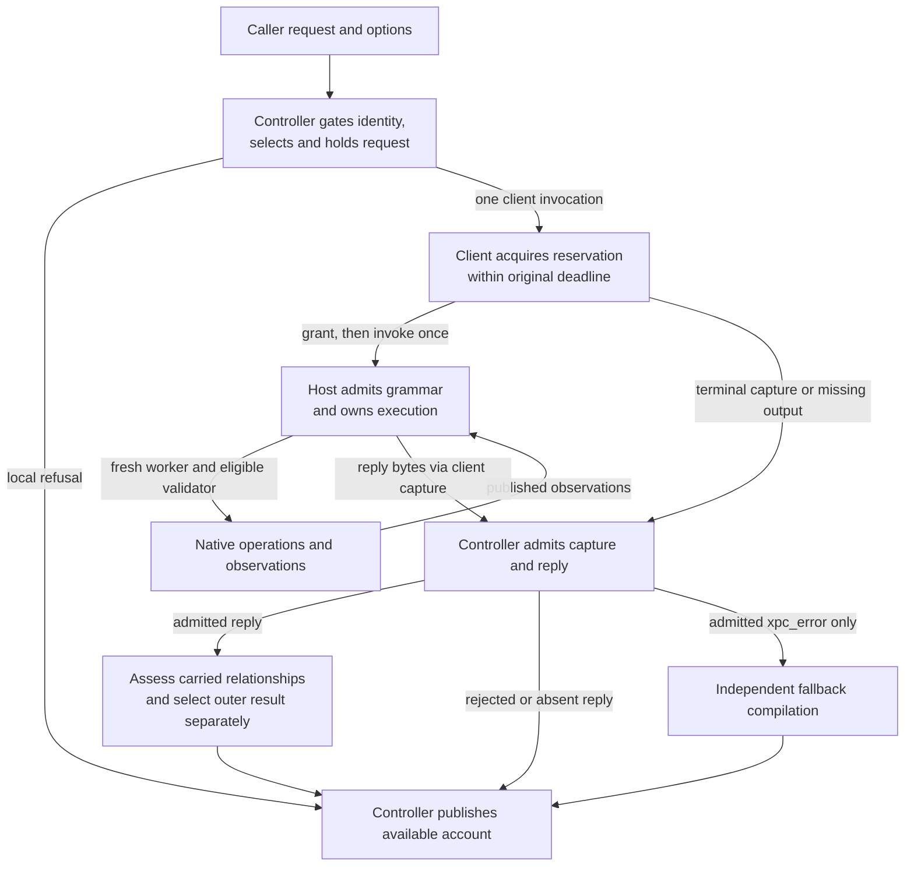

# The Controller: Authority and Evidence

The controller decides what to ask the apparatus to do, admits what comes back,
and publishes an account of the available evidence. It does not apply the
specimen's sandbox or observe its effects directly. Those responsibilities
belong to the host, worker and validator described in the
[architecture tour](ARCHITECTURE.md) and [worker tour](WORKER.md).

This tour follows consequential decisions and the information each needs. The
[public contract](CONTRACT.md) owns field meanings and obligations; the
[controller reference](../controller/README.md) owns CLI usage and the module
map. Source and check citations below explain realization and assertion scope.
Reading an assertion is not evidence that it executed, and a constructed
receiver input does not establish that a native producer emits it.

## Authority and limits

Product responsibility and operating-system privilege are different. A caller
supplies a request and options; the controller's compiled contract identity
constrains which request it accepts. Packaged metadata and the external-runner
registry constrain equipment selection. Filesystem permissions, code signing,
launchd and connection authorization constrain what can actually be done.
A selected path or recorded entitlement is an observation about equipment,
not proof of a live process's effective sandbox authority.

The controller launches a client, not the sandboxed worker. The client owns
reservation acquisition and submission. The host admits the full grammar,
creates fresh workers and validators, coordinates collection before release,
and owns native child cleanup. Workers apply policy and attempt operations;
validators query waiting workers. The controller cannot replace any of these
observations with its own success flag. In particular, a failed operation or
signal alone does not establish sandbox cause, and `query_first` does not
assert agreement between prediction and enforcement.

The following authored diagram summarizes control and evidence flow. Its
arrows name transfers or decisions, not proof that requested effects occurred.
The source routes and checking scopes appear in the sections below; this is
not a generated architecture inventory.

## Originating and preparing work

`example` originates a build-defined specimen. In
[example.rs](../controller/src/example.rs), `render` inserts the compiled
identity, uses the request parser and identity gate, serializes the whole
object and appends one newline. `emit` writes only after rendering and requires
a successful flush. It reads no request, app manifest or registry and launches
nothing. Exit 0 promises that the emitted specimen is admitted by the same
build's `run`, not that an attempted operation succeeds. The host still owns
full grammar admission. The
[emission rule](CONTRACT.md#contract-request-specimen-emit_example) and its
extracted example preserve that separation. The documentation extractor reads
the source constant; documentation does not supply runtime example content.
Version dispatch likewise reports compiled identity without executing work.

For saved specimens, [run_flow.rs](../controller/src/run_flow.rs) holds the
request text and parsed value. Its identity gate precedes interpretation of
selectors and augments. This is not a promise of no earlier environment reads:
host facts, app-root resolution and the manifest attempt occur before request
admission. Missing/unreadable input is a tool failure; malformed JSON or an
unsupported request identity is a structured request refusal. Neither invokes
the client. The host's separate capacity and meaning admission can refuse an
otherwise prepared request before launching a worker.

[runner_select.rs](../controller/src/runner_select.rs) validates supplied
selectors, including shadowed aliases, before applying fieldwise precedence.
[augments.rs](../controller/src/augments.rs) validates names and reads packaged
fragments in order, resolving policies in memory. Selection is computed before
augmentation, but its error is returned after available dossier collection and
wins over an augmentation error. Actor policies are visited in request order;
this preparation does not decide whether a carried policy is valid for its
actor's sandbox mode.

The controller removes its selection fields and serializes the selected value
once. That held string supplies the client and eligible whole-request fallback;
actor fallback inputs come from held policy objects. It neither rewrites nor
rereads the caller file to prepare those invocations. In `run_flow.rs`,
`emitted_example_reaches_the_client_as_the_emitted_document` asserts exact
callback equality to emitted bytes minus the framing newline, with one callback
and an unchanged file. This is a constructed dependency test under a test
identity. The signed-app
[round-trip checker](../tests/suites/witness_contract/check_example_round_trip.py)
compares the pipe's accepted byte count with prepared length: that is not an
exact-byte observation at the pipe or proof of host receipt.

[dossier.rs](../controller/src/dossier.rs) records selected source and available
binary provenance. The import scan in
[sbpl_imports.rs](../controller/src/sbpl_imports.rs) observes a bounded literal
closure through separate filesystem reads; it is not a frozen filesystem image
or proof of the native compiler's later imports. Dossier mismatches retain
information without becoming selection refusals. Held source hashes identify
decoded source strings, not the original JSON file bytes. The
[dossier rules](CONTRACT.md#contract-dossier-collection) distinguish those scopes.

## Selecting and directing the apparatus

Built-in selection uses the manifest's fixed service entry. External selection
uses the registry, refuses pending installations for ordinary runs, and checks
protocol compatibility. Required controller-level entitlement keys are checked
against the selected worker's Boolean-true read-back, not the host's keys.
Neither route reads an Info.plist to rediscover the service name. These are
preflight metadata checks; the host's actor equipment binding and live signing
inspection remain separate obligations.

The [run inventory](../controller/README.md#what-a-run-reads-and-launches)
describes environmental inputs and launches. `RunDependencies` in `run_flow.rs`
exposes app root, manifest load, registry, client and compiler boundaries to
constructed orchestration controls. Counts of callback invocations establish
those controlled routes, not absence of every possible operating-system read.
Direct XPC callers still face host admission; they cannot delegate unresolved
controller options to it. Standalone `sbpl-check` has its own helper admission
and performs compilation without running the specimen.

## Invocation and uncertainty

[runner_client.rs](../controller/src/runner_client.rs) creates the absolute
continuous deadline before helper resolution, spawn and stdin delivery. The
[Swift session](../runner/Clients/PWRunnerClient/PWRunnerClientSession.swift)
may reconnect while acquiring an effect-free reservation. Immediately before
submission it resamples the original deadline and marks the execution selector
invoked. Submission ends acquisition permanently. A lost execution reply,
timeout or refusal cannot re-enter the acquisition loop or replay execution.

An admitted `invoked` record establishes selector invocation, not host receipt,
grammar acceptance or an effect. A complete admitted capture is needed to use
`not_invoked`; missing or rejected capture leaves submission unknown. The
host-reported PID and instance are peer observations, not independent kernel
generation identity. [Transport rules](CONTRACT.md#contract-transport-delivery)
keep these distinctions separate from connection authorization.

The controller owns the helper process and pipes through
[utils.rs](../controller/src/utils.rs). Successful stdin writes count bytes
accepted by the pipe. They do not establish that the client read those bytes.
The controller drains output and waits without its own independent receiver
deadline, so the nominal RPC allowance is not a total command-return bound.
Wall-clock start/end timestamps remain raw observations, even if they reverse;
they are not substitutes for the continuous deadline.

Known gap: after submission, effects can occur without a usable reply or
public envelope. There is no durable per-run result retrieval or safe replay
protocol. The client's once-only state machine bounds its own submission;
it cannot make a later caller's retry safe or undo an earlier effect.

## Receiving and evaluating evidence

Admission proceeds in order: request-delivery failure, client retention and
framing, client producer and capture semantics, complete host framing and
producer, then decoded geometry and profile-receipt context. Delivery failure
wins even when output was captured. Unsupported or malformed bytes retain
transport diagnostics but supply no semantic submission or host claims.
Decoded records refused by a later gate can remain in the envelope while
execution diagnostics are withheld. The
[admission rules](CONTRACT.md#contract-envelope-data-admit),
[wire contract](CONTRACT.md#contract-wire-frame-admit), and
`run_flow::admit_reply` describe these distinct gates.

After those gates, [porcelain_admission.rs](../controller/src/porcelain_admission.rs)
checks lifecycle claims against carried native references, phase collection and
policy delivery evidence. [porcelain_native.rs](../controller/src/porcelain_native.rs)
checks fresh-I/O and exec relationships;
[porcelain_actor.rs](../controller/src/porcelain_actor.rs) checks actor setup,
application, equipment, gates, owned reap and extension custody. Those
relationships do not make every native return equally informative: an old
`open_read` success establishes opening, while fresh-read records carry their
own returned-byte observations. Missing publication does not prove absence of
a native effect. The controller neither gathers external log candidates on
this run path nor converts permission-shaped errors into sandbox attribution.

These readers take the carried reply, not the original request. Their joins
establish relationships within that account. The host owns its assembly from
the prepared request. The profile receipt's
[label check](CONTRACT.md#contract-profile-receipt-labels), for example, checks
status/producer/stage context; it does not independently compare a requested
nonce or revalidate captured bytecode. A consumer needs separately retained
request operands to make such a comparison.

Current actor diagnostics first select actions through carried actor labels
and each matching phase's action IDs, then assess each carried subprocess. Worker-local
lifecycle failures withhold that projection. Later reply-wide findings withhold
the aggregate and retain separately computed actor rows. A retained local
`clean_exit` does not override a finding against its launch PID, identity or
action membership, or independently establish attribution to the requested
actor. The constructed
`typed_invalid_actor_account_keeps_independent_actor_endings` assertion in
`porcelain_admission.rs` tests retention with an invalid account; it does not
establish sound attribution under every possible association failure.

Reporting failure follows another branch. The host attempts a rich fallback
retaining observations and removing comparisons, then a minimal report if it
cannot preserve the evidence. The controller checks degraded markers, summary
and retention form, with geometry/profile context still applicable. It does
not run ordinary actor/phase association checks in that branch; worker-local
lifecycle checks still apply. `typed_degradation_never_certifies_surviving_comparison`
tests rejection of a retained comparison and acceptance after its removal.
Retaining inconsistent material does not certify the joins that failed, and
minimal evidence loss does not mean no effect occurred.

The public contract retains these scoped actor projections and degraded-form
checks. It does not promise stronger actor attribution or ordinary association
certification. The definitions of
[withholding scope](CONTRACT.md#contract-diagnostics-issue-subject-withholding_scope)
and [degraded associations](CONTRACT.md#contract-reply-failure-associations)
keep those limits beside the preservation rules.

## Selecting a result and publishing it

`run_flow::complete_execution` computes diagnostics and selects the outer result
separately. For an admitted reply, exact `finished` selects true/0; other
outcomes select false/1. Earlier admission and delivery failures follow their
own refusal paths. An unsuccessful attempt can belong to a finished experiment;
controller integrity findings can also coexist with that current
[success mapping](CONTRACT.md#contract-envelope-data-success_findings).
`typed_completion_preserves_native_failure_beside_finished_summary`
and `malformed_phase_claims_withhold_projection_and_preserve_raw_reply` are
constructed controls of these separate operations, not observations that a
native host spontaneously emits every tested contradiction.

Fallback compilation is eligible only after an admitted client terminal
`xpc_error` and successful request delivery. It checks the held whole request
and separately checks each carried actor policy object in request order,
before host mode admission is known. `actor_fallback_uses_held_policy_objects_before_host_mode_admission`
in `run_flow.rs` pins that distinction. The helper capture retains identity,
parsing, exit and outcome evidence separately. This independent compilation
establishes neither worker progress nor the cause of a lost reply.

[consumer.py](../tests/lib/consumer.py), through `admitted_reply` and
`_validate_result`, independently reads complete captured host bytes and checks
outer outcome, exact Boolean success and exact integer exit. Its applicability
does not depend on the result fields it checks or the presence of controller
diagnostics. An unrelated record fault does not excuse a result mismatch.
The [checker controls](../tests/suites/blackbox_e2e/checker_controls.py) mutate
these fields and admission prerequisites using independently specified
expectations. Such constructed checks test interpretation, not native production.
Actual process exit is a separate capture observation from reported exit code.

Known gap: this Python consumer does not reproduce the controller's collection
capacity gate. Its result comparison assumes replies within that domain; a
capacity-only controller refusal is outside its intended reading scope.
Reader agreement cannot be generalized to all possible inputs.

Current `unconfirmed` also merges unresolved and inapplicable final status while
retaining the host's raw distinction. The definitions of
[vocabulary](CONTRACT.md#contract-diagnostics-execution-vocabulary-vocabulary_choice)
and [classifier maintenance](CONTRACT.md#contract-diagnostics-execution-reader_evidence-classifier_generation)
retain that vocabulary and separately authored semantic classifiers. Their
agreement is checked within stated scopes; no generated shared classifier or
universal equivalence is promised.

General envelopes are rendered before `println!` in
[json_contract.rs](../controller/src/json_contract.rs) and run dispatch; these
paths do not implement the example command's explicit fallible write/flush
protocol. For `example`, complete-looking JSON is unusable on exit 2, including
a late flush failure. `only_complete_output_with_a_successful_flush_succeeds`
in `example.rs` tests that case with an injected writer. Neither publication
path establishes downstream receipt or durable storage. Interrupted output
can follow effects; stderr is a human diagnostic, not a replacement protocol.

## Equipment administration and recovery

Runner commands have machine-state responsibilities distinct from executing a
specimen. [runner_commands.rs](../controller/src/runner_commands.rs) dispatches
these operations; [runner_manager.rs](../controller/src/runner_manager.rs) owns
registry publication, signing/read-back and service/plist inspection. The
[installation contract](CONTRACT.md#contract-installation-commands) defines the
command-specific meanings; the [external-runner guide](PolicyWitness.md#external-runners-byoxpc)
provides the operating workflow.

A modifier holds the stable sibling advisory lock across registry changes and
launchd actions. Publication validates lossless read-back, writes and syncs a
same-directory temporary file, then renames it. This prevents partial registry
publication, not a transaction encompassing signing, filesystem and launchd.
Installation may sign the supplied bundle before durable pending publication;
those effects need not await a successful stdout response. Pending ownership
is saved before plist creation/bootstrap, and later failures retain recovery.
Read-only commands can see a complete prior or replacement registry.

Selection reads recorded metadata. Reconcile observes current service/plist
state without changing it. A candidate name or label prefix grants no cleanup
authority. Removal needs durable ownership plus separate current service and
plist checks; it saves pending cleanup before actions and rechecks the plist
before unlink. Unknown inspection is not absence. Retirement requires observed
service and plist absence, no warnings and successful registry publication.
A completed remove can therefore retain cleanup; a completed validate can
report invalid or missing equipment. Their success flags do not erase those
facts. Recovery records persist beyond controller exit and lost output.

Verify originates its own allow-default, empty-plan request, uses the shared
client/admission path and leaves the registry unchanged. It can explicitly
verify a pending record. Its admitted `runner_pid` copies the host report's PID,
which can denote host or worker according to that report's lifecycle; it is not
an unconditional worker identity receipt. Successful verification is scoped to
this apply-only exchange, not all future operations or authority conditions.

## Resources and lifetimes

| Held resource or observation | Owner and lifetime | What holding it does not establish |
| --- | --- | --- |
| Parsed request, selected source, serialization and actor policy copies | Controller memory through preparation, invocation and eligible fallback | Immutable import files or host receipt |
| Manifest/registry metadata, selected binary hashes and host facts | Controller snapshots from their respective reads | Live process identity or unchanged external state |
| Client child, stdin writer and output pipes | Controller drains output, joins delivery and waits for the helper | Cancellation of host work or total-time bound |
| Retained client/host bytes, typed records and public projection | Controller preserves admitted and rejected material at their stated boundaries through rendering | Semantic authority for rejected records or downstream persistence |
| Continuous deadline and wall-clock timestamps | Controller creates deadline; client enforces it; wall readings remain raw | Equivalent clock meanings or replay safety |
| Registry lock and temporary publication file | Modifier owns lock through machine actions/publication | Atomicity of every external operation |
| Pending installation/cleanup records | Durable registry state survives process/output failure until qualified retirement | Current resource absence merely because an action returned success |
| Worker shared mappings, authority regions and child cleanup | Host/worker apparatus owns them, not the controller | Controller permission to erase or unlink named native resources |

Full child output is collected before retained prefixes are capped. The caps
therefore bound retained reports, not peak allocation. Multiple eligible actor
fallbacks can accumulate reports before host actor-capacity admission. Exact
capacities and their consequences belong to [LIMITS](LIMITS.md); storage and
native resource teardown belong to [FOOTPRINT](FOOTPRINT.md).

## Changes that alter what can be promised

Moving a gate changes which bytes acquire meaning and which failure takes
precedence. Rereading a caller file or sharing a semantic classifier changes
which observations are independent. Moving output or cleanup publication across
a machine action changes what survives failure. Stronger request binding,
actor attribution, successful-result certification or durable output promises
need the missing operands or mechanisms as well as independently expected
controls; a new sentence alone cannot supply them.

The implementation and checks above support different levels of claim.
Source inspection identifies owners and branches. Controlled callbacks,
constructed replies and injected writers establish their asserted boundaries
when executed. A native example round trip observes one selected build and
machine execution, including process status and reported native evidence; it
does not establish lost-reply, degraded-association, cleanup-race or universal
reader behavior. No historical execution count is part of this tour's support.

## Known gaps

- [Invocation and uncertainty](#invocation-and-uncertainty): lost replies and
  output do not establish nonexecution; no durable retrieval or safe replay.
- [Selecting a result and publishing it](#selecting-a-result-and-publishing-it):
  the independent consumer excludes controller capacity-only refusals from its
  intended reading domain.
