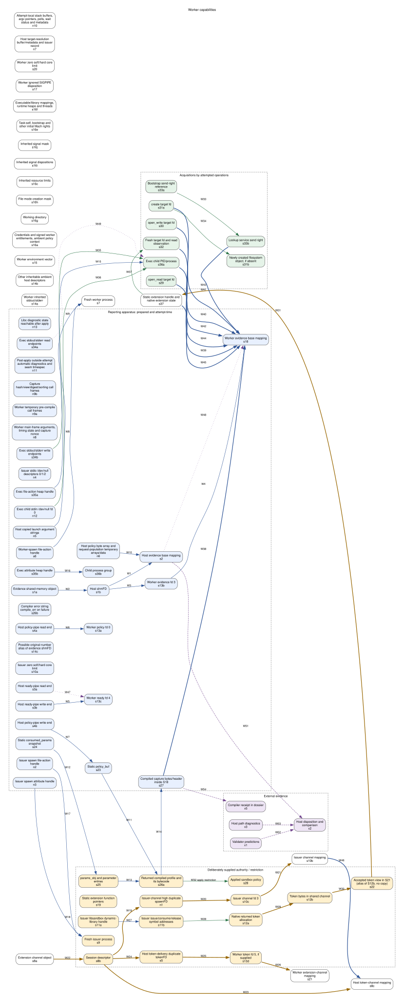

# The Worker: Instrument and Constraints

A worker must keep reporting under the policy it is testing while leaving the
requested operations exposed to that policy. PolicyWitness prepares its report
storage before application, then opens file targets, looks up Mach services and
creates exec resources inside the attempts. Moving a target open across that
boundary changes the experiment: a later read would exercise an already held
descriptor, with the authority that acquiring it supplied.

The boundary is policy application inside a running process. The executable,
libraries, memory and process context are already present. A fresh worker
applies one specimen once; its later phases share that process and can observe
effects of earlier actions. The unsandboxed host arranges queries, collects
publications and replies. This tour explains the resources and constraints of
that instrument. The [architecture tour](ARCHITECTURE.md) owns orchestration
and ordering; the [build tour](BUILD.md) owns compilation and provenance;
the [evidence contract](../tests/FAILURE-PROPAGATION-CONTRACT.md#worker-evidence-contract)
owns the meaning of its records.

## Capability map

The figure and expandable inventory are generated from
[architecture.json](architecture.json). Each S/N node preserves a resource
entry; X nodes represent external evidence. The facts distinguish an object
from its descriptors, mappings and borrowed views. The host and worker can
map the same object while retaining different references and lifetimes.

Blue nodes are reporting apparatus, including exec reporting resources acquired
inside an attempt. Gold nodes represent deliberately supplied authority,
restriction or the API/compiler resources used to exercise them. Green nodes
are acquisitions by attempted operations. Purple nodes hold evidence assembled
outside the worker. White nodes have multiple roles or form the ambient
execution substrate: the fresh worker, inherited state, token mappings that
also carry metadata, extension state acquired during a requested action, and
shared working storage. Starting credentials and policy context remain outside
the supplied-authority cluster because part of that context is ambient.

Blue solid edges prepare resources; blue bold edges publish observations.
Gold bold edges deliver authority-bearing objects; green edges exercise a
resource, including applying a restriction. Purple dotted edges observe and
purple dashed edges join evidence. The application boundary is the applied-policy
node and the acquisition periods in the inventory. The token channel and
reporting mapping are separate. Validator predictions join host evidence
outside the worker; the host's release ordinal controls admission to attempts.
The edges select relationships among the inventoried resources. Some nodes,
including ambient state and temporary storage, stand without a drawn
observation path. Open the SVG at its native size to read the complete map.

In the table, H is the host, W the worker, E the host's extension session and I
the issuer. P means reporting apparatus, A supplied authority or restriction,
and O operation acquisitions. [L](#launch-observation-l) identifies a recorded
production launch observation and its applicability;
IC and CLI are the contaminated-worker and ordinary exec-child controls in the
[inheritance suite](../tests/suites/runner_exec_inheritance/README.md).
Acquisition periods record call-site placement, including outputs acquired on
compilation return. Check citations name the particular assertion supporting a
fact; other implementation details retain source-only support. Policy-specific
outcomes belong to their stated specimens and observation conditions. Call-site
completeness is established by source review, not by citation checks.
[Runner guidance](../runner/AGENTS.md#reviewing-a-new-capability) describes the
review procedure. Process
exit reclaims that process's
remaining references; created files and references held by other processes have
their own lifetimes.

<!-- BEGIN GENERATED ARCHITECTURE GRAPH worker_capabilities -->

*Figure: worker capabilities. Generated from [architecture.json](architecture.json) by [generate_architecture.py](generate_architecture.py); dot source in [worker-capabilities.dot](worker-capabilities.dot). Figure IDs correspond to the table IDs. Sources support the implementation account. Check citations state their assertion scope; remaining facts have source support only. The generator checks source-symbol presence, resolves cited definitions and requires nonempty scope text; the relevance of each assertion is reviewed, not mechanically established.*

Worker capabilities: 83 nodes and 54 edges; source-symbol presence and cited definitions checked

#### Worker capabilities nodes

| Id | Node | Kind | Inventory ID | Acquired by | When | Held across | Release / teardown action | Authority | Reaches exec children | Role | Sources | Checks and assertion scope | Limits |
| --- | --- | --- | --- | --- | --- | --- | --- | --- | --- | --- | --- | --- | --- |
| s1a | Evidence shared-memory object | reporting | S1a | H: pw_cworker_shm_open_create, ftruncate | Before compilation | Later phases; last mapping/reference may outlive worker | H requests immediate shm_unlink; injected failure leaves name after teardown | Shared writable input/publication storage | No explicit child reference; see S13b | P | [`runCWorker`](../runner/Sources/PWRunnerCore/CWorker.swift) | [`check`](../tests/suites/runner_unit/host_setup_controls.py) — Setup controls compare requested dup2 destinations with child descriptor metadata, check argv counts and instrumented cleanup; shared-object identity is not established by metadata. |  |
| s1b | Host shmFD | reporting | S1b | H: pw_cworker_shm_open_create; requests FD_CLOEXEC clear without checking return | Before compilation | Through successful worker spawn; host mapping remains through collection | H setup/spawn-failure close, or ownership relinquished and close after transfer deadline starts on successful spawn | Can map/resize the evidence object | Worker receives it; later validators cannot inherit the closed host reference; exec child excludes worker evidence descriptors | P | [`runCWorker`](../runner/Sources/PWRunnerCore/CWorker.swift) | [`check`](../tests/suites/runner_unit/host_setup_controls.py) — Setup controls compare requested dup2 destinations with child descriptor metadata, check argv counts and instrumented cleanup; shared-object identity is not established by metadata.; [`check`](../tests/suites/runner_unit/launch_descriptor_controls.py) — Independent object, descriptor-number reuse and complete-mapping teardown controls; successful worker reporting and reap remain intact. |  |
| s2 | Host evidence base mapping | reporting | S2 | H: mmap, zero/populate/page-touch | Before compilation | Beyond host descriptor close, through collection including after worker exit or unconfirmed cleanup | H defer munmap | Read worker publications; write input/release/exit request | No: exec replaces address space | P | [`runCWorker`](../runner/Sources/PWRunnerCore/CWorker.swift) | [`runCWorkerLifecycleTests`](../runner/Tests/PWRunnerCoreTests/CWorkerLifecycleTests.swift) — Controlled worker publications, ownership, acknowledgement reconciliation and confirmed reap; includes acknowledgement recovered after abnormal exit.; [`check`](../tests/suites/runner_unit/launch_descriptor_controls.py) — Independent object, descriptor-number reuse and complete-mapping teardown controls; successful worker reporting and reap remain intact. |  |
| s3a | Host ready-pipe read end | reporting | S3a | H: pipe; FD_CLOEXEC | Before compilation | Readiness wait only | H after readiness wait or setup/spawn failure | Observe ready byte | No: close-on-exec | P | [`runCWorker`](../runner/Sources/PWRunnerCore/CWorker.swift) | [`check`](../tests/suites/runner_unit/host_setup_controls.py) — Setup controls compare requested dup2 destinations with child descriptor metadata, check argv counts and instrumented cleanup; shared-object identity is not established by metadata. |  |
| s3b | Host ready-pipe write end | reporting | S3b | H: pipe; FD_CLOEXEC | Before compilation | Through worker spawn | H immediately after spawn or failure | Supply worker readiness endpoint | Worker fd 4; child excludes it | P | [`runCWorker`](../runner/Sources/PWRunnerCore/CWorker.swift) | [`check`](../tests/suites/runner_unit/host_setup_controls.py) — Setup controls compare requested dup2 destinations with child descriptor metadata, check argv counts and instrumented cleanup; shared-object identity is not established by metadata. |  |
| s4a | Host policy-pipe read end | reporting | S4a | H: pipe; FD_CLOEXEC | Before compilation | Through worker spawn | H immediately after spawn or failure | Receive policy bytes | Worker fd 0 replaced in exec child | P | [`runCWorker`](../runner/Sources/PWRunnerCore/CWorker.swift) | [`check`](../tests/suites/runner_unit/host_setup_controls.py) — Setup controls compare requested dup2 destinations with child descriptor metadata, check argv counts and instrumented cleanup; shared-object identity is not established by metadata. |  |
| s4b | Host policy-pipe write end | reporting | S4b | H: pipe; F_SETNOSIGPIPE, O_NONBLOCK, FD_CLOEXEC | Before compilation | Through bounded policy transfer | H after transfer or setup/spawn failure | Deliver source and EOF | No: close-on-exec | P | [`runCWorker`](../runner/Sources/PWRunnerCore/CWorker.swift) | [`check`](../tests/suites/runner_unit/host_setup_controls.py) — Setup controls compare requested dup2 destinations with child descriptor metadata, check argv counts and instrumented cleanup; shared-object identity is not established by metadata. |  |
| s5 | Host token-delivery duplicate tokenFD | authority | S5 | H: fcntl(F_DUPFD_CLOEXEC, 64) | Before compilation | Through driver return | H defer close | Duplicate authority-bearing channel | Worker fd 5; exec/extension combination refused | A | [`runCWorker`](../runner/Sources/PWRunnerCore/CWorker.swift) | [`check`](../tests/suites/runner_unit/host_setup_controls.py) — Setup controls compare requested dup2 destinations with child descriptor metadata, check argv counts and instrumented cleanup; shared-object identity is not established by metadata. |  |
| s6 | Worker-spawn file-action handle | reporting | S6 | H: posix_spawn_file_actions_init, adddup2 | Before compilation | Through driver return | H defer destroy | Prescribes worker descriptor table | Handle no; actions determine worker state | P; setup caveat | [`runCWorker`](../runner/Sources/PWRunnerCore/CWorker.swift) | [`check`](../tests/suites/runner_unit/host_setup_controls.py) — Setup controls compare requested dup2 destinations with child descriptor metadata, check argv counts and instrumented cleanup; shared-object identity is not established by metadata. |  |
| s7 | Fresh worker process | mixed | S7 | H: posix_spawn, nil attributes/envp | Before compilation | Until exit; unconfirmed cleanup may outlive driver | Terminal publication: erase accepted token, release done, _exit; early return, cancellation, fatal signal or H termination; H waitpid observes reap | Executes specimen with inherited context and signed identity | It parents exec children; not itself inherited | none (ambient execution substrate) | [`runCWorker`](../runner/Sources/PWRunnerCore/CWorker.swift); [`publish_done_and_exit`](../controller/tools/pw_probe_runner/pw_probe_runner.c) | [`launch_inventory`](../tests/suites/runner_exec_inheritance/run.sh) — Requires identified worker captures, readiness and reap/absence; specific inventory contents are the separately identified observation L.; [`terminal_exit_without_request`](../tests/suites/runner_c_worker_harness/run.sh) — Applied worker publishes done and exits cleanly without a host exit request. |  |
| s8a | Extension channel object | mixed | S8a | E: pw_cworker_shm_open_create, ftruncate | Before compilation | Issuer then worker; through session | E requests shm_unlink; injected failure leaves name after teardown | Holds transferable token and issuer metadata | No admitted exec+extension plan | A + E | [`ExtensionSession`](../runner/Sources/PWRunnerCore/ExtensionIssuer.swift) | [`extension_boundaries`](../tests/suites/witness_contract/run.sh) — Controlled issuer/worker native-call boundaries, delivery/refusal metadata and token confinement; private library allocation internals remain source-only.; [`check`](../tests/suites/runner_unit/host_setup_controls.py) — Setup controls compare requested dup2 destinations with child descriptor metadata, check argv counts and instrumented cleanup; shared-object identity is not established by metadata. |  |
| s8b | Session descriptor | authority | S8b | E: pw_cworker_shm_open_create, FD_CLOEXEC | Before compilation | Through session | E deinit close, including setup-failure returns | Map/duplicate token channel | No: close-on-exec except explicit delivery dup | A | [`ExtensionSession`](../runner/Sources/PWRunnerCore/ExtensionIssuer.swift) | [`check`](../tests/suites/runner_unit/host_setup_controls.py) — Instrumented issuer-session setup controls observe descriptor cleanup; shared-object identity is not established by matching descriptor metadata. |  |
| s8c | Host token-channel mapping | mixed | S8c | E: mmap, zero/header/path writes | Before compilation | Through reply preparation | E erase before reply; deinit erases, unmaps | Read issuance evidence; supply/erase token | No: address space replaced | A + E | [`ExtensionSession`](../runner/Sources/PWRunnerCore/ExtensionIssuer.swift) | [`extension_boundaries`](../tests/suites/witness_contract/run.sh) — Controlled issuer/worker native-call boundaries, delivery/refusal metadata and token confinement; private library allocation internals remain source-only. |  |
| s9 | Fresh issuer process | authority | S9 | E: posix_spawn with CLOEXEC_DEFAULT, nil envp | Before compilation | Until issuer exit; delivery requires confirmed clean reap | I return; E wait/terminate | Ordinary signed issuer authority for file token issuance | No: sibling, reaped before worker delivery | A | [`ExtensionSession`](../runner/Sources/PWRunnerCore/ExtensionIssuer.swift) | [`extension_boundaries`](../tests/suites/witness_contract/run.sh) — Controlled issuer/worker native-call boundaries, delivery/refusal metadata and token confinement; private library allocation internals remain source-only. |  |
| s10a | Issuer zero soft/hard core limit | reporting | S10a | I: setrlimit(RLIMIT_CORE) | Before compilation | Until issuer exit | Exit; failure returns before mapping | Restricts core-dump production | No: issuer creates no exec child | P | [`main`](../controller/tools/pw_probe_runner/pw_extension_issuer.c) | [`extension_boundaries`](../tests/suites/witness_contract/run.sh) — Controlled issuer/worker native-call boundaries, delivery/refusal metadata and token confinement; private library allocation internals remain source-only. |  |
| s10b | Issuer channel mapping | mixed | S10b | I: mmap from fd 3 | Before compilation | Until publication/exit | Normal munmap; malformed header exits without explicit unmap | Write token and issuance metadata | No child | A + E | [`main`](../controller/tools/pw_probe_runner/pw_extension_issuer.c) | [`extension_boundaries`](../tests/suites/witness_contract/run.sh) — Controlled issuer/worker native-call boundaries, delivery/refusal metadata and token confinement; private library allocation internals remain source-only. |  |
| s10c | Issuer channel fd 3 | authority | S10c | E adddup2, received by I | Before compilation | Through I mapping attempt | I close(3) after mmap; earlier errors leave to exit | Map channel | No child | A | [`ExtensionSession`](../runner/Sources/PWRunnerCore/ExtensionIssuer.swift) | [`extension_boundaries`](../tests/suites/witness_contract/run.sh) — Controlled issuer/worker native-call boundaries, delivery/refusal metadata and token confinement; private library allocation internals remain source-only. |  |
| s11a | Issuer libsandbox dynamic- library handle | authority | S11a | I: dlopen(RTLD_NOW \| RTLD_LOCAL) | Before compilation | Until exit; no explicit dlclose | Loader/process teardown; internals unobserved | Makes private issuance API callable, not an entitlement grant | No child | A | [`main`](../controller/tools/pw_probe_runner/pw_extension_issuer.c) | [`extension_boundaries`](../tests/suites/witness_contract/run.sh) — Controlled issuer/worker native-call boundaries, delivery/refusal metadata and token confinement; private library allocation internals remain source-only. |  |
| s11b | Issuer issue/consume/release symbol addresses | authority | S11b | I: three dlsym calls | Before compilation | Issuance check/call; loader image remains | Automatic values end with I; no independent handle release | API entry points; consume/release are checked, not invoked | No child | A | [`main`](../controller/tools/pw_probe_runner/pw_extension_issuer.c) | [`extension_boundaries`](../tests/suites/witness_contract/run.sh) — Controlled issuer/worker native-call boundaries, delivery/refusal metadata and token confinement; private library allocation internals remain source-only. |  |
| s12a | Native returned token allocation | authority | S12a | I: sandbox_extension_issue_file | Before compilation | Copy/reject decision only | I bounded erase then free; oversized tail caveat | Bearer bytes for native extension consumption | No: issuer storage not inherited | A | [`main`](../controller/tools/pw_probe_runner/pw_extension_issuer.c) | [`extension_boundaries`](../tests/suites/witness_contract/run.sh) — Controlled issuer/worker native-call boundaries, delivery/refusal metadata and token confinement; private library allocation internals remain source-only. |  |
| s12b | Token bytes in shared channel | authority | S12b | I: memcpy on bounded accepted token | Before compilation | Until worker consume decision or ordinary departure after channel acceptance; earlier mapping/header refusals leave erasure to the host; host erasure is independent; fatal interruption may bypass worker cleanup | Worker full-buffer erasure in S22; independent host erasure in S8c | Transferable extension token | No admitted exec+extension plan | A | [`main`](../controller/tools/pw_probe_runner/pw_extension_issuer.c); [`erase_accepted_token`](../controller/tools/pw_probe_runner/pw_probe_runner.c) | [`extension_boundaries`](../tests/suites/witness_contract/run.sh) — Controlled issuer/worker native-call boundaries, delivery/refusal metadata and token confinement; private library allocation internals remain source-only.; [`terminal_erasure`](../tests/suites/runner_c_worker_harness/run.sh) — Independent full-capacity and publication-boundary observations reject shortened or late erasure, including refusal paths. |  |
| s13a | Worker policy fd 0 | reporting | S13a | H adddup2(policyPipe[0], 0); W default policy fd | Before compilation | Later attempts and phases, until exit | No W close; exit | Read remaining policy stream; normally EOF after source receipt | No: child addopen replaces stdin | P, retained after use | [`runCWorker`](../runner/Sources/PWRunnerCore/CWorker.swift) | [`launch_inventory`](../tests/suites/runner_exec_inheritance/run.sh) — Requires identified worker captures, readiness and reap/absence; specific inventory contents are the separately identified observation L. |  |
| s13b | Worker evidence fd 3 | reporting | S13b | H requests adddup2(shmFD, 3); low-fd collision can substitute policy pipe | Before compilation | Later attempts and phases, until exit | No W close; exit | Map backing object separately from existing mapping | No: child CLOEXEC_DEFAULT | P | [`runCWorker`](../runner/Sources/PWRunnerCore/CWorker.swift) | [`launch_inventory`](../tests/suites/runner_exec_inheritance/run.sh) — Requires identified worker captures, readiness and reap/absence; specific inventory contents are the separately identified observation L.; [`check`](../tests/suites/runner_unit/host_setup_controls.py) — Setup controls compare requested dup2 destinations with child descriptor metadata, check argv counts and instrumented cleanup; shared-object identity is not established by metadata. |  |
| s13c | Worker ready fd 4 | reporting | S13c | H requests adddup2(readyPipe[1], 4); self-dup control leaves fd absent | Before compilation | Later attempts and phases, until exit | No W close; exit | Write readiness pipe; host later closes reader | No: child CLOEXEC_DEFAULT | P | [`runCWorker`](../runner/Sources/PWRunnerCore/CWorker.swift) | [`launch_inventory`](../tests/suites/runner_exec_inheritance/run.sh) — Requires identified worker captures, readiness and reap/absence; specific inventory contents are the separately identified observation L.; [`check`](../tests/suites/runner_unit/host_setup_controls.py) — Setup controls compare requested dup2 destinations with child descriptor metadata, check argv counts and instrumented cleanup; shared-object identity is not established by metadata. |  |
| s13d | Worker token fd 5, if supplied | authority | S13d | H requests adddup2(tokenFD, 5); failed action can still spawn | Before compilation | Through extension preparation | prepare_extension closes once; early main refusals leave to exit | Map token channel | No admitted exec+extension plan; child flags would exclude it | A | [`runCWorker`](../runner/Sources/PWRunnerCore/CWorker.swift) | [`extension_boundaries`](../tests/suites/witness_contract/run.sh) — Controlled issuer/worker native-call boundaries, delivery/refusal metadata and token confinement; private library allocation internals remain source-only.; [`check`](../tests/suites/runner_unit/host_setup_controls.py) — Setup controls compare requested dup2 destinations with child descriptor metadata, check argv counts and instrumented cleanup; shared-object identity is not established by metadata. |  |
| s14a | Worker inherited stdout/stderr | mixed | S14a | H spawn, without replacement file actions | Before compilation | Until exit | Exit; no explicit W close | Whatever underlying endpoints allow; L saw read/write /dev/null | No: exec-child capture pipes replace 1/2 | none | [`runCWorker`](../runner/Sources/PWRunnerCore/CWorker.swift) | [`launch_inventory`](../tests/suites/runner_exec_inheritance/run.sh) — Requires identified worker captures, readiness and reap/absence; specific inventory contents are the separately identified observation L. |  |
| s14b | Other inheritable ambient host descriptors | mixed | S14b | H spawn without CLOEXEC_DEFAULT | Before compilation | Until exit unless a file action overwrites number | No generic W sweep; exit | Depends on inherited objects | No: exec-child CLOEXEC_DEFAULT; IC/CLI test child isolation | none | [`runCWorker`](../runner/Sources/PWRunnerCore/CWorker.swift) | [`contaminated_worker`](../tests/suites/runner_exec_inheritance/run.sh) — Independent observer receives the canary descriptor/environment in the worker adapter and excludes them from exec children; checks child stdio and stdin EOF. |  |
| s14c | Possible original-number alias of evidence shmFD | reporting | S14c | H clears FD_CLOEXEC and duplicates to 3 without closing source | Before compilation | Until worker exit if original number survives file actions; closing the host descriptor does not remove this child reference | No generic W sweep; exit | Same evidence object as S13b, not a second object | No: exec-child CLOEXEC_DEFAULT | P | [`runCWorker`](../runner/Sources/PWRunnerCore/CWorker.swift) | Source only; no assertion cited |  |
| s15 | Worker environment vector | mixed | S15 | H posix_spawn(..., nil) | Before compilation | Until exit | Process teardown | No entries observed; potential environment-dependent behavior is source-scoped | No: explicit {NULL} child env; IC/CLI test this boundary | none | [`runCWorker`](../runner/Sources/PWRunnerCore/CWorker.swift) | [`launch_inventory`](../tests/suites/runner_exec_inheritance/run.sh) — Requires identified worker captures, readiness and reap/absence; specific inventory contents are the separately identified observation L. |  |
| s16a | Credentials and signed worker entitlements, ambient policy context | mixed | S16a | Kernel/loader at H spawn; controller checks required keys | Before compilation | Until exit; SBPL/extension interventions alter effective access | Exit, not a PW reset | Starting access and restrictions; built-in manifest has empty entitlements | Credentials/policy inherit subject to exec semantics; child signature supplies own entitlements | Supplied entitlements plus ambient authority/restrictions; mixed starting substrate | [`runCWorker`](../runner/Sources/PWRunnerCore/CWorker.swift); [`enforce_required_entitlements`](../controller/src/runner_select.rs) | Source only; no assertion cited |  |
| s16g | Working directory | mixed | S16g | Received at H spawn; no PW reset | Before compilation | Later attempts/phases, until exit | Exit | Relative file-target resolution | Yes, no chdir action | none | [`runCWorker`](../runner/Sources/PWRunnerCore/CWorker.swift) | [`launch_inventory`](../tests/suites/runner_exec_inheritance/run.sh) — Requires identified worker captures, readiness and reap/absence; specific inventory contents are the separately identified observation L. |  |
| s16h | File-mode creation mask | mixed | S16h | Received at H spawn; no PW reset | Before compilation | Later attempts/phases, until exit | Exit | Reduces requested creation mode | Yes, no umask action | none | [`runCWorker`](../runner/Sources/PWRunnerCore/CWorker.swift) | Source only; no assertion cited |  |
| s16c | Inherited resource limits | mixed | S16c | Received at H spawn | Before compilation | Until exit, except extension core-limit intervention | Exit; S20 changes core limit | Caps allocation, files, core, processes etc. | Yes by spawn inheritance; public extension/exec exclusion applies | none | [`runCWorker`](../runner/Sources/PWRunnerCore/CWorker.swift) | Source only; no assertion cited |  |
| s16i | Inherited signal dispositions | mixed | S16i | Received at H spawn, nil attributes | Before compilation | Until exit except S17 | W changes SIGPIPE only | Affects fatal delivery and ignored signals | Ignored dispositions persist, caught handlers reset by exec | none | [`runCWorker`](../runner/Sources/PWRunnerCore/CWorker.swift) | Source only; no assertion cited |  |
| s16j | Inherited signal mask | mixed | S16j | Received at H spawn, nil attributes | Before compilation | Until exit | No PW reset | Controls blocked signal delivery | Yes, no SETSIGMASK | none | [`runCWorker`](../runner/Sources/PWRunnerCore/CWorker.swift) | Source only; no assertion cited |  |
| s16e | Task-self, bootstrap and other initial Mach rights | mixed | S16e | Kernel/runtime initialization at spawn | Before compilation | Until exit or library changes | No PW general release; full live right census unavailable | Task/IPC authority, bootstrap namespace access | Special-port inheritance/native exec rules; exact set unknown | none | [`runCWorker`](../runner/Sources/PWRunnerCore/CWorker.swift) | [`launch_inventory`](../tests/suites/runner_exec_inheritance/run.sh) — Requires identified worker captures, readiness and reap/absence; specific inventory contents are the separately identified observation L. |  |
| s16f | Executable/library mappings, runtime heaps and threads | mixed | S16f | Loader/runtime creates new image at H spawn; later library calls | Before compilation initially; later internal changes unknown | Until exit or library release | Native runtime; no PW census/teardown | Executable code, storage and runtime service access | Not the same mappings/threads: exec loads a new image | none | [`runCWorker`](../runner/Sources/PWRunnerCore/CWorker.swift) | [`launch_inventory`](../tests/suites/runner_exec_inheritance/run.sh) — Requires identified worker captures, readiness and reap/absence; specific inventory contents are the separately identified observation L. |  |
| s17 | Worker ignored SIGPIPE disposition | mixed | S17 | W: signal(SIGPIPE, SIG_IGN) | Before compilation | All attempts/phases, until exit | No reset | Survive broken ready-pipe write; also changes exec-child behavior | Yes: no SETSIGDEF; no dedicated live signal control | P + effect on O | [`main`](../controller/tools/pw_probe_runner/pw_probe_runner.c) | [`launch_inventory`](../tests/suites/runner_exec_inheritance/run.sh) — Pre-ready hold requires readiness errno EPIPE followed by clean worker completion and confirmed reap. |  |
| s18 | Worker evidence base mapping | reporting | S18 | map_region: fstat, mmap(MAP_SHARED) | Before compilation | Later attempts/phases, until exit | No explicit W unmap; exit | Read requests, publish results, observe release/exit | No: exec replaces mappings and excludes fd 3 | P | [`map_region`](../controller/tools/pw_probe_runner/pw_probe_runner.c) | Source only; no assertion cited |  |
| s19 | Static extension function pointers | authority | S19 | prepare_extension: dlsym(RTLD_DEFAULT) | Before compilation | Later attempts/phases, until exit | Static storage at exit; no dynamic handle acquired here | Callable native consume/release, no pre-apply consumption | No admitted combination; pointer storage not inherited across exec | A | [`prepare_extension`](../controller/tools/pw_probe_runner/pw_probe_runner.c) | [`extension_boundaries`](../tests/suites/witness_contract/run.sh) — Controlled issuer/worker native-call boundaries, delivery/refusal metadata and token confinement; private library allocation internals remain source-only. |  |
| s20 | Worker zero soft/hard core limit | mixed | S20 | prepare_extension: setrlimit(RLIMIT_CORE) after symbols resolve | Before compilation | All later attempts/phases, until exit if call succeeds | No reset; exit | Restricts core dumping; missing symbols/setup failure qualify it | No admitted exec with extension; hypothetical ABI child would inherit | P + process context | [`prepare_extension`](../controller/tools/pw_probe_runner/pw_probe_runner.c) | [`extension_boundaries`](../tests/suites/witness_contract/run.sh) — Controlled issuer/worker native-call boundaries, delivery/refusal metadata and token confinement; private library allocation internals remain source-only. |  |
| s21 | Worker extension-channel mapping | mixed | S21 | prepare_extension: mmap(MAP_SHARED) | Before compilation | Accepted mapping until exit, including after erase | Rejected mapping: erase/munmap; accepted: no explicit unmap | Read/erase token and inspect channel admission metadata | No admitted combination; address space replaced on exec | A + P | [`prepare_extension`](../controller/tools/pw_probe_runner/pw_probe_runner.c) | [`extension_boundaries`](../tests/suites/witness_contract/run.sh) — Controlled issuer/worker native-call boundaries, delivery/refusal metadata and token confinement; private library allocation internals remain source-only. |  |
| s22 | Accepted token view in S21 (alias of S12b, no copy) | authority | S22 | prepare_extension: length/NUL/header inspection | Before compilation | Until consume decision or ordinary departure after acceptance; fatal interruption may bypass cleanup | Full-buffer erase before done, early return or cancellation exit; no native release; separate host erasure remains | Consumable bearer token; validation does not consume it | No admitted combination | A | [`prepare_extension`](../controller/tools/pw_probe_runner/pw_probe_runner.c); [`erase_accepted_token`](../controller/tools/pw_probe_runner/pw_probe_runner.c); [`publish_done_and_exit`](../controller/tools/pw_probe_runner/pw_probe_runner.c) | [`extension_boundaries`](../tests/suites/witness_contract/run.sh) — Controlled issuer/worker native-call boundaries, delivery/refusal metadata and token confinement; private library allocation internals remain source-only.; [`terminal_erasure`](../tests/suites/runner_c_worker_harness/run.sh) — Independent full-capacity and publication-boundary observations reject shortened or late erasure, including refusal paths. |  |
| s23 | Static policy_buf | reporting | S23 | W static storage; read_all_from_fd fills it | Before compilation | Later attempts/phases, until exit | No wipe or explicit release | Policy input, not a target-file descriptor | No: new exec image | P | [`main`](../controller/tools/pw_probe_runner/pw_probe_runner.c) | [`bare_deny_default`](../tests/suites/runner_c_worker_harness/run.sh) — The direct C harness observes applied policy, terminal publication and a denied file-open attempt under bare deny-default; host Swift handling is outside this control. |  |
| s24 | Static consumed_params snapshot | reporting | S24 | W: memcpy from bounded shared parameters | Before compilation | Later attempts/phases, until exit | No wipe; static storage teardown | Exact compile/capture inputs; no additional access | No: new exec image | P | [`main`](../controller/tools/pw_probe_runner/pw_probe_runner.c) | [`params_round_trip`](../tests/suites/runner_c_worker_harness/run.sh) — Named TARGET parameter reaches the compiled policy: the configured path attempt returns EPERM after successful apply; allocation/free details remain source-only. |  |
| s25 | params_obj and parameter entries | authority | S25 | W: sandbox_create_params, sandbox_set_param | Before compilation | Until compile return, or parameter refusal | sandbox_free_params on success/failure paths after creation | Supplies named compiler inputs | No: freed before possible child spawn | A | [`main`](../controller/tools/pw_probe_runner/pw_probe_runner.c) | [`params_round_trip`](../tests/suites/runner_c_worker_harness/run.sh) — Named TARGET parameter reaches the compiled policy: the configured path attempt returns EPERM after successful apply; allocation/free details remain source-only. |  |
| s26a | Returned compiled profile and its bytecode | authority | S26a | W: sandbox_compile_string | On compilation return, before apply | Passed to capture/apply; allocation lifetime inside apply unknown | No explicit sandbox_free_profile; exit reclaims remaining process storage | Input to restriction application; not an applied policy by itself | No: new exec image; applied restriction separate S28 | A | [`main`](../controller/tools/pw_probe_runner/pw_probe_runner.c) | [`bare_deny_default`](../tests/suites/runner_c_worker_harness/run.sh) — The direct C harness observes applied policy, terminal publication and a denied file-open attempt under bare deny-default; host Swift handling is outside this control. |  |
| s26b | Compiler error string compile_err on failure | reporting | S26b | W: sandbox_compile_string out parameter | On compilation return, before apply | Failure reporting only | W free when non-null and profile null | None; diagnostic bytes | No child on failed compile path | P | [`main`](../controller/tools/pw_probe_runner/pw_probe_runner.c) | [`compile_failure`](../tests/suites/runner_c_worker_harness/run.sh) — Malformed source publishes compile refusal without apply or attempts and exits cleanly; native error allocation/free is source-only. |  |
| s27 | Compiled capture bytes/header inside S18 | reporting | S27 | pw_capture_profile / pw_read_memory: mach_vm_read_overwrite, hashes | Between compilation and apply | Later attempts/phases, until exit; host copies accepted receipt | No separate allocation/unmap; S18 teardown | Read own task memory via preexisting task port; publish receipt | No: new image, evidence fd excluded | P | [`pw_capture_profile`](../controller/tools/pw_probe_runner/pw_profile_capture.h) | [`max_targets_reply_survives`](../tests/suites/witness_contract/run.sh) — The maximal-metadata workload requires a captured compiled-profile receipt with positive bytecode length in the returned reply. |  |
| s28 | Applied sandbox policy | authority | S28 | W: sandbox_apply(profile) | Between compilation and apply closing boundary | All later attempts/phases, until exit on success | One-way, no undo | Restricts starting authority; extension may augment access | Inherited sandbox constraints | A | [`main`](../controller/tools/pw_probe_runner/pw_probe_runner.c) | [`bare_deny_default`](../tests/suites/runner_c_worker_harness/run.sh) — The direct C harness observes applied policy, terminal publication and a denied file-open attempt under bare deny-default; host Swift handling is outside this control. |  |
| s29 | open_read target fd | operation | S29 | attempt_file_open_read: open(O_RDONLY) | After apply within an attempt | Attempt only on ordinary cleanup path | close after best-effort one-byte read; return ignored | Read opened object | No: closed before later exec, which also excludes it | O | [`attempt_file_open_read`](../controller/tools/pw_probe_runner/pw_probe_runner.c) | [`bare_deny_default`](../tests/suites/runner_c_worker_harness/run.sh) — The direct C harness observes applied policy, terminal publication and a denied file-open attempt under bare deny-default; host Swift handling is outside this control. |  |
| s30 | open_write target fd | operation | S30 | attempt_file_open_write: open(O_WRONLY \| O_TRUNC) | After apply within an attempt | Attempt only on ordinary cleanup path | close after unchecked one-byte write | Write/truncate opened object; actual write result unpublished | No: later exec excludes it | O | [`attempt_file_open_write`](../controller/tools/pw_probe_runner/pw_probe_runner.c) | [`file_actions_have_exact_effects`](../tests/suites/run_effects/file_actions_have_exact_effects.sh) — Independent file bytes establish the open-write/truncation effect; the worker does not publish the write return. |  |
| s31a | create target fd | operation | S31a | attempt_file_create: open(O_WRONLY \| O_CREAT, 0600) | After apply within an attempt | Attempt only on ordinary cleanup path | close, return ignored | Write existing object or create missing object | No: later exec excludes it | O | [`attempt_file_create`](../controller/tools/pw_probe_runner/pw_probe_runner.c) | [`create_existing_file_preserves_contents`](../tests/suites/witness_contract/run.sh) — Pre-existing targets retain their bytes after create-open; this does not exercise absent-target creation. |  |
| s31b | Newly created filesystem object, if absent | operation | S31b | attempt_file_create: same open | After apply within an attempt | Later attempts/phases and beyond worker exit | No automatic unlink; later action/external actor may remove | Persistent filesystem effect, mode subject to umask | Child can resolve it by path, not inherited fd | O | [`attempt_file_create`](../controller/tools/pw_probe_runner/pw_probe_runner.c) | [`create_allow`](../tests/suites/runner_c_worker_harness/run.sh) — An initially absent target exists after the successful create attempt under allow-default; the worker also publishes its observed path. |  |
| s32 | Fresh target fd and read observation | operation | S32 | attempt_file_read_fresh: open(O_RDONLY \| O_CLOEXEC), fstat, read | After apply within an attempt | Attempt only on successful close; close failure retained | One close, result published; no retry | Read and identify fresh opened object | No: close-on-exec and child exclusion | O | [`attempt_file_read_fresh`](../controller/tools/pw_probe_runner/pw_probe_runner.c) | [`extensions`](../tests/suites/witness_contract/run.sh) — Fresh-read and extension action evidence is compared with independent file bytes and native-call controls; native release is not a revocation assertion. |  |
| s33a | Bootstrap send-right reference | operation | S33a | attempt_mach_lookup: task_get_special_port | After apply within an attempt | Later attempts/phases, until exit after successful acquisition | No matching mach_port_deallocate, even when lookup fails | Bootstrap namespace request authority | No explicit transfer; special bootstrap port inheritance is separate | O, unintended retention | [`attempt_mach_lookup`](../controller/tools/pw_probe_runner/pw_probe_runner.c) | Source only; no assertion cited |  |
| s33b | Lookup service send right | operation | S33b | attempt_mach_lookup: bootstrap_look_up | After apply within an attempt | Attempt on successful lookup | mach_port_deallocate(mach_task_self, svc), result ignored | Send to looked-up service | No explicit port-transfer action | O | [`attempt_mach_lookup`](../controller/tools/pw_probe_runner/pw_probe_runner.c) | Source only; no assertion cited |  |
| s34a | Exec stdout/stderr read endpoints | reporting | S34a | exec_resources_acquire: two pipe calls | After apply within an attempt | One attempt | exec_resources_release, including partial setup/spawn failure | Read child output | No: explicit addclose and CLOEXEC_DEFAULT | P | [`exec_resources_acquire`](../controller/tools/pw_probe_runner/pw_probe_runner.c) | [`exec_pipes_per_attempt`](../tests/suites/runner_c_worker_harness/run.sh) — Repeated successful execs and surrounding reads under a hard descriptor ceiling constrain descriptor accumulation across attempts; call placement remains source-derived.; [`contaminated_worker`](../tests/suites/runner_exec_inheritance/run.sh) — Independent observer receives the canary descriptor/environment in the worker adapter and excludes them from exec children; checks child stdio and stdin EOF. |  |
| s34b | Exec stdout/stderr write endpoints | reporting | S34b | exec_resources_acquire: two pipe calls | After apply within an attempt | Until successful spawn in worker; child lifetime may extend | Worker closes after spawn; setup/spawn failure releases; child exit closes own refs | Child output channel | Yes, duplicated as 1/2; originals explicitly closed | P | [`exec_resources_acquire`](../controller/tools/pw_probe_runner/pw_probe_runner.c) | [`exec_pipes_per_attempt`](../tests/suites/runner_c_worker_harness/run.sh) — Repeated successful execs and surrounding reads under a hard descriptor ceiling constrain descriptor accumulation across attempts; call placement remains source-derived.; [`contaminated_worker`](../tests/suites/runner_exec_inheritance/run.sh) — Independent observer receives the canary descriptor/environment in the worker adapter and excludes them from exec children; checks child stdio and stdin EOF. |  |
| s35a | Exec file-action heap handle | reporting | S35a | exec_resources_acquire: init, addopen/dup2/close | After apply within an attempt | One attempt | exec_resources_release destroys initialized handle | Select child descriptors, including /dev/null | Handle no; action effects yes | P | [`exec_resources_acquire`](../controller/tools/pw_probe_runner/pw_probe_runner.c) | Source only; no assertion cited |  |
| s35b | Exec attribute heap handle | reporting | S35b | exec_resources_acquire: init/setflags/setpgroup | After apply within an attempt | One attempt | exec_resources_release destroys initialized handle | Child fd isolation and process-group choice | Handle no; flags/group effects yes | P | [`exec_resources_acquire`](../controller/tools/pw_probe_runner/pw_probe_runner.c) | Source only; no assertion cited |  |
| s36a | Exec child PID/process | operation | S36a | attempt_exec_spawn: posix_spawn | After apply within an attempt | Attempt normally; unconfirmed reap or worker death can leave child alive | Wait observation, conditional group kill, bounded nonblocking reap | Execute requested target under inherited sandbox | This is the child; it can spawn descendants | O | [`attempt_exec_spawn`](../controller/tools/pw_probe_runner/pw_probe_runner.c) | [`exec_pipes_per_attempt`](../tests/suites/runner_c_worker_harness/run.sh) — Repeated successful execs and surrounding reads under a hard descriptor ceiling constrain descriptor accumulation across attempts; call placement remains source-derived.; [`contaminated_worker`](../tests/suites/runner_exec_inheritance/run.sh) — Independent observer receives the canary descriptor/environment in the worker adapter and excludes them from exec children; checks child stdio and stdin EOF.; [`closed_streams_leader_exit`](../tests/suites/runner_exec_lifecycle/closed_streams_leader_exit.sh) — Independent peer identity/group observations establish same-group survival after ordinary completion, then fixture cleanup.; [`worker_dies_during_exec`](../tests/suites/runner_exec_lifecycle/run.sh) — Independent child observations establish survival after worker death and retain fixture-owned cleanup.; [`exec_control_states`](../tests/suites/runner_c_worker_harness/run.sh) — Production exec code with controlled native returns checks collection, termination-request and leader-reap separation and native call order. |  |
| s36b | Child process group | reporting | S36b | Exec spawn attributes SETPGROUP, pgroup 0 | After apply within an attempt | As long as members remain, possibly beyond attempt/worker | No request on ordinary completion; exceptional group kill while leader ownership is known; no group-absence claim | Cleanup addressing for members that remain | Yes to descendants unless they leave group | P | [`exec_resources_acquire`](../controller/tools/pw_probe_runner/pw_probe_runner.c); [`attempt_exec_spawn`](../controller/tools/pw_probe_runner/pw_probe_runner.c) | [`closed_streams_leader_exit`](../tests/suites/runner_exec_lifecycle/closed_streams_leader_exit.sh) — Independent peer identity/group observations establish same-group survival after ordinary completion, then fixture cleanup.; [`worker_dies_during_exec`](../tests/suites/runner_exec_lifecycle/run.sh) — Independent child observations establish survival after worker death and retain fixture-owned cleanup.; [`exec_control_states`](../tests/suites/runner_c_worker_harness/run.sh) — Production exec code with controlled native returns checks collection, termination-request and leader-reap separation and native call order. |  |
| s37 | Static extension handle and native extension state | mixed | S37 | attempt_extension: consume result other than -1 | After apply within an attempt | Across attempts/phases; requested release is not proven revocation | Explicit release action once if submitted/eligible; no automatic exit-time release call; OS teardown | Native extension access represented by handle; exact kernel state unobserved | No admitted exec+extension plan | A + O | [`attempt_extension`](../controller/tools/pw_probe_runner/pw_probe_runner.c) | [`extension_boundaries`](../tests/suites/witness_contract/run.sh) — Controlled issuer/worker native-call boundaries, delivery/refusal metadata and token confinement; private library allocation internals remain source-only. |  |
| n1 | Issuer-channel high duplicate spawnFD | authority | N1 | E: fcntl(F_DUPFD_CLOEXEC, 64) | Before compilation | Through E initializer | E defer close; fd 3 duplicate lives in issuer | Selects channel from a high source; low-fd control preserves delivery | No: issuer sibling, duplicate close-on-exec | A | [`ExtensionSession`](../runner/Sources/PWRunnerCore/ExtensionIssuer.swift) | [`extension_boundaries`](../tests/suites/witness_contract/run.sh) — Controlled issuer/worker native-call boundaries, delivery/refusal metadata and token confinement; private library allocation internals remain source-only.; [`check`](../tests/suites/runner_unit/host_setup_controls.py) — Setup controls compare requested dup2 destinations with child descriptor metadata, check argv counts and instrumented cleanup; shared-object identity is not established by metadata. |  |
| n2 | Issuer spawn file-action handle | reporting | N2 | E: init, adddup2, three addopen | Before compilation | Through E initializer | E defer destroy | Channel/stdio selection | No worker memory inheritance | P | [`ExtensionSession`](../runner/Sources/PWRunnerCore/ExtensionIssuer.swift) | [`extension_boundaries`](../tests/suites/witness_contract/run.sh) — Controlled issuer/worker native-call boundaries, delivery/refusal metadata and token confinement; private library allocation internals remain source-only.; [`check`](../tests/suites/runner_unit/host_setup_controls.py) — Setup controls compare requested dup2 destinations with child descriptor metadata, check argv counts and instrumented cleanup; shared-object identity is not established by metadata. |  |
| n3 | Issuer spawn attribute handle | reporting | N3 | E: init and setflags(CLOEXEC_DEFAULT) | Before compilation | Through E initializer | E defer destroy | Issuer fd isolation | No worker memory inheritance | P | [`ExtensionSession`](../runner/Sources/PWRunnerCore/ExtensionIssuer.swift) | [`extension_boundaries`](../tests/suites/witness_contract/run.sh) — Controlled issuer/worker native-call boundaries, delivery/refusal metadata and token confinement; private library allocation internals remain source-only.; [`check`](../tests/suites/runner_unit/host_setup_controls.py) — Setup controls compare requested dup2 destinations with child descriptor metadata, check argv counts and instrumented cleanup; shared-object identity is not established by metadata. |  |
| n4 | Issuer stdio /dev/null descriptors 0/1/2 | reporting | N4 | E: posix_spawn_file_actions_addopen, executed by native spawn | Before compilation | Issuer lifetime | Issuer exit | Read EOF/write discard | No: issuer creates no child | P | [`ExtensionSession`](../runner/Sources/PWRunnerCore/ExtensionIssuer.swift) | Source only; no assertion cited |  |
| n5 | Host copied launch argument strings | reporting | N5 | withCStringArrayCopy: strdup for H/E invocations | Before compilation | Spawn call only | Helper defer free; Swift array lifetime | Transfer launch arguments, not token bytes | Arguments copied into new images, host pointers not inherited | P; setup caveat | [`withCStringArrayCopy`](../runner/Sources/PWRunnerCore/CWorker.swift) | [`check`](../tests/suites/runner_unit/host_setup_controls.py) — Setup controls compare requested dup2 destinations with child descriptor metadata, check argv counts and instrumented cleanup; shared-object identity is not established by metadata. |  |
| n6 | Host policy byte array and request-population temporary arrays/data | reporting | N6 | H: Array(input.policy.utf8), writeString, captureNonceBytes | Before compilation | Transfer/population scope; input objects may live through run | Swift scope/ARC, not worker teardown | Exact delivered inputs and nonce | No host memory inheritance | P | [`runCWorker`](../runner/Sources/PWRunnerCore/CWorker.swift) | Source only; no assertion cited |  |
| n7 | Host target-resolution buffer/metadata and issuer record | mixed | N7 | E: [CChar], caller-buffer realpath, fstatat, strings/record | Before compilation | Through preparation; record survives into reply | Swift scope/ARC | Resolve token target before worker starts; metadata is host evidence | No | A + E | [`ExtensionSession`](../runner/Sources/PWRunnerCore/ExtensionIssuer.swift) | [`extension_boundaries`](../tests/suites/witness_contract/run.sh) — Controlled issuer/worker native-call boundaries, delivery/refusal metadata and token confinement; private library allocation internals remain source-only. |  |
| n8 | Worker main-frame arguments, timing state and capture nonce | reporting | N8 | W local declarations, pw_clock_start, nonce memcpy | Before compilation | Main frame until exit; timing changes across phases | Process exit (main never returns after successful apply) | Operate release/timing protocol; no new access handle | No: new exec image | P | [`main`](../controller/tools/pw_probe_runner/pw_probe_runner.c) | Source only; no assertion cited |  |
| n9a | Worker temporary pre-compile call frames | reporting | N9a | parse_args, map_region, read_all_from_fd, pw_timing_setup, prepare_extension | Before compilation | Call only | Return or process exit | None beyond existing pointers/rights | No: exec replaces stack | P | [`parse_args`](../controller/tools/pw_probe_runner/pw_probe_runner.c); [`map_region`](../controller/tools/pw_probe_runner/pw_probe_runner.c); [`read_all_from_fd`](../controller/tools/pw_probe_runner/pw_probe_runner.c); [`pw_timing_setup`](../controller/tools/pw_probe_runner/pw_probe_runner.c); [`prepare_extension`](../controller/tools/pw_probe_runner/pw_probe_runner.c) | Source only; no assertion cited |  |
| n9b | Capture hash/view/digest/sorting call frames | reporting | N9b | pw_capture_profile, pw_consumed_params_digest, pw_read_memory | Between compilation and apply | Call only | Return or process exit | Read own memory with existing task right | No: exec replaces stack | P | [`pw_capture_profile`](../controller/tools/pw_probe_runner/pw_profile_capture.h) | Source only; no assertion cited |  |
| n10 | Attempt-local stack buffers, argv pointers, polls, wait status and metadata | mixed | N10 | run_attempt and each attempt_*, capture_observed_path, drain_one, exec_resources_acquire; attempt_sysctl_read holds a sysctl value-read buffer of 4,096 bytes on the stack | After apply within an attempt | Call/attempt only; selected observations copied into S18; sysctl value bytes and post-call length discarded | Return or process exit | Use already inventoried target/child handles; no separate authority | argv_local strings copied; stack not inherited | O + P (working/observation storage) | [`run_attempt`](../controller/tools/pw_probe_runner/pw_probe_runner.c); [`attempt_sysctl_read`](../controller/tools/pw_probe_runner/pw_probe_runner.c) | [`check_capacity`](../tests/suites/runner_c_worker_harness/check_sysctl.py) — Independent call receipt requires the fixed supplied sysctl capacity; a shortened-capacity mutant is rejected.; [`check_call_and_result`](../tests/suites/runner_c_worker_harness/check_sysctl.py) — Substituted sysctl success/failure returns preserve rc/errno semantics despite changed out-parameter length. | [`sysctl_read_bytes`](LIMITS.md#execution-budgets) |
| n11 | Post-apply outside-attempt automatic diagnostics and seam timespec | reporting | N11 | wait_for_proceed, proceed_refused, W post-phase seam | After apply outside an attempt | Call, or nonreturning refusal frame until exit | Return/exit; not dynamically allocated by PW | None; diagnostic/control working storage | No child spawned on these paths | P | [`wait_for_proceed`](../controller/tools/pw_probe_runner/pw_probe_runner.c) | Source only; no assertion cited |  |
| n12 | Exec child stdin /dev/null fd 0 | reporting | N12 | exec_resources_acquire registers addopen; native spawn executes it | After apply within an attempt | Child lifetime | Child closes it or exits | Read EOF without exposing policy pipe | Yes, explicit child fd 0 | P | [`exec_resources_acquire`](../controller/tools/pw_probe_runner/pw_probe_runner.c) | [`exec_pipes_per_attempt`](../tests/suites/runner_c_worker_harness/run.sh) — Repeated successful execs and surrounding reads under a hard descriptor ceiling constrain descriptor accumulation across attempts; call placement remains source-derived.; [`contaminated_worker`](../tests/suites/runner_exec_inheritance/run.sh) — Independent observer receives the canary descriptor/environment in the worker adapter and excludes them from exec children; checks child stdio and stdin EOF. |  |
| n13 | Libc diagnostic state reachable after apply | reporting | N13 | fail_from_errno, exec_setup_failed, attempt_exec_spawn, attempt_mach_lookup, run_attempt: snprintf, strerror | After apply within an attempt | Library-dependent; ordinary errno table is static, fallback buffer retained | Library/exit; no PW-owned handle | Diagnostic formatting; hidden allocation/locale behavior bounded only by source studied | Library memory not carried across exec | P | [`fail_from_errno`](../controller/tools/pw_probe_runner/pw_probe_runner.c); [`exec_setup_failed`](../controller/tools/pw_probe_runner/pw_probe_runner.c); [`attempt_exec_spawn`](../controller/tools/pw_probe_runner/pw_probe_runner.c); [`attempt_mach_lookup`](../controller/tools/pw_probe_runner/pw_probe_runner.c); [`run_attempt`](../controller/tools/pw_probe_runner/pw_probe_runner.c) | Source only; no assertion cited |  |
| x1 | Validator predictions | external | X1 | planValidatorQueries | Query collection outside worker | Eligible phase and reply | Owning host/controller object lifetime | Live worker PID query through separate validator | No worker-to-child transfer | External evidence | [`planValidatorQueries`](../runner/Sources/PWRunnerCore/CWorkerOrchestrator.swift) | [`comparison_matrix`](../tests/suites/witness_contract/run.sh) — Independent reader checks query/attempt association and phase-order evidence on the submitted comparison specimens. |  |
| x2 | Host disposition and comparison | external | X2 | comparisonEvidence | After collection/publication | Reply | Owning host/controller object lifetime | Join worker publications, query records and process observations | No worker-to-child transfer | External evidence | [`comparisonEvidence`](../runner/Sources/PWRunnerCore/CWorkerOrchestrator.swift) | [`comparison_matrix`](../tests/suites/witness_contract/run.sh) — Independent reader checks query/attempt association and phase-order evidence on the submitted comparison specimens. |  |
| x3 | Host path diagnostics | external | X3 | enrichPathDiagnostics | After attempt collection | Reply | Owning host/controller object lifetime | Later path/metadata observations under host authority | No worker-to-child transfer | External evidence | [`enrichPathDiagnostics`](../runner/Sources/PWRunnerCore/PWRunnerService.swift) | [`path_query_integrated`](../tests/suites/witness_contract/opt_in/path_query_integrated.sh) — Integrated path-query controls check later host path resolution and its separation from the worker observation. |  |
| x4 | Controller denial-log candidates | external | X4 | attach_sandbox_logs | Outside worker; collector surrounds execution | Envelope | Owning host/controller object lifetime | External log collection and correlation | No worker-to-child transfer | External evidence | [`attach_sandbox_logs`](../controller/src/run_flow.rs) | [`worker_termination_and_log_correlation`](../tests/suites/witness_contract/run.sh) — Requires capture availability and worker-disposition facts; candidate association assertions run when native events are available. |  |
| x5 | Compiler receipt in dossier | external | X5 | decodeProfileCapture | Capture before apply; host decode after publication | Reply and optional dossier | Owning host/controller object lifetime | Copy/hash admitted receipt from shared evidence | No worker-to-child transfer | External evidence | [`decodeProfileCapture`](../runner/Sources/PWRunnerCore/CWorker.swift) | [`max_targets_reply_survives`](../tests/suites/witness_contract/run.sh) — The maximal-metadata workload requires a captured compiled-profile receipt with positive bytecode length in the returned reply. |  |

#### Worker capabilities edges

| Id | From | To | Kind | Edge | Sources | Checks and assertion scope | Limits |
| --- | --- | --- | --- | --- | --- | --- | --- |
| W1 | s1b | s2 | prepares | Host maps evidence descriptor | [`runCWorker`](../runner/Sources/PWRunnerCore/CWorker.swift) | [`check`](../tests/suites/runner_unit/launch_descriptor_controls.py) — Independent mapping challenges distinguish the true evidence object; worker reporting and final reap remain intact. |  |
| W2 | s1a | s1b | prepares | Host holds backing-object descriptor through worker launch | [`runCWorker`](../runner/Sources/PWRunnerCore/CWorker.swift) | [`check`](../tests/suites/runner_unit/launch_descriptor_controls.py) — Independent object, descriptor-number reuse and complete-mapping teardown controls; successful worker reporting and reap remain intact. |  |
| W3 | s1b | s13b | prepares | Spawn action duplicates evidence descriptor | [`runCWorker`](../runner/Sources/PWRunnerCore/CWorker.swift) | [`check`](../tests/suites/runner_unit/launch_descriptor_controls.py) — Independent mapping challenges distinguish the true evidence object; worker reporting and final reap remain intact. |  |
| W4 | s13b | s18 | prepares | Worker maps evidence descriptor | [`runCWorker`](../runner/Sources/PWRunnerCore/CWorker.swift); [`map_region`](../controller/tools/pw_probe_runner/pw_probe_runner.c) | Source only; no assertion cited |  |
| W5 | s3b | s13c | prepares | Spawn action duplicates readiness endpoint | [`runCWorker`](../runner/Sources/PWRunnerCore/CWorker.swift) | [`check`](../tests/suites/runner_unit/host_setup_controls.py) — Setup controls compare requested dup2 destinations with child descriptor metadata, check argv counts and instrumented cleanup; shared-object identity is not established by metadata. |  |
| W6 | s4a | s13a | prepares | Spawn action duplicates policy endpoint | [`runCWorker`](../runner/Sources/PWRunnerCore/CWorker.swift) | [`check`](../tests/suites/runner_unit/host_setup_controls.py) — Setup controls compare requested dup2 destinations with child descriptor metadata, check argv counts and instrumented cleanup; shared-object identity is not established by metadata. |  |
| W7 | s4b | s23 | prepares | Policy delivery fills static source buffer | [`runCWorker`](../runner/Sources/PWRunnerCore/CWorker.swift) | Source only; no assertion cited |  |
| W8 | s6 | s7 | prepares | Worker launch file actions select protocol endpoints | [`runCWorker`](../runner/Sources/PWRunnerCore/CWorker.swift) | [`check`](../tests/suites/runner_unit/host_setup_controls.py) — Setup controls compare requested dup2 destinations with child descriptor metadata, check argv counts and instrumented cleanup; shared-object identity is not established by metadata. |  |
| W9 | n5 | s7 | prepares | Copied argv supplies worker launch arguments | [`withCStringArrayCopy`](../runner/Sources/PWRunnerCore/CWorker.swift) | [`check`](../tests/suites/runner_unit/host_setup_controls.py) — Setup controls compare requested dup2 destinations with child descriptor metadata, check argv counts and instrumented cleanup; shared-object identity is not established by metadata. |  |
| W10 | n6 | s2 | prepares | Host initializes request fields and nonce | [`runCWorker`](../runner/Sources/PWRunnerCore/CWorker.swift) | Source only; no assertion cited |  |
| W11 | s23 | s26a | prepares | Compiler reads source buffer | [`main`](../controller/tools/pw_probe_runner/pw_probe_runner.c) | [`bare_deny_default`](../tests/suites/runner_c_worker_harness/run.sh) — The direct C harness observes applied policy, terminal publication and a denied file-open attempt under bare deny-default; host Swift handling is outside this control. |  |
| W12 | s24 | s25 | prepares | Snapshot entries populate compiler parameters | [`main`](../controller/tools/pw_probe_runner/pw_probe_runner.c) | [`params_round_trip`](../tests/suites/runner_c_worker_harness/run.sh) — Named TARGET parameter reaches the compiled policy: the configured path attempt returns EPERM after successful apply; allocation/free details remain source-only. |  |
| W13 | s25 | s26a | prepares | Compiler receives parameter object | [`main`](../controller/tools/pw_probe_runner/pw_probe_runner.c) | [`params_round_trip`](../tests/suites/runner_c_worker_harness/run.sh) — Named TARGET parameter reaches the compiled policy: the configured path attempt returns EPERM after successful apply; allocation/free details remain source-only. |  |
| W14 | s26a | s27 | prepares | Capture reads returned compiled object | [`main`](../controller/tools/pw_probe_runner/pw_probe_runner.c); [`pw_capture_profile`](../controller/tools/pw_probe_runner/pw_profile_capture.h) | [`max_targets_reply_survives`](../tests/suites/witness_contract/run.sh) — The maximal-metadata workload requires a captured compiled-profile receipt with positive bytecode length in the returned reply. |  |
| W15 | s35a | s36a | prepares | Spawn file actions select child descriptors | [`exec_resources_acquire`](../controller/tools/pw_probe_runner/pw_probe_runner.c) | [`exec_pipes_per_attempt`](../tests/suites/runner_c_worker_harness/run.sh) — Repeated successful execs and surrounding reads under a hard descriptor ceiling constrain descriptor accumulation across attempts; call placement remains source-derived.; [`contaminated_worker`](../tests/suites/runner_exec_inheritance/run.sh) — Independent observer receives the canary descriptor/environment in the worker adapter and excludes them from exec children; checks child stdio and stdin EOF. |  |
| W16 | s35b | s36b | prepares | Spawn attributes select child process group | [`exec_resources_acquire`](../controller/tools/pw_probe_runner/pw_probe_runner.c) | [`closed_streams_leader_exit`](../tests/suites/runner_exec_lifecycle/closed_streams_leader_exit.sh) — Independent peer identity/group observations establish same-group survival after ordinary leader-plus-EOF completion, then fixture cleanup. |  |
| W17 | n2 | s9 | prepares | Issuer file actions select channel and stdio | [`ExtensionSession`](../runner/Sources/PWRunnerCore/ExtensionIssuer.swift) | [`check`](../tests/suites/runner_unit/host_setup_controls.py) — Setup controls compare requested dup2 destinations with child descriptor metadata, check argv counts and instrumented cleanup; shared-object identity is not established by metadata. |  |
| W18 | n3 | s9 | prepares | Issuer attributes select descriptor isolation | [`ExtensionSession`](../runner/Sources/PWRunnerCore/ExtensionIssuer.swift) | Source only; no assertion cited |  |
| W19 | s8b | n1 | supplies_authority | High duplicate of session descriptor | [`ExtensionSession`](../runner/Sources/PWRunnerCore/ExtensionIssuer.swift) | [`check`](../tests/suites/runner_unit/host_setup_controls.py) — Setup controls compare requested dup2 destinations with child descriptor metadata, check argv counts and instrumented cleanup; shared-object identity is not established by metadata. |  |
| W20 | n1 | s10c | supplies_authority | Issuer receives channel fd | [`ExtensionSession`](../runner/Sources/PWRunnerCore/ExtensionIssuer.swift) | [`check`](../tests/suites/runner_unit/host_setup_controls.py) — Setup controls compare requested dup2 destinations with child descriptor metadata, check argv counts and instrumented cleanup; shared-object identity is not established by metadata. |  |
| W21 | s10c | s10b | supplies_authority | Issuer maps channel fd | [`ExtensionSession`](../runner/Sources/PWRunnerCore/ExtensionIssuer.swift) | [`extension_boundaries`](../tests/suites/witness_contract/run.sh) — Controlled issuer/worker native-call boundaries, delivery/refusal metadata and token confinement; private library allocation internals remain source-only. |  |
| W22 | s8a | s8b | supplies_authority | Session holds channel object descriptor | [`ExtensionSession`](../runner/Sources/PWRunnerCore/ExtensionIssuer.swift) | [`check`](../tests/suites/runner_unit/host_setup_controls.py) — Setup controls compare requested dup2 destinations with child descriptor metadata, check argv counts and instrumented cleanup; shared-object identity is not established by metadata. |  |
| W23 | s8b | s8c | supplies_authority | Host maps authority-bearing channel | [`ExtensionSession`](../runner/Sources/PWRunnerCore/ExtensionIssuer.swift) | [`check`](../tests/suites/runner_unit/host_setup_controls.py) — Setup controls compare requested dup2 destinations with child descriptor metadata, check argv counts and instrumented cleanup; shared-object identity is not established by metadata. |  |
| W24 | s8b | s5 | supplies_authority | Host duplicates channel for worker delivery | [`runCWorker`](../runner/Sources/PWRunnerCore/CWorker.swift) | [`check`](../tests/suites/runner_unit/host_setup_controls.py) — Setup controls compare requested dup2 destinations with child descriptor metadata, check argv counts and instrumented cleanup; shared-object identity is not established by metadata. |  |
| W25 | s5 | s13d | supplies_authority | Worker receives optional token descriptor | [`runCWorker`](../runner/Sources/PWRunnerCore/CWorker.swift) | [`check`](../tests/suites/runner_unit/host_setup_controls.py) — Setup controls compare requested dup2 destinations with child descriptor metadata, check argv counts and instrumented cleanup; shared-object identity is not established by metadata. |  |
| W26 | s13d | s21 | supplies_authority | Worker maps token descriptor | [`runCWorker`](../runner/Sources/PWRunnerCore/CWorker.swift); [`prepare_extension`](../controller/tools/pw_probe_runner/pw_probe_runner.c) | [`extension_boundaries`](../tests/suites/witness_contract/run.sh) — Controlled issuer/worker native-call boundaries, delivery/refusal metadata and token confinement; private library allocation internals remain source-only. |  |
| W27 | s11a | s11b | prepares | Loaded API symbols permit issuance | [`main`](../controller/tools/pw_probe_runner/pw_extension_issuer.c) | [`extension_boundaries`](../tests/suites/witness_contract/run.sh) — Controlled issuer/worker native-call boundaries, delivery/refusal metadata and token confinement; private library allocation internals remain source-only. |  |
| W28 | s11b | s12a | exercises | Native issuer returns bearer allocation | [`main`](../controller/tools/pw_probe_runner/pw_extension_issuer.c) | [`extension_boundaries`](../tests/suites/witness_contract/run.sh) — Controlled issuer/worker native-call boundaries, delivery/refusal metadata and token confinement; private library allocation internals remain source-only. |  |
| W29 | s12a | s12b | supplies_authority | Issuer copies accepted bearer bytes | [`main`](../controller/tools/pw_probe_runner/pw_extension_issuer.c) | [`extension_boundaries`](../tests/suites/witness_contract/run.sh) — Controlled issuer/worker native-call boundaries, delivery/refusal metadata and token confinement; private library allocation internals remain source-only. |  |
| W30 | s12b | s22 | supplies_authority | Worker borrows same bytes through its mapping | [`prepare_extension`](../controller/tools/pw_probe_runner/pw_probe_runner.c); [`attempt_extension`](../controller/tools/pw_probe_runner/pw_probe_runner.c) | Source only; no assertion cited |  |
| W31 | s22 | s37 | supplies_authority | Requested consume yields native extension handle | [`prepare_extension`](../controller/tools/pw_probe_runner/pw_probe_runner.c); [`attempt_extension`](../controller/tools/pw_probe_runner/pw_probe_runner.c) | [`extension_boundaries`](../tests/suites/witness_contract/run.sh) — Controlled issuer/worker native-call boundaries, delivery/refusal metadata and token confinement; private library allocation internals remain source-only. |  |
| W32 | s26a | s28 | exercises | Apply receives compiled object and imposes policy | [`main`](../controller/tools/pw_probe_runner/pw_probe_runner.c) | [`bare_deny_default`](../tests/suites/runner_c_worker_harness/run.sh) — The direct C harness observes applied policy, terminal publication and a denied file-open attempt under bare deny-default; host Swift handling is outside this control. |  |
| W33 | s33a | s33b | exercises | Lookup uses acquired bootstrap reference | [`attempt_mach_lookup`](../controller/tools/pw_probe_runner/pw_probe_runner.c) | Source only; no assertion cited |  |
| W34 | s31a | s31b | exercises | Successful create-open can create absent file | [`attempt_file_create`](../controller/tools/pw_probe_runner/pw_probe_runner.c) | [`create_allow`](../tests/suites/runner_c_worker_harness/run.sh) — An initially absent target exists after the successful create attempt under allow-default; the worker also publishes its observed path. |  |
| W35 | s34b | s36a | exercises | Child receives output endpoints as stdout/stderr | [`exec_resources_acquire`](../controller/tools/pw_probe_runner/pw_probe_runner.c) | [`exec_pipes_per_attempt`](../tests/suites/runner_c_worker_harness/run.sh) — Repeated successful execs and surrounding reads under a hard descriptor ceiling constrain descriptor accumulation across attempts; call placement remains source-derived.; [`contaminated_worker`](../tests/suites/runner_exec_inheritance/run.sh) — Independent observer receives the canary descriptor/environment in the worker adapter and excludes them from exec children; checks child stdio and stdin EOF. |  |
| W36 | n12 | s36a | exercises | Child receives explicit stdin | [`exec_resources_acquire`](../controller/tools/pw_probe_runner/pw_probe_runner.c) | [`exec_pipes_per_attempt`](../tests/suites/runner_c_worker_harness/run.sh) — Repeated successful execs and surrounding reads under a hard descriptor ceiling constrain descriptor accumulation across attempts; call placement remains source-derived.; [`contaminated_worker`](../tests/suites/runner_exec_inheritance/run.sh) — Independent observer receives the canary descriptor/environment in the worker adapter and excludes them from exec children; checks child stdio and stdin EOF. |  |
| W37 | s37 | s32 | exercises | Fresh read attempts access under current extension state | [`attempt_extension`](../controller/tools/pw_probe_runner/pw_probe_runner.c) | [`extension_boundaries`](../tests/suites/witness_contract/run.sh) — Controlled issuer/worker native-call boundaries, delivery/refusal metadata and token confinement; private library allocation internals remain source-only. |  |
| W38 | s27 | s18 | publishes | Capture writes receipt into evidence mapping | [`pw_capture_profile`](../controller/tools/pw_probe_runner/pw_profile_capture.h) | [`max_targets_reply_survives`](../tests/suites/witness_contract/run.sh) — The maximal-metadata workload requires a captured compiled-profile receipt with positive bytecode length in the returned reply. |  |
| W39 | s29 | s18 | publishes | Publishes open status and available observed path | [`attempt_file_open_read`](../controller/tools/pw_probe_runner/pw_probe_runner.c) | [`bare_deny_default`](../tests/suites/runner_c_worker_harness/run.sh) — The direct C harness observes applied policy, terminal publication and a denied file-open attempt under bare deny-default; host Swift handling is outside this control. |  |
| W40 | s30 | s18 | publishes | Publishes open status; write return discarded | [`attempt_file_open_write`](../controller/tools/pw_probe_runner/pw_probe_runner.c) | [`file_actions_have_exact_effects`](../tests/suites/run_effects/file_actions_have_exact_effects.sh) — Independent file bytes establish the open-write/truncation effect; the worker does not publish the write return. |  |
| W41 | s31a | s18 | publishes | Publishes file-create attempt status from open result | [`attempt_file_create`](../controller/tools/pw_probe_runner/pw_probe_runner.c) | [`create_existing_file_preserves_contents`](../tests/suites/witness_contract/run.sh) — Pre-existing targets retain their bytes after create-open; this does not exercise absent-target creation. |  |
| W42 | s32 | s18 | publishes | Publishes native open/stat/read/close observations | [`attempt_file_read_fresh`](../controller/tools/pw_probe_runner/pw_probe_runner.c) | [`extensions`](../tests/suites/witness_contract/run.sh) — Fresh-read and extension action evidence is compared with independent file bytes and native-call controls; native release is not a revocation assertion. |  |
| W43 | s33b | s18 | publishes | Publishes lookup status, not retained port authority | [`attempt_mach_lookup`](../controller/tools/pw_probe_runner/pw_probe_runner.c) | [`prediction_unavailable_attempt_observed`](../tests/suites/runner_filter_local_name/run.sh) — The live local-name specimen retains native lookup attempt status; no right-count or deallocation assertion. |  |
| W44 | s36a | s18 | publishes | Publishes spawn, wait and cleanup observations | [`attempt_exec_spawn`](../controller/tools/pw_probe_runner/pw_probe_runner.c) | [`exec_pipes_per_attempt`](../tests/suites/runner_c_worker_harness/run.sh) — Repeated successful execs and surrounding reads under a hard descriptor ceiling constrain descriptor accumulation across attempts; call placement remains source-derived.; [`contaminated_worker`](../tests/suites/runner_exec_inheritance/run.sh) — Independent observer receives the canary descriptor/environment in the worker adapter and excludes them from exec children; checks child stdio and stdin EOF. |  |
| W45 | s37 | s18 | publishes | Publishes consume/release native result | [`attempt_extension`](../controller/tools/pw_probe_runner/pw_probe_runner.c) | [`extension_boundaries`](../tests/suites/witness_contract/run.sh) — Controlled issuer/worker native-call boundaries, delivery/refusal metadata and token confinement; private library allocation internals remain source-only. |  |
| W46 | s10b | s8c | publishes | Issuer publishes through same channel object | [`main`](../controller/tools/pw_probe_runner/pw_extension_issuer.c); [`ExtensionSession`](../runner/Sources/PWRunnerCore/ExtensionIssuer.swift) | [`extension_boundaries`](../tests/suites/witness_contract/run.sh) — Controlled issuer/worker native-call boundaries, delivery/refusal metadata and token confinement; private library allocation internals remain source-only. |  |
| W47 | s3a | s13c | observes | Host reads worker readiness byte | [`runCWorker`](../runner/Sources/PWRunnerCore/CWorker.swift) | [`runCWorkerLifecycleTests`](../runner/Tests/PWRunnerCoreTests/CWorkerLifecycleTests.swift) — Controlled worker readiness, release/acknowledgement and exit/reap observations. |  |
| W48 | s2 | s18 | observes | Host observes publications in its retained evidence mapping, including after worker exit | [`runCWorker`](../runner/Sources/PWRunnerCore/CWorker.swift) | [`runCWorkerLifecycleTests`](../runner/Tests/PWRunnerCoreTests/CWorkerLifecycleTests.swift) — Controlled worker publications, ownership, acknowledgement reconciliation and confirmed reap; includes acknowledgement recovered after abnormal exit. |  |
| W49 | s34a | s36a | observes | Worker drains child output | [`attempt_exec_spawn`](../controller/tools/pw_probe_runner/pw_probe_runner.c); [`drain_one`](../controller/tools/pw_probe_runner/pw_probe_runner.c) | [`exec_pipes_per_attempt`](../tests/suites/runner_c_worker_harness/run.sh) — Repeated successful execs and surrounding reads under a hard descriptor ceiling constrain descriptor accumulation across attempts; call placement remains source-derived.; [`contaminated_worker`](../tests/suites/runner_exec_inheritance/run.sh) — Independent observer receives the canary descriptor/environment in the worker adapter and excludes them from exec children; checks child stdio and stdin EOF. |  |
| W51 | s2 | x2 | joins | Host uses admitted publications | [`runCWorker`](../runner/Sources/PWRunnerCore/CWorker.swift); [`comparisonEvidence`](../runner/Sources/PWRunnerCore/CWorkerOrchestrator.swift); [`observeAcknowledgement`](../runner/Sources/PWRunnerCore/CWorker.swift) | [`runCWorkerLifecycleTests`](../runner/Tests/PWRunnerCoreTests/CWorkerLifecycleTests.swift) — Controlled worker publications, ownership, acknowledgement reconciliation and confirmed reap; includes acknowledgement recovered after abnormal exit. |  |
| W52 | x1 | x2 | joins | Host joins prediction records to attempt evidence | [`planValidatorQueries`](../runner/Sources/PWRunnerCore/CWorkerOrchestrator.swift) | [`comparison_matrix`](../tests/suites/witness_contract/run.sh) — Independent reader checks query/attempt association and phase-order evidence on the submitted comparison specimens. |  |
| W53 | x3 | x2 | joins | Host attaches later path-resolution results | [`enrichPathDiagnostics`](../runner/Sources/PWRunnerCore/PWRunnerService.swift) | [`path_query_integrated`](../tests/suites/witness_contract/opt_in/path_query_integrated.sh) — Integrated path-query controls check later host path resolution and its separation from the worker observation. |  |
| W54 | s27 | x5 | joins | Host decodes and copies receipt | [`pw_capture_profile`](../controller/tools/pw_probe_runner/pw_profile_capture.h); [`decodeProfileCapture`](../runner/Sources/PWRunnerCore/CWorker.swift) | [`max_targets_reply_survives`](../tests/suites/witness_contract/run.sh) — The maximal-metadata workload requires a captured compiled-profile receipt with positive bytecode length in the returned reply. |  |
| W55 | x2 | x4 | joins | Controller associates external log candidates with run evidence | [`attach_sandbox_logs`](../controller/src/run_flow.rs); [`finish_sandbox_log_capture`](../controller/src/run_flow.rs) | [`worker_termination_and_log_correlation`](../tests/suites/witness_contract/run.sh) — Requires capture availability and worker-disposition facts; candidate association assertions run when native events are available.; [`observer_windows_survive_association_serialization_and_consumer_recovery`](../controller/src/run_flow.rs) — Constructed observer events acquire the expected candidate step through production association/serialization; invalid windows withhold candidates, including on signaled runs. |  |

Notes:

- `s5`: Setup controls observe a failed endpoint action followed by spawn.
- `s6`: Setup controls observe later uses after failed file-action initialization/addition; fixture containment is not production refusal.
- `s12a`: Private issuance allocation internals remain unobserved.
- `s14a`: L observed read/write null-device stdout and stderr.
- `s14b`: L observed no additional numeric descriptor; the contaminated-worker control separately supplies a positive inheritance case.
- `s14c`: L observed no original-number evidence alias in its endpoint arrangement; source permits other arrangements.
- `s15`: L produced identical plain and environment-displaying ps output; this is scoped to those two launches.
- `s16a`: Selected signing metadata and required-key checks do not measure effective worker authority.
- `s16g`: L observed cwd / in both launches.
- `s16h`: No live umask measurement is credited.
- `s16c`: No live resource-limit census is credited.
- `s16i`: No live inherited-signal census is credited.
- `s16j`: No live signal-mask measurement is credited.
- `s16e`: L port inspection was refused; the exact live right set remains unknown.
- `s16f`: L retained vmmap output; per-allocation origin and policy gating remain unknown.
- `s17`: L pre-ready launch retained readiness errno EPIPE and later clean completion.
- `s19`: Private loader/library internals remain unobserved.
- `s21`: Rejected-mapping unmap failure is recorded on the preparation path.
- `s25`: Private parameter-allocation internals remain unobserved.
- `s26a`: Private compiled-object lifetime inside apply remains unknown.
- `s33a`: No independent right-count control is cited for the retained bootstrap reference.
- `s33b`: No independent right-count control is cited for service-right release.
- `s35a`: The examined Apple source uses malloc/realloc; installed allocation behavior is unobserved.
- `s35b`: The examined Apple source uses malloc; installed allocation behavior is unobserved.
- `n2`: Failed initialization reaches fixture-contained invalid-handle use in setup controls.
- `n3`: Failed initialization reaches fixture-contained invalid-handle use in setup controls.
- `n4`: Issuer stdio file actions have source support only; extension boundary controls do not assert these endpoint identities.
- `n5`: Controlled strdup failure can dispatch empty or truncated argv.
- `n6`: Swift allocation internals and temporary-array lifetimes have source support only.
- `n9a`: Native library internals remain unobserved.
- `n9b`: qsort/CommonCrypto internal allocation behavior remains unobserved.
- `n10`: Compiler stack/page behavior remains unobserved; the sysctl checks cover supplied capacity and return handling.
- `n13`: Installed libc allocation and locale internals remain unobserved.
- `x1`: No transfer into worker; release ordinal is separate
- `x2`: Host-owned interpretation under evidence contract
- `x4`: Candidate association, not worker-native cause
- `x5`: Receipt and applied-policy evidence are distinct
- `W4`: Source identifies the descriptor-to-mapping operation. L does not independently identify the evidence mapping object.
- `W51`: A final acquire after confirmed reap can recover an unseen acknowledgement while ownership remained unbroken; successful completion is not required and broken ownership cannot be repaired.

Claims without a cited check: `s14c`, `s16a`, `s16h`, `s16c`, `s16i`, `s16j`, `s18`, `s33a`, `s33b`, `s35a`, `s35b`, `n4`, `n6`, `n8`, `n9a`, `n9b`, `n11`, `n13`, `W4`, `W7`, `W10`, `W18`, `W30`, `W33`.

<!-- END GENERATED ARCHITECTURE GRAPH worker_capabilities -->

## Launch observation L

[L's receipt](worker-launch-observation.json) identifies run
`20261018T223601Z_85d8418b`, executed from revision
`f85c7b094d75bf72931cd4856cb4ad086da20cbe` against the signed app accepted with
runtime implementation `a458b28`. The app's own build stamp remains
`v0.3.1-39-g6380645-dirty`; its inventory matches that accepted app. Worker source
identity is
`4cb19db043606894ace2e978434f8805edf4c79245f3588cc68a33b36deca9e8`.
The receipt retains the command, specimens, source hashes, selected raw captures,
final worker evidence and hashes of the original artifacts. Complete raw output
is local, gitignored evidence in the pinned run named by the receipt.

The [launch-inventory case](../tests/suites/runner_exec_inheritance/README.md#production-launch-inventory-opt-in)
observed two separate workers with empty allow-default plans, held by existing
pre-ready and post-apply sleep overrides. Source order, selected controls and
elapsed time locate the observations; the observer did not read publication
flags live. Both captures showed numeric descriptors 0–4, read/write null-device
stdout/stderr, cwd `/`, and identical plain and environment-displaying `ps`
output. `vmmap` returned an inventory; `lsmp` refused task inspection. Both
workers later published completion and were reaped; the pre-ready worker
reported readiness `EPIPE` after the host's readiness wait expired.

These observations apply to this app and these two launch configurations after
the accepted refactors. They do not measure changes within one process or
identify an unnamed mapping as the reporting object. Extension-bearing workers,
deny-policy acquisitions, signal state, umask and resource limits were outside
the observation. Reuse after a change to launch, worker or observer behavior
requires an applicability review or a new observation; source identity alone
does not establish that the relevant condition was exercised.

## Reporting apparatus

The host's [`runCWorker`](../runner/Sources/PWRunnerCore/CWorker.swift) creates
an evidence object, requests its immediate unlink, sizes and maps it, initializes
the request and touches its pages. The worker's
[`map_region`](../controller/tools/pw_probe_runner/pw_probe_runner.c) maps the
received descriptor before compilation. The mapping holds request data,
publication payloads and atomic control fields. The host's mapping remains
available during collection even when worker cleanup is unconfirmed. The
[C harness](../tests/suites/runner_c_worker_harness/README.md) checks publication
under its bare-deny and full-region cases.

The worker retains its evidence descriptor as well as the mapping. Its policy
input and readiness descriptors also stay open until exit. Policy EOF ends
source delivery and the host closes its readiness reader after the wait, while
the worker's references remain. Results are published through mapped memory.
The ready pipe serves readiness, and the policy pipe supplies source bytes.
The production launch observation saw those endpoints before and after apply
under its allow-default specimen.

Request, result and token storage have fixed capacities from the
[limits inventory](LIMITS.md). The policy buffer and consumed-parameter snapshot
are static worker storage. Temporary frames hold timing arithmetic, hash state,
argv pointers and diagnostics. Host-side Swift arrays and copied launch strings
remain host allocations; spawn copies argument contents into the new image.
The worker checks the received source length and bounded fields, then passes
the policy and parameter snapshot to libsandbox. Its compiled-object path is
[`main`](../controller/tools/pw_probe_runner/pw_probe_runner.c) →
[`pw_capture_profile`](../controller/tools/pw_probe_runner/pw_profile_capture.h)
when requested → application. PW explicitly frees the parameter object and a
returned compile-error string on the corresponding paths. The compiled profile
has no explicit PW destruction call; ownership changes inside the private apply
routine remain unobserved.

The optional compiler receipt uses the already mapped evidence region and reads
worker memory before apply. The host
[`decodeProfileCapture`](../runner/Sources/PWRunnerCore/CWorker.swift) validates
and copies the published receipt. Its relation to compiled bytes, application
and effective permissions is defined by the
[receipt contract](PolicyWitness.md#compiled-object-receipt-opt-in).

## Starting authority and ambient context

A worker starts with the authority and restrictions of its credentials, signed
image and inherited context. Built-in workers carry empty entitlements; external
runners supply a separately signed worker, whose read-back entitlements are
checked against the specimen's required keys by
[`enforce_required_entitlements`](../controller/src/runner_select.rs).
The [external-runner guide](PolicyWitness.md#external-runners-byoxpc) and
[signing reference](SIGNING.md#evidence-artifacts) own that selection and identity
account. Applying SBPL adds the specimen restriction to this starting state.
Explicit [augments](../runner/augments/README.md#exec_baseline-composition-limits)
change the submitted policy and are recorded as such.

PW does not determine whether privacy consent mediation affected a worker
attempt. A recorded error or timeout leaves that question unresolved. The
[external-runner guide](PolicyWitness.md#external-runners-byoxpc) gives
target-selection guidance for this limitation.

Host spawn actions select the policy, evidence and readiness endpoints, plus
the optional token endpoint. The worker launch uses nil spawn attributes and
leaves other descriptors to native close-on-exec inheritance. Its standard
output/error are inherited, and the evidence descriptor can also survive under
its original number if later file actions leave that number intact. The host
passes nil envp. The examined Apple
[spawn wrapper](https://github.com/apple-oss-distributions/xnu/blob/f6217f891ac0bb64f3d375211650a4c1ff8ca1ea/libsyscall/wrappers/spawn/posix_spawn.c)
forwards that pointer and the examined
[exec path](https://github.com/apple-oss-distributions/xnu/blob/f6217f891ac0bb64f3d375211650a4c1ff8ca1ea/bsd/kern/kern_exec.c)
constructs an empty environment. The recorded production launch case used an
empty allow-default specimen. Its observation found matching plain and
environment-displaying process output, inherited null-device standard
output/error, and the expected protocol endpoints. The contaminated-worker
control separately establishes a configuration in which an extra descriptor
and environment value reach the worker.

The worker inherits cwd, umask, limits and signal state. It ignores SIGPIPE
before compilation. Exec-child setup selects descriptor isolation and a new
process group, while leaving ignored-signal inheritance and the signal mask to
native spawn rules. Its empty environment and selected standard descriptors
have independent [inheritance controls](../tests/suites/runner_exec_inheritance/README.md).
The observer used by those controls itself ignores SIGPIPE, so that observation
covers environment and descriptors. For an extension request, preparation sets
both core limits to zero after resolving the private entry points; local failure
is recorded. Public admission in
[`extensionMeaningFailure`](../runner/Sources/PWRunnerCore/ProbeRunner.swift)
refuses an exec attempt combined with extension use.

Host launch setup has unchecked native returns: file-action initialization and
worker endpoint duplication, evidence unlink/descriptor flags, issuer handle
initialization and copied-argument allocation. The source specifies the actions
requested; a successful normal launch observes one completed path. These
unchecked paths are visible in
[`runCWorker`](../runner/Sources/PWRunnerCore/CWorker.swift),
[`ExtensionSession`](../runner/Sources/PWRunnerCore/ExtensionIssuer.swift) and
[`withCStringArrayCopy`](../runner/Sources/PWRunnerCore/CWorker.swift).
The [host setup controls](../tests/suites/runner_unit/README.md#host-setup-failures-and-descriptor-collisions)
exercise these boundaries in disposable source copies with an independent child
observer. Injected worker action-add failures allow a child to run with a wrong
endpoint; failed argument copies allow empty or truncated argv. Injected unlink
failures leave shared-memory names after owner teardown. The checked worker
pipe-flag and issuer action/attribute-flag failures prevent spawn and clean up
in the exercised cases. After a failed handle initialization, the fixture
adapters record subsequent invalid-handle uses and return EINVAL. Their receipts
record the host control flow through those adapter calls.

Descriptor order also matters without injected native failure. The
low-descriptor fixture deliberately closes stdin and low unused descriptors
before exercising launch setup. In that configuration, evidence is allocated at
fd 0. The policy action overwrites it before the evidence action reads that
number: the child receives a policy pipe at fd 3. Its readiness source equals
its destination and remains close-on-exec in this observation, leaving fd 4
absent. The issuer's separate high-duplicate control preserves its channel under
the exercised low-descriptor arrangement.

Known gap: the starting-state observation is bounded to the exercised launch
configuration. It records descriptors, process identity, cwd, displayed
arguments/environment and VM regions. Task-port inspection was refused; live
signal masks, resource limits, a complete Mach-right census and private runtime
state remain unobserved. Native inheritance and loader behavior therefore form
part of the instrument's received substrate, without a complete isolation or
effective-authority census.

## Acquisitions inside attempts

File targets are opened inside their requested actions. The distinctions among
those actions determine what is observed:

| Action | Call and retained observation |
| --- | --- |
| [`attempt_file_open_read`](../controller/tools/pw_probe_runner/pw_probe_runner.c) | Opens read-only. The open result determines the published attempt status. On successful open, records an available descriptor-path observation, attempts a one-byte read and close, and discards those latter returns. |
| [`attempt_file_open_write`](../controller/tools/pw_probe_runner/pw_probe_runner.c) | Opens with `O_WRONLY \| O_TRUNC`. The open result determines the published attempt status. On successful open, attempts to write `x` and close and discards their returns. |
| [`attempt_file_create`](../controller/tools/pw_probe_runner/pw_probe_runner.c) | Opens with `O_WRONLY \| O_CREAT` and mode argument `0600`, subject to inherited umask. Existing targets are opened without truncation; missing targets can be created. Close is attempted and its return discarded. |
| [`attempt_file_read_fresh`](../controller/tools/pw_probe_runner/pw_probe_runner.c) | Opens a fresh close-on-exec descriptor and retains open, metadata, bounded read and single-close results, including partial native evidence when a later call fails. |

The [existing-file control](../tests/suites/witness_contract/README.md#create-on-an-existing-file)
checks preserved bytes and object identity in its case. The
[fresh-read contract](PolicyWitness.md#extension-and-fresh-read-output) defines
which native observations and bounded bytes reach the reply.

Exec setup is also inside the attempt, after apply.
[`exec_resources_acquire`](../controller/tools/pw_probe_runner/pw_probe_runner.c)
creates the output pipes and initializes opaque spawn handles, checks setup
results and calls cleanup for initialized resources on failure. The examined Apple
[spawn implementation](https://github.com/apple-oss-distributions/xnu/blob/f6217f891ac0bb64f3d375211650a4c1ff8ca1ea/libsyscall/wrappers/spawn/posix_spawn.c)
allocates both handles and can grow action storage. That is a published-source
account; allocation events in the installed libraries were unobserved. PW's
post-apply diagnostics also call libc formatting and error-string routines into
fixed destinations. The examined
[formatting implementation](https://github.com/apple-oss-distributions/Libc/blob/71bbe350ab79eef58113991d817ccc6165061a64/stdio/FreeBSD/vfprintf.c)
and [error-string implementation](https://github.com/apple-oss-distributions/Libc/blob/71bbe350ab79eef58113991d817ccc6165061a64/string/FreeBSD/strerror.c)
have path-dependent internal behavior, including a retained fallback error
buffer. Runtime allocator, locale and binding behavior remain unobserved at
these call sites.

The [per-attempt resource controls](../tests/suites/runner_c_worker_harness/README.md#exec-resources-are-per-attempt)
exercise a descriptor ceiling and a bare-deny setup path. The ceiling checks
reuse across attempts; the denying case observes setup reaching spawn for its
profile and environment. Source establishes post-apply placement. The child
receives explicit null-device stdin, captured stdout/stderr, an empty environment
and a new process group. PW drains output and observes the leader under the
[execution budgets](LIMITS.md#execution-budgets). A nonzero child exit after
successful spawn still supplies spawn evidence; the
[exec action contract](PolicyWitness.md#attempt-kinds-the-runner-implements)
keeps spawn, child exit and cleanup meanings separate.

[`attempt_exec_spawn`](../controller/tools/pw_probe_runner/pw_probe_runner.c)
retains leader ownership during observation and targets its process group for
exceptional cleanup. The optional `exec_observation` records the collection
snapshot before cleanup, actual group/fallback call results and the final leader
wait separately, behind slot publication. Pending or failed waits have no status;
clock faults and local deadlines do not fabricate native errno. Missing metadata
establishes no cleanup fact. Worker death can interrupt cleanup; the host
supervises the worker. The [lifecycle controls](../tests/suites/runner_exec_lifecycle/README.md)
observe the exercised leader/descendant paths independently.

Known gap: exec descendants can outlive later steps and worker exit. Ordinary
completion requests no termination, so same-group descendants that close their
streams can survive; worker death can also leave descendants alive. Exceptional
cleanup requests target the owned group, but descendants that leave it escape
those requests. Signal returns, EOF and leader reap do not establish group absence.

Mach lookup acquires a bootstrap send-right reference, then a service right on
successful lookup. [`attempt_mach_lookup`](../controller/tools/pw_probe_runner/pw_probe_runner.c)
attempts to deallocate the service right and leaves the acquired bootstrap
reference until process exit, including after lookup failure and repeated
attempts. This lifetime is source-established; a live right-count measurement
is absent. [`attempt_sysctl_read`](../controller/tools/pw_probe_runner/pw_probe_runner.c)
uses an attempt-local stack buffer and publishes call status, discarding the
returned sysctl value. The inventory includes that buffer among local working
storage. Unlink and access calls acquire no PW-owned target handle at their
call sites.

## Supplied extension authority

An extension experiment supplies additional authority deliberately. The host
resolves the target and records its metadata, then a fresh ordinary-authority
issuer requests a native file token. The issuer and host have their own channel
views, separate from worker evidence. Host delivery requires bounded accepted
issuance and confirmed clean issuer reaping.
[`ExtensionSession`](../runner/Sources/PWRunnerCore/ExtensionIssuer.swift)
owns that preparation and its later host erasure.

The worker's [`prepare_extension`](../controller/tools/pw_probe_runner/pw_probe_runner.c)
resolves consume/release symbols before apply, changes the core limit on the
prepared path, maps and validates the optional channel, and attempts to close
its descriptor once. Early main refusals can precede that preparation. Accepted
token bytes remain a borrowed view of the shared mapping. Requested consume and
release calls occur in
[`attempt_extension`](../controller/tools/pw_probe_runner/pw_probe_runner.c),
inside an attempt after apply. The static handle carries state across actions
and phases; a native result other than the consume failure sentinel establishes
the handle used by a later requested release.

Worker erasure occurs when preparation rejects a mapped channel, after the
consume decision on paths reaching that cleanup, before the post-phase test
seams, and on every ordinary departure after a channel has been accepted.
[`erase_accepted_token`](../controller/tools/pw_probe_runner/pw_probe_runner.c)
clears the full fixed buffer, including bytes beyond the token's terminating NUL.
Terminal paths erase before releasing `done`; cancellation and early returns
erase without adding publications. Fatal termination or an interrupted native
call need not reach cleanup. Erasure does not call native extension release.
The accepted mapping remains until exit. The host separately erases its channel
before reply preparation and again at session destruction; its observation
belongs to the host. In issuer [`main`](../controller/tools/pw_probe_runner/pw_extension_issuer.c),
bounded length inspection governs copying and erasure before free. An oversized
token is rejected and that inspected prefix is erased; the allocation extent
beyond the bound is unobserved.

Fresh reads obtain a new descriptor at each requested action, so before-consume,
during-use and after-release reads each test fresh acquisition at that point.
The worker publishes the native release result and any subsequent requested
read observations. The [extension checks](../tests/suites/witness_contract/check_extensions.py)
accept either result for the after-release read and verify returned content
when successful. The [native evidence contract](../tests/FAILURE-PROPAGATION-CONTRACT.md#native-extension-evidence)
defines the limits of native results and local publication.

Known gap: private extension calls may allocate or retain internal state that PW
cannot inspect. Erasure observations cover PW-owned transient buffers; successful
native results and phase progress do not establish kernel extension state,
stable identity, effective permissions or access revocation.

## Native observations and publications

The worker knows the admitted attempt kinds and targets, bounded arguments,
phase partitions, release ordinals, time allowances and extension handle state.
It compiles through libsandbox and applies the returned profile. Its attempts
record native operations and their outcomes. Prediction belongs to the separate
validator; disposition and comparison belong to the host.

A native call can complete before the worker publishes the attempt slot.
[`pw_progress`](../controller/tools/pw_probe_runner/pw_worker_evidence.h)
records the latest atomic milestone, while
[`run_attempt`](../controller/tools/pw_probe_runner/pw_probe_runner.c)
releases the completed slot after writing its payload. The host reads completed
payload after observing publication. The
[create-then-kill control](../tests/suites/witness_contract/README.md#death-after-the-native-return-before-publication)
independently observes the created file while requiring the reply to withhold
the unpublished result. Partially written payload remains outside the evidence
the host is entitled to decode. Native call-boundary flags and result publication
have the meanings in the [worker evidence contract](../tests/FAILURE-PROPAGATION-CONTRACT.md#worker-evidence-contract).

The worker's release wait uses atomic fields, continuous-clock samples and local
arithmetic/text. Refusal erases an accepted token buffer, publishes `done` and
exits; cancellation erases and exits without adding `done` or acknowledgement.
After the phase loop it erases a delivered token and runs any selected post-phase
seam. [`publish_done_and_exit`](../controller/tools/pw_probe_runner/pw_probe_runner.c)
then erases, releases `done` and calls `_exit(0)` without waiting for the host.
The host retains its evidence mapping after worker exit and independently
observes reaping. Its exit request still cancels a worker waiting for release;
grace and termination remain fallback cleanup. These paths use existing storage
and automatic frames. Explicit PW dynamic acquisitions after
apply are concentrated in the attempted operations; the source-level inventory
ends at native/library call boundaries whose internals remain unobserved.

The host plans validator queries in no-report mode and closes collection before
releasing the worker. The [ordering account](ARCHITECTURE.md#one-run-in-time)
and [ordering evidence states](../tests/FAILURE-PROPAGATION-CONTRACT.md#ordering-evidence-states)
define eligibility for `query_first`. Earlier actions and external actors can
change conditions before a later attempt, even with an intact release hold.
Unqualified raw query records remain available after a refusal; they do not
establish whether each native call encountered a live target. A phase's valid
collection/release/acknowledgement chain establishes historical worker lifetime
through collection even when the worker later exits abnormally without `done`.
The worker receives the release ordinal; the host retains the predictions and
assembles comparisons. Later path diagnostics come from the host, and log
candidates and dossiers from the controller. The
[evidence ownership table](ARCHITECTURE.md#evidence-channels-and-ownership)
and [comparison contract](PolicyWitness.md#reading-a-comparison-record) define
what those observations mean, including object-identity and causal limits.

## Changes that change the experiment

A proposed improvement can move authority or an observation across a boundary.
These examples connect the implementation choice to the question being tested.

| Proposed change | Effect on the question | Current behavior and evidence |
| --- | --- | --- |
| Open a file target before apply or retain a read descriptor across extension phases | Exercises previously acquired authority | Fresh-read source and [extension controls](../tests/suites/witness_contract/README.md#native-extension-boundaries) put each acquisition inside its requested action. |
| Prepare exec pipes and handles before apply | Moves setup outside the specimen's applied conditions | Per-attempt acquisition and [resource controls](../tests/suites/runner_c_worker_harness/README.md#exec-resources-are-per-attempt) retain that exposure. |
| Consume a token during preparation or put its bytes in the evidence region | Moves the authority intervention earlier or gives reporting storage bearer authority | Preparation resolves symbols; the separate channel and requested lifecycle calls are covered by the [native boundary controls](../tests/suites/witness_contract/README.md#native-extension-boundaries). |
| Retry with a changed target, extra authority or a friendlier policy, or reuse a worker for another specimen | Substitutes different experimental conditions | The driver launches a fresh worker for the submitted specimen. Interrupted I/O and process-observation loops retry within their existing protocols. |
| Insert `exec_baseline` automatically | Changes the tested policy, including its broad file-read allowance | [Augment composition](../runner/augments/README.md#exec_baseline-composition-limits) is explicit and recorded in resolved source. |
| Move reply assembly into the worker | Couples reporting to specimen-controlled communication | The host reads released payload; [death before publication](../tests/suites/witness_contract/README.md#death-after-the-native-return-before-publication) preserves an independently observed effect with a withheld result. |

Removing the collection hold would also let worker effects change what
supposedly prior queries observe. The
[ordering controls](../tests/suites/witness_contract/README.md#predictions-before-attempts)
observe both the hold and its limited snapshot meaning. The relevant design
choice is which authority and observation belong on each side of the boundary.

## Known gaps

- [Starting authority and ambient context](#starting-authority-and-ambient-context): the launch observation is a bounded census of inherited and runtime state.
- [Acquisitions inside attempts](#acquisitions-inside-attempts): exec descendants can survive ordinary completion or worker death; escaped descendants are not contained.
- [Supplied extension authority](#supplied-extension-authority): private native state and allocation extend beyond PW-owned buffer and publication observations.
