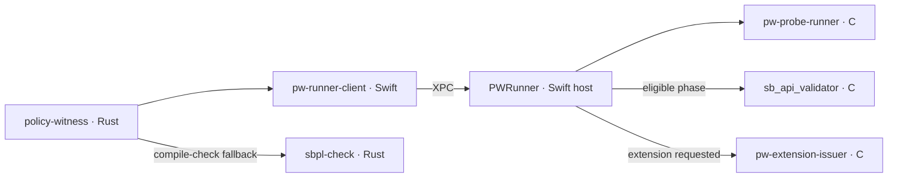

# PolicyWitness: code weight and distribution

Surveyed commit: `23c3e639fb8cace789a05cbbf179c0f0c90e47a3`

PolicyWitness has about **15,900 lines of runtime code in 46 files**, within
**89,100 lines of first-party code and build definitions in 489 files**.
Tests, harnesses and executable fixtures account for **72%** of that code,
roughly **four times the runtime**. Build/release support and documentation
generators contribute another 9,100 lines.

## Code distribution

Shares below are of the 89,071 authored code lines. Locations describe
responsibility; inline Rust tests are counted with tests.

| Area and location | Code lines | Share | General responsibility |
| --- | ---: | ---: | --- |
| Rust runtime — [controller/src](../../controller/src/) | 7,093 | 8.0% | CLI dispatch, request preparation, runner selection and registry, provenance, reply admission, evidence projection and the `sbpl-check` helper. |
| Swift host/client and C shim — [runner/Sources](../../runner/Sources/), [Clients](../../runner/Clients/), [Services](../../runner/Services/) | 6,350 | 7.1% | XPC transport, wire types, admission, child lifetimes, phase ordering and result assembly. |
| Native helpers and headers — [controller/tools](../../controller/tools/) | 2,409 | 2.7% | Policy compilation/application, probe attempts, live-process sandbox queries, extension issuance and shared-memory publication. |
| Tests, harnesses and fixture programs — [tests](../../tests/), [runner/Tests](../../runner/Tests/), Rust test-only code | 64,090 | 72.0% | Independent evidence readers, unit and integrated controls, native observers, fixture builders, dispatch and result accounting. |
| Build/release/shared tooling — [build.sh](../../build.sh), build manifests, [notarize.py](../../notarize.py), selected [tests/lib](../../tests/lib/) helpers | 6,553 | 7.4% | Compilation, bundle assembly, signing/provenance, release acceptance and publication, interpreter/toolchain checks and checkout locking. |
| Documentation and contract generators — [docs/*.py](../../docs/) | 2,576 | 2.9% | Generate and check architecture/build accounts, limits, contract versions and worker identity; parse documentation. |
| **Total** | **89,071** | **100%** | |

Across these areas, the language distribution is **Python 43.0k**, **Rust
16.3k**, **Swift 14.9k**, **C and headers 7.4k**, **shell 7.1k**, and **other
build definitions/Objective-C 0.3k** lines. Python's weight is in validation
and tooling; the runtime is approximately 45% Rust, 40% Swift and 15% C/headers.

The test total includes 35.0k lines of suite programs, 9.2k of Rust tests and
test support, and 8.2k of Swift tests. The remainder is fixture programs and
shared harness code. The [catalog](../../tests/catalog.json) registers 235
cases across 41 suites containing cases, plus the `opt_in` selection group.

## Runtime concentration and responsibilities

Five files contain **7,921 lines: half of the runtime**.

| File | Runtime code lines | Responsibility |
| --- | ---: | --- |
| [PWRunnerAPI.swift](../../runner/Sources/PWRunnerCore/PWRunnerAPI.swift) | 2,337 | Request/reply types, decoding/admission and evidence records. |
| [disposition.rs](../../controller/src/disposition.rs) | 1,649 | Validate lifecycle claims against supporting observations and project execution diagnostics. |
| [pw_probe_runner.c](../../controller/tools/pw_probe_runner/pw_probe_runner.c) | 1,448 | Apply the policy, perform ordered attempts and publish native observations. |
| [CWorker.swift](../../runner/Sources/PWRunnerCore/CWorker.swift) | 1,313 | Host-side shared-memory layout, worker launch, phase handshake, collection and child lifecycle. |
| [CWorkerOrchestrator.swift](../../runner/Sources/PWRunnerCore/CWorkerOrchestrator.swift) | 1,174 | Translate requests, plan queries, associate observations and assemble classifications/comparisons. |

The process structure is small, with distinct responsibilities:

Each specimen gets a fresh host and worker. The host remains unsandboxed;
the worker applies the policy once. The validator queries the waiting worker
before the host closes collection and releases that phase's attempts. The
issuer supplies extension tokens through a separate transient channel. The
host assembles observations into a reply, and the controller admits that
reply and adds provenance and diagnostics to the output envelope.

Responsibility is concentrated at the boundaries: versioned JSON between
controller/client/host; a C/Swift shared-memory layout and publication protocol
between host and worker; validator query/reply framing; and the
collection/release/acknowledgement chain establishing order. The largest
files therefore cover evidence representation, validation and orchestration
as well as the attempted operations themselves.

## Material surrounding the code

The tracked tree contains **1,269 regular files totaling 18.1 MiB**, plus four
symlink aliases. Its other substantial contents are:

- **Documentation:** 91 Markdown files outside records/vendor, about 19,200
  physical lines. Approximately 1,200 nonblank lines are generated or copied
  regions. Five JSON files under `docs/` contribute another 18,600 nonblank
  lines of manifests and observations; 12 DOT/SVG files hold generated diagrams.
- **Fixture data:** 76 non-code, non-Markdown files under `tests/fixtures/`,
  about 23,000 nonblank lines of specimens, expected shapes, policies and
  related inputs.
- **Investigation records:** `records/` contains 496 files and 9.4 MiB,
  **52% of tracked bytes**, including about 5,700 lines of investigation
  programs. These are separate from the maintained-code totals above.
- **Vendored code:** `tests/lib/vendor/` contributes about 5,900 Python code
  lines, also separate from the first-party totals.

## Counting basis

Counts use Git blobs from the commit above, counting each path once. Code
lines exclude blanks and comment-only lines; string literals, docstrings and
embedded fixture text remain included. Rust test-only items are assigned to
tests, and 15 generated code lines are excluded from authored totals.
Build/shared tooling includes the build entry points and manifests, evidence
and release helpers, and shared compiler/interpreter/locking checks.
Symlink aliases, untracked build products, caches and local test output do not
contribute to the counts.
